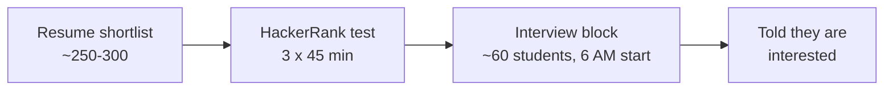

A three-stage process: a **resume screen**, a **HackerRank test** with three 45-minute sections, and a long block of **back-to-back interviews starting at 6 AM**. The account this page is built from came from a candidate who was shortlisted despite a low CPI, which says something about how GS reads resumes.

## At a glance

| | |
|---|---|
| **Stages** | Resume shortlist → online test → interview block |
| **Resume round** | Around 250–300 students shortlisted (candidate's estimate) |
| **Online test** | HackerRank, 3 sections × 45 min: Programming, Quant, Data Science |
| **Test → interview** | Around 60 students called for interviews, many "just in case" |
| **Interviews** | Start at 6:00 AM; around 5–6 interviews if things go well |
| **What they emphasised** | Math/ML projects and coursework, DSA fundamentals, probability and linear algebra, clear thinking aloud |
| **Campus / year** | Campus in Kanpur, interviews on 1 December. Year, role and package: *not stated* |

## The pipeline

## What makes GS different

- **The resume is read closely.** ML projects and math coursework were what the candidate put forward, and they were shortlisted even with a low CPI.
- **The test is broad, not just coding.** Programming, quantitative aptitude and data science are scored as separate sections, and you need to do well in any two of the three.
- **Test score decides interview order.** Higher scores mean earlier and more interviews, so there is a real benefit to scoring high.
- **Interviews test thinking, not recall.** Puzzles, probability, a geometry-flavoured coding problem and a search problem where the *path* to the optimal answer mattered as much as the answer.

## Pages


  
  
  
  
  
  

