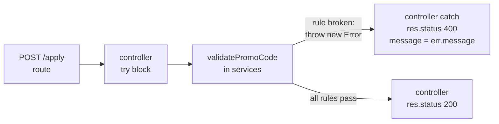

## What the question is

You are given a working Node.js backend for an **event ticket-booking app**. Users pick an event, choose how many tickets they want, and can apply a **promo code** for a discount. The app is complete except for one function:

```js
function validatePromoCode(promoCode, quantity, cartTotal, currentUser, eventId) {
  if (quantity < promoCode.minTickets) {
    throw new Error(`Minimum of ${promoCode.minTickets} tickets required`);
  }
  // ...the remaining rules are missing
}
```

It lives in the `services` folder, in a file named like `promoCodeService.js`. Your job is to add the missing `if` checks (5 to 8 of them). Each check looks at one rule of the promo code, and if the rule is broken it **throws an error with a specific message**. If no rule is broken, the code is valid. The project's tests call this function with many inputs and check that the right message comes out, or that nothing is thrown.

That is the whole question. You do not touch routes, controllers, the database or the frontend.

## How the project is laid out


**Editor's note.** The question only fixes the `services` folder and the function. The rest of this tree is the usual Express layout such projects use, so you know where to look; exact folder names may differ.


```text
project/
├── package.json          "test" script lives here (npm test)
├── README.md             the problem statement: the rules and their messages
├── src/
│   ├── routes/           POST /api/promo/apply  → calls the controller
│   ├── controllers/      reads req.body, calls the service, sends the response
│   ├── services/
│   │   └── promoCodeService.js   ← the only file you edit
│   └── models/           PromoCode, User, Event: the exact field names
└── test/                 the tests: exact messages and the order of checks
```

How one request flows, and why the service must **throw**:



The service never receives `res`. The controller wraps the call in `try { … } catch (err) { … }` and turns any thrown error into a 400 response with `err.message`. The tests usually call the service directly and assert that it throws:

```js
expect(() => validatePromoCode(promo, 1, 1000, user, 101))
  .toThrow("Minimum of 2 tickets required");
```

So an answer that does `return res.status(400).json(...)` (like the probable answer you were sent) **fails**: `res` is undefined inside the service, so the call crashes with a `TypeError` instead of throwing your message. Keep the logic of that answer, change every `return res.status(400).json({ message: X })` into `throw new Error(X)`, and replace the final `res.status(200)` with `return true` (or just nothing, whatever the existing code returns).

## How to solve it in the exam (step by step)

1. **Read the problem statement** (README or the question panel). Write down every rule and its message in the order given.
2. **Open the function.** Search the project for `validatePromoCode`. Look at the `if` that is already written: it shows you the variable names, the message style (backticks and `${}`), and that errors are thrown.
3. **Open the model** (`models/PromoCode…`). Copy the exact field names: is it `expiryDate` or `expiresAt`, `maxUsageLimit` or `maxUses`, `allowedEventIds` or `eventIds`? A wrong name reads `undefined` and silently skips the rule.
4. **Open the test file.** Copy the expected messages character for character, and note which rule each test breaks. If a test breaks two rules at once, its expected message tells you which check must come first.
5. **Write the `if`s in the order of the statement**, one per rule, each one `throw new Error(...)`.
6. **Run the tests** (`npm test`, or the platform's run button). Read the first failure: usually a message typo, a `>` that should be `>=`, or a date boundary.
7. Fix, re-run, repeat until all pass. Do not edit the tests.

## The eight rules

Field names and messages below are the ones in the version you were given. Check them against the model and tests in the exam.

| # | Rule | Fails when | Error message |
|---|---|---|---|
| 1 | Minimum tickets | `quantity < promoCode.minTickets` | `Minimum of ${minTickets} tickets required` |
| 2 | Maximum tickets | `quantity > promoCode.maxTickets` | `Maximum of ${maxTickets} tickets allowed` |
| 3 | Not expired | today is **after** the expiry day | `This promo code expired on ${expiryDate}` |
| 4 | Already started | today is **before** the start day | `This promo code is not active until ${startDate}` |
| 5 | Redemption limit | `usageCount >= maxUsageLimit` | `This promo code has reached its maximum redemption limit` |
| 6 | Minimum order | `cartTotal < minOrderAmount` | `Order total must be at least ${minOrderAmount} to use this code` |
| 7 | First-time buyers only | `newUserOnly` and the user is not a first-time buyer | `This promo code is restricted to first-time buyers only` |
| 8 | Allowed events | `eventId` is not in `allowedEventIds` | `This promo code cannot be applied to the selected event` |

Boundaries: buying exactly `minTickets` or exactly `maxTickets` is allowed; a code expiring **today** is still valid; a code starting **today** is valid; with `usageCount` one below the limit the code still works (it is `>=`, because a code with limit 100 has used all 100 redemptions when `usageCount` is 100).

## The solution

Passes all 17 `validatePromoCode` tests in the [practice project](/downloads/ibm-promo-practice.zip) with the machine set to IST and to UTC. It uses `setHours(0, 0, 0, 0)` for the dates, the same as the answer you were given; see the timezone row under the traps for the one case where that matters.

```js
function startOfDay(value) {
  const d = new Date(value);
  d.setHours(0, 0, 0, 0);
  return d;
}

function isSet(value) {
  return value !== null && value !== undefined;
}

function validatePromoCode(promoCode, quantity, cartTotal, currentUser, eventId) {
  if (isSet(promoCode.minTickets) && quantity < promoCode.minTickets) {
    throw new Error(`Minimum of ${promoCode.minTickets} tickets required`);
  }

  if (isSet(promoCode.maxTickets) && quantity > promoCode.maxTickets) {
    throw new Error(`Maximum of ${promoCode.maxTickets} tickets allowed`);
  }

  const today = startOfDay(new Date());

  if (isSet(promoCode.expiryDate) && today > startOfDay(promoCode.expiryDate)) {
    throw new Error(`This promo code expired on ${promoCode.expiryDate}`);
  }

  if (isSet(promoCode.startDate) && today < startOfDay(promoCode.startDate)) {
    throw new Error(`This promo code is not active until ${promoCode.startDate}`);
  }

  if (isSet(promoCode.maxUsageLimit) && promoCode.usageCount >= promoCode.maxUsageLimit) {
    throw new Error("This promo code has reached its maximum redemption limit");
  }

  if (isSet(promoCode.minOrderAmount) && cartTotal < promoCode.minOrderAmount) {
    throw new Error(`Order total must be at least ${promoCode.minOrderAmount} to use this code`);
  }

  if (promoCode.newUserOnly && !currentUser.isFirstPurchase) {
    throw new Error("This promo code is restricted to first-time buyers only");
  }

  const allowed = promoCode.allowedEventIds;
  if (Array.isArray(allowed) && allowed.length > 0 &&
      !allowed.map(String).includes(String(eventId))) {
    throw new Error("This promo code cannot be applied to the selected event");
  }

  return true;
}
```

**Minimum version for the exam.** If the statement says every field is always present, the `isSet` guards and helper are optional. The bare version is the same eight `if`s with plain conditions, for example:

```js
if (quantity > promoCode.maxTickets) {
  throw new Error(`Maximum of ${promoCode.maxTickets} tickets allowed`);
}
```

When every field is filled in, the guarded and bare versions behave the same. The guards only matter when a hidden test leaves a limit empty (`null`), where the bare version wrongly rejects. One judgement call: the guarded version treats an **empty** `allowedEventIds` as "any event". If the statement says an empty list means "no event", drop the `allowed.length > 0` part.

## Traps that fail tests

Every output below was run in Node 22.

| Trap | What happens | Fix |
|---|---|---|
| **Quotes instead of backticks** | `"Minimum of ${promoCode.minTickets} tickets"` prints the `${…}` literally | Use backticks `` ` `` for any message with `${}` |
| **Message typo** | Tests compare the whole string: a missing full stop or a capital letter fails | Copy messages from the tests or statement, never retype from memory |
| **Wrong order** | A test with 1 ticket **and** a small cart expects the tickets message | Keep the statement's order; the first broken rule wins |
| **`>` vs `>=`** | Limit 100 with `usageCount` 100 must fail | Redemption: `>=`. Tickets and amounts: strict `<` / `>` |
| **Comparing full timestamps** | `expiryDate` is midnight at the start of its day, so at 10 AM on that day `now > expiry` and a code expiring today looks expired | Compare days: `setHours(0, 0, 0, 0)` on both sides |
| **`null` limits** | `5 > null` is `true` and `null >= 0` is `true`, so an empty `maxTickets` or `maxUsageLimit` rejects every order | Check the field is set before comparing (`5 > undefined` is `false`, so only `null` bites) |
| **Type mismatch on ids** | `[101, 102].includes("101")` is `false`: the id from the URL is a string | Compare as strings: `allowed.map(String).includes(String(eventId))` |
| **Numbers as strings** | `"10" < "9"` is `true` (text comparison) | If `quantity` comes from `req.body` as text, use `Number(quantity)` |
| **`return res…` in the service** | `res` is undefined there, so it crashes with a `TypeError` | `throw new Error(message)` |
| **Date strings and timezones** | `new Date("2026-11-01")` is midnight **UTC**; `new Date("2026-11-01T00:00:00")` is midnight **local**. West of UTC (US Pacific), `setHours` on a `"YYYY-MM-DD"` string moves it to the previous day, and the "expires today" test fails. Checked: the solution above passes in IST and UTC, fails that one test in US Pacific and UTC+14 | Judges normally run in UTC, where `setHours` is fine. If only the "expires today" or "starts today" test fails, compare UTC days instead: `const day = (v) => new Date(v).toISOString().slice(0, 10);` then `day(new Date()) > day(promoCode.expiryDate)`. That variant passed all tests in all four zones |
| **Changing `usageCount`** | Incrementing the count inside validation makes the next test start from a wrong value | Validation only reads. Increment happens after payment, elsewhere |

## If the exam version has more rules

The same shape covers anything else they add. Common extras, all one `if` each:

```js
if (!promoCode.isActive) {
  throw new Error("This promo code is inactive");
}

if (promoCode.userId && promoCode.userId !== currentUser.id) {
  throw new Error("This promo code belongs to another user");
}

if (currentUser.usedPromoCodes.includes(promoCode.code)) {
  throw new Error("You have already used this promo code");
}
```

Messages here are examples; use the statement's.
