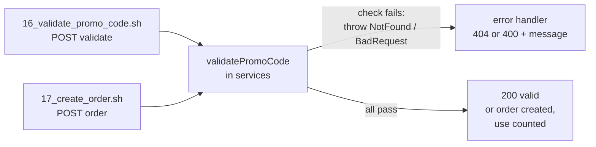

## The question, as it appeared

**ShowPass** is an event-ticketing platform. It already handles venues with several sections, event lifecycles (draft, published, on sale, sold out, completed, cancelled), ticket purchases with live seat inventory, and orders, payments and promo codes.

**The bug:** promo codes are accepted when they should be rejected. Expired codes still work, codes meant for one event work on any event, and codes past their usage limit keep getting redeemed.

**Task:** fix the promo-code validation so that

1. **Deleted codes are rejected.** A deleted code must not be found or accepted.
2. **Dates are checked.** Reject a code before its start date or after its end date.
3. **Usage limits are enforced.** Reject a code that has already been used the maximum number of times.
4. **Event restriction works.** An event-specific code only works for its own event.
5. **Minimum quantity is enforced.** The order must have at least the minimum number of tickets before the code applies.

The exact response structure, rules and edge cases are in **`technical-specs/promo_code_validation.md`**.

**Notes given with the question:**

- Swagger API docs are at **`/api-docs`** while the server runs.
- The overall architecture is in **`documents/ARCHITECTURE.md`**.
- **`curl_scripts/`** has helper scripts for login, event setup, promo-code creation and orders. All inputs are already in **`arguments.json`**, so you run them with no arguments: `./01_register_user.sh`, `./02_login.sh`, `./15_create_promo_code.sh`, `./16_validate_promo_code.sh`, `./17_create_order.sh`. More in `curl_scripts/HELPER.md`.
- Starting the Express server takes over the terminal, so open a **second terminal tab** for the scripts.

## What it means in plain words

There is one function (in a promo-code service file under the server's `services/` folder) that is supposed to check a code before it is used. Right now it finds the code and says "valid" without checking enough. You add the missing checks. Each check that fails **throws** an error; the controller already turns thrown errors into the right HTTP response. Both the "validate code" API and the "place order" API go through this function, so fixing it fixes both.



## Exactly what to do in the exam

### Minutes 0 to 8 · Read before you type

| Open | What to take from it |
|---|---|
| `technical-specs/promo_code_validation.md` | **The source of truth.** Copy every error message, its status code (404 vs 400), the order of checks, and edge cases (is the end date inclusive? is the code case-insensitive? what if no event is passed?) |
| `documents/ARCHITECTURE.md` | Which folder holds services, which ORM is used (Sequelize, Prisma, Mongoose, or plain SQL), where errors are defined |
| The promo-code service | Find it from the terminal (below). Read what the function already does and which error class the existing `throw` uses |
| The PromoCode model | **Exact field names**: the delete marker (`deletedAt` / `isDeleted`), the dates (`validFrom`/`validTo` or `startDate`/`endDate`), the uses (`maxUses`/`currentUses` or `usageLimit`/`usedCount`), `eventId`, `minTickets` / `minQuantity` |
| The errors file (often `utils/errors.js`) | Class names: `NotFoundError`, `BadRequestError`, `ValidationError`, or one `ApiError(status, message)` |

Finding the files from the terminal:

```bash
grep -rn "validatePromo" --include=*.js . | grep -v node_modules
grep -rln "class .*Error" --include=*.js . | grep -v node_modules
ls src/models 2>/dev/null || ls models
```

### Minutes 8 to 20 · Write the checks

Add the checks **in the order the spec lists them** (if it does not say, use the order of the task: deleted, dates, usage, event, quantity). One `if` per rule, each with `throw`.

### Minutes 20 to 35 · Prove it with the curl scripts

Terminal 1:

```bash
npm start            # or: npm run dev (check package.json "scripts")
```

Terminal 2:

```bash
cd curl_scripts
chmod +x *.sh        # only if you get "Permission denied"
./01_register_user.sh
./02_login.sh
./15_create_promo_code.sh
./16_validate_promo_code.sh
./17_create_order.sh
```

Then break one rule at a time by editing `arguments.json` and running `./16_validate_promo_code.sh` (and `./17_create_order.sh` for usage):

| Rule | Change in `arguments.json` | Expect |
|---|---|---|
| Event | validate with a different `eventId` than the code's | 400, wrong-event message |
| Quantity | `quantity` below the code's minimum | 400, minimum-quantity message |
| Dates | create a code with an end date in the past (or start date in the future), then validate it | 400, expired / not-yet-valid message |
| Usage | create a code with max uses 1, place one order, then validate or order again | 400, usage-limit message |
| Deleted | delete the code (see `HELPER.md` for the delete script), then validate it | **404**, same message as an unknown code |
| Happy path | the original values | 200, valid |

If a script needs a value you don't have (an event id), `HELPER.md` lists the scripts that create events and print ids. Swagger at `http://localhost:<port>/api-docs` shows each request body.

### Minutes 35 onward · Edge cases and submit

Run the test command if the project has one (`npm test`), re-read the spec's edge-case list against your code line by line, then submit. Do not edit tests, routes or the order code unless the spec asks.

## The fix

Field names, error classes and messages here are the likely ones; replace them with what the model, errors file and spec say.

```js
const { NotFoundError, BadRequestError } = require("../utils/errors");

async function validatePromoCode(code, eventId, quantity = 1) {
  const promo = await PromoCode.findOne({ where: { code } });

  // 1. Deleted = not found (same error as a code that never existed)
  if (!promo || promo.deletedAt || promo.isDeleted) {
    throw new NotFoundError("Promo code not found");
  }

  // 2. Dates
  const now = new Date();
  if (promo.validFrom && now < new Date(promo.validFrom)) {
    throw new BadRequestError("Promo code is not yet valid");
  }
  if (promo.validTo && now > new Date(promo.validTo)) {
    throw new BadRequestError("Promo code has expired");
  }

  // 3. Usage limit (null = unlimited)
  if (promo.maxUses !== null && promo.maxUses !== undefined && promo.currentUses >= promo.maxUses) {
    throw new BadRequestError("Promo code usage limit reached");
  }

  // 4. Event restriction (null = works on every event)
  if (promo.eventId !== null && promo.eventId !== undefined && String(promo.eventId) !== String(eventId)) {
    throw new BadRequestError("Promo code is not valid for this event");
  }

  // 5. Minimum quantity
  const qty = quantity === null || quantity === undefined ? 1 : Number(quantity);
  if (promo.minTickets && qty < promo.minTickets) {
    throw new BadRequestError(`Minimum ticket quantity required is ${promo.minTickets}`);
  }

  return { valid: true, promo };
}
```

The same logic (without `async`, on an in-memory model) passes all 19 exam-shaped tests in the [practice project](/downloads/ibm-promo-practice.zip), and the curl run shows the bug and the fix: before, a third order on a 2-use code returns 201 and a deleted code validates with 200; after, they return 400 `Promo code usage limit reached` and 404 `Promo code not found`.

### The deleted-code rule, depending on the codebase

"Should not be found" means the deleted code must behave exactly like a code that does not exist. Two ways, pick the one that fits the code you see:

| What the model has | Filter in the query | Or check after fetching |
|---|---|---|
| Sequelize with `paranoid: true` | already excluded by `findOne`; the bug is elsewhere (a `paranoid: false` or raw query) | — |
| Sequelize / SQL `deletedAt` column | `where: { code, deletedAt: null }` | <code>if (!promo &#124;&#124; promo.deletedAt)</code> |
| `isDeleted` boolean | `where: { code, isDeleted: false }` | <code>if (!promo &#124;&#124; promo.isDeleted)</code> |
| Mongoose | `PromoCode.findOne({ code, deletedAt: null })` | same `if` |

Either works; the after-fetch `if` is the smallest change and cannot break the query.

### The five rules in one table

| # | Rule | Fails when | Error | Likely message |
|---|---|---|---|---|
| 1 | Deleted / missing | no row, or the row is marked deleted | NotFound, **404** | `Promo code not found` |
| 2a | Not started | `now < validFrom` | BadRequest, 400 | `Promo code is not yet valid` |
| 2b | Expired | `now > validTo` | BadRequest, 400 | `Promo code has expired` |
| 3 | Usage limit | `currentUses >= maxUses` (skip if `maxUses` is null) | BadRequest, 400 | `Promo code usage limit reached` |
| 4 | Event | code has an `eventId` and it differs from the request's | BadRequest, 400 | `Promo code is not valid for this event` |
| 5 | Minimum quantity | `quantity < minTickets` | BadRequest, 400 | `Minimum ticket quantity required is ${minTickets}` |



The Django version of ShowPass has the same five rules, and the code you were sent is a correct shape for it: it looks the code up case-insensitively, raises `NotFoundError` for missing **or soft-deleted** codes, then `BadRequestError` for dates, usage, minimum quantity and event. Differences from the JS fix above: it raises instead of throws, compares exact datetimes with `timezone.now()`, checks minimum quantity **before** the event (follow the spec's order), and returns `{'valid': True, 'promo': promo}`. If your test offers Python, use that code with the spec's messages.



## Traps that lose marks

| Trap | Why it fails | Fix |
|---|---|---|
| Deleted code returns 400 | The spec says "should not be found": that is 404, same as a missing code | Throw the **NotFound** error with the not-found message |
| Messages typed from memory | Tests compare the full string and the status | Copy from the spec file |
| Wrong order | A code that is expired **and** for another event must give the spec's first error | Follow the spec's order |
| `maxUses` null treated as 0 | `5 >= null` is `true` in JavaScript, so unlimited codes get rejected | Check it is set first |
| Event id types | `"2" !== 2`: the id from the body or URL can be a string, the DB one a number | `String(a) !== String(b)` |
| Missing `eventId` on an event-specific code | Must be rejected, not skipped | `String(undefined)` is `"undefined"`, so the check above rejects it |
| `quantity` as a string | `"10" < "4"` is `true` (text comparison) | `Number(quantity)` |
| Counting a use inside validation | The order flow already counts uses after a successful order; counting here double-counts and breaks the validate endpoint | Validation only reads |
| `await` missing | With an async ORM, `findOne` returns a Promise, which is never null, so every check reads `undefined` | Keep `await` and make the function `async` if the lookup is async |
| Changing the function's name, arguments or return shape | The controller and order code depend on them | Only add checks |
| Running scripts in the server's terminal | The server occupies it | Second terminal tab |
