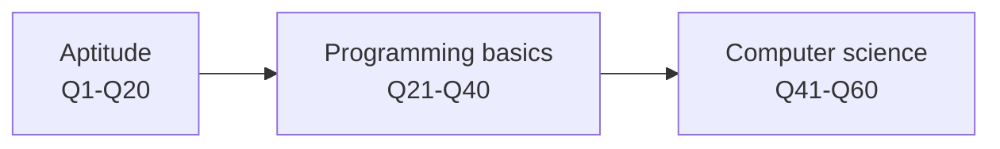

An online assessment of **60 multiple-choice questions** split evenly into **aptitude**, **programming basics** and **computer science**. This section holds every question with its options and a toggle that opens the answer and a short, plain explanation.

## At a glance

| | |
|---|---|
| **Stage covered** | Online assessment (HirePro) |
| **Questions** | 60 MCQs, 4 options each |
| **Aptitude** | Q1–Q20: problem solving, puzzles, logical reasoning, data analysis |
| **Programming basics** | Q21–Q40: number systems, logic gates, C output tracing, scheduling, linked lists, searching |
| **Computer science** | Q41–Q60: architecture, data structures, C pointers, OOP, operating systems |
| **Heavy topics** | C pointer and `printf` tracing (about 15 of 60), OS and architecture basics, one lantern puzzle with five questions |
| **Core subjects from 8 campus papers** | 156 more questions in four tabs at the [end of this page](#core-subjects-from-campus-papers): OOPS, operating systems, digital circuits, computer architecture |
| **Time limit, marking scheme, cut-off, later rounds** | *not stated* |

## The assessment



## Pages


  
  
  
  


<!-- core-tabs:start -->

## Core subjects from campus papers

156 more questions from eight Qualcomm online tests (BITS Goa 2024, BITS Hyderabad 2024, 2025 paper (campus not named), BITS Hyderabad 2025, Delhi campus 2024, IIIT Delhi 2025, IISc 2024, NIT Durgapur), limited to the four core sections: OOPS, operating systems, digital circuits and computer architecture. They were transcribed from photos of the HirePro screen, solved here, and every circuit was redrawn. A question asked in two papers is listed once with both sources.

| Tab | Questions | Medium | Flagged |
|---|:-:|:-:|:-:|
| OOPS | 5 | 0 | 0 |
| Operating systems | 26 | 5 | 1 |
| Digital circuits | 80 | 15 | 6 |
| Computer architecture | 45 | 5 | 1 |

*Medium* means the answer is sound but rests on reading a blurred photo or an ambiguous question; the toggle says why. *Flagged* means no option is right as printed, or the photo cut off data the answer needs; the toggle shows the working instead of a pick.





Only five OOPS questions appear across the eight papers; the section was small in every sitting. Q50–Q54 of the [60-question set](/companies/qualcomm/04-computer-science/) and the [OOP in C++ book](/core/oop-cpp/) cover the rest of the ground.

**5 questions.** Medium confidence: none. Flagged (no reliable pick): none.

### Constructors

#### O1 · Constructors

*Asked in: Delhi campus 2024, Q54*

The process of defining more than one constructor with different parameter lists in the same class is known as:

**Options**

- **A.** Constructor overriding
- **B.** Constructor chaining
- **C.** Constructor hiding
- **D.** Constructor overloading

<details class="hx:last-of-type:mb-0 hx:rounded-lg hx:bg-neutral-50 hx:dark:bg-neutral-800 hx:p-2 hx:mt-4 hx:group">
<summary class="hx:flex hx:items-center hx:cursor-pointer hx:select-none hx:list-none hx:p-1 hx:rounded-sm hx:transition-colors hx:hover:bg-gray-100 hx:dark:hover:bg-neutral-800 hx:before:mr-1 hx:before:inline-block hx:before:transition-transform hx:before:content-[''] hx:dark:before:invert hx:rtl:before:rotate-180 hx:group-open:before:rotate-90"><strong class="hx:text-lg">Show answer and explanation</strong></summary>
<div class="hx:p-2 hx:overflow-hidden">

**Answer: D.** Constructor overloading

Same name, different parameter lists, resolved at compile time: that is overloading. Overriding needs a base and a derived class, and constructors are not inherited, so they cannot be overridden. Chaining is one constructor calling another (`this(...)` in Java, a delegating constructor in C++).

</div>
</details>

### Inheritance

#### O2 · Inheritance

*Asked in: Delhi campus 2024, Q55*

The figure shows two classes: **Class B → Class A** (B is derived from A, and nothing else is involved). What type of inheritance is this?

**Options**

- **A.** Multilevel inheritance
- **B.** Single inheritance
- **C.** Multiple inheritance
- **D.** Hybrid inheritance

<details class="hx:last-of-type:mb-0 hx:rounded-lg hx:bg-neutral-50 hx:dark:bg-neutral-800 hx:p-2 hx:mt-4 hx:group">
<summary class="hx:flex hx:items-center hx:cursor-pointer hx:select-none hx:list-none hx:p-1 hx:rounded-sm hx:transition-colors hx:hover:bg-gray-100 hx:dark:hover:bg-neutral-800 hx:before:mr-1 hx:before:inline-block hx:before:transition-transform hx:before:content-[''] hx:dark:before:invert hx:rtl:before:rotate-180 hx:group-open:before:rotate-90"><strong class="hx:text-lg">Show answer and explanation</strong></summary>
<div class="hx:p-2 hx:overflow-hidden">

**Answer: B.** Single inheritance

One base and one derived class is single inheritance. Multilevel needs a chain (C → B → A); multiple needs one class with two or more bases; hybrid mixes these.

</div>
</details>

### Access control

#### O3 · Access control

*Asked in: Delhi campus 2024, Q58*

Given a method in a protected class, what access modifier do you use to restrict access to that method to only the other members of the same class?

**Options**

- **A.** private
- **B.** public
- **C.** transient
- **D.** protected

<details class="hx:last-of-type:mb-0 hx:rounded-lg hx:bg-neutral-50 hx:dark:bg-neutral-800 hx:p-2 hx:mt-4 hx:group">
<summary class="hx:flex hx:items-center hx:cursor-pointer hx:select-none hx:list-none hx:p-1 hx:rounded-sm hx:transition-colors hx:hover:bg-gray-100 hx:dark:hover:bg-neutral-800 hx:before:mr-1 hx:before:inline-block hx:before:transition-transform hx:before:content-[''] hx:dark:before:invert hx:rtl:before:rotate-180 hx:group-open:before:rotate-90"><strong class="hx:text-lg">Show answer and explanation</strong></summary>
<div class="hx:p-2 hx:overflow-hidden">

**Answer: A.** private

`private` limits access to the class itself. `protected` would also open it to subclasses (and, in Java, the package). `transient` is not an access modifier; it marks a field to skip during serialisation.

</div>
</details>

### Static members

#### O4 · Static members

*Asked in: NIT Durgapur, Q55*

Which of the statements below is/are true?

I. A static method belongs to the class rather than to an object of the class.  
II. Static methods can be called without creating an object of the class.  
III. A static method can access static data members and can change their values.

**Options**

- **A.** Only (I)
- **B.** All (I), (II) and (III)
- **C.** Only (II)
- **D.** Only (III)

<details class="hx:last-of-type:mb-0 hx:rounded-lg hx:bg-neutral-50 hx:dark:bg-neutral-800 hx:p-2 hx:mt-4 hx:group">
<summary class="hx:flex hx:items-center hx:cursor-pointer hx:select-none hx:list-none hx:p-1 hx:rounded-sm hx:transition-colors hx:hover:bg-gray-100 hx:dark:hover:bg-neutral-800 hx:before:mr-1 hx:before:inline-block hx:before:transition-transform hx:before:content-[''] hx:dark:before:invert hx:rtl:before:rotate-180 hx:group-open:before:rotate-90"><strong class="hx:text-lg">Show answer and explanation</strong></summary>
<div class="hx:p-2 hx:overflow-hidden">

**Answer: B.** All (I), (II) and (III)

All three hold. A static method has no `this`, so it cannot touch instance members directly, but static data belongs to the class and a static method may read and write it.

</div>
</details>

### Interfaces (Java)

#### O5 · Interfaces (Java)

*Asked in: NIT Durgapur, Q46*

Which one of the statements given in the options is **false**?

**Options**

- **A.** An interface that is declared within the body of a class or interface is known as a nested interface.
- **B.** A class declaration can be a member of an interface.
- **C.** A constant can be a member of an interface.
- **D.** If an interface is named in the implements clause of a class, then the class must implement all of the methods declared within the interface.

<details class="hx:last-of-type:mb-0 hx:rounded-lg hx:bg-neutral-50 hx:dark:bg-neutral-800 hx:p-2 hx:mt-4 hx:group">
<summary class="hx:flex hx:items-center hx:cursor-pointer hx:select-none hx:list-none hx:p-1 hx:rounded-sm hx:transition-colors hx:hover:bg-gray-100 hx:dark:hover:bg-neutral-800 hx:before:mr-1 hx:before:inline-block hx:before:transition-transform hx:before:content-[''] hx:dark:before:invert hx:rtl:before:rotate-180 hx:group-open:before:rotate-90"><strong class="hx:text-lg">Show answer and explanation</strong></summary>
<div class="hx:p-2 hx:overflow-hidden">

**Answer: D.** If an interface is named in the implements clause of a class, then the class must implement all of the methods declared within the interface.

An **abstract** class can name an interface in its `implements` clause and leave some methods unimplemented; only a concrete class must implement all of them (and since Java 8, `default` methods need no implementation either). The first three are true: nested interfaces exist, an interface may declare a member class, and every interface field is implicitly `public static final`, i.e. a constant.

</div>
</details>





Process states, scheduling arithmetic, memory, synchronisation and deadlock. Most items are one-line concept checks; the arithmetic ones (round robin, Little's law, C-SCAN) are worked in full.

**26 questions.** Medium confidence: S10, S11, S15, S18, S21. Flagged (no reliable pick): S12.

### Processes

#### S1 · Processes

*Asked in: NIT Durgapur, Q39*

In which of the process states given in the options are process instructions executed?

**Options**

- **A.** Running state
- **B.** Terminated state
- **C.** Waiting state
- **D.** Ready state

<details class="hx:last-of-type:mb-0 hx:rounded-lg hx:bg-neutral-50 hx:dark:bg-neutral-800 hx:p-2 hx:mt-4 hx:group">
<summary class="hx:flex hx:items-center hx:cursor-pointer hx:select-none hx:list-none hx:p-1 hx:rounded-sm hx:transition-colors hx:hover:bg-gray-100 hx:dark:hover:bg-neutral-800 hx:before:mr-1 hx:before:inline-block hx:before:transition-transform hx:before:content-[''] hx:dark:before:invert hx:rtl:before:rotate-180 hx:group-open:before:rotate-90"><strong class="hx:text-lg">Show answer and explanation</strong></summary>
<div class="hx:p-2 hx:overflow-hidden">

**Answer: A.** Running state

Only a process that holds the CPU executes instructions; that is the running state. Ready processes wait for the CPU, waiting (blocked) processes wait for an event such as I/O.

</div>
</details>

#### S2 · Processes

*Asked in: NIT Durgapur, Q30*

If a process has finished its execution, what is the state of that process?

**Options**

- **A.** Waiting
- **B.** Ready
- **C.** Terminated
- **D.** Running

<details class="hx:last-of-type:mb-0 hx:rounded-lg hx:bg-neutral-50 hx:dark:bg-neutral-800 hx:p-2 hx:mt-4 hx:group">
<summary class="hx:flex hx:items-center hx:cursor-pointer hx:select-none hx:list-none hx:p-1 hx:rounded-sm hx:transition-colors hx:hover:bg-gray-100 hx:dark:hover:bg-neutral-800 hx:before:mr-1 hx:before:inline-block hx:before:transition-transform hx:before:content-[''] hx:dark:before:invert hx:rtl:before:rotate-180 hx:group-open:before:rotate-90"><strong class="hx:text-lg">Show answer and explanation</strong></summary>
<div class="hx:p-2 hx:overflow-hidden">

**Answer: C.** Terminated

After its last instruction (or `exit()`), a process moves to the terminated state, where it stays until the parent collects its exit status.

</div>
</details>

#### S3 · Processes

*Asked in: BITS Goa 2024, Q39*

Which section of the process memory layout is also called the **bss** segment?

**Options**

- **A.** Stack
- **B.** Uninitialized data segment
- **C.** Initialized data segment
- **D.** Code segment

<details class="hx:last-of-type:mb-0 hx:rounded-lg hx:bg-neutral-50 hx:dark:bg-neutral-800 hx:p-2 hx:mt-4 hx:group">
<summary class="hx:flex hx:items-center hx:cursor-pointer hx:select-none hx:list-none hx:p-1 hx:rounded-sm hx:transition-colors hx:hover:bg-gray-100 hx:dark:hover:bg-neutral-800 hx:before:mr-1 hx:before:inline-block hx:before:transition-transform hx:before:content-[''] hx:dark:before:invert hx:rtl:before:rotate-180 hx:group-open:before:rotate-90"><strong class="hx:text-lg">Show answer and explanation</strong></summary>
<div class="hx:p-2 hx:overflow-hidden">

**Answer: B.** Uninitialized data segment

The bss (block started by symbol) holds globals and statics that are not explicitly initialised; the loader zero-fills it, so it takes no space in the executable file. Initialised globals go in the data segment.

</div>
</details>

#### S4 · Processes

*Asked in: BITS Hyderabad 2024, Q33*

During a context switch, which of the following information is stored for later use?

I. Accounting information  
II. I/O status information

**Options**

- **A.** Only (II)
- **B.** Neither (I) nor (II)
- **C.** Both (I) and (II)
- **D.** Only (I)

<details class="hx:last-of-type:mb-0 hx:rounded-lg hx:bg-neutral-50 hx:dark:bg-neutral-800 hx:p-2 hx:mt-4 hx:group">
<summary class="hx:flex hx:items-center hx:cursor-pointer hx:select-none hx:list-none hx:p-1 hx:rounded-sm hx:transition-colors hx:hover:bg-gray-100 hx:dark:hover:bg-neutral-800 hx:before:mr-1 hx:before:inline-block hx:before:transition-transform hx:before:content-[''] hx:dark:before:invert hx:rtl:before:rotate-180 hx:group-open:before:rotate-90"><strong class="hx:text-lg">Show answer and explanation</strong></summary>
<div class="hx:p-2 hx:overflow-hidden">

**Answer: C.** Both (I) and (II)

Both live in the process control block (PCB), which is saved on a switch along with the registers, program counter, scheduling and memory-management information.

</div>
</details>

#### S5 · Processes

*Asked in: BITS Hyderabad 2025, Q39*

Let *st1* be the time to switch between user mode and kernel mode, and *st2* the time to switch between two user processes. Which is true?

**Options**

- **A.** Indeterminate
- **B.** st1 > st2
- **C.** st1 < st2
- **D.** st1 = st2

<details class="hx:last-of-type:mb-0 hx:rounded-lg hx:bg-neutral-50 hx:dark:bg-neutral-800 hx:p-2 hx:mt-4 hx:group">
<summary class="hx:flex hx:items-center hx:cursor-pointer hx:select-none hx:list-none hx:p-1 hx:rounded-sm hx:transition-colors hx:hover:bg-gray-100 hx:dark:hover:bg-neutral-800 hx:before:mr-1 hx:before:inline-block hx:before:transition-transform hx:before:content-[''] hx:dark:before:invert hx:rtl:before:rotate-180 hx:group-open:before:rotate-90"><strong class="hx:text-lg">Show answer and explanation</strong></summary>
<div class="hx:p-2 hx:overflow-hidden">

**Answer: C.** st1 < st2

A mode switch only changes the privilege level and stack, inside the same process. A process switch has to do a mode switch **and** save one PCB, restore another, change the address space and lose TLB and cache warmth, so it always costs more.

</div>
</details>

### Scheduling

#### S6 · Scheduling

*Asked in: BITS Hyderabad 2024, Q27*

Which scheduler is also called the **job scheduler**?

**Options**

- **A.** Intermediate-term
- **B.** Long-term
- **C.** Short-term
- **D.** Medium-term

<details class="hx:last-of-type:mb-0 hx:rounded-lg hx:bg-neutral-50 hx:dark:bg-neutral-800 hx:p-2 hx:mt-4 hx:group">
<summary class="hx:flex hx:items-center hx:cursor-pointer hx:select-none hx:list-none hx:p-1 hx:rounded-sm hx:transition-colors hx:hover:bg-gray-100 hx:dark:hover:bg-neutral-800 hx:before:mr-1 hx:before:inline-block hx:before:transition-transform hx:before:content-[''] hx:dark:before:invert hx:rtl:before:rotate-180 hx:group-open:before:rotate-90"><strong class="hx:text-lg">Show answer and explanation</strong></summary>
<div class="hx:p-2 hx:overflow-hidden">

**Answer: B.** Long-term

The long-term scheduler picks jobs from the job pool and admits them to memory, controlling the degree of multiprogramming. The short-term one is the CPU scheduler; the medium-term one swaps processes out and in.

</div>
</details>

#### S7 · Scheduling

*Asked in: Delhi campus 2024, Q40*

Which of the CPU scheduling algorithms given in the options suffers from the **convoy effect**?

**Options**

- **A.** Multilevel queue
- **B.** Shortest remaining time first
- **C.** Round robin
- **D.** First come first serve

<details class="hx:last-of-type:mb-0 hx:rounded-lg hx:bg-neutral-50 hx:dark:bg-neutral-800 hx:p-2 hx:mt-4 hx:group">
<summary class="hx:flex hx:items-center hx:cursor-pointer hx:select-none hx:list-none hx:p-1 hx:rounded-sm hx:transition-colors hx:hover:bg-gray-100 hx:dark:hover:bg-neutral-800 hx:before:mr-1 hx:before:inline-block hx:before:transition-transform hx:before:content-[''] hx:dark:before:invert hx:rtl:before:rotate-180 hx:group-open:before:rotate-90"><strong class="hx:text-lg">Show answer and explanation</strong></summary>
<div class="hx:p-2 hx:overflow-hidden">

**Answer: D.** First come first serve

In FCFS one long CPU-bound job holds the CPU while short I/O-bound jobs pile up behind it like cars behind a truck, which lowers both CPU and device utilisation.

</div>
</details>

#### S8 · Scheduling

*Asked in: 2025 paper (campus not named), Q31*

Round robin with time quantum 1. Five processes arrive at time 0 in the order A, B, C, D, E with burst times A = 4, B = 1, C = 8, D = 1, E = 2. What is the completion time of A?

**Options**

- **A.** 11
- **B.** 4
- **C.** 10
- **D.** 12

<details class="hx:last-of-type:mb-0 hx:rounded-lg hx:bg-neutral-50 hx:dark:bg-neutral-800 hx:p-2 hx:mt-4 hx:group">
<summary class="hx:flex hx:items-center hx:cursor-pointer hx:select-none hx:list-none hx:p-1 hx:rounded-sm hx:transition-colors hx:hover:bg-gray-100 hx:dark:hover:bg-neutral-800 hx:before:mr-1 hx:before:inline-block hx:before:transition-transform hx:before:content-[''] hx:dark:before:invert hx:rtl:before:rotate-180 hx:group-open:before:rotate-90"><strong class="hx:text-lg">Show answer and explanation</strong></summary>
<div class="hx:p-2 hx:overflow-hidden">

**Answer: A.** 11

Each round gives every live process one unit.

| Time | 1 | 2 | 3 | 4 | 5 | 6 | 7 | 8 | 9 | 10 | 11 |
|---|---|---|---|---|---|---|---|---|---|---|---|
| Runs | A | **B** | C | **D** | E | A | C | **E** | A | C | **A** |

B finishes at 2, D at 4, E at 8, A at **11**, and C runs alone afterwards to finish at 16.

</div>
</details>

#### S9 · Scheduling

*Asked in: BITS Goa 2024, Q30*

What is the average waiting time of a process if the scheduling queue holds on average 34 processes and 9 processes arrive every second?

**Options**

- **A.** 3.7 units
- **B.** 2.9 units
- **C.** 9 units
- **D.** 4 units

<details class="hx:last-of-type:mb-0 hx:rounded-lg hx:bg-neutral-50 hx:dark:bg-neutral-800 hx:p-2 hx:mt-4 hx:group">
<summary class="hx:flex hx:items-center hx:cursor-pointer hx:select-none hx:list-none hx:p-1 hx:rounded-sm hx:transition-colors hx:hover:bg-gray-100 hx:dark:hover:bg-neutral-800 hx:before:mr-1 hx:before:inline-block hx:before:transition-transform hx:before:content-[''] hx:dark:before:invert hx:rtl:before:rotate-180 hx:group-open:before:rotate-90"><strong class="hx:text-lg">Show answer and explanation</strong></summary>
<div class="hx:p-2 hx:overflow-hidden">

**Answer: A.** 3.7 units

Little's law: *n = λ × W*, so *W = n / λ = 34 / 9 ≈ 3.78* seconds; the option is 3.7.

</div>
</details>

#### S10 · Scheduling

*Asked in: NIT Durgapur, Q22*

Which of the statements given below is/are correct for CPU scheduling algorithms?

I. The throughput of Shortest Process Next (SPN) is on the higher side compared to FCFS.  
II. The overhead for round robin is lower as compared to SPN.  
III. Starvation of processes is possible in FCFS.

**Options**

- **A.** Only (II) and (III)
- **B.** Only (II)
- **C.** Only (I) and (II)
- **D.** Only (I) and (III)

<details class="hx:last-of-type:mb-0 hx:rounded-lg hx:bg-neutral-50 hx:dark:bg-neutral-800 hx:p-2 hx:mt-4 hx:group">
<summary class="hx:flex hx:items-center hx:cursor-pointer hx:select-none hx:list-none hx:p-1 hx:rounded-sm hx:transition-colors hx:hover:bg-gray-100 hx:dark:hover:bg-neutral-800 hx:before:mr-1 hx:before:inline-block hx:before:transition-transform hx:before:content-[''] hx:dark:before:invert hx:rtl:before:rotate-180 hx:group-open:before:rotate-90"><strong class="hx:text-lg">Show answer and explanation</strong></summary>
<div class="hx:p-2 hx:overflow-hidden">

**Answer: C.** Only (I) and (II)

I is true: running short jobs first finishes more jobs per unit time. II is true in the standard comparison (Stallings): RR has minimal decision overhead, while SPN must estimate and compare burst times, which can be costly. III is false: in FCFS every process eventually reaches the head of the queue, so none starves.

*Medium confidence.* Statement II depends on the textbook comparison table; RR does pay for extra context switches, but its scheduling decision itself is the cheapest.

</div>
</details>

#### S11 · Scheduling

*Asked in: IIIT Delhi 2025, Q40*

Which one of the given options is also called the **release time** of a CPU scheduling process?

**Options**

- **A.** Completion time
- **B.** Response time
- **C.** Release time
- **D.** Start time

<details class="hx:last-of-type:mb-0 hx:rounded-lg hx:bg-neutral-50 hx:dark:bg-neutral-800 hx:p-2 hx:mt-4 hx:group">
<summary class="hx:flex hx:items-center hx:cursor-pointer hx:select-none hx:list-none hx:p-1 hx:rounded-sm hx:transition-colors hx:hover:bg-gray-100 hx:dark:hover:bg-neutral-800 hx:before:mr-1 hx:before:inline-block hx:before:transition-transform hx:before:content-[''] hx:dark:before:invert hx:rtl:before:rotate-180 hx:group-open:before:rotate-90"><strong class="hx:text-lg">Show answer and explanation</strong></summary>
<div class="hx:p-2 hx:overflow-hidden">

**Answer: A.** Completion time

The time at which a process leaves the system (finishes and releases the CPU) is its completion time, also called exit time. Note that in real-time scheduling "release time" means the time a job becomes ready, which is none of these options.

*Medium confidence.* The wording is unusual; completion (exit) time is the only option that is a synonym for the moment a process leaves.

</div>
</details>

### Disk scheduling

#### S12 · Disk scheduling

*Asked in: IISc 2024, Q34*

A disk driver receives requests for cylinders in the order 67, 45, 22, 180, 112, 95, 77, 69, 66, 55, 10. C-SCAN is used, where each seek … (the rest of the sentence is cut off in the photo). The head is currently at cylinder 30. What is the total seek time?

**Options**

- **A.** 558 ms
- **B.** 1096 ms
- **C.** 996 ms
- **D.** 408 ms

<details class="hx:last-of-type:mb-0 hx:rounded-lg hx:bg-neutral-50 hx:dark:bg-neutral-800 hx:p-2 hx:mt-4 hx:group">
<summary class="hx:flex hx:items-center hx:cursor-pointer hx:select-none hx:list-none hx:p-1 hx:rounded-sm hx:transition-colors hx:hover:bg-gray-100 hx:dark:hover:bg-neutral-800 hx:before:mr-1 hx:before:inline-block hx:before:transition-transform hx:before:content-[''] hx:dark:before:invert hx:rtl:before:rotate-180 hx:group-open:before:rotate-90"><strong class="hx:text-lg">Show answer and explanation</strong></summary>
<div class="hx:p-2 hx:overflow-hidden">

**No reliable pick.** The seek time per cylinder and the disk size are missing from the photo.

The service order is clear: moving up from 30, the head serves 45, 55, 66, 67, 69, 77, 95, 112, 180, then jumps back and serves 10 and 22.

- Counting only the cylinders actually crossed while serving: 30 → 180 = 150, wrap 180 → 10 = 170, 10 → 22 = 12, total 332. At 3 ms per cylinder that is **996 ms**.
- If the head goes to the last cylinder (199) and the return to 0 is counted: 169 + 199 + 22 = 390 cylinders.

The time per cylinder and the disk size were in the cut-off part, so the answer cannot be fixed.

</div>
</details>

### Memory management

#### S13 · Memory management

*Asked in: BITS Hyderabad 2024, Q26*

Which of the statements given below is/are true about **dynamic partitioning**?

I. Partitions are of fixed length and their number is variable.  
II. Holes are created in memory over time.  
III. Partitions are not of the same length and they vary in number.

**Options**

- **A.** Only (I) and (II)
- **B.** Only (I)
- **C.** Only (III)
- **D.** Only (II) and (III)

<details class="hx:last-of-type:mb-0 hx:rounded-lg hx:bg-neutral-50 hx:dark:bg-neutral-800 hx:p-2 hx:mt-4 hx:group">
<summary class="hx:flex hx:items-center hx:cursor-pointer hx:select-none hx:list-none hx:p-1 hx:rounded-sm hx:transition-colors hx:hover:bg-gray-100 hx:dark:hover:bg-neutral-800 hx:before:mr-1 hx:before:inline-block hx:before:transition-transform hx:before:content-[''] hx:dark:before:invert hx:rtl:before:rotate-180 hx:group-open:before:rotate-90"><strong class="hx:text-lg">Show answer and explanation</strong></summary>
<div class="hx:p-2 hx:overflow-hidden">

**Answer: D.** Only (II) and (III)

Dynamic (variable) partitioning carves exactly the size each process needs, so partitions differ in size and count (III). As processes leave, free gaps appear between allocated blocks: external fragmentation (II). Fixed-length partitions describe static partitioning.

</div>
</details>

#### S14 · Memory management

*Asked in: IIIT Delhi 2025, Q38*

Which of the following statements about memory fragmentation is true?

**Options**

- **A.** Such issues only occur in heap memory.
- **B.** Using malloc() instead of calloc() prevents these issues.
- **C.** These issues occur only in stack memory.
- **D.** They can be caused by repeated allocation and deallocation.

<details class="hx:last-of-type:mb-0 hx:rounded-lg hx:bg-neutral-50 hx:dark:bg-neutral-800 hx:p-2 hx:mt-4 hx:group">
<summary class="hx:flex hx:items-center hx:cursor-pointer hx:select-none hx:list-none hx:p-1 hx:rounded-sm hx:transition-colors hx:hover:bg-gray-100 hx:dark:hover:bg-neutral-800 hx:before:mr-1 hx:before:inline-block hx:before:transition-transform hx:before:content-[''] hx:dark:before:invert hx:rtl:before:rotate-180 hx:group-open:before:rotate-90"><strong class="hx:text-lg">Show answer and explanation</strong></summary>
<div class="hx:p-2 hx:overflow-hidden">

**Answer: D.** They can be caused by repeated allocation and deallocation.

Fragmentation comes from allocating and freeing blocks of different sizes over time, which leaves unusable gaps. It is not limited to the heap (OS physical memory fragments too), and `malloc` vs `calloc` only differ in zero-filling.

</div>
</details>

#### S15 · Memory management

*Asked in: NIT Durgapur*

Which of the given statements is/are **not** true regarding memory management?

I. Memory management refers to management of primary memory.  
II. Memory management refers to management of secondary memory.

**Options**

- **A.** Both (I) and (II)
- **B.** Only (II)
- **C.** Neither (I) nor (II)
- **D.** Only (I)

<details class="hx:last-of-type:mb-0 hx:rounded-lg hx:bg-neutral-50 hx:dark:bg-neutral-800 hx:p-2 hx:mt-4 hx:group">
<summary class="hx:flex hx:items-center hx:cursor-pointer hx:select-none hx:list-none hx:p-1 hx:rounded-sm hx:transition-colors hx:hover:bg-gray-100 hx:dark:hover:bg-neutral-800 hx:before:mr-1 hx:before:inline-block hx:before:transition-transform hx:before:content-[''] hx:dark:before:invert hx:rtl:before:rotate-180 hx:group-open:before:rotate-90"><strong class="hx:text-lg">Show answer and explanation</strong></summary>
<div class="hx:p-2 hx:overflow-hidden">

**Answer: B.** Only (II)

In OS terms memory management is about main (primary) memory: allocation, protection, paging, swapping. Secondary storage is handled by file-system and disk management, so II is the false statement.

*Medium confidence.* Some notes describe swapping as moving data between primary and secondary memory, but the subject being managed is still main memory.

</div>
</details>

### Virtual memory

#### S16 · Virtual memory

*Asked in: BITS Hyderabad 2025, Q30*

The working-set size of a process should be increased (to minimise page faults) when the page-fault rate is:

**Options**

- **A.** Constant
- **B.** Low
- **C.** High
- **D.** Varying

<details class="hx:last-of-type:mb-0 hx:rounded-lg hx:bg-neutral-50 hx:dark:bg-neutral-800 hx:p-2 hx:mt-4 hx:group">
<summary class="hx:flex hx:items-center hx:cursor-pointer hx:select-none hx:list-none hx:p-1 hx:rounded-sm hx:transition-colors hx:hover:bg-gray-100 hx:dark:hover:bg-neutral-800 hx:before:mr-1 hx:before:inline-block hx:before:transition-transform hx:before:content-[''] hx:dark:before:invert hx:rtl:before:rotate-180 hx:group-open:before:rotate-90"><strong class="hx:text-lg">Show answer and explanation</strong></summary>
<div class="hx:p-2 hx:overflow-hidden">

**Answer: C.** High

Page-fault-frequency control: a high fault rate means the process has too few frames, so its working set is grown; a very low rate means frames can be taken away.

</div>
</details>

### Inter-process communication

#### S17 · Inter-process communication

*Asked in: IIIT Delhi 2025, Q34*

Consider the IPC models I) Message passing and II) Shared memory. Which model(s) use map-memory system calls to access memory?

**Options**

- **A.** Neither (I) nor (II)
- **B.** Only (I)
- **C.** Only (II)
- **D.** Both (I) and (II)

<details class="hx:last-of-type:mb-0 hx:rounded-lg hx:bg-neutral-50 hx:dark:bg-neutral-800 hx:p-2 hx:mt-4 hx:group">
<summary class="hx:flex hx:items-center hx:cursor-pointer hx:select-none hx:list-none hx:p-1 hx:rounded-sm hx:transition-colors hx:hover:bg-gray-100 hx:dark:hover:bg-neutral-800 hx:before:mr-1 hx:before:inline-block hx:before:transition-transform hx:before:content-[''] hx:dark:before:invert hx:rtl:before:rotate-180 hx:group-open:before:rotate-90"><strong class="hx:text-lg">Show answer and explanation</strong></summary>
<div class="hx:p-2 hx:overflow-hidden">

**Answer: C.** Only (II)

Shared memory is set up with calls such as `shmget`/`shmat` or `mmap`, which map a common region into each address space; after that the processes use plain loads and stores. Message passing goes through `send`/`receive` system calls instead.

</div>
</details>

#### S18 · Inter-process communication

*Asked in: NIT Durgapur*

Which of the following statements about sockets is/are true?

I. Sockets do not create connections between machines or processes to facilitate communication over a network.  
II. In a distributed application, sockets offer dependable, asynchronous communication between parts operating on various machines.

**Options**

- **A.** None
- **B.** Only ii
- **C.** Both i and ii
- **D.** Only i

<details class="hx:last-of-type:mb-0 hx:rounded-lg hx:bg-neutral-50 hx:dark:bg-neutral-800 hx:p-2 hx:mt-4 hx:group">
<summary class="hx:flex hx:items-center hx:cursor-pointer hx:select-none hx:list-none hx:p-1 hx:rounded-sm hx:transition-colors hx:hover:bg-gray-100 hx:dark:hover:bg-neutral-800 hx:before:mr-1 hx:before:inline-block hx:before:transition-transform hx:before:content-[''] hx:dark:before:invert hx:rtl:before:rotate-180 hx:group-open:before:rotate-90"><strong class="hx:text-lg">Show answer and explanation</strong></summary>
<div class="hx:p-2 hx:overflow-hidden">

**Answer: B.** Only ii

Statement I is false: a socket is exactly the endpoint through which a connection between two processes (possibly on different machines) is made. Statement II describes their use in distributed applications.

*Medium confidence.* Statement II is loosely worded (sockets can be blocking or non-blocking; only TCP is reliable), but it is the intended true statement.

</div>
</details>

### Synchronisation

#### S19 · Synchronisation

*Asked in: Delhi campus 2024, Q37*

Which of the following is a case of the concurrency-control problem?

**Options**

- **A.** Block allocation
- **B.** Bounded buffer
- **C.** I/O interlock
- **D.** Low page hit ratio

<details class="hx:last-of-type:mb-0 hx:rounded-lg hx:bg-neutral-50 hx:dark:bg-neutral-800 hx:p-2 hx:mt-4 hx:group">
<summary class="hx:flex hx:items-center hx:cursor-pointer hx:select-none hx:list-none hx:p-1 hx:rounded-sm hx:transition-colors hx:hover:bg-gray-100 hx:dark:hover:bg-neutral-800 hx:before:mr-1 hx:before:inline-block hx:before:transition-transform hx:before:content-[''] hx:dark:before:invert hx:rtl:before:rotate-180 hx:group-open:before:rotate-90"><strong class="hx:text-lg">Show answer and explanation</strong></summary>
<div class="hx:p-2 hx:overflow-hidden">

**Answer: B.** Bounded buffer

The bounded-buffer (producer-consumer) problem is a classic synchronisation problem: producers must wait when the buffer is full and consumers when it is empty, with mutual exclusion on the buffer.

</div>
</details>

#### S20 · Synchronisation

*Asked in: Delhi campus 2024, Q48*

Which of the following are **hardware-based** solutions to the critical-section problem?

I. test_and_set()  
II. compare_and_swap()  
III. Peterson's solution

**Options**

- **A.** Only (I) and (II)
- **B.** Only (I) and (III)
- **C.** Only (I)
- **D.** All (I), (II) and (III)

<details class="hx:last-of-type:mb-0 hx:rounded-lg hx:bg-neutral-50 hx:dark:bg-neutral-800 hx:p-2 hx:mt-4 hx:group">
<summary class="hx:flex hx:items-center hx:cursor-pointer hx:select-none hx:list-none hx:p-1 hx:rounded-sm hx:transition-colors hx:hover:bg-gray-100 hx:dark:hover:bg-neutral-800 hx:before:mr-1 hx:before:inline-block hx:before:transition-transform hx:before:content-[''] hx:dark:before:invert hx:rtl:before:rotate-180 hx:group-open:before:rotate-90"><strong class="hx:text-lg">Show answer and explanation</strong></summary>
<div class="hx:p-2 hx:overflow-hidden">

**Answer: A.** Only (I) and (II)

`test_and_set` and `compare_and_swap` are atomic machine instructions. Peterson's algorithm is a pure software solution that uses ordinary loads and stores (and in fact needs memory barriers on modern CPUs).

</div>
</details>

#### S21 · Synchronisation

*Asked in: Delhi campus 2024, Q43*

The `test_and_set()` algorithm below will satisfy which of the critical-section requirements? (The options were not captured in the photo.)

```c
do {
    waiting[i] = true;
    key = true;
    while (waiting[i] && key)
        key = test_and_set(&lock);
    waiting[i] = false;

    /* critical section */

    j = (i + 1) % n;
    while ((j != i) && !waiting[j])
        j = (j + 1) % n;
    if (j == i)
        lock = false;
    else
        waiting[j] = false;

    /* remainder section */
} while (true);
```

<details class="hx:last-of-type:mb-0 hx:rounded-lg hx:bg-neutral-50 hx:dark:bg-neutral-800 hx:p-2 hx:mt-4 hx:group">
<summary class="hx:flex hx:items-center hx:cursor-pointer hx:select-none hx:list-none hx:p-1 hx:rounded-sm hx:transition-colors hx:hover:bg-gray-100 hx:dark:hover:bg-neutral-800 hx:before:mr-1 hx:before:inline-block hx:before:transition-transform hx:before:content-[''] hx:dark:before:invert hx:rtl:before:rotate-180 hx:group-open:before:rotate-90"><strong class="hx:text-lg">Show answer and explanation</strong></summary>
<div class="hx:p-2 hx:overflow-hidden">

**Answer** (options not captured):

This is the bounded-waiting mutual exclusion algorithm with `test_and_set`, and it satisfies **all three** requirements:

- **Mutual exclusion**: a process enters only when `key` becomes false (it won the lock) or when `waiting[i]` is set false by the leaving process, and only one of those can happen at a time.
- **Progress**: a leaving process either hands over to a waiting process or releases the lock.
- **Bounded waiting**: the leaving process scans `waiting[]` in cyclic order starting at *i + 1*, so any waiting process gets in within *n − 1* turns.

*Medium confidence.* Only the question and code were photographed; pick the option that lists mutual exclusion, progress and bounded waiting.

</div>
</details>

### Deadlock

#### S22 · Deadlock

*Asked in: Delhi campus 2024, Q49*

Which of the following are methods for handling deadlocks?

I. Use a protocol to prevent or avoid deadlocks.  
II. Allow the system to enter a deadlocked state, detect it, and recover.  
III. Ignore the problem and pretend that deadlocks never occur.

**Options**

- **A.** Only (I) and (III)
- **B.** Only (I)
- **C.** All (I), (II) and (III)
- **D.** Only (I) and (II)

<details class="hx:last-of-type:mb-0 hx:rounded-lg hx:bg-neutral-50 hx:dark:bg-neutral-800 hx:p-2 hx:mt-4 hx:group">
<summary class="hx:flex hx:items-center hx:cursor-pointer hx:select-none hx:list-none hx:p-1 hx:rounded-sm hx:transition-colors hx:hover:bg-gray-100 hx:dark:hover:bg-neutral-800 hx:before:mr-1 hx:before:inline-block hx:before:transition-transform hx:before:content-[''] hx:dark:before:invert hx:rtl:before:rotate-180 hx:group-open:before:rotate-90"><strong class="hx:text-lg">Show answer and explanation</strong></summary>
<div class="hx:p-2 hx:overflow-hidden">

**Answer: C.** All (I), (II) and (III)

These are the three textbook strategies. The third (the "ostrich" approach) is what most general-purpose systems, including Linux and Windows, actually do.

</div>
</details>

#### S23 · Deadlock

*Asked in: BITS Goa 2024, Q36*

In deadlock avoidance, a request for a resource that is currently available is granted:

I. only if the allocation leaves the system in a safe state.  
II. if the allocation leaves the system in a safe or an unsafe state.

**Options**

- **A.** Only (I)
- **B.** Both (I) and (II)
- **C.** Only (II)
- **D.** Neither (I) nor (II)

<details class="hx:last-of-type:mb-0 hx:rounded-lg hx:bg-neutral-50 hx:dark:bg-neutral-800 hx:p-2 hx:mt-4 hx:group">
<summary class="hx:flex hx:items-center hx:cursor-pointer hx:select-none hx:list-none hx:p-1 hx:rounded-sm hx:transition-colors hx:hover:bg-gray-100 hx:dark:hover:bg-neutral-800 hx:before:mr-1 hx:before:inline-block hx:before:transition-transform hx:before:content-[''] hx:dark:before:invert hx:rtl:before:rotate-180 hx:group-open:before:rotate-90"><strong class="hx:text-lg">Show answer and explanation</strong></summary>
<div class="hx:p-2 hx:overflow-hidden">

**Answer: A.** Only (I)

Avoidance (e.g. the banker's algorithm) grants a request only if the resulting state is safe; otherwise the process waits even though the resource is free.

</div>
</details>

#### S24 · Deadlock

*Asked in: IISc 2024, Q39*

What will happen if a system does not employ either a deadlock-prevention or a deadlock-avoidance algorithm?

**Options**

- **A.** Nothing will happen.
- **B.** Deadlock situation may not arise.
- **C.** Deadlock situation arise.
- **D.** Deadlock situation may arise.

<details class="hx:last-of-type:mb-0 hx:rounded-lg hx:bg-neutral-50 hx:dark:bg-neutral-800 hx:p-2 hx:mt-4 hx:group">
<summary class="hx:flex hx:items-center hx:cursor-pointer hx:select-none hx:list-none hx:p-1 hx:rounded-sm hx:transition-colors hx:hover:bg-gray-100 hx:dark:hover:bg-neutral-800 hx:before:mr-1 hx:before:inline-block hx:before:transition-transform hx:before:content-[''] hx:dark:before:invert hx:rtl:before:rotate-180 hx:group-open:before:rotate-90"><strong class="hx:text-lg">Show answer and explanation</strong></summary>
<div class="hx:p-2 hx:overflow-hidden">

**Answer: D.** Deadlock situation may arise.

Without prevention or avoidance nothing rules a deadlock out, but it is not guaranteed either; it may arise, and the system then needs detection and recovery.

</div>
</details>

#### S25 · Deadlock

*Asked in: NIT Durgapur, Q52*

Which one of the given options is true if information such as "which resources a process will request" is given in advance?

**Options**

- **A.** The operating system cannot decide whether the process should not wait for each request.
- **B.** The operating system cannot decide whether the process should wait for each request.
- **C.** The operating system cannot decide whether the current request can be satisfied or must be delayed.
- **D.** The operating system can decide whether or not the process should wait for each request.

<details class="hx:last-of-type:mb-0 hx:rounded-lg hx:bg-neutral-50 hx:dark:bg-neutral-800 hx:p-2 hx:mt-4 hx:group">
<summary class="hx:flex hx:items-center hx:cursor-pointer hx:select-none hx:list-none hx:p-1 hx:rounded-sm hx:transition-colors hx:hover:bg-gray-100 hx:dark:hover:bg-neutral-800 hx:before:mr-1 hx:before:inline-block hx:before:transition-transform hx:before:content-[''] hx:dark:before:invert hx:rtl:before:rotate-180 hx:group-open:before:rotate-90"><strong class="hx:text-lg">Show answer and explanation</strong></summary>
<div class="hx:p-2 hx:overflow-hidden">

**Answer: D.** The operating system can decide whether or not the process should wait for each request.

Knowing future requests in advance is exactly what deadlock avoidance needs: for each request the OS checks whether granting it keeps the system safe, and makes the process wait if it would not.

</div>
</details>

### Operating-system basics

#### S26 · Operating-system basics

*Asked in: IISc 2024, Q26*

Which of the statement(s) given below is/are true about a Linux (kernel) distribution?

I. It is mostly abbreviated as distro.  
II. It consists of a software collection.  
III. It consists of a package management system.

**Options**

- **A.** Only (III)
- **B.** Only (I)
- **C.** Only (II)
- **D.** (I), (II) and (III)

<details class="hx:last-of-type:mb-0 hx:rounded-lg hx:bg-neutral-50 hx:dark:bg-neutral-800 hx:p-2 hx:mt-4 hx:group">
<summary class="hx:flex hx:items-center hx:cursor-pointer hx:select-none hx:list-none hx:p-1 hx:rounded-sm hx:transition-colors hx:hover:bg-gray-100 hx:dark:hover:bg-neutral-800 hx:before:mr-1 hx:before:inline-block hx:before:transition-transform hx:before:content-[''] hx:dark:before:invert hx:rtl:before:rotate-180 hx:group-open:before:rotate-90"><strong class="hx:text-lg">Show answer and explanation</strong></summary>
<div class="hx:p-2 hx:overflow-hidden">

**Answer: D.** (I), (II) and (III)

A distribution (distro) bundles the Linux kernel with a collection of software (GNU tools, libraries, desktop, etc.) and a package manager such as apt, dnf or pacman to install and update it.

</div>
</details>





The largest section: Boolean algebra, combinational and sequential circuits, counters, timing, logic families and data converters. Every circuit figure is redrawn from the exam photos.

**80 questions.** Medium confidence: D25, D31, D34, D40, D47, D48, D49, D50, D51, D52, D53, D63, D68, D79, D80. Flagged (no reliable pick): D9, D12, D28, D43, D61, D69.

### Codes and number systems

#### D1 · Codes and number systems

*Asked in: BITS Goa 2024, Q53*

Excess-3 code can be used to perform the addition and subtraction of which of the following effectively?

**Options**

- **A.** Hexadecimal
- **B.** Octal
- **C.** BCD
- **D.** Binary

<details class="hx:last-of-type:mb-0 hx:rounded-lg hx:bg-neutral-50 hx:dark:bg-neutral-800 hx:p-2 hx:mt-4 hx:group">
<summary class="hx:flex hx:items-center hx:cursor-pointer hx:select-none hx:list-none hx:p-1 hx:rounded-sm hx:transition-colors hx:hover:bg-gray-100 hx:dark:hover:bg-neutral-800 hx:before:mr-1 hx:before:inline-block hx:before:transition-transform hx:before:content-[''] hx:dark:before:invert hx:rtl:before:rotate-180 hx:group-open:before:rotate-90"><strong class="hx:text-lg">Show answer and explanation</strong></summary>
<div class="hx:p-2 hx:overflow-hidden">

**Answer: C.** BCD

XS-3 is BCD + 3. It is self-complementing (the 9's complement of a digit is its bitwise inverse), and a decimal carry out of a digit appears as a natural binary carry, which makes BCD add and subtract easy.

</div>
</details>

#### D2 · Codes and number systems

*Asked in: BITS Goa 2024, Q45*

A BCD to excess-2 (XS-2) code converter is designed with input B₀B₁B₂B₃ and output A₀A₁A₂A₃. What is the expression for A₂?

**Options**

- **A.** B₂′B₃ + B₁′B₃
- **B.** B₃′B₁′ + B₁B₂
- **C.** B₂′B₁ + B₁′B₂
- **D.** B₂′B₁ + B₁B₃

<details class="hx:last-of-type:mb-0 hx:rounded-lg hx:bg-neutral-50 hx:dark:bg-neutral-800 hx:p-2 hx:mt-4 hx:group">
<summary class="hx:flex hx:items-center hx:cursor-pointer hx:select-none hx:list-none hx:p-1 hx:rounded-sm hx:transition-colors hx:hover:bg-gray-100 hx:dark:hover:bg-neutral-800 hx:before:mr-1 hx:before:inline-block hx:before:transition-transform hx:before:content-[''] hx:dark:before:invert hx:rtl:before:rotate-180 hx:group-open:before:rotate-90"><strong class="hx:text-lg">Show answer and explanation</strong></summary>
<div class="hx:p-2 hx:overflow-hidden">

**Answer: C.** B₂′B₁ + B₁′B₂

Take the subscript as the bit weight (B₀ = LSB). XS-2 = BCD + 0010, so: A₀ = B₀; A₁ = B₁′ with a carry B₁ into bit 2; A₂ = B₂ ⊕ B₁ = **B₂′B₁ + B₁′B₂**; A₃ = B₃ ⊕ B₂B₁.

</div>
</details>

#### D3 · Codes and number systems

*Asked in: BITS Hyderabad 2024, Q56*

What is the result of (771)₈ + (543)₈ in hexadecimal?

**Options**

- **A.** 35C
- **B.** 1314
- **C.** 1534
- **D.** 34C

<details class="hx:last-of-type:mb-0 hx:rounded-lg hx:bg-neutral-50 hx:dark:bg-neutral-800 hx:p-2 hx:mt-4 hx:group">
<summary class="hx:flex hx:items-center hx:cursor-pointer hx:select-none hx:list-none hx:p-1 hx:rounded-sm hx:transition-colors hx:hover:bg-gray-100 hx:dark:hover:bg-neutral-800 hx:before:mr-1 hx:before:inline-block hx:before:transition-transform hx:before:content-[''] hx:dark:before:invert hx:rtl:before:rotate-180 hx:group-open:before:rotate-90"><strong class="hx:text-lg">Show answer and explanation</strong></summary>
<div class="hx:p-2 hx:overflow-hidden">

**Answer: A.** 35C

771₈ = 505 and 543₈ = 355, sum 860 = 3·256 + 5·16 + 12 = **35C₁₆**. (1534 is the octal sum.)

</div>
</details>

#### D4 · Codes and number systems

*Asked in: BITS Hyderabad 2025, Q60*

Which statements are true about the 2-out-of-5 code?

I. It is an even-parity code.  
II. It is an unweighted code.  
III. There are exactly two 1s in each group.

**Options**

- **A.** Only (I) and (II)
- **B.** Only (I) and (III)
- **C.** All (I), (II) and (III)
- **D.** Only (II) and (III)

<details class="hx:last-of-type:mb-0 hx:rounded-lg hx:bg-neutral-50 hx:dark:bg-neutral-800 hx:p-2 hx:mt-4 hx:group">
<summary class="hx:flex hx:items-center hx:cursor-pointer hx:select-none hx:list-none hx:p-1 hx:rounded-sm hx:transition-colors hx:hover:bg-gray-100 hx:dark:hover:bg-neutral-800 hx:before:mr-1 hx:before:inline-block hx:before:transition-transform hx:before:content-[''] hx:dark:before:invert hx:rtl:before:rotate-180 hx:group-open:before:rotate-90"><strong class="hx:text-lg">Show answer and explanation</strong></summary>
<div class="hx:p-2 hx:overflow-hidden">

**Answer: C.** All (I), (II) and (III)

Every code word has exactly two 1s (III), so the number of ones is always even (I). It is usually listed as non-weighted: the 0-1-2-4-7 weights fit every digit except 0 (11000).

</div>
</details>

### Boolean algebra

#### D5 · Boolean algebra

*Asked in: BITS Goa 2024, Q46*

Simplify Y = (A + B′ + C′)(A + B′ + C).

**Options**

- **A.** A + B
- **B.** A′ + B
- **C.** A + B′
- **D.** A′ + B′

<details class="hx:last-of-type:mb-0 hx:rounded-lg hx:bg-neutral-50 hx:dark:bg-neutral-800 hx:p-2 hx:mt-4 hx:group">
<summary class="hx:flex hx:items-center hx:cursor-pointer hx:select-none hx:list-none hx:p-1 hx:rounded-sm hx:transition-colors hx:hover:bg-gray-100 hx:dark:hover:bg-neutral-800 hx:before:mr-1 hx:before:inline-block hx:before:transition-transform hx:before:content-[''] hx:dark:before:invert hx:rtl:before:rotate-180 hx:group-open:before:rotate-90"><strong class="hx:text-lg">Show answer and explanation</strong></summary>
<div class="hx:p-2 hx:overflow-hidden">

**Answer: C.** A + B′

(X + C′)(X + C) = X + CC′ = X with X = A + B′.

</div>
</details>

#### D6 · Boolean algebra

*Asked in: BITS Hyderabad 2025, Q53*

What is the minimum number of gates needed to implement X + X′Y?

**Options**

- **A.** One OR and one NAND
- **B.** One OR and one NOR
- **C.** One OR gate
- **D.** One OR, one AND and one inverter

<details class="hx:last-of-type:mb-0 hx:rounded-lg hx:bg-neutral-50 hx:dark:bg-neutral-800 hx:p-2 hx:mt-4 hx:group">
<summary class="hx:flex hx:items-center hx:cursor-pointer hx:select-none hx:list-none hx:p-1 hx:rounded-sm hx:transition-colors hx:hover:bg-gray-100 hx:dark:hover:bg-neutral-800 hx:before:mr-1 hx:before:inline-block hx:before:transition-transform hx:before:content-[''] hx:dark:before:invert hx:rtl:before:rotate-180 hx:group-open:before:rotate-90"><strong class="hx:text-lg">Show answer and explanation</strong></summary>
<div class="hx:p-2 hx:overflow-hidden">

**Answer: C.** One OR gate

X + X′Y = (X + X′)(X + Y) = X + Y, a single OR gate.

</div>
</details>

#### D7 · Boolean algebra

*Asked in: IISc 2024, Q55*

F = (A + CDA′)B + (D′ + C′D)BA′. What is the simplified expression?

**Options**

- **A.** B
- **B.** A + C + D
- **C.** AB
- **D.** C

<details class="hx:last-of-type:mb-0 hx:rounded-lg hx:bg-neutral-50 hx:dark:bg-neutral-800 hx:p-2 hx:mt-4 hx:group">
<summary class="hx:flex hx:items-center hx:cursor-pointer hx:select-none hx:list-none hx:p-1 hx:rounded-sm hx:transition-colors hx:hover:bg-gray-100 hx:dark:hover:bg-neutral-800 hx:before:mr-1 hx:before:inline-block hx:before:transition-transform hx:before:content-[''] hx:dark:before:invert hx:rtl:before:rotate-180 hx:group-open:before:rotate-90"><strong class="hx:text-lg">Show answer and explanation</strong></summary>
<div class="hx:p-2 hx:overflow-hidden">

**Answer: A.** B

First term: AB + A′BCD. Second: D′ + C′D = D′ + C′, giving A′B(C′ + D′). Then

F = AB + A′B[CD + (CD)′] = AB + A′B = **B**.

</div>
</details>

#### D8 · Boolean algebra

*Asked in: 2025 paper (campus not named), Q55*

Find the complement of Y = A′B′C + AC + (A′B′ + BC).

**Options**

- **A.** (A + B′ + C′)(A′ + C)(A′ + B′)(B′ + C)
- **B.** (A + B + C′)(A + C)(A′ + B′)(B + C)
- **C.** (A′ + B′ + C′)(A + C)(A + B)(B′ + C′)
- **D.** (A + B + C′)(A′ + C′)(A + B)(B′ + C′)

<details class="hx:last-of-type:mb-0 hx:rounded-lg hx:bg-neutral-50 hx:dark:bg-neutral-800 hx:p-2 hx:mt-4 hx:group">
<summary class="hx:flex hx:items-center hx:cursor-pointer hx:select-none hx:list-none hx:p-1 hx:rounded-sm hx:transition-colors hx:hover:bg-gray-100 hx:dark:hover:bg-neutral-800 hx:before:mr-1 hx:before:inline-block hx:before:transition-transform hx:before:content-[''] hx:dark:before:invert hx:rtl:before:rotate-180 hx:group-open:before:rotate-90"><strong class="hx:text-lg">Show answer and explanation</strong></summary>
<div class="hx:p-2 hx:overflow-hidden">

**Answer: D.** (A + B + C′)(A′ + C′)(A + B)(B′ + C′)

De Morgan turns the OR of four product terms into the AND of their complements: (A′B′C)′ = A + B + C′, (AC)′ = A′ + C′, (A′B′)′ = A + B, (BC)′ = B′ + C′.

</div>
</details>

#### D9 · Boolean algebra

*Asked in: BITS Goa 2024, Q44*

Which of the following expressions resembles (AB + A′(A + B))(A + B)(A + C)?

**Options**

- **A.** (C′ + A′B′)′
- **B.** ((A′ + B′)(A′ + C′)(B′ + C′))′
- **C.** (C′(A′ + B))′
- **D.** (A′ + B′C′)′

<details class="hx:last-of-type:mb-0 hx:rounded-lg hx:bg-neutral-50 hx:dark:bg-neutral-800 hx:p-2 hx:mt-4 hx:group">
<summary class="hx:flex hx:items-center hx:cursor-pointer hx:select-none hx:list-none hx:p-1 hx:rounded-sm hx:transition-colors hx:hover:bg-gray-100 hx:dark:hover:bg-neutral-800 hx:before:mr-1 hx:before:inline-block hx:before:transition-transform hx:before:content-[''] hx:dark:before:invert hx:rtl:before:rotate-180 hx:group-open:before:rotate-90"><strong class="hx:text-lg">Show answer and explanation</strong></summary>
<div class="hx:p-2 hx:overflow-hidden">

**No reliable pick.** No option equals the simplified expression AB + BC.

A′(A + B) = A′B, and AB + A′B = B. Then B(A + B) = B and B(A + C) = **AB + BC**. The options expand to AC + BC, AB + AC + BC, C + AB′ and AB + AC; none is AB + BC. If the last factor were (B + C) the result would be B, also not offered, so the question looks misprinted.

</div>
</details>

#### D10 · Boolean algebra

*Asked in: IISc 2024, Q58*

If X = f(A, B, C, D) = Σ(1, 2, 4, 7, 8, 11, 13, 14) and Y(A, B, C, D) = Π(3, 5, 7, 8, 10, 11, 12, 13), then the expressions for X and Y respectively are:

**Options**

- **A.** A⊕B⊕C⊕D and A′⊕B′⊕C′⊕D′
- **B.** A⊕B⊕C′⊕D and (A′+C+D′)(B′+C+D′)(A′+C+D)(A′+B′+C′)
- **C.** ABCD and A⊕B⊕C⊕D
- **D.** A⊕B⊕C⊕D and (A+C′+D′)(B′+C+D′)(A′+C+D)(A′+B+C′)

<details class="hx:last-of-type:mb-0 hx:rounded-lg hx:bg-neutral-50 hx:dark:bg-neutral-800 hx:p-2 hx:mt-4 hx:group">
<summary class="hx:flex hx:items-center hx:cursor-pointer hx:select-none hx:list-none hx:p-1 hx:rounded-sm hx:transition-colors hx:hover:bg-gray-100 hx:dark:hover:bg-neutral-800 hx:before:mr-1 hx:before:inline-block hx:before:transition-transform hx:before:content-[''] hx:dark:before:invert hx:rtl:before:rotate-180 hx:group-open:before:rotate-90"><strong class="hx:text-lg">Show answer and explanation</strong></summary>
<div class="hx:p-2 hx:overflow-hidden">

**Answer: D.** A⊕B⊕C⊕D and (A+C′+D′)(B′+C+D′)(A′+C+D)(A′+B+C′)

X lists exactly the minterms with an odd number of ones, so X = A⊕B⊕C⊕D (odd parity).

For Y, group the zeros (3, 5, 7, 8, 10, 11, 12, 13) on a K-map: 0-11 → (A + C′ + D′), -101 → (B′ + C + D′), 1-00 → (A′ + C + D), 101- → (A′ + B + C′). That is option D. Option A's second part is X again (an even number of inversions does not change parity).

</div>
</details>

#### D11 · Boolean algebra

*Asked in: BITS Goa 2024, Q55*

How many entries does the truth table of a four-input circuit have?

**Options**

- **A.** 12
- **B.** 8
- **C.** 16
- **D.** 4

<details class="hx:last-of-type:mb-0 hx:rounded-lg hx:bg-neutral-50 hx:dark:bg-neutral-800 hx:p-2 hx:mt-4 hx:group">
<summary class="hx:flex hx:items-center hx:cursor-pointer hx:select-none hx:list-none hx:p-1 hx:rounded-sm hx:transition-colors hx:hover:bg-gray-100 hx:dark:hover:bg-neutral-800 hx:before:mr-1 hx:before:inline-block hx:before:transition-transform hx:before:content-[''] hx:dark:before:invert hx:rtl:before:rotate-180 hx:group-open:before:rotate-90"><strong class="hx:text-lg">Show answer and explanation</strong></summary>
<div class="hx:p-2 hx:overflow-hidden">

**Answer: C.** 16

2⁴ = 16 rows.

</div>
</details>

### Gates and combinational circuits

#### D12 · Gates and combinational circuits

*Asked in: BITS Hyderabad 2024, Q42*

In the circuit below (redrawn from the photo), which input combination makes the output F logic 1?

<figure class="nb-fig"></figure>

**Options**

- **A.** A = 0, B = 0, C = 1
- **B.** A = 0, B = 0, C = 0
- **C.** A = 0, B = 1, C = 1
- **D.** A = 1, B = 1, C = 1

<details class="hx:last-of-type:mb-0 hx:rounded-lg hx:bg-neutral-50 hx:dark:bg-neutral-800 hx:p-2 hx:mt-4 hx:group">
<summary class="hx:flex hx:items-center hx:cursor-pointer hx:select-none hx:list-none hx:p-1 hx:rounded-sm hx:transition-colors hx:hover:bg-gray-100 hx:dark:hover:bg-neutral-800 hx:before:mr-1 hx:before:inline-block hx:before:transition-transform hx:before:content-[''] hx:dark:before:invert hx:rtl:before:rotate-180 hx:group-open:before:rotate-90"><strong class="hx:text-lg">Show answer and explanation</strong></summary>
<div class="hx:p-2 hx:overflow-hidden">

**No reliable pick.** The photo is blurred around G7. As read, all four options give F = 1.

Work backwards. F = XNOR(G7, C) and G7 = XNOR(G5, G6, C), so the two C terms cancel and F = G5 ⊕ G6. With G5 = A + G4 and G6 = XNOR(A, G4): if A = 0, F = G4 ⊕ G4′ = 1; if A = 1, F = G4′.

For A = B = C = 1: G1 = 0, G3 = 0, G4 = XNOR(1, 0) = 0, so F = 1 too. As drawn, **every option gives F = 1**. If G7 is a two-input gate (C going only to G8), F = G5 ⊕ G6 ⊕ C and only **A = 0, B = 0, C = 0** works, which is probably the intended answer.

</div>
</details>

#### D13 · Gates and combinational circuits

*Asked in: BITS Hyderabad 2025, Q47*

For the NMOS circuit shown, what is Z?

<figure class="nb-fig"></figure>

**Options**

- **A.** (AB)
- **B.** (A + B)
- **C.** (A + B)′
- **D.** (AB)′

<details class="hx:last-of-type:mb-0 hx:rounded-lg hx:bg-neutral-50 hx:dark:bg-neutral-800 hx:p-2 hx:mt-4 hx:group">
<summary class="hx:flex hx:items-center hx:cursor-pointer hx:select-none hx:list-none hx:p-1 hx:rounded-sm hx:transition-colors hx:hover:bg-gray-100 hx:dark:hover:bg-neutral-800 hx:before:mr-1 hx:before:inline-block hx:before:transition-transform hx:before:content-[''] hx:dark:before:invert hx:rtl:before:rotate-180 hx:group-open:before:rotate-90"><strong class="hx:text-lg">Show answer and explanation</strong></summary>
<div class="hx:p-2 hx:overflow-hidden">

**Answer: D.** (AB)′

Z is pulled low only when both series transistors conduct, i.e. A = B = 1; otherwise the resistor pulls it high. Series pull-down = NAND.

</div>
</details>

#### D14 · Gates and combinational circuits

*Asked in: Delhi campus 2024, Q55*

What function does this NAND-only circuit implement?

<figure class="nb-fig"></figure>

**Options**

- **A.** A + B
- **B.** AB
- **C.** (AB)′ + (AB)′
- **D.** A′ + B′

<details class="hx:last-of-type:mb-0 hx:rounded-lg hx:bg-neutral-50 hx:dark:bg-neutral-800 hx:p-2 hx:mt-4 hx:group">
<summary class="hx:flex hx:items-center hx:cursor-pointer hx:select-none hx:list-none hx:p-1 hx:rounded-sm hx:transition-colors hx:hover:bg-gray-100 hx:dark:hover:bg-neutral-800 hx:before:mr-1 hx:before:inline-block hx:before:transition-transform hx:before:content-[''] hx:dark:before:invert hx:rtl:before:rotate-180 hx:group-open:before:rotate-90"><strong class="hx:text-lg">Show answer and explanation</strong></summary>
<div class="hx:p-2 hx:overflow-hidden">

**Answer: A.** A + B

The first two NANDs have their inputs tied, so they give A′ and B′. The last gives (A′B′)′ = **A + B** (De Morgan).

</div>
</details>

#### D15 · Gates and combinational circuits

*Asked in: Delhi campus 2024, Q59*

Find the output Y of the given circuit.

<figure class="nb-fig"></figure>

**Options**

- **A.** A + B
- **B.** A′ + B′
- **C.** A + B′
- **D.** A′ + B

<details class="hx:last-of-type:mb-0 hx:rounded-lg hx:bg-neutral-50 hx:dark:bg-neutral-800 hx:p-2 hx:mt-4 hx:group">
<summary class="hx:flex hx:items-center hx:cursor-pointer hx:select-none hx:list-none hx:p-1 hx:rounded-sm hx:transition-colors hx:hover:bg-gray-100 hx:dark:hover:bg-neutral-800 hx:before:mr-1 hx:before:inline-block hx:before:transition-transform hx:before:content-[''] hx:dark:before:invert hx:rtl:before:rotate-180 hx:group-open:before:rotate-90"><strong class="hx:text-lg">Show answer and explanation</strong></summary>
<div class="hx:p-2 hx:overflow-hidden">

**Answer: A.** A + B

Y = [(A + B)′ · (BC)′]′ = (A + B) + BC = **A + B** (absorption).

</div>
</details>

#### D16 · Gates and combinational circuits

*Asked in: IIIT Delhi 2025, Q55*

In the combinational circuit shown, the inputs are A = 1 and B = 0. Determine the value of Q.

<figure class="nb-fig"></figure>

**Options**

- **A.** Output Q = 1 if we change inputs to A = 0 and B = 1
- **B.** Output Q = 0
- **C.** Output Q = 1
- **D.** None of the above

<details class="hx:last-of-type:mb-0 hx:rounded-lg hx:bg-neutral-50 hx:dark:bg-neutral-800 hx:p-2 hx:mt-4 hx:group">
<summary class="hx:flex hx:items-center hx:cursor-pointer hx:select-none hx:list-none hx:p-1 hx:rounded-sm hx:transition-colors hx:hover:bg-gray-100 hx:dark:hover:bg-neutral-800 hx:before:mr-1 hx:before:inline-block hx:before:transition-transform hx:before:content-[''] hx:dark:before:invert hx:rtl:before:rotate-180 hx:group-open:before:rotate-90"><strong class="hx:text-lg">Show answer and explanation</strong></summary>
<div class="hx:p-2 hx:overflow-hidden">

**Answer: B.** Output Q = 0

G1·G3 = (A ⊕ B)·AB = 0 for every input, so the upper NAND is always 1. G3·G5 = AB·(A + B)′ = 0 for every input, so the lower NAND is always 1. Q = 1 ⊕ 1 = **0**, whatever A and B are (so the first option is false too).

</div>
</details>

#### D17 · Gates and combinational circuits

*Asked in: IISc 2024, Q50*

Consider the figure. What is the only word (ABC) it disregards, i.e. gives Y = 0?

<figure class="nb-fig"></figure>

**Options**

- **A.** 100
- **B.** 101
- **C.** 000
- **D.** 111

<details class="hx:last-of-type:mb-0 hx:rounded-lg hx:bg-neutral-50 hx:dark:bg-neutral-800 hx:p-2 hx:mt-4 hx:group">
<summary class="hx:flex hx:items-center hx:cursor-pointer hx:select-none hx:list-none hx:p-1 hx:rounded-sm hx:transition-colors hx:hover:bg-gray-100 hx:dark:hover:bg-neutral-800 hx:before:mr-1 hx:before:inline-block hx:before:transition-transform hx:before:content-[''] hx:dark:before:invert hx:rtl:before:rotate-180 hx:group-open:before:rotate-90"><strong class="hx:text-lg">Show answer and explanation</strong></summary>
<div class="hx:p-2 hx:overflow-hidden">

**Answer: D.** 111

Y = A′ + B′ + C′ = (ABC)′, which is 0 only for **111**.

</div>
</details>

#### D18 · Gates and combinational circuits

*Asked in: 2025 paper (campus not named), Q42*

What is the minimum number of NOR gates needed to realise Y = [A · (B · (C · D′)′)′]′ (bars over ABCD′, BCD′, CD′ and D)?

**Options**

- **A.** 4 two-input NOR and 2 four-input NOR
- **B.** 3 two-input NOR and 2 four-input NOR
- **C.** 4 two-input NOR and 1 four-input NOR
- **D.** 3 two-input NOR and 1 four-input NOR

<details class="hx:last-of-type:mb-0 hx:rounded-lg hx:bg-neutral-50 hx:dark:bg-neutral-800 hx:p-2 hx:mt-4 hx:group">
<summary class="hx:flex hx:items-center hx:cursor-pointer hx:select-none hx:list-none hx:p-1 hx:rounded-sm hx:transition-colors hx:hover:bg-gray-100 hx:dark:hover:bg-neutral-800 hx:before:mr-1 hx:before:inline-block hx:before:transition-transform hx:before:content-[''] hx:dark:before:invert hx:rtl:before:rotate-180 hx:group-open:before:rotate-90"><strong class="hx:text-lg">Show answer and explanation</strong></summary>
<div class="hx:p-2 hx:overflow-hidden">

**Answer: C.** 4 two-input NOR and 1 four-input NOR

Peel the bars from inside: (CD′)′ = C′ + D, so (B(C′ + D))′ = B′ + CD′, and Y = A′ + B(C′ + D) = (A′ + B)(A′ + C′ + D).

A product of sums is a NOR–NOR circuit: Y = NOR(NOR(A′, B), NOR(A′, C′, D)). That needs two NORs as inverters (A′, C′), NOR(A′, B) and the output NOR: **four two-input NORs**, plus **one four-input NOR** (one input tied low) for the three-literal sum.

</div>
</details>

#### D19 · Gates and combinational circuits

*Asked in: BITS Hyderabad 2024, Q54*

The circuit-level design using inverters and tri-state buffers shown below can be used as a:

<figure class="nb-fig"></figure>

**Options**

- **A.** Half adder
- **B.** 2:1 multiplexer
- **C.** Full adder
- **D.** D flip-flop

<details class="hx:last-of-type:mb-0 hx:rounded-lg hx:bg-neutral-50 hx:dark:bg-neutral-800 hx:p-2 hx:mt-4 hx:group">
<summary class="hx:flex hx:items-center hx:cursor-pointer hx:select-none hx:list-none hx:p-1 hx:rounded-sm hx:transition-colors hx:hover:bg-gray-100 hx:dark:hover:bg-neutral-800 hx:before:mr-1 hx:before:inline-block hx:before:transition-transform hx:before:content-[''] hx:dark:before:invert hx:rtl:before:rotate-180 hx:group-open:before:rotate-90"><strong class="hx:text-lg">Show answer and explanation</strong></summary>
<div class="hx:p-2 hx:overflow-hidden">

**Answer: B.** 2:1 multiplexer

X enables the In1 buffer and X′ enables the In0 buffer, so exactly one input drives the shared output: Out = X·In1 + X′·In0.

</div>
</details>

### Multiplexers and decoders

#### D20 · Multiplexers and decoders

*Asked in: IIIT Delhi 2025, Q54*

How can a 2:1 MUX be used as a NOT gate?

**Options**

- **A.** D₀ = input, D₁ = 1, select line = 0
- **B.** D₀ = 1, D₁ = 0, select line = input
- **C.** D₀ = 1, D₁ = input, select line = 1
- **D.** D₀ = 0, D₁ = 0, select line = input

<details class="hx:last-of-type:mb-0 hx:rounded-lg hx:bg-neutral-50 hx:dark:bg-neutral-800 hx:p-2 hx:mt-4 hx:group">
<summary class="hx:flex hx:items-center hx:cursor-pointer hx:select-none hx:list-none hx:p-1 hx:rounded-sm hx:transition-colors hx:hover:bg-gray-100 hx:dark:hover:bg-neutral-800 hx:before:mr-1 hx:before:inline-block hx:before:transition-transform hx:before:content-[''] hx:dark:before:invert hx:rtl:before:rotate-180 hx:group-open:before:rotate-90"><strong class="hx:text-lg">Show answer and explanation</strong></summary>
<div class="hx:p-2 hx:overflow-hidden">

**Answer: B.** D₀ = 1, D₁ = 0, select line = input

Y = S′D₀ + SD₁ = S′·1 + S·0 = S′ with the input on the select line.

</div>
</details>

#### D21 · Multiplexers and decoders

*Asked in: Delhi campus 2024, Q56*

For the 4:1 MUX shown (I₀ = 1, I₁ = 0, I₂ = 0, I₃ = 1, S₁ = A, S₀ = B), what is f?

<figure class="nb-fig"></figure>

**Options**

- **A.** A′B + A
- **B.** A′B + AB′
- **C.** AB
- **D.** AB + A′B′

<details class="hx:last-of-type:mb-0 hx:rounded-lg hx:bg-neutral-50 hx:dark:bg-neutral-800 hx:p-2 hx:mt-4 hx:group">
<summary class="hx:flex hx:items-center hx:cursor-pointer hx:select-none hx:list-none hx:p-1 hx:rounded-sm hx:transition-colors hx:hover:bg-gray-100 hx:dark:hover:bg-neutral-800 hx:before:mr-1 hx:before:inline-block hx:before:transition-transform hx:before:content-[''] hx:dark:before:invert hx:rtl:before:rotate-180 hx:group-open:before:rotate-90"><strong class="hx:text-lg">Show answer and explanation</strong></summary>
<div class="hx:p-2 hx:overflow-hidden">

**Answer: D.** AB + A′B′

f = A′B′·I₀ + A′B·I₁ + AB′·I₂ + AB·I₃ = **A′B′ + AB** (XNOR).

</div>
</details>

#### D22 · Multiplexers and decoders

*Asked in: IISc 2024, Q53*

A 4:1 MUX has D₀ = x and D₁ = D₂ = D₃ = 1, with select lines S₁ = B and S₀ = A. What is the output? Now D₀ and D₁ are given x, while D₂ and D₃ are given x′. What is the new output?

**Options**

- **A.** A ⊕ x and A ⊕ x
- **B.** A + B + x and A + x
- **C.** A + B + x and B ⊕ x
- **D.** A + B + x and A ⊕ x

<details class="hx:last-of-type:mb-0 hx:rounded-lg hx:bg-neutral-50 hx:dark:bg-neutral-800 hx:p-2 hx:mt-4 hx:group">
<summary class="hx:flex hx:items-center hx:cursor-pointer hx:select-none hx:list-none hx:p-1 hx:rounded-sm hx:transition-colors hx:hover:bg-gray-100 hx:dark:hover:bg-neutral-800 hx:before:mr-1 hx:before:inline-block hx:before:transition-transform hx:before:content-[''] hx:dark:before:invert hx:rtl:before:rotate-180 hx:group-open:before:rotate-90"><strong class="hx:text-lg">Show answer and explanation</strong></summary>
<div class="hx:p-2 hx:overflow-hidden">

**Answer: C.** A + B + x and B ⊕ x

First: Y = A′B′x + A′B + AB′ + AB = A′B′x + A + B = **A + B + x**.

Second: the inputs depend only on S₁ = B (x when B = 0, x′ when B = 1), so Y = B′x + Bx′ = **B ⊕ x**.

</div>
</details>

#### D23 · Multiplexers and decoders

*Asked in: 2025 paper (campus not named), Q49*

For the given 74LS139 decoder circuit, what is Y?

<figure class="nb-fig"></figure>

**Options**

- **A.** A NOR B
- **B.** A XOR B
- **C.** A OR B
- **D.** A NAND B

<details class="hx:last-of-type:mb-0 hx:rounded-lg hx:bg-neutral-50 hx:dark:bg-neutral-800 hx:p-2 hx:mt-4 hx:group">
<summary class="hx:flex hx:items-center hx:cursor-pointer hx:select-none hx:list-none hx:p-1 hx:rounded-sm hx:transition-colors hx:hover:bg-gray-100 hx:dark:hover:bg-neutral-800 hx:before:mr-1 hx:before:inline-block hx:before:transition-transform hx:before:content-[''] hx:dark:before:invert hx:rtl:before:rotate-180 hx:group-open:before:rotate-90"><strong class="hx:text-lg">Show answer and explanation</strong></summary>
<div class="hx:p-2 hx:overflow-hidden">

**Answer: B.** A XOR B

The 74LS139 outputs are active-low: Y0 = m₀′ and Y3 = m₃′. The input bubbles invert them back, the OR gives m₀ + m₃ = A′B′ + AB, and the output bubble inverts that: Y = (A ⊙ B)′ = **A ⊕ B**.

</div>
</details>

#### D24 · Multiplexers and decoders

*Asked in: Delhi campus 2024, Q46*

A 5:32 decoder is to be designed. The engineer is provided with one 2:4 decoder and N 3:8 decoders. What is N?

**Options**

- **A.** 2
- **B.** 8
- **C.** 5
- **D.** 4

<details class="hx:last-of-type:mb-0 hx:rounded-lg hx:bg-neutral-50 hx:dark:bg-neutral-800 hx:p-2 hx:mt-4 hx:group">
<summary class="hx:flex hx:items-center hx:cursor-pointer hx:select-none hx:list-none hx:p-1 hx:rounded-sm hx:transition-colors hx:hover:bg-gray-100 hx:dark:hover:bg-neutral-800 hx:before:mr-1 hx:before:inline-block hx:before:transition-transform hx:before:content-[''] hx:dark:before:invert hx:rtl:before:rotate-180 hx:group-open:before:rotate-90"><strong class="hx:text-lg">Show answer and explanation</strong></summary>
<div class="hx:p-2 hx:overflow-hidden">

**Answer: D.** 4

The two MSBs go to the 2:4 decoder, whose four outputs enable four 3:8 decoders driven by the three LSBs: 4 × 8 = 32 outputs.

</div>
</details>

### Arithmetic circuits

#### D25 · Arithmetic circuits

*Asked in: IIIT Delhi 2025, Q41*

Calculate the minimum number of NAND gates required to implement a three-bit magnitude comparator having one output that goes HIGH when the two three-bit numbers are equal.

**Options**

- **A.** 17
- **B.** 16
- **C.** 14
- **D.** 15

<details class="hx:last-of-type:mb-0 hx:rounded-lg hx:bg-neutral-50 hx:dark:bg-neutral-800 hx:p-2 hx:mt-4 hx:group">
<summary class="hx:flex hx:items-center hx:cursor-pointer hx:select-none hx:list-none hx:p-1 hx:rounded-sm hx:transition-colors hx:hover:bg-gray-100 hx:dark:hover:bg-neutral-800 hx:before:mr-1 hx:before:inline-block hx:before:transition-transform hx:before:content-[''] hx:dark:before:invert hx:rtl:before:rotate-180 hx:group-open:before:rotate-90"><strong class="hx:text-lg">Show answer and explanation</strong></summary>
<div class="hx:p-2 hx:overflow-hidden">

**Answer: A.** 17

E = (A₂ ⊙ B₂)(A₁ ⊙ B₁)(A₀ ⊙ B₀). Each XNOR costs 5 NANDs (4 for XOR, 1 to invert): 15. The 3-input AND is a 3-input NAND plus an inverting NAND: 2. Total **17**.

*Medium confidence.* Counts in other books vary with which XOR form is used; 17 is the standard textbook count.

</div>
</details>

### Programmable logic

#### D26 · Programmable logic

*Asked in: 2025 paper (campus not named), Q56*

A 4-bit BCD adder is implemented in a programmable ROM, and a control input switches it to a subtractor. What ROM size is needed?

**Options**

- **A.** 1K × 8
- **B.** 1K × 5
- **C.** 32K
- **D.** 4K × 4

<details class="hx:last-of-type:mb-0 hx:rounded-lg hx:bg-neutral-50 hx:dark:bg-neutral-800 hx:p-2 hx:mt-4 hx:group">
<summary class="hx:flex hx:items-center hx:cursor-pointer hx:select-none hx:list-none hx:p-1 hx:rounded-sm hx:transition-colors hx:hover:bg-gray-100 hx:dark:hover:bg-neutral-800 hx:before:mr-1 hx:before:inline-block hx:before:transition-transform hx:before:content-[''] hx:dark:before:invert hx:rtl:before:rotate-180 hx:group-open:before:rotate-90"><strong class="hx:text-lg">Show answer and explanation</strong></summary>
<div class="hx:p-2 hx:overflow-hidden">

**Answer: B.** 1K × 5

Address inputs: two 4-bit digits + carry/borrow in + the add/subtract control = 10 bits → 2¹⁰ = 1K words. Outputs: the 4-bit result digit + carry/borrow out = 5 bits. So **1K × 5**.

</div>
</details>

#### D27 · Programmable logic

*Asked in: BITS Hyderabad 2025, Q44*

For the PLA shown, what is the value of F?

<figure class="nb-fig"></figure>

**Options**

- **A.** A
- **B.** ABC′
- **C.** B
- **D.** AB′

<details class="hx:last-of-type:mb-0 hx:rounded-lg hx:bg-neutral-50 hx:dark:bg-neutral-800 hx:p-2 hx:mt-4 hx:group">
<summary class="hx:flex hx:items-center hx:cursor-pointer hx:select-none hx:list-none hx:p-1 hx:rounded-sm hx:transition-colors hx:hover:bg-gray-100 hx:dark:hover:bg-neutral-800 hx:before:mr-1 hx:before:inline-block hx:before:transition-transform hx:before:content-[''] hx:dark:before:invert hx:rtl:before:rotate-180 hx:group-open:before:rotate-90"><strong class="hx:text-lg">Show answer and explanation</strong></summary>
<div class="hx:p-2 hx:overflow-hidden">

**Answer: C.** B

The product lines are ABC, A′B and ABC′. ABC + ABC′ = AB, and AB + A′B = **B**.

</div>
</details>

#### D28 · Programmable logic

*Asked in: IIIT Delhi 2025, Q59*

What is the value of the function F1 (A = MSB, C = LSB) in the PLA shown?

<figure class="nb-fig"></figure>

**Options**

- **A.** F1 = Σ(1, 4, 7)
- **B.** F1 = Σ(0, 3, 7)
- **C.** F1 = Π(0, 2)
- **D.** (fourth option not visible in the photo)

<details class="hx:last-of-type:mb-0 hx:rounded-lg hx:bg-neutral-50 hx:dark:bg-neutral-800 hx:p-2 hx:mt-4 hx:group">
<summary class="hx:flex hx:items-center hx:cursor-pointer hx:select-none hx:list-none hx:p-1 hx:rounded-sm hx:transition-colors hx:hover:bg-gray-100 hx:dark:hover:bg-neutral-800 hx:before:mr-1 hx:before:inline-block hx:before:transition-transform hx:before:content-[''] hx:dark:before:invert hx:rtl:before:rotate-180 hx:group-open:before:rotate-90"><strong class="hx:text-lg">Show answer and explanation</strong></summary>
<div class="hx:p-2 hx:overflow-hidden">

**No reliable pick.** The correct value Σ(0, 2) is not among the three visible options.

The eight AND rows are the minterms m₀ … m₇ in order (row 1 taps A′, B′, C′; row 2 taps A′, B′, C; and so on). F1's OR line has crosses on rows m₀ and m₂, so **F1 = Σ(0, 2) = A′C′**. Σ(1, 4, 7) is F2, and Π(0, 2) is the complement of the right answer. If the cut-off fourth option reads Σ(0, 2), pick it.

</div>
</details>

#### D29 · Programmable logic

*Asked in: Delhi campus 2024*

For a CPLD (complex programmable logic device), the status of the AND array and the OR array will be:

**Options**

- **A.** Programmable AND array and fixed OR array
- **B.** Fixed AND array and fixed OR array
- **C.** Fixed AND array and programmable OR array
- **D.** Programmable AND array and programmable OR array

<details class="hx:last-of-type:mb-0 hx:rounded-lg hx:bg-neutral-50 hx:dark:bg-neutral-800 hx:p-2 hx:mt-4 hx:group">
<summary class="hx:flex hx:items-center hx:cursor-pointer hx:select-none hx:list-none hx:p-1 hx:rounded-sm hx:transition-colors hx:hover:bg-gray-100 hx:dark:hover:bg-neutral-800 hx:before:mr-1 hx:before:inline-block hx:before:transition-transform hx:before:content-[''] hx:dark:before:invert hx:rtl:before:rotate-180 hx:group-open:before:rotate-90"><strong class="hx:text-lg">Show answer and explanation</strong></summary>
<div class="hx:p-2 hx:overflow-hidden">

**Answer: A.** Programmable AND array and fixed OR array

A CPLD is built from PAL-style macrocells: a programmable AND array feeding a fixed OR. Both programmable is a PLA; fixed AND with programmable OR is a PROM.

</div>
</details>

### Latches and flip-flops

#### D30 · Latches and flip-flops

*Asked in: BITS Hyderabad 2024, Q52*

What is the difference between a latch and a flip-flop?

**Options**

- **A.** Latches are used in synchronous circuits and flip-flops in asynchronous circuits
- **B.** Latches are level-triggered and flip-flops are edge-triggered
- **C.** Latches store bits and flip-flops store data
- **D.** Latches are analog and flip-flops are digital

<details class="hx:last-of-type:mb-0 hx:rounded-lg hx:bg-neutral-50 hx:dark:bg-neutral-800 hx:p-2 hx:mt-4 hx:group">
<summary class="hx:flex hx:items-center hx:cursor-pointer hx:select-none hx:list-none hx:p-1 hx:rounded-sm hx:transition-colors hx:hover:bg-gray-100 hx:dark:hover:bg-neutral-800 hx:before:mr-1 hx:before:inline-block hx:before:transition-transform hx:before:content-[''] hx:dark:before:invert hx:rtl:before:rotate-180 hx:group-open:before:rotate-90"><strong class="hx:text-lg">Show answer and explanation</strong></summary>
<div class="hx:p-2 hx:overflow-hidden">

**Answer: B.** Latches are level-triggered and flip-flops are edge-triggered

A latch is transparent while its enable is at the active level; a flip-flop samples only at a clock edge.

</div>
</details>

#### D31 · Latches and flip-flops

*Asked in: BITS Hyderabad 2025, Q51*

Find the mode of operation of the given SR latch during the period starting at e (e to f).

<figure class="nb-fig"></figure>

**Options**

- **A.** Reset
- **B.** Set
- **C.** Hold
- **D.** Prohibit

<details class="hx:last-of-type:mb-0 hx:rounded-lg hx:bg-neutral-50 hx:dark:bg-neutral-800 hx:p-2 hx:mt-4 hx:group">
<summary class="hx:flex hx:items-center hx:cursor-pointer hx:select-none hx:list-none hx:p-1 hx:rounded-sm hx:transition-colors hx:hover:bg-gray-100 hx:dark:hover:bg-neutral-800 hx:before:mr-1 hx:before:inline-block hx:before:transition-transform hx:before:content-[''] hx:dark:before:invert hx:rtl:before:rotate-180 hx:group-open:before:rotate-90"><strong class="hx:text-lg">Show answer and explanation</strong></summary>
<div class="hx:p-2 hx:overflow-hidden">

**Answer: D.** Prohibit

Between e and f both S and R are 1, the forbidden input of a NOR SR latch (both outputs are forced to 0). For the other intervals: a–b prohibited, b–c reset, c–d hold, d–e reset, f–g reset.

*Medium confidence.* Waveforms read from a photo; the timing of the R dip is approximate.

</div>
</details>

#### D32 · Latches and flip-flops

*Asked in: BITS Hyderabad 2025, Q56*

A flip-flop has inputs P and N with the behaviour below. What is its characteristic equation?

| P | N | Qnext |
|:-:|:-:|:-:|
| 0 | 0 | Q′ |
| 0 | 1 | Q′ |
| 1 | 0 | Q′ |
| 1 | 1 | 1 |

**Options**

- **A.** Q′ + PN
- **B.** PQ′N
- **C.** Q + PN′
- **D.** P′ + QN′

<details class="hx:last-of-type:mb-0 hx:rounded-lg hx:bg-neutral-50 hx:dark:bg-neutral-800 hx:p-2 hx:mt-4 hx:group">
<summary class="hx:flex hx:items-center hx:cursor-pointer hx:select-none hx:list-none hx:p-1 hx:rounded-sm hx:transition-colors hx:hover:bg-gray-100 hx:dark:hover:bg-neutral-800 hx:before:mr-1 hx:before:inline-block hx:before:transition-transform hx:before:content-[''] hx:dark:before:invert hx:rtl:before:rotate-180 hx:group-open:before:rotate-90"><strong class="hx:text-lg">Show answer and explanation</strong></summary>
<div class="hx:p-2 hx:overflow-hidden">

**Answer: A.** Q′ + PN

Qnext is Q′ in three rows and 1 when P = N = 1, so Qnext = Q′ + PN.

</div>
</details>

#### D33 · Latches and flip-flops

*Asked in: Delhi campus 2024*

What is the next-state equation of a T flip-flop?

**Options**

- **A.** Qn+1 = T + Qn
- **B.** Qn+1 = T ⊙ Qn
- **C.** Qn+1 = (T + Qn)(T·Qn)
- **D.** Qn+1 = T ⊕ Qn

<details class="hx:last-of-type:mb-0 hx:rounded-lg hx:bg-neutral-50 hx:dark:bg-neutral-800 hx:p-2 hx:mt-4 hx:group">
<summary class="hx:flex hx:items-center hx:cursor-pointer hx:select-none hx:list-none hx:p-1 hx:rounded-sm hx:transition-colors hx:hover:bg-gray-100 hx:dark:hover:bg-neutral-800 hx:before:mr-1 hx:before:inline-block hx:before:transition-transform hx:before:content-[''] hx:dark:before:invert hx:rtl:before:rotate-180 hx:group-open:before:rotate-90"><strong class="hx:text-lg">Show answer and explanation</strong></summary>
<div class="hx:p-2 hx:overflow-hidden">

**Answer: D.** Qn+1 = T ⊕ Qn

T = 0 holds, T = 1 toggles: Qn+1 = TQn′ + T′Qn = T ⊕ Qn.

</div>
</details>

#### D34 · Latches and flip-flops

*Asked in: 2025 paper (campus not named), Q44*

How is a D flip-flop converted into a T flip-flop?

**Options**

- **A.** D = Q′
- **B.** D = 0
- **C.** D = Q
- **D.** D = 1

<details class="hx:last-of-type:mb-0 hx:rounded-lg hx:bg-neutral-50 hx:dark:bg-neutral-800 hx:p-2 hx:mt-4 hx:group">
<summary class="hx:flex hx:items-center hx:cursor-pointer hx:select-none hx:list-none hx:p-1 hx:rounded-sm hx:transition-colors hx:hover:bg-gray-100 hx:dark:hover:bg-neutral-800 hx:before:mr-1 hx:before:inline-block hx:before:transition-transform hx:before:content-[''] hx:dark:before:invert hx:rtl:before:rotate-180 hx:group-open:before:rotate-90"><strong class="hx:text-lg">Show answer and explanation</strong></summary>
<div class="hx:p-2 hx:overflow-hidden">

**Answer: A.** D = Q′

In general D = T ⊕ Q. With T held at 1 (a toggle flip-flop), D = Q′.

*Medium confidence.* The full conversion is D = T ⊕ Q; the options assume T = 1.

</div>
</details>

#### D35 · Latches and flip-flops

*Asked in: BITS Goa 2024, Q43*

The output of the 2:1 MUX is fed to a D flip-flop, and the Q output of the flip-flop is fed back to the select line of the MUX. The set-up works as a:

<figure class="nb-fig"></figure>

**Options**

- **A.** JK flip-flop
- **B.** RS flip-flop
- **C.** D flip-flop
- **D.** Mod-3 counter

<details class="hx:last-of-type:mb-0 hx:rounded-lg hx:bg-neutral-50 hx:dark:bg-neutral-800 hx:p-2 hx:mt-4 hx:group">
<summary class="hx:flex hx:items-center hx:cursor-pointer hx:select-none hx:list-none hx:p-1 hx:rounded-sm hx:transition-colors hx:hover:bg-gray-100 hx:dark:hover:bg-neutral-800 hx:before:mr-1 hx:before:inline-block hx:before:transition-transform hx:before:content-[''] hx:dark:before:invert hx:rtl:before:rotate-180 hx:group-open:before:rotate-90"><strong class="hx:text-lg">Show answer and explanation</strong></summary>
<div class="hx:p-2 hx:overflow-hidden">

**Answer: A.** JK flip-flop

D = Q′·J + Q·K′, which is exactly the JK characteristic equation Qnext = JQ′ + K′Q.

</div>
</details>

#### D36 · Latches and flip-flops

*Asked in: Delhi campus 2024, Q47*

A circuit diagram of a J-K flip-flop built from gates is shown. What is the output Q if J = 1 and K = 0?

<figure class="nb-fig"></figure>

**Options**

- **A.** Last state
- **B.** 1
- **C.** 0
- **D.** Undefined

<details class="hx:last-of-type:mb-0 hx:rounded-lg hx:bg-neutral-50 hx:dark:bg-neutral-800 hx:p-2 hx:mt-4 hx:group">
<summary class="hx:flex hx:items-center hx:cursor-pointer hx:select-none hx:list-none hx:p-1 hx:rounded-sm hx:transition-colors hx:hover:bg-gray-100 hx:dark:hover:bg-neutral-800 hx:before:mr-1 hx:before:inline-block hx:before:transition-transform hx:before:content-[''] hx:dark:before:invert hx:rtl:before:rotate-180 hx:group-open:before:rotate-90"><strong class="hx:text-lg">Show answer and explanation</strong></summary>
<div class="hx:p-2 hx:overflow-hidden">

**Answer: B.** 1

With K = 0 Gate 1 is 0, so it cannot reset; with J = 1 and Q′ = 1 (or already set) Gate 2 drives the set side on the clock. J = 1, K = 0 is the set condition: Q = **1**.

</div>
</details>

#### D37 · Latches and flip-flops

*Asked in: BITS Hyderabad 2025, Q52*

If the inputs to a JK flip-flop are J = 01010101 and K = 10001101 (one bit per clock, left first), what is Q′?

**Options**

- **A.** 01010101
- **B.** 01110110
- **C.** 10010101
- **D.** 10001001

<details class="hx:last-of-type:mb-0 hx:rounded-lg hx:bg-neutral-50 hx:dark:bg-neutral-800 hx:p-2 hx:mt-4 hx:group">
<summary class="hx:flex hx:items-center hx:cursor-pointer hx:select-none hx:list-none hx:p-1 hx:rounded-sm hx:transition-colors hx:hover:bg-gray-100 hx:dark:hover:bg-neutral-800 hx:before:mr-1 hx:before:inline-block hx:before:transition-transform hx:before:content-[''] hx:dark:before:invert hx:rtl:before:rotate-180 hx:group-open:before:rotate-90"><strong class="hx:text-lg">Show answer and explanation</strong></summary>
<div class="hx:p-2 hx:overflow-hidden">

**Answer: D.** 10001001

| J | 0 | 1 | 0 | 1 | 0 | 1 | 0 | 1 |
|---|---|---|---|---|---|---|---|---|
| K | 1 | 0 | 0 | 0 | 1 | 1 | 0 | 1 |
| action | reset | set | hold | set | reset | toggle | hold | toggle |
| Q | 0 | 1 | 1 | 1 | 0 | 1 | 1 | 0 |

The first pair resets, so the start state does not matter. Q′ = **10001001**.

</div>
</details>

#### D38 · Latches and flip-flops

*Asked in: IISc 2024, Q44*

The initial output of the flip-flop shown is 0 and the clock frequency is 12 kHz. What is the output frequency?

<figure class="nb-fig"></figure>

**Options**

- **A.** 6 kHz
- **B.** 12 kHz
- **C.** 3 kHz
- **D.** 48 kHz

<details class="hx:last-of-type:mb-0 hx:rounded-lg hx:bg-neutral-50 hx:dark:bg-neutral-800 hx:p-2 hx:mt-4 hx:group">
<summary class="hx:flex hx:items-center hx:cursor-pointer hx:select-none hx:list-none hx:p-1 hx:rounded-sm hx:transition-colors hx:hover:bg-gray-100 hx:dark:hover:bg-neutral-800 hx:before:mr-1 hx:before:inline-block hx:before:transition-transform hx:before:content-[''] hx:dark:before:invert hx:rtl:before:rotate-180 hx:group-open:before:rotate-90"><strong class="hx:text-lg">Show answer and explanation</strong></summary>
<div class="hx:p-2 hx:overflow-hidden">

**Answer: A.** 6 kHz

S is fed from Q′ and R from Q, so every clock edge sets a reset flip-flop or resets a set one: it toggles. A toggle flip-flop divides the clock by 2, so **6 kHz**.

</div>
</details>

#### D39 · Latches and flip-flops

*Asked in: BITS Goa 2024, Q57*

The circuit has three flip-flops: A is a D flip-flop with D_A = BC, B is a T flip-flop with T_B = 1, and C is a JK flip-flop with J_C = K_C = B′, all on one clock. The present state ABC = 101. What is the state after 6 clock pulses?

<figure class="nb-fig"></figure>

**Options**

- **A.** 010
- **B.** 101
- **C.** 000
- **D.** 110

<details class="hx:last-of-type:mb-0 hx:rounded-lg hx:bg-neutral-50 hx:dark:bg-neutral-800 hx:p-2 hx:mt-4 hx:group">
<summary class="hx:flex hx:items-center hx:cursor-pointer hx:select-none hx:list-none hx:p-1 hx:rounded-sm hx:transition-colors hx:hover:bg-gray-100 hx:dark:hover:bg-neutral-800 hx:before:mr-1 hx:before:inline-block hx:before:transition-transform hx:before:content-[''] hx:dark:before:invert hx:rtl:before:rotate-180 hx:group-open:before:rotate-90"><strong class="hx:text-lg">Show answer and explanation</strong></summary>
<div class="hx:p-2 hx:overflow-hidden">

**Answer: C.** 000

A⁺ = BC, B⁺ = B′, C⁺ = C ⊕ B′.

101 → 010 → 000 → 011 → 101 → …, a cycle of 4. Six pulses = one full cycle + 2, so the state is **000**.

</div>
</details>

### Registers and sequential design

#### D40 · Registers and sequential design

*Asked in: IISc 2024, Q47*

The serial-in parallel-out shift register shown has feedback X = (D₃ ⊕ D₂) ⊕ (D₁D₀)′. If its initial state is 1111, what is the content of the register after the 3rd clock pulse?

<figure class="nb-fig"></figure>

**Options**

- **A.** 1011
- **B.** 0111
- **C.** 0110
- **D.** 1101

<details class="hx:last-of-type:mb-0 hx:rounded-lg hx:bg-neutral-50 hx:dark:bg-neutral-800 hx:p-2 hx:mt-4 hx:group">
<summary class="hx:flex hx:items-center hx:cursor-pointer hx:select-none hx:list-none hx:p-1 hx:rounded-sm hx:transition-colors hx:hover:bg-gray-100 hx:dark:hover:bg-neutral-800 hx:before:mr-1 hx:before:inline-block hx:before:transition-transform hx:before:content-[''] hx:dark:before:invert hx:rtl:before:rotate-180 hx:group-open:before:rotate-90"><strong class="hx:text-lg">Show answer and explanation</strong></summary>
<div class="hx:p-2 hx:overflow-hidden">

**Answer: A.** 1011

The serial input enters at the D₀ end (the arrow is on that side) and data shifts toward D₃.

| Clock | X computed from | Register D₃D₂D₁D₀ |
|:-:|---|:-:|
| 0 | | 1111 |
| 1 | (1⊕1)⊕(1·1)′ = 0 | 1110 |
| 2 | (1⊕1)⊕(1·0)′ = 1 | 1101 |
| 3 | (1⊕1)⊕(0·1)′ = 1 | **1011** |

*Medium confidence.* If the serial input entered at D₃ instead, the sequence would be 0111, 1011, 1101 and the answer 1101.

</div>
</details>

#### D41 · Registers and sequential design

*Asked in: BITS Hyderabad 2025, Q57*

In the figure, a MUX is placed in front of every flip-flop with a common select S. How do the flip-flops behave in normal mode and in scan mode?

<figure class="nb-fig"></figure>

**Options**

- **A.** As flip-flops in both modes
- **B.** As usual in scan mode and as a shift register in normal mode
- **C.** As a shift register in both modes
- **D.** As usual in normal mode and as a shift register in scan mode

<details class="hx:last-of-type:mb-0 hx:rounded-lg hx:bg-neutral-50 hx:dark:bg-neutral-800 hx:p-2 hx:mt-4 hx:group">
<summary class="hx:flex hx:items-center hx:cursor-pointer hx:select-none hx:list-none hx:p-1 hx:rounded-sm hx:transition-colors hx:hover:bg-gray-100 hx:dark:hover:bg-neutral-800 hx:before:mr-1 hx:before:inline-block hx:before:transition-transform hx:before:content-[''] hx:dark:before:invert hx:rtl:before:rotate-180 hx:group-open:before:rotate-90"><strong class="hx:text-lg">Show answer and explanation</strong></summary>
<div class="hx:p-2 hx:overflow-hidden">

**Answer: D.** As usual in normal mode and as a shift register in scan mode

This is a scan chain (design for test). In normal mode (S = 0) each flip-flop captures its functional input D; in scan mode (S = 1) each captures the previous flip-flop's Q, so the chain shifts test data from SI to SO.

</div>
</details>

#### D42 · Registers and sequential design

*Asked in: IISc 2024, Q49*

Consider the counter table below. It is required to design the counter with J-K flip-flops. Find the input J_C.

| C | B | A | → C | B | A |
|:-:|:-:|:-:|:-:|:-:|:-:|
| 0 | 0 | 0 | 0 | 1 | 0 |
| 0 | 0 | 1 | 1 | 0 | 0 |
| 0 | 1 | 0 | 0 | 1 | 1 |
| 0 | 1 | 1 | 0 | 0 | 1 |
| 1 | 0 | 0 | 1 | 1 | 0 |
| 1 | 0 | 1 | 0 | 0 | 0 |
| 1 | 1 | 0 | 0 | 0 | 0 |
| 1 | 1 | 1 | 0 | 0 | 0 |

**Options**

- **A.** A′B′
- **B.** AB
- **C.** A′B
- **D.** AB′

<details class="hx:last-of-type:mb-0 hx:rounded-lg hx:bg-neutral-50 hx:dark:bg-neutral-800 hx:p-2 hx:mt-4 hx:group">
<summary class="hx:flex hx:items-center hx:cursor-pointer hx:select-none hx:list-none hx:p-1 hx:rounded-sm hx:transition-colors hx:hover:bg-gray-100 hx:dark:hover:bg-neutral-800 hx:before:mr-1 hx:before:inline-block hx:before:transition-transform hx:before:content-[''] hx:dark:before:invert hx:rtl:before:rotate-180 hx:group-open:before:rotate-90"><strong class="hx:text-lg">Show answer and explanation</strong></summary>
<div class="hx:p-2 hx:overflow-hidden">

**Answer: D.** AB′

J_C matters only when C = 0 (when C = 1 it is a don't-care). C goes 0 → 1 only from 001, so J_C = 1 at CBA = 001 and 0 at 000, 010, 011. Using the don't-cares, J_C = **AB′**.

</div>
</details>

#### D43 · Registers and sequential design

*Asked in: IISc 2024, Q46*

JK flip-flops are used to design a sequence detector for 1001 (overlap allowed); the output is 1 when the sequence is detected, e.g. input 10010100110101010100100110. Two flip-flops A and B are needed. What are their input equations (X is the input)?

**Options**

- **A.** JA = B′X′, KA = B′ + X, JB = X + A, KB = X
- **B.** JA = BX′, KA = B′ + X, JB = X + A, KB = X′
- **C.** JA = B′X′, KA = B′ + X′, JB = X′ + A, KB = X′
- **D.** JA = BX, KA = B + X, JB = X + A′, KB = X

<details class="hx:last-of-type:mb-0 hx:rounded-lg hx:bg-neutral-50 hx:dark:bg-neutral-800 hx:p-2 hx:mt-4 hx:group">
<summary class="hx:flex hx:items-center hx:cursor-pointer hx:select-none hx:list-none hx:p-1 hx:rounded-sm hx:transition-colors hx:hover:bg-gray-100 hx:dark:hover:bg-neutral-800 hx:before:mr-1 hx:before:inline-block hx:before:transition-transform hx:before:content-[''] hx:dark:before:invert hx:rtl:before:rotate-180 hx:group-open:before:rotate-90"><strong class="hx:text-lg">Show answer and explanation</strong></summary>
<div class="hx:p-2 hx:overflow-hidden">

**No reliable pick.** No option implements the detector; option B is the closest.

A Mealy detector with S0 = 00 (nothing), S1 = 01 ("1"), S2 = 11 ("10"), S3 = 10 ("100"):

| State AB | X = 0 | X = 1 |
|:-:|:-:|:-:|
| 00 | 00 | 01 |
| 01 | 11 | 01 |
| 11 | 10 | 01 |
| 10 | 00 | 01, Z = 1 |

This gives **JA = BX′, KA = B′ + X, JB = X, KB = AX′, Z = AB′X**. Option B matches the A equations exactly but not the B ones, and a brute-force check of all 24 state assignments shows that none of the four options detects 1001.

</div>
</details>

### Counters

#### D44 · Counters

*Asked in: 2025 paper (campus not named), Q47*

How many flip-flops are needed for a mod-35 counter?

**Options**

- **A.** 5
- **B.** 4
- **C.** 6
- **D.** 7

<details class="hx:last-of-type:mb-0 hx:rounded-lg hx:bg-neutral-50 hx:dark:bg-neutral-800 hx:p-2 hx:mt-4 hx:group">
<summary class="hx:flex hx:items-center hx:cursor-pointer hx:select-none hx:list-none hx:p-1 hx:rounded-sm hx:transition-colors hx:hover:bg-gray-100 hx:dark:hover:bg-neutral-800 hx:before:mr-1 hx:before:inline-block hx:before:transition-transform hx:before:content-[''] hx:dark:before:invert hx:rtl:before:rotate-180 hx:group-open:before:rotate-90"><strong class="hx:text-lg">Show answer and explanation</strong></summary>
<div class="hx:p-2 hx:overflow-hidden">

**Answer: C.** 6

Need 2ⁿ ≥ 35: 2⁵ = 32 is too small, 2⁶ = 64 works, so **6**.

</div>
</details>

#### D45 · Counters

*Asked in: 2025 paper (campus not named), Q46*

A binary counter with N flip-flops counts from 0 to 783. What is N?

**Options**

- **A.** 10
- **B.** 11
- **C.** 9
- **D.** 8

<details class="hx:last-of-type:mb-0 hx:rounded-lg hx:bg-neutral-50 hx:dark:bg-neutral-800 hx:p-2 hx:mt-4 hx:group">
<summary class="hx:flex hx:items-center hx:cursor-pointer hx:select-none hx:list-none hx:p-1 hx:rounded-sm hx:transition-colors hx:hover:bg-gray-100 hx:dark:hover:bg-neutral-800 hx:before:mr-1 hx:before:inline-block hx:before:transition-transform hx:before:content-[''] hx:dark:before:invert hx:rtl:before:rotate-180 hx:group-open:before:rotate-90"><strong class="hx:text-lg">Show answer and explanation</strong></summary>
<div class="hx:p-2 hx:overflow-hidden">

**Answer: A.** 10

784 states: 2⁹ = 512 < 784 ≤ 1024 = 2¹⁰, so **10**.

</div>
</details>

#### D46 · Counters

*Asked in: 2025 paper (campus not named), Q43*

A counter is clocked at 256 kHz and the output of its last flip-flop is 2 kHz. What is the MOD number?

**Options**

- **A.** 100
- **B.** 125
- **C.** 128
- **D.** 208

<details class="hx:last-of-type:mb-0 hx:rounded-lg hx:bg-neutral-50 hx:dark:bg-neutral-800 hx:p-2 hx:mt-4 hx:group">
<summary class="hx:flex hx:items-center hx:cursor-pointer hx:select-none hx:list-none hx:p-1 hx:rounded-sm hx:transition-colors hx:hover:bg-gray-100 hx:dark:hover:bg-neutral-800 hx:before:mr-1 hx:before:inline-block hx:before:transition-transform hx:before:content-[''] hx:dark:before:invert hx:rtl:before:rotate-180 hx:group-open:before:rotate-90"><strong class="hx:text-lg">Show answer and explanation</strong></summary>
<div class="hx:p-2 hx:overflow-hidden">

**Answer: C.** 128

256 / 2 = **128**.

</div>
</details>

#### D47 · Counters

*Asked in: 2025 paper (campus not named), Q50*

How many flip-flops are needed to build the counter with the state diagram shown?

<figure class="nb-fig"></figure>

**Options**

- **A.** 3
- **B.** 2
- **C.** 1
- **D.** 4

<details class="hx:last-of-type:mb-0 hx:rounded-lg hx:bg-neutral-50 hx:dark:bg-neutral-800 hx:p-2 hx:mt-4 hx:group">
<summary class="hx:flex hx:items-center hx:cursor-pointer hx:select-none hx:list-none hx:p-1 hx:rounded-sm hx:transition-colors hx:hover:bg-gray-100 hx:dark:hover:bg-neutral-800 hx:before:mr-1 hx:before:inline-block hx:before:transition-transform hx:before:content-[''] hx:dark:before:invert hx:rtl:before:rotate-180 hx:group-open:before:rotate-90"><strong class="hx:text-lg">Show answer and explanation</strong></summary>
<div class="hx:p-2 hx:overflow-hidden">

**Answer: D.** 4

The states are 4-bit words (0001, 0010, …, 1111) used directly as outputs, so each bit needs its own flip-flop: **4**. Three would suffice only for a binary-encoded 8-state machine followed by decoding.

*Medium confidence.* Reading: the states themselves are the flip-flop outputs.

</div>
</details>

#### D48 · Counters

*Asked in: BITS Hyderabad 2025, Q49*

A 4-bit ripple **down** counter is at state 1000. How many flip-flops change state after 3 clock pulses?

**Options**

- **A.** 2
- **B.** 1
- **C.** 3
- **D.** 4

<details class="hx:last-of-type:mb-0 hx:rounded-lg hx:bg-neutral-50 hx:dark:bg-neutral-800 hx:p-2 hx:mt-4 hx:group">
<summary class="hx:flex hx:items-center hx:cursor-pointer hx:select-none hx:list-none hx:p-1 hx:rounded-sm hx:transition-colors hx:hover:bg-gray-100 hx:dark:hover:bg-neutral-800 hx:before:mr-1 hx:before:inline-block hx:before:transition-transform hx:before:content-[''] hx:dark:before:invert hx:rtl:before:rotate-180 hx:group-open:before:rotate-90"><strong class="hx:text-lg">Show answer and explanation</strong></summary>
<div class="hx:p-2 hx:overflow-hidden">

**Answer: C.** 3

1000 → 0111 → 0110 → 0101. Comparing 1000 with 0101, three bits differ: **3**.

*Medium confidence.* If the question means the flip-flops that toggle on the 3rd pulse alone (0110 → 0101), the answer would be 2.

</div>
</details>

#### D49 · Counters

*Asked in: Delhi campus 2024, Q54*

The given circuit is a cascade of 4 J-K flip-flops. It works as a:

<figure class="nb-fig"></figure>

**Options**

- **A.** Mod-5 asynchronous DOWN counter
- **B.** Mod-5 asynchronous UP counter
- **C.** Mod-10 asynchronous UP counter
- **D.** Mod-10 asynchronous DOWN counter

<details class="hx:last-of-type:mb-0 hx:rounded-lg hx:bg-neutral-50 hx:dark:bg-neutral-800 hx:p-2 hx:mt-4 hx:group">
<summary class="hx:flex hx:items-center hx:cursor-pointer hx:select-none hx:list-none hx:p-1 hx:rounded-sm hx:transition-colors hx:hover:bg-gray-100 hx:dark:hover:bg-neutral-800 hx:before:mr-1 hx:before:inline-block hx:before:transition-transform hx:before:content-[''] hx:dark:before:invert hx:rtl:before:rotate-180 hx:group-open:before:rotate-90"><strong class="hx:text-lg">Show answer and explanation</strong></summary>
<div class="hx:p-2 hx:overflow-hidden">

**Answer: C.** Mod-10 asynchronous UP counter

J = K = 1, so each stage toggles, and each stage is clocked by the previous Q: a ripple counter. The AND of Q₁ and Q₃ clears everything when the count reaches 1010 (ten), so it counts 0 … 9: **mod-10 up**.

*Medium confidence.* Assumes negative-edge-triggered flip-flops, the usual ripple up-counter; with positive-edge stages clocked from Q it would count down, and the clear at Q₁Q₃ would not give a clean mod-10.

</div>
</details>

#### D50 · Counters

*Asked in: BITS Goa 2024, Q54*

In the counter of the figure (4 J-K flip-flops, J₀ = K₀ = HIGH, the other J = K pairs driven by NAND gates of the Q outputs), the counter locks after some initial states into two final states, toggling alternately between them. Identify the states.

<figure class="nb-fig"></figure>

**Options**

- **A.** 1001 and 0110
- **B.** 1110 and 0001
- **C.** 1010 and 0101
- **D.** 1111 and 0000

<details class="hx:last-of-type:mb-0 hx:rounded-lg hx:bg-neutral-50 hx:dark:bg-neutral-800 hx:p-2 hx:mt-4 hx:group">
<summary class="hx:flex hx:items-center hx:cursor-pointer hx:select-none hx:list-none hx:p-1 hx:rounded-sm hx:transition-colors hx:hover:bg-gray-100 hx:dark:hover:bg-neutral-800 hx:before:mr-1 hx:before:inline-block hx:before:transition-transform hx:before:content-[''] hx:dark:before:invert hx:rtl:before:rotate-180 hx:group-open:before:rotate-90"><strong class="hx:text-lg">Show answer and explanation</strong></summary>
<div class="hx:p-2 hx:overflow-hidden">

**Answer: C.** 1010 and 0101

In a lock-up pair every bit toggles on every clock, so every J = K input must be 1 in both states, i.e. every NAND must see a 0 in both states. All-ones (1111) gives at least one NAND all-ones inputs, so 1111 ↔ 0000 is impossible. Simulating the readable wirings, the pair that survives in all of them is **1010 ↔ 0101**.

*Medium confidence.* The NAND wiring in the photo is partly illegible; the figure shows the resulting lock-up cycle.

</div>
</details>

### Timing

#### D51 · Timing

*Asked in: IISc 2024, Q51*

What is the maximum frequency of operation of a flip-flop if t_setup = 1 ns, t_pd = 5 ns and t_ns = 2 ns (total negative slack)?

**Options**

- **A.** 165 MHz
- **B.** 98 MHz
- **C.** 205 MHz
- **D.** 125 MHz

<details class="hx:last-of-type:mb-0 hx:rounded-lg hx:bg-neutral-50 hx:dark:bg-neutral-800 hx:p-2 hx:mt-4 hx:group">
<summary class="hx:flex hx:items-center hx:cursor-pointer hx:select-none hx:list-none hx:p-1 hx:rounded-sm hx:transition-colors hx:hover:bg-gray-100 hx:dark:hover:bg-neutral-800 hx:before:mr-1 hx:before:inline-block hx:before:transition-transform hx:before:content-[''] hx:dark:before:invert hx:rtl:before:rotate-180 hx:group-open:before:rotate-90"><strong class="hx:text-lg">Show answer and explanation</strong></summary>
<div class="hx:p-2 hx:overflow-hidden">

**Answer: D.** 125 MHz

Without slack the minimum period is t_pd + t_setup = 6 ns (166.7 MHz). Negative slack of 2 ns means the path misses that target by 2 ns, so the achievable period is 8 ns: **125 MHz**.

*Medium confidence.* 165 MHz is the trap answer that ignores the slack.

</div>
</details>

#### D52 · Timing

*Asked in: IISc 2024, Q56*

In the figure below, timing analysis shows that the Gate signal arrives later than the CLK input. What is the effect and how can it be removed?

<figure class="nb-fig"></figure>

**Options**

- **A.** Glitch will occur and it can be removed by A gating signal
- **B.** Glitch will occur and it can be removed either by A gating signal or B gating signal
- **C.** Glitch will occur and it cannot be removed by A gating signal or B gating signal
- **D.** Glitch will occur and it can be removed by B gating signal

<details class="hx:last-of-type:mb-0 hx:rounded-lg hx:bg-neutral-50 hx:dark:bg-neutral-800 hx:p-2 hx:mt-4 hx:group">
<summary class="hx:flex hx:items-center hx:cursor-pointer hx:select-none hx:list-none hx:p-1 hx:rounded-sm hx:transition-colors hx:hover:bg-gray-100 hx:dark:hover:bg-neutral-800 hx:before:mr-1 hx:before:inline-block hx:before:transition-transform hx:before:content-[''] hx:dark:before:invert hx:rtl:before:rotate-180 hx:group-open:before:rotate-90"><strong class="hx:text-lg">Show answer and explanation</strong></summary>
<div class="hx:p-2 hx:overflow-hidden">

**Answer: A.** Glitch will occur and it can be removed by A gating signal

Gate falls while CLK is high, so the flip-flop sees a narrow sliver pulse (a glitch), and its rise in the next high phase clips the following pulse. For an AND clock gate the enable must change only while CLK is low. "A gating" has the same meaning as Gate but switches during the low phase, so it removes the glitch. "B gating" also switches while CLK is low but is inverted, so it would let through the wrong pulses.

*Medium confidence.* Waveforms read from a photo.

</div>
</details>

#### D53 · Timing

*Asked in: BITS Hyderabad 2024, Q58*

For the net in the figure, how do we represent the net delay?

<figure class="nb-fig"></figure>

**Options**

- **A.** f(C_net + C_pin)
- **B.** f(C_pin)
- **C.** f(R_net)
- **D.** f(R_net, C_net + C_pin)

<details class="hx:last-of-type:mb-0 hx:rounded-lg hx:bg-neutral-50 hx:dark:bg-neutral-800 hx:p-2 hx:mt-4 hx:group">
<summary class="hx:flex hx:items-center hx:cursor-pointer hx:select-none hx:list-none hx:p-1 hx:rounded-sm hx:transition-colors hx:hover:bg-gray-100 hx:dark:hover:bg-neutral-800 hx:before:mr-1 hx:before:inline-block hx:before:transition-transform hx:before:content-[''] hx:dark:before:invert hx:rtl:before:rotate-180 hx:group-open:before:rotate-90"><strong class="hx:text-lg">Show answer and explanation</strong></summary>
<div class="hx:p-2 hx:overflow-hidden">

**Answer: D.** f(R_net, C_net + C_pin)

Interconnect delay is an RC delay: the net resistance charging the net capacitance plus the input-pin capacitance of the load (Elmore delay ≈ R_net·(C_net/2 + C_pin)).

*Medium confidence.* The fourth option was cut off in the photo; it is written here as the expected R-and-C form.

</div>
</details>

### Logic families

#### D54 · Logic families

*Asked in: BITS Goa 2024, Q48*

Which digital IC family consumes the minimum power?

**Options**

- **A.** ECL
- **B.** DTL
- **C.** TTL
- **D.** CMOS

<details class="hx:last-of-type:mb-0 hx:rounded-lg hx:bg-neutral-50 hx:dark:bg-neutral-800 hx:p-2 hx:mt-4 hx:group">
<summary class="hx:flex hx:items-center hx:cursor-pointer hx:select-none hx:list-none hx:p-1 hx:rounded-sm hx:transition-colors hx:hover:bg-gray-100 hx:dark:hover:bg-neutral-800 hx:before:mr-1 hx:before:inline-block hx:before:transition-transform hx:before:content-[''] hx:dark:before:invert hx:rtl:before:rotate-180 hx:group-open:before:rotate-90"><strong class="hx:text-lg">Show answer and explanation</strong></summary>
<div class="hx:p-2 hx:overflow-hidden">

**Answer: D.** CMOS

Static CMOS draws almost no current except while switching. ECL is the most power-hungry because its transistors never saturate and current always flows.

</div>
</details>

#### D55 · Logic families

*Asked in: 2025 paper (campus not named), Q45*

Which logic families are non-saturated?

**Options**

- **A.** RTL and TTL
- **B.** TTL and DCTL
- **C.** DTL and HTL
- **D.** Schottky TTL and ECL

<details class="hx:last-of-type:mb-0 hx:rounded-lg hx:bg-neutral-50 hx:dark:bg-neutral-800 hx:p-2 hx:mt-4 hx:group">
<summary class="hx:flex hx:items-center hx:cursor-pointer hx:select-none hx:list-none hx:p-1 hx:rounded-sm hx:transition-colors hx:hover:bg-gray-100 hx:dark:hover:bg-neutral-800 hx:before:mr-1 hx:before:inline-block hx:before:transition-transform hx:before:content-[''] hx:dark:before:invert hx:rtl:before:rotate-180 hx:group-open:before:rotate-90"><strong class="hx:text-lg">Show answer and explanation</strong></summary>
<div class="hx:p-2 hx:overflow-hidden">

**Answer: D.** Schottky TTL and ECL

ECL keeps its transistors in the active region; Schottky TTL clamps the base-collector junction with a Schottky diode so the transistor never saturates. That is why both are fast.

</div>
</details>

#### D56 · Logic families

*Asked in: IIIT Delhi 2025, Q52*

Which one of the given families has the highest noise margin?

**Options**

- **A.** Schottky TTL
- **B.** CMOS
- **C.** Standard TTL
- **D.** Low-power Schottky TTL

<details class="hx:last-of-type:mb-0 hx:rounded-lg hx:bg-neutral-50 hx:dark:bg-neutral-800 hx:p-2 hx:mt-4 hx:group">
<summary class="hx:flex hx:items-center hx:cursor-pointer hx:select-none hx:list-none hx:p-1 hx:rounded-sm hx:transition-colors hx:hover:bg-gray-100 hx:dark:hover:bg-neutral-800 hx:before:mr-1 hx:before:inline-block hx:before:transition-transform hx:before:content-[''] hx:dark:before:invert hx:rtl:before:rotate-180 hx:group-open:before:rotate-90"><strong class="hx:text-lg">Show answer and explanation</strong></summary>
<div class="hx:p-2 hx:overflow-hidden">

**Answer: B.** CMOS

CMOS switches near V_DD/2 with rail-to-rail outputs, giving noise margins of roughly 30–45% of V_DD, against about 0.4 V for TTL.

</div>
</details>

#### D57 · Logic families

*Asked in: Delhi campus 2024, Q49*

How many 74ALS00 NAND-gate inputs can be driven by one 74ALS00 NAND-gate output? Given I_OL(max) = 8 mA, I_IL(max) = 0.1 mA, I_OH(max) = 0.4 mA, I_IH(max) = 20 µA.

**Options**

- **A.** 20
- **B.** 8
- **C.** 10
- **D.** 15

<details class="hx:last-of-type:mb-0 hx:rounded-lg hx:bg-neutral-50 hx:dark:bg-neutral-800 hx:p-2 hx:mt-4 hx:group">
<summary class="hx:flex hx:items-center hx:cursor-pointer hx:select-none hx:list-none hx:p-1 hx:rounded-sm hx:transition-colors hx:hover:bg-gray-100 hx:dark:hover:bg-neutral-800 hx:before:mr-1 hx:before:inline-block hx:before:transition-transform hx:before:content-[''] hx:dark:before:invert hx:rtl:before:rotate-180 hx:group-open:before:rotate-90"><strong class="hx:text-lg">Show answer and explanation</strong></summary>
<div class="hx:p-2 hx:overflow-hidden">

**Answer: A.** 20

LOW: 8 / 0.1 = 80. HIGH: 0.4 mA / 20 µA = 20. Fan-out is the smaller: **20**.

</div>
</details>

#### D58 · Logic families

*Asked in: IISc 2024, Q57*

The output of an inverter drives a parallel register made of 74AS74 D flip-flops. What is the maximum number of flip-flop CLR inputs this gate can drive? Given I_IH = 40 µA, I_IL = 1.8 mA, I_OH = 2 mA, I_OL = 20 mA.

**Options**

- **A.** 40
- **B.** 35
- **C.** 11
- **D.** 50

<details class="hx:last-of-type:mb-0 hx:rounded-lg hx:bg-neutral-50 hx:dark:bg-neutral-800 hx:p-2 hx:mt-4 hx:group">
<summary class="hx:flex hx:items-center hx:cursor-pointer hx:select-none hx:list-none hx:p-1 hx:rounded-sm hx:transition-colors hx:hover:bg-gray-100 hx:dark:hover:bg-neutral-800 hx:before:mr-1 hx:before:inline-block hx:before:transition-transform hx:before:content-[''] hx:dark:before:invert hx:rtl:before:rotate-180 hx:group-open:before:rotate-90"><strong class="hx:text-lg">Show answer and explanation</strong></summary>
<div class="hx:p-2 hx:overflow-hidden">

**Answer: C.** 11

HIGH: 2 mA / 40 µA = 50. LOW: 20 / 1.8 = 11.1, so 11. Fan-out = min = **11**.

</div>
</details>

#### D59 · Logic families

*Asked in: BITS Hyderabad 2024*

For the DTL NAND gate shown, V_γ(BE) = 0.5 V, V_CE(sat) = 0.2 V, the drop across a conducting diode is 0.7 V and the diode cut-in voltage is 0.6 V. What is the noise margin when one input is LOW?

<figure class="nb-fig"></figure>

**Options**

- **A.** 0.9 V
- **B.** 0.5 V
- **C.** 0.6 V
- **D.** 0.8 V

<details class="hx:last-of-type:mb-0 hx:rounded-lg hx:bg-neutral-50 hx:dark:bg-neutral-800 hx:p-2 hx:mt-4 hx:group">
<summary class="hx:flex hx:items-center hx:cursor-pointer hx:select-none hx:list-none hx:p-1 hx:rounded-sm hx:transition-colors hx:hover:bg-gray-100 hx:dark:hover:bg-neutral-800 hx:before:mr-1 hx:before:inline-block hx:before:transition-transform hx:before:content-[''] hx:dark:before:invert hx:rtl:before:rotate-180 hx:group-open:before:rotate-90"><strong class="hx:text-lg">Show answer and explanation</strong></summary>
<div class="hx:p-2 hx:overflow-hidden">

**Answer: D.** 0.8 V

With an input at V_CE(sat) = 0.2 V, node P sits at 0.2 + 0.7 = 0.9 V. Q1 starts to turn on when P reaches the cut-in of D1 + D2 + the base-emitter junction: 0.6 + 0.6 + 0.5 = 1.7 V. Noise margin = 1.7 − 0.9 = **0.8 V**.

</div>
</details>

#### D60 · Logic families

*Asked in: BITS Hyderabad 2025, Q58*

In the TTL NAND circuit shown, input A = +5 V and input B is grounded. Which is true about Q2, Q3 and Q4?

<figure class="nb-fig"></figure>

**Options**

- **A.** Q2 OFF, Q3 ON, Q4 OFF
- **B.** Q2 ON, Q3 ON, Q4 OFF
- **C.** Q2 OFF, Q3 OFF, Q4 ON
- **D.** Q2, Q3 and Q4 all OFF

<details class="hx:last-of-type:mb-0 hx:rounded-lg hx:bg-neutral-50 hx:dark:bg-neutral-800 hx:p-2 hx:mt-4 hx:group">
<summary class="hx:flex hx:items-center hx:cursor-pointer hx:select-none hx:list-none hx:p-1 hx:rounded-sm hx:transition-colors hx:hover:bg-gray-100 hx:dark:hover:bg-neutral-800 hx:before:mr-1 hx:before:inline-block hx:before:transition-transform hx:before:content-[''] hx:dark:before:invert hx:rtl:before:rotate-180 hx:group-open:before:rotate-90"><strong class="hx:text-lg">Show answer and explanation</strong></summary>
<div class="hx:p-2 hx:overflow-hidden">

**Answer: A.** Q2 OFF, Q3 ON, Q4 OFF

B low clamps node Y at about 0.7 V through D3. Turning on D4, Q2 and Q4 would need about 2.1 V, so Q2 and Q4 are OFF. With Q2 off, R2 pulls Q3's base high and Q3 (with D1) pulls the output X HIGH: a NAND with one input low.

</div>
</details>

#### D61 · Logic families

*Asked in: IIIT Delhi 2025, Q53*

For the TTL NOT gate shown, the diode D at the output node is used:

<figure class="nb-fig"></figure>

**Options**

- **A.** to restore the logic level degradation
- **B.** to provide necessary collector-emitter drop across Q2
- **C.** (option not visible)
- **D.** (option not visible)

<details class="hx:last-of-type:mb-0 hx:rounded-lg hx:bg-neutral-50 hx:dark:bg-neutral-800 hx:p-2 hx:mt-4 hx:group">
<summary class="hx:flex hx:items-center hx:cursor-pointer hx:select-none hx:list-none hx:p-1 hx:rounded-sm hx:transition-colors hx:hover:bg-gray-100 hx:dark:hover:bg-neutral-800 hx:before:mr-1 hx:before:inline-block hx:before:transition-transform hx:before:content-[''] hx:dark:before:invert hx:rtl:before:rotate-180 hx:group-open:before:rotate-90"><strong class="hx:text-lg">Show answer and explanation</strong></summary>
<div class="hx:p-2 hx:overflow-hidden">

**No reliable pick.** Two of the four options were cut off; neither visible option is the purpose of D.

D keeps Q4 cut off when the output is LOW. Then Q2 and Q3 conduct, so Q4's base is only at V_CE(sat)(Q2) + V_BE(Q3) ≈ 0.9 V, while Q4 plus D plus Q3 in series need about 0.7 + 0.7 + 0.2 = 1.6 V. Without D both totem-pole transistors could conduct together. Choose the option that says this.

</div>
</details>

#### D62 · Logic families

*Asked in: BITS Hyderabad 2025, Q42*

A sudden flow of static electricity between two electrically charged objects for a very short time is:

**Options**

- **A.** ESD
- **B.** Avalanche breakdown
- **C.** Pinch-off
- **D.** Short circuit

<details class="hx:last-of-type:mb-0 hx:rounded-lg hx:bg-neutral-50 hx:dark:bg-neutral-800 hx:p-2 hx:mt-4 hx:group">
<summary class="hx:flex hx:items-center hx:cursor-pointer hx:select-none hx:list-none hx:p-1 hx:rounded-sm hx:transition-colors hx:hover:bg-gray-100 hx:dark:hover:bg-neutral-800 hx:before:mr-1 hx:before:inline-block hx:before:transition-transform hx:before:content-[''] hx:dark:before:invert hx:rtl:before:rotate-180 hx:group-open:before:rotate-90"><strong class="hx:text-lg">Show answer and explanation</strong></summary>
<div class="hx:p-2 hx:overflow-hidden">

**Answer: A.** ESD

Electrostatic discharge (ESD).

</div>
</details>

### MOS circuits

#### D63 · MOS circuits

*Asked in: BITS Hyderabad 2025, Q41*

In the sampling circuit shown, M1's gate is at +3 V, the input is a 0.5 V sine wave at 10 MHz, C_H = 1 pF, µnCox = 50 µA/V², W/L = 10/1, V_th = 0.7 V, V_DD = 3 V, γ = 0. Find the (worst-case) on-resistance of M1.

<figure class="nb-fig"></figure>

**Options**

- **A.** 2.5 kΩ
- **B.** 1.11 kΩ
- **C.** 5 kΩ
- **D.** 3.25 kΩ

<details class="hx:last-of-type:mb-0 hx:rounded-lg hx:bg-neutral-50 hx:dark:bg-neutral-800 hx:p-2 hx:mt-4 hx:group">
<summary class="hx:flex hx:items-center hx:cursor-pointer hx:select-none hx:list-none hx:p-1 hx:rounded-sm hx:transition-colors hx:hover:bg-gray-100 hx:dark:hover:bg-neutral-800 hx:before:mr-1 hx:before:inline-block hx:before:transition-transform hx:before:content-[''] hx:dark:before:invert hx:rtl:before:rotate-180 hx:group-open:before:rotate-90"><strong class="hx:text-lg">Show answer and explanation</strong></summary>
<div class="hx:p-2 hx:overflow-hidden">

**Answer: B.** 1.11 kΩ

In triode, R_on = 1 / [µnCox (W/L)(V_GS − V_th)] with V_GS = 3 − V_in. It is largest at the input peak, V_in = 0.5 V: R_on = 1 / (50 µ × 10 × 1.8) = **1.11 kΩ**.

*Medium confidence.* The question says "minimum"; 1.11 kΩ is the value at the input peak, which is the largest (worst-case) on-resistance and the one used to size the switch.

</div>
</details>

#### D64 · MOS circuits

*Asked in: BITS Goa 2024, Q42*

A cell in a DRAM must hold 3 V, and the voltage must stay above 1 V. It is refreshed every 10 ms and the leakage (discharge) current is 0.1 µA. What is the storage capacitance?

**Options**

- **A.** 1 nF
- **B.** 10 mF
- **C.** 0.5 nF
- **D.** 0.1 µF

<details class="hx:last-of-type:mb-0 hx:rounded-lg hx:bg-neutral-50 hx:dark:bg-neutral-800 hx:p-2 hx:mt-4 hx:group">
<summary class="hx:flex hx:items-center hx:cursor-pointer hx:select-none hx:list-none hx:p-1 hx:rounded-sm hx:transition-colors hx:hover:bg-gray-100 hx:dark:hover:bg-neutral-800 hx:before:mr-1 hx:before:inline-block hx:before:transition-transform hx:before:content-[''] hx:dark:before:invert hx:rtl:before:rotate-180 hx:group-open:before:rotate-90"><strong class="hx:text-lg">Show answer and explanation</strong></summary>
<div class="hx:p-2 hx:overflow-hidden">

**Answer: C.** 0.5 nF

C = I·Δt / ΔV = 0.1 µA × 10 ms / (3 − 1) V = 10⁻⁹ / 2 = **0.5 nF**.

</div>
</details>

### Data converters

#### D65 · Data converters

*Asked in: BITS Goa 2024, Q47*

A 4-bit R-2R ladder DAC has V_ref = 3 V. What is the analog output for the input 0101?

**Options**

- **A.** 0.6252 V
- **B.** 0.9375 V
- **C.** 1.2542 V
- **D.** 1.4891 V

<details class="hx:last-of-type:mb-0 hx:rounded-lg hx:bg-neutral-50 hx:dark:bg-neutral-800 hx:p-2 hx:mt-4 hx:group">
<summary class="hx:flex hx:items-center hx:cursor-pointer hx:select-none hx:list-none hx:p-1 hx:rounded-sm hx:transition-colors hx:hover:bg-gray-100 hx:dark:hover:bg-neutral-800 hx:before:mr-1 hx:before:inline-block hx:before:transition-transform hx:before:content-[''] hx:dark:before:invert hx:rtl:before:rotate-180 hx:group-open:before:rotate-90"><strong class="hx:text-lg">Show answer and explanation</strong></summary>
<div class="hx:p-2 hx:overflow-hidden">

**Answer: B.** 0.9375 V

V_out = V_ref × D / 2ⁿ = 3 × 5 / 16 = **0.9375 V**.

</div>
</details>

#### D66 · Data converters

*Asked in: BITS Hyderabad 2025, Q48*

How many equal intervals are there in a 16-bit DAC?

**Options**

- **A.** 65535
- **B.** 16383
- **C.** 23412
- **D.** 23441

<details class="hx:last-of-type:mb-0 hx:rounded-lg hx:bg-neutral-50 hx:dark:bg-neutral-800 hx:p-2 hx:mt-4 hx:group">
<summary class="hx:flex hx:items-center hx:cursor-pointer hx:select-none hx:list-none hx:p-1 hx:rounded-sm hx:transition-colors hx:hover:bg-gray-100 hx:dark:hover:bg-neutral-800 hx:before:mr-1 hx:before:inline-block hx:before:transition-transform hx:before:content-[''] hx:dark:before:invert hx:rtl:before:rotate-180 hx:group-open:before:rotate-90"><strong class="hx:text-lg">Show answer and explanation</strong></summary>
<div class="hx:p-2 hx:overflow-hidden">

**Answer: A.** 65535

2¹⁶ levels make 2¹⁶ − 1 = **65535** steps between full scale and zero.

</div>
</details>

#### D67 · Data converters

*Asked in: BITS Hyderabad 2025, Q50*

What is the SNR of a 16-bit ADC (in dB)?

**Options**

- **A.** 67
- **B.** 98
- **C.** 75
- **D.** 86

<details class="hx:last-of-type:mb-0 hx:rounded-lg hx:bg-neutral-50 hx:dark:bg-neutral-800 hx:p-2 hx:mt-4 hx:group">
<summary class="hx:flex hx:items-center hx:cursor-pointer hx:select-none hx:list-none hx:p-1 hx:rounded-sm hx:transition-colors hx:hover:bg-gray-100 hx:dark:hover:bg-neutral-800 hx:before:mr-1 hx:before:inline-block hx:before:transition-transform hx:before:content-[''] hx:dark:before:invert hx:rtl:before:rotate-180 hx:group-open:before:rotate-90"><strong class="hx:text-lg">Show answer and explanation</strong></summary>
<div class="hx:p-2 hx:overflow-hidden">

**Answer: B.** 98

Ideal SNR = 6.02 N + 1.76 = 6.02 × 16 + 1.76 ≈ **98 dB**.

</div>
</details>

#### D68 · Data converters

*Asked in: IIIT Delhi 2025, Q58*

Which one of the options given below is **not** a component of a SAR-type analog-to-digital converter?

**Options**

- **A.** R-2R ladder
- **B.** Digital-to-analog converter
- **C.** Op-amp
- **D.** Comparator

<details class="hx:last-of-type:mb-0 hx:rounded-lg hx:bg-neutral-50 hx:dark:bg-neutral-800 hx:p-2 hx:mt-4 hx:group">
<summary class="hx:flex hx:items-center hx:cursor-pointer hx:select-none hx:list-none hx:p-1 hx:rounded-sm hx:transition-colors hx:hover:bg-gray-100 hx:dark:hover:bg-neutral-800 hx:before:mr-1 hx:before:inline-block hx:before:transition-transform hx:before:content-[''] hx:dark:before:invert hx:rtl:before:rotate-180 hx:group-open:before:rotate-90"><strong class="hx:text-lg">Show answer and explanation</strong></summary>
<div class="hx:p-2 hx:overflow-hidden">

**Answer: C.** Op-amp

A SAR ADC is a successive-approximation register, a DAC (often an R-2R ladder) and a comparator, plus a sample-and-hold. A separate op-amp is not one of its defining blocks.

*Medium confidence.* Some DAC implementations use an op-amp internally, so the question relies on the block-level view.

</div>
</details>

#### D69 · Data converters

*Asked in: Delhi campus 2024, Q52*

The full-scale output and full-scale error of an 8-bit DAC are 2 mA and ±0.6% F.S. What is the possible output range for the binary input 10010000?

**Options**

- **A.** 1468 to 1504 µA
- **B.** 1666 to 1702 µA
- **C.** 1264 to 1302 µA
- **D.** 1865 to 1897 µA

<details class="hx:last-of-type:mb-0 hx:rounded-lg hx:bg-neutral-50 hx:dark:bg-neutral-800 hx:p-2 hx:mt-4 hx:group">
<summary class="hx:flex hx:items-center hx:cursor-pointer hx:select-none hx:list-none hx:p-1 hx:rounded-sm hx:transition-colors hx:hover:bg-gray-100 hx:dark:hover:bg-neutral-800 hx:before:mr-1 hx:before:inline-block hx:before:transition-transform hx:before:content-[''] hx:dark:before:invert hx:rtl:before:rotate-180 hx:group-open:before:rotate-90"><strong class="hx:text-lg">Show answer and explanation</strong></summary>
<div class="hx:p-2 hx:overflow-hidden">

**No reliable pick.** The computed range 1117–1141 µA is not among the options.

Step = 2 mA / 255 ≈ 7.84 µA. 10010000 = 144, so the ideal output is 144 × 7.84 ≈ 1129 µA, and the error is ±0.6% × 2 mA = ±12 µA: **1117 to 1141 µA**, which is not offered. The options are 36 µA wide, which matches ±0.9% F.S., so the numbers in the question were probably changed.

</div>
</details>

### Circuits and signals

#### D70 · Circuits and signals

*Asked in: BITS Goa 2024, Q59*

Three resistors of 6 kΩ each and three capacitors of 6 F each are all connected in parallel. What are the effective resistance and capacitance?

**Options**

- **A.** 2 kΩ and 2 F
- **B.** 18 kΩ and 18 F
- **C.** 18 kΩ and 2 F
- **D.** 2 kΩ and 18 F

<details class="hx:last-of-type:mb-0 hx:rounded-lg hx:bg-neutral-50 hx:dark:bg-neutral-800 hx:p-2 hx:mt-4 hx:group">
<summary class="hx:flex hx:items-center hx:cursor-pointer hx:select-none hx:list-none hx:p-1 hx:rounded-sm hx:transition-colors hx:hover:bg-gray-100 hx:dark:hover:bg-neutral-800 hx:before:mr-1 hx:before:inline-block hx:before:transition-transform hx:before:content-[''] hx:dark:before:invert hx:rtl:before:rotate-180 hx:group-open:before:rotate-90"><strong class="hx:text-lg">Show answer and explanation</strong></summary>
<div class="hx:p-2 hx:overflow-hidden">

**Answer: D.** 2 kΩ and 18 F

Resistors in parallel: 6k / 3 = 2 kΩ. Capacitors in parallel add: 3 × 6 = 18 F.

</div>
</details>

#### D71 · Circuits and signals

*Asked in: BITS Goa 2024, Q56*

A 15 Ω resistor in series with an inductor carries i(t) = 2 + 3 sin(100t + 30°) + 5 sin(…t + 30°) A. Find the RMS current and the power consumed.

**Options**

- **A.** √10 A and 315 W
- **B.** √21 A and 215 W
- **C.** √15 A and 300 W
- **D.** √21 A and 315 W

<details class="hx:last-of-type:mb-0 hx:rounded-lg hx:bg-neutral-50 hx:dark:bg-neutral-800 hx:p-2 hx:mt-4 hx:group">
<summary class="hx:flex hx:items-center hx:cursor-pointer hx:select-none hx:list-none hx:p-1 hx:rounded-sm hx:transition-colors hx:hover:bg-gray-100 hx:dark:hover:bg-neutral-800 hx:before:mr-1 hx:before:inline-block hx:before:transition-transform hx:before:content-[''] hx:dark:before:invert hx:rtl:before:rotate-180 hx:group-open:before:rotate-90"><strong class="hx:text-lg">Show answer and explanation</strong></summary>
<div class="hx:p-2 hx:overflow-hidden">

**Answer: D.** √21 A and 315 W

I²_rms = 2² + 3²/2 + 5²/2 = 4 + 4.5 + 12.5 = 21, so I_rms = √21 A. Only the resistor dissipates: P = 21 × 15 = **315 W**.

</div>
</details>

#### D72 · Circuits and signals

*Asked in: BITS Hyderabad 2024, Q51*

A 1 MΩ resistor is connected to a capacitor C. The capacitor voltage drops by 65% in 6.5 s. What is C?

**Options**

- **A.** 6.5 µF
- **B.** 6.2 µF
- **C.** 1 µF
- **D.** 15 µF

<details class="hx:last-of-type:mb-0 hx:rounded-lg hx:bg-neutral-50 hx:dark:bg-neutral-800 hx:p-2 hx:mt-4 hx:group">
<summary class="hx:flex hx:items-center hx:cursor-pointer hx:select-none hx:list-none hx:p-1 hx:rounded-sm hx:transition-colors hx:hover:bg-gray-100 hx:dark:hover:bg-neutral-800 hx:before:mr-1 hx:before:inline-block hx:before:transition-transform hx:before:content-[''] hx:dark:before:invert hx:rtl:before:rotate-180 hx:group-open:before:rotate-90"><strong class="hx:text-lg">Show answer and explanation</strong></summary>
<div class="hx:p-2 hx:overflow-hidden">

**Answer: B.** 6.2 µF

35% remains: 0.35 = e^(−t/RC), so RC = 6.5 / ln(1/0.35) = 6.5 / 1.05 ≈ 6.19 s and C = 6.19 s / 1 MΩ ≈ **6.2 µF**.

</div>
</details>

#### D73 · Circuits and signals

*Asked in: Delhi campus 2024, Q58*

In voltage measurement, determine the RMS value of the voltage if the peak-to-peak voltage is 6 V.

**Options**

- **A.** 2.12 V
- **B.** 4.14 V
- **C.** 3.13 V
- **D.** 1.11 V

<details class="hx:last-of-type:mb-0 hx:rounded-lg hx:bg-neutral-50 hx:dark:bg-neutral-800 hx:p-2 hx:mt-4 hx:group">
<summary class="hx:flex hx:items-center hx:cursor-pointer hx:select-none hx:list-none hx:p-1 hx:rounded-sm hx:transition-colors hx:hover:bg-gray-100 hx:dark:hover:bg-neutral-800 hx:before:mr-1 hx:before:inline-block hx:before:transition-transform hx:before:content-[''] hx:dark:before:invert hx:rtl:before:rotate-180 hx:group-open:before:rotate-90"><strong class="hx:text-lg">Show answer and explanation</strong></summary>
<div class="hx:p-2 hx:overflow-hidden">

**Answer: A.** 2.12 V

Peak = 3 V; for a sine, RMS = 3 / √2 = **2.12 V**.

</div>
</details>

#### D74 · Circuits and signals

*Asked in: 2025 paper (campus not named), Q53*

How many RC pairs are used in a second-order op-amp low-pass filter?

**Options**

- **A.** 8
- **B.** 1
- **C.** 4
- **D.** 2

<details class="hx:last-of-type:mb-0 hx:rounded-lg hx:bg-neutral-50 hx:dark:bg-neutral-800 hx:p-2 hx:mt-4 hx:group">
<summary class="hx:flex hx:items-center hx:cursor-pointer hx:select-none hx:list-none hx:p-1 hx:rounded-sm hx:transition-colors hx:hover:bg-gray-100 hx:dark:hover:bg-neutral-800 hx:before:mr-1 hx:before:inline-block hx:before:transition-transform hx:before:content-[''] hx:dark:before:invert hx:rtl:before:rotate-180 hx:group-open:before:rotate-90"><strong class="hx:text-lg">Show answer and explanation</strong></summary>
<div class="hx:p-2 hx:overflow-hidden">

**Answer: D.** 2

Each RC section adds one pole; a second-order (e.g. Sallen–Key) low-pass uses **two** RC pairs.

</div>
</details>

#### D75 · Circuits and signals

*Asked in: IIIT Delhi 2025, Q56*

Which among the following is the power spectral density (PSD) of Brownian noise?

**Options**

- **A.** 1/f
- **B.** 1
- **C.** 1/f²
- **D.** 1/f³

<details class="hx:last-of-type:mb-0 hx:rounded-lg hx:bg-neutral-50 hx:dark:bg-neutral-800 hx:p-2 hx:mt-4 hx:group">
<summary class="hx:flex hx:items-center hx:cursor-pointer hx:select-none hx:list-none hx:p-1 hx:rounded-sm hx:transition-colors hx:hover:bg-gray-100 hx:dark:hover:bg-neutral-800 hx:before:mr-1 hx:before:inline-block hx:before:transition-transform hx:before:content-[''] hx:dark:before:invert hx:rtl:before:rotate-180 hx:group-open:before:rotate-90"><strong class="hx:text-lg">Show answer and explanation</strong></summary>
<div class="hx:p-2 hx:overflow-hidden">

**Answer: C.** 1/f²

Brownian (red) noise is integrated white noise, so its PSD falls as **1/f²**. White noise is flat (1) and pink noise is 1/f.

</div>
</details>

#### D76 · Circuits and signals

*Asked in: 2025 paper (campus not named), Q60*

Identify the type of relay shown.

<figure class="nb-fig"></figure>

**Options**

- **A.** SPST
- **B.** DPDT
- **C.** DPST
- **D.** SPDT

<details class="hx:last-of-type:mb-0 hx:rounded-lg hx:bg-neutral-50 hx:dark:bg-neutral-800 hx:p-2 hx:mt-4 hx:group">
<summary class="hx:flex hx:items-center hx:cursor-pointer hx:select-none hx:list-none hx:p-1 hx:rounded-sm hx:transition-colors hx:hover:bg-gray-100 hx:dark:hover:bg-neutral-800 hx:before:mr-1 hx:before:inline-block hx:before:transition-transform hx:before:content-[''] hx:dark:before:invert hx:rtl:before:rotate-180 hx:group-open:before:rotate-90"><strong class="hx:text-lg">Show answer and explanation</strong></summary>
<div class="hx:p-2 hx:overflow-hidden">

**Answer: A.** SPST

One moving contact (single pole) that closes onto one fixed contact (single throw).

</div>
</details>

### Memory devices

#### D77 · Memory devices

*Asked in: IISc 2024, Q60*

In the case of an EPROM, which type of rays is used to erase the data stored in memory?

**Options**

- **A.** Infrared rays
- **B.** Supersonic rays
- **C.** Ultraviolet rays
- **D.** Microwave rays

<details class="hx:last-of-type:mb-0 hx:rounded-lg hx:bg-neutral-50 hx:dark:bg-neutral-800 hx:p-2 hx:mt-4 hx:group">
<summary class="hx:flex hx:items-center hx:cursor-pointer hx:select-none hx:list-none hx:p-1 hx:rounded-sm hx:transition-colors hx:hover:bg-gray-100 hx:dark:hover:bg-neutral-800 hx:before:mr-1 hx:before:inline-block hx:before:transition-transform hx:before:content-[''] hx:dark:before:invert hx:rtl:before:rotate-180 hx:group-open:before:rotate-90"><strong class="hx:text-lg">Show answer and explanation</strong></summary>
<div class="hx:p-2 hx:overflow-hidden">

**Answer: C.** Ultraviolet rays

UV light through the quartz window gives the trapped floating-gate electrons enough energy to escape. EEPROM and flash erase electrically instead.

</div>
</details>

### Control unit

#### D78 · Control unit

*Asked in: IISc 2024, Q43*

Which is not a part of a hardwired control unit?

**Options**

- **A.** Logic gates
- **B.** Counters
- **C.** ROM
- **D.** Decoders

<details class="hx:last-of-type:mb-0 hx:rounded-lg hx:bg-neutral-50 hx:dark:bg-neutral-800 hx:p-2 hx:mt-4 hx:group">
<summary class="hx:flex hx:items-center hx:cursor-pointer hx:select-none hx:list-none hx:p-1 hx:rounded-sm hx:transition-colors hx:hover:bg-gray-100 hx:dark:hover:bg-neutral-800 hx:before:mr-1 hx:before:inline-block hx:before:transition-transform hx:before:content-[''] hx:dark:before:invert hx:rtl:before:rotate-180 hx:group-open:before:rotate-90"><strong class="hx:text-lg">Show answer and explanation</strong></summary>
<div class="hx:p-2 hx:overflow-hidden">

**Answer: C.** ROM

A hardwired control unit is built from gates, decoders and counters (step counter). A ROM holding control words is the control memory of a microprogrammed control unit.

</div>
</details>

### Testing

#### D79 · Testing

*Asked in: BITS Goa 2024, Q52*

What is the term for how easily any particular node X can be set to logic 1 or 0 through input vectors, with the error at X propagated to the output?

**Options**

- **A.** Testability
- **B.** Observability
- **C.** Controllability
- **D.** All of the above

<details class="hx:last-of-type:mb-0 hx:rounded-lg hx:bg-neutral-50 hx:dark:bg-neutral-800 hx:p-2 hx:mt-4 hx:group">
<summary class="hx:flex hx:items-center hx:cursor-pointer hx:select-none hx:list-none hx:p-1 hx:rounded-sm hx:transition-colors hx:hover:bg-gray-100 hx:dark:hover:bg-neutral-800 hx:before:mr-1 hx:before:inline-block hx:before:transition-transform hx:before:content-[''] hx:dark:before:invert hx:rtl:before:rotate-180 hx:group-open:before:rotate-90"><strong class="hx:text-lg">Show answer and explanation</strong></summary>
<div class="hx:p-2 hx:overflow-hidden">

**Answer: A.** Testability

Setting a node to a value is controllability; seeing its effect at an output is observability. Needing both is testability.

*Medium confidence.* The question text in the photo is garbled; this is the reading that fits the options.

</div>
</details>

#### D80 · Testing

*Asked in: Delhi campus 2024, Q51*

The figure (a verification flow with test-case planning, VIP classes, an execution platform and tracking) is shown. Which of the following is best suited and used in the areas of DFT?

**Options**

- **A.** Timing analysis
- **B.** Fault models
- **C.** Delay calculation
- **D.** Silicon debugging

<details class="hx:last-of-type:mb-0 hx:rounded-lg hx:bg-neutral-50 hx:dark:bg-neutral-800 hx:p-2 hx:mt-4 hx:group">
<summary class="hx:flex hx:items-center hx:cursor-pointer hx:select-none hx:list-none hx:p-1 hx:rounded-sm hx:transition-colors hx:hover:bg-gray-100 hx:dark:hover:bg-neutral-800 hx:before:mr-1 hx:before:inline-block hx:before:transition-transform hx:before:content-[''] hx:dark:before:invert hx:rtl:before:rotate-180 hx:group-open:before:rotate-90"><strong class="hx:text-lg">Show answer and explanation</strong></summary>
<div class="hx:p-2 hx:overflow-hidden">

**Answer: B.** Fault models

Design for test generates test patterns against fault models (stuck-at, transition, bridging) and measures fault coverage; that is the DFT-specific item in the list.

*Medium confidence.* The figure and the question are only loosely connected in the photo.

</div>
</details>





Number representation, x86 and 8085 registers and instructions, pipelining, performance, memory and buses. Some papers label this section "Computer Architecture 2" or "CA".

**45 questions.** Medium confidence: A29, A31, A36, A40, A42. Flagged (no reliable pick): A37.

### Number systems

#### A1 · Number systems

*Asked in: BITS Goa 2024, Q50 · IIIT Delhi 2025, Q30*

What will be the decimal equivalent of the number (011.101)₂?

**Options**

- **A.** Given number is invalid binary number
- **B.** 3.625
- **C.** 3
- **D.** 2.625

<details class="hx:last-of-type:mb-0 hx:rounded-lg hx:bg-neutral-50 hx:dark:bg-neutral-800 hx:p-2 hx:mt-4 hx:group">
<summary class="hx:flex hx:items-center hx:cursor-pointer hx:select-none hx:list-none hx:p-1 hx:rounded-sm hx:transition-colors hx:hover:bg-gray-100 hx:dark:hover:bg-neutral-800 hx:before:mr-1 hx:before:inline-block hx:before:transition-transform hx:before:content-[''] hx:dark:before:invert hx:rtl:before:rotate-180 hx:group-open:before:rotate-90"><strong class="hx:text-lg">Show answer and explanation</strong></summary>
<div class="hx:p-2 hx:overflow-hidden">

**Answer: B.** 3.625

Integer part 011 = 3. Fraction .101 = 1·2⁻¹ + 0·2⁻² + 1·2⁻³ = 0.5 + 0.125 = 0.625. Total **3.625**.

</div>
</details>

#### A2 · Number systems

*Asked in: BITS Hyderabad 2024, Q38*

Convert (5613)₈ to decimal.

**Options**

- **A.** 4900
- **B.** 2955
- **C.** 1500
- **D.** 3955

<details class="hx:last-of-type:mb-0 hx:rounded-lg hx:bg-neutral-50 hx:dark:bg-neutral-800 hx:p-2 hx:mt-4 hx:group">
<summary class="hx:flex hx:items-center hx:cursor-pointer hx:select-none hx:list-none hx:p-1 hx:rounded-sm hx:transition-colors hx:hover:bg-gray-100 hx:dark:hover:bg-neutral-800 hx:before:mr-1 hx:before:inline-block hx:before:transition-transform hx:before:content-[''] hx:dark:before:invert hx:rtl:before:rotate-180 hx:group-open:before:rotate-90"><strong class="hx:text-lg">Show answer and explanation</strong></summary>
<div class="hx:p-2 hx:overflow-hidden">

**Answer: B.** 2955

5·512 + 6·64 + 1·8 + 3 = 2560 + 384 + 8 + 3 = **2955**.

</div>
</details>

#### A3 · Number systems

*Asked in: BITS Hyderabad 2025, Q25*

What is the decimal equivalent of (1111011011000)₂?

**Options**

- **A.** 458
- **B.** 7596
- **C.** 7896
- **D.** 785

<details class="hx:last-of-type:mb-0 hx:rounded-lg hx:bg-neutral-50 hx:dark:bg-neutral-800 hx:p-2 hx:mt-4 hx:group">
<summary class="hx:flex hx:items-center hx:cursor-pointer hx:select-none hx:list-none hx:p-1 hx:rounded-sm hx:transition-colors hx:hover:bg-gray-100 hx:dark:hover:bg-neutral-800 hx:before:mr-1 hx:before:inline-block hx:before:transition-transform hx:before:content-[''] hx:dark:before:invert hx:rtl:before:rotate-180 hx:group-open:before:rotate-90"><strong class="hx:text-lg">Show answer and explanation</strong></summary>
<div class="hx:p-2 hx:overflow-hidden">

**Answer: C.** 7896

Group into hex from the right: 1 1110 1101 1000 = 0x1ED8 = 1·4096 + 14·256 + 13·16 + 8 = **7896**.

</div>
</details>

#### A4 · Number systems

*Asked in: BITS Hyderabad 2025, Q28 · IIIT Delhi 2025, Q27*

Convert (10101010101011)₂ into hexadecimal.

**Options**

- **A.** (2CCC)₁₆
- **B.** (2AAB)₁₆
- **C.** (2BBB)₁₆
- **D.** (2BBC)₁₆

<details class="hx:last-of-type:mb-0 hx:rounded-lg hx:bg-neutral-50 hx:dark:bg-neutral-800 hx:p-2 hx:mt-4 hx:group">
<summary class="hx:flex hx:items-center hx:cursor-pointer hx:select-none hx:list-none hx:p-1 hx:rounded-sm hx:transition-colors hx:hover:bg-gray-100 hx:dark:hover:bg-neutral-800 hx:before:mr-1 hx:before:inline-block hx:before:transition-transform hx:before:content-[''] hx:dark:before:invert hx:rtl:before:rotate-180 hx:group-open:before:rotate-90"><strong class="hx:text-lg">Show answer and explanation</strong></summary>
<div class="hx:p-2 hx:overflow-hidden">

**Answer: B.** (2AAB)₁₆

Group four bits at a time from the right: 10 | 1010 | 1010 | 1011 = 2 A A B, so **(2AAB)₁₆**.

</div>
</details>

#### A5 · Number systems

*Asked in: Delhi campus 2024, Q26*

Convert (9ED)₁₆ to octal.

**Options**

- **A.** 4776
- **B.** 4855
- **C.** 4765
- **D.** 4755

<details class="hx:last-of-type:mb-0 hx:rounded-lg hx:bg-neutral-50 hx:dark:bg-neutral-800 hx:p-2 hx:mt-4 hx:group">
<summary class="hx:flex hx:items-center hx:cursor-pointer hx:select-none hx:list-none hx:p-1 hx:rounded-sm hx:transition-colors hx:hover:bg-gray-100 hx:dark:hover:bg-neutral-800 hx:before:mr-1 hx:before:inline-block hx:before:transition-transform hx:before:content-[''] hx:dark:before:invert hx:rtl:before:rotate-180 hx:group-open:before:rotate-90"><strong class="hx:text-lg">Show answer and explanation</strong></summary>
<div class="hx:p-2 hx:overflow-hidden">

**Answer: D.** 4755

9ED = 1001 1110 1101. Regroup in threes from the right: 100 111 101 101 = 4 7 5 5, so **(4755)₈**.

</div>
</details>

#### A6 · Number systems

*Asked in: 2025 paper (campus not named), Q21*

Convert 109 (decimal) to hexadecimal.

**Options**

- **A.** 4D
- **B.** 100D
- **C.** 6D
- **D.** 109F

<details class="hx:last-of-type:mb-0 hx:rounded-lg hx:bg-neutral-50 hx:dark:bg-neutral-800 hx:p-2 hx:mt-4 hx:group">
<summary class="hx:flex hx:items-center hx:cursor-pointer hx:select-none hx:list-none hx:p-1 hx:rounded-sm hx:transition-colors hx:hover:bg-gray-100 hx:dark:hover:bg-neutral-800 hx:before:mr-1 hx:before:inline-block hx:before:transition-transform hx:before:content-[''] hx:dark:before:invert hx:rtl:before:rotate-180 hx:group-open:before:rotate-90"><strong class="hx:text-lg">Show answer and explanation</strong></summary>
<div class="hx:p-2 hx:overflow-hidden">

**Answer: C.** 6D

109 = 6·16 + 13, and 13 is D, so **6D**.

</div>
</details>

#### A7 · Number systems

*Asked in: Delhi campus 2024, Q47*

What is the correct 2's complement representation of (−55)₁₀ in 8 bits?

**Options**

- **A.** 11001001
- **B.** 01010101
- **C.** 10110101
- **D.** 11101101

<details class="hx:last-of-type:mb-0 hx:rounded-lg hx:bg-neutral-50 hx:dark:bg-neutral-800 hx:p-2 hx:mt-4 hx:group">
<summary class="hx:flex hx:items-center hx:cursor-pointer hx:select-none hx:list-none hx:p-1 hx:rounded-sm hx:transition-colors hx:hover:bg-gray-100 hx:dark:hover:bg-neutral-800 hx:before:mr-1 hx:before:inline-block hx:before:transition-transform hx:before:content-[''] hx:dark:before:invert hx:rtl:before:rotate-180 hx:group-open:before:rotate-90"><strong class="hx:text-lg">Show answer and explanation</strong></summary>
<div class="hx:p-2 hx:overflow-hidden">

**Answer: A.** 11001001

+55 = 0011 0111. Invert: 1100 1000. Add 1: **1100 1001**.

</div>
</details>

#### A8 · Number systems

*Asked in: IIIT Delhi 2025, Q23*

What is the binary equivalent of (−56)₁₀ (24-bit two's complement)?

**Options**

- **A.** (000000000000000001001000)₂
- **B.** (000000000000000000001000)₂
- **C.** (111111111111111111101000)₂
- **D.** (111111111111111111001000)₂

<details class="hx:last-of-type:mb-0 hx:rounded-lg hx:bg-neutral-50 hx:dark:bg-neutral-800 hx:p-2 hx:mt-4 hx:group">
<summary class="hx:flex hx:items-center hx:cursor-pointer hx:select-none hx:list-none hx:p-1 hx:rounded-sm hx:transition-colors hx:hover:bg-gray-100 hx:dark:hover:bg-neutral-800 hx:before:mr-1 hx:before:inline-block hx:before:transition-transform hx:before:content-[''] hx:dark:before:invert hx:rtl:before:rotate-180 hx:group-open:before:rotate-90"><strong class="hx:text-lg">Show answer and explanation</strong></summary>
<div class="hx:p-2 hx:overflow-hidden">

**Answer: D.** (111111111111111111001000)₂

+56 = 0011 1000. Invert and add 1 in 8 bits: 1100 1000. Sign-extend to 24 bits with ones: **1111 1111 1111 1111 1100 1000**. (Option C is −24.)

</div>
</details>

#### A9 · Number systems

*Asked in: IISc 2024, Q40*

What is the 2's complement of the decimal number 95 (7 bits)?

**Options**

- **A.** 1100111
- **B.** 0100001
- **C.** 0101010
- **D.** 1100110

<details class="hx:last-of-type:mb-0 hx:rounded-lg hx:bg-neutral-50 hx:dark:bg-neutral-800 hx:p-2 hx:mt-4 hx:group">
<summary class="hx:flex hx:items-center hx:cursor-pointer hx:select-none hx:list-none hx:p-1 hx:rounded-sm hx:transition-colors hx:hover:bg-gray-100 hx:dark:hover:bg-neutral-800 hx:before:mr-1 hx:before:inline-block hx:before:transition-transform hx:before:content-[''] hx:dark:before:invert hx:rtl:before:rotate-180 hx:group-open:before:rotate-90"><strong class="hx:text-lg">Show answer and explanation</strong></summary>
<div class="hx:p-2 hx:overflow-hidden">

**Answer: B.** 0100001

95 = 101 1111. Invert: 010 0000. Add 1: **010 0001**.

</div>
</details>

### Boolean algebra and gates

#### A10 · Boolean algebra and gates

*Asked in: 2025 paper (campus not named), Q26*

AB + AB′ + A′C + AC is independent of which variable?

**Options**

- **A.** A
- **B.** AC
- **C.** B
- **D.** C

<details class="hx:last-of-type:mb-0 hx:rounded-lg hx:bg-neutral-50 hx:dark:bg-neutral-800 hx:p-2 hx:mt-4 hx:group">
<summary class="hx:flex hx:items-center hx:cursor-pointer hx:select-none hx:list-none hx:p-1 hx:rounded-sm hx:transition-colors hx:hover:bg-gray-100 hx:dark:hover:bg-neutral-800 hx:before:mr-1 hx:before:inline-block hx:before:transition-transform hx:before:content-[''] hx:dark:before:invert hx:rtl:before:rotate-180 hx:group-open:before:rotate-90"><strong class="hx:text-lg">Show answer and explanation</strong></summary>
<div class="hx:p-2 hx:overflow-hidden">

**Answer: C.** B

AB + AB′ = A(B + B′) = A and A′C + AC = C, so the expression is **A + C**: B has dropped out.

</div>
</details>

#### A11 · Boolean algebra and gates

*Asked in: 2025 paper (campus not named), Q21*

Reduce (P + Q)·(P + Q).

**Options**

- **A.** PQ + 1
- **B.** PQ
- **C.** P
- **D.** P + Q

<details class="hx:last-of-type:mb-0 hx:rounded-lg hx:bg-neutral-50 hx:dark:bg-neutral-800 hx:p-2 hx:mt-4 hx:group">
<summary class="hx:flex hx:items-center hx:cursor-pointer hx:select-none hx:list-none hx:p-1 hx:rounded-sm hx:transition-colors hx:hover:bg-gray-100 hx:dark:hover:bg-neutral-800 hx:before:mr-1 hx:before:inline-block hx:before:transition-transform hx:before:content-[''] hx:dark:before:invert hx:rtl:before:rotate-180 hx:group-open:before:rotate-90"><strong class="hx:text-lg">Show answer and explanation</strong></summary>
<div class="hx:p-2 hx:overflow-hidden">

**Answer: D.** P + Q

Idempotent law: X·X = X with X = P + Q.

</div>
</details>

#### A12 · Boolean algebra and gates

*Asked in: BITS Hyderabad 2025, Q54*

Which one of the given options is the correct reduction of (P′ + R)·R?

**Options**

- **A.** P′ + R
- **B.** R·(1 + P′)
- **C.** P′R + 1
- **D.** P′·R

<details class="hx:last-of-type:mb-0 hx:rounded-lg hx:bg-neutral-50 hx:dark:bg-neutral-800 hx:p-2 hx:mt-4 hx:group">
<summary class="hx:flex hx:items-center hx:cursor-pointer hx:select-none hx:list-none hx:p-1 hx:rounded-sm hx:transition-colors hx:hover:bg-gray-100 hx:dark:hover:bg-neutral-800 hx:before:mr-1 hx:before:inline-block hx:before:transition-transform hx:before:content-[''] hx:dark:before:invert hx:rtl:before:rotate-180 hx:group-open:before:rotate-90"><strong class="hx:text-lg">Show answer and explanation</strong></summary>
<div class="hx:p-2 hx:overflow-hidden">

**Answer: B.** R·(1 + P′)

(P′ + R)·R = P′R + R = R(P′ + 1) = R. The only option equal to R is **R·(1 + P′)**, the last step before simplifying 1 + P′ to 1.

</div>
</details>

#### A13 · Boolean algebra and gates

*Asked in: NIT Durgapur*

Which one of the given options is the correct reduction of HT + HTC?

**Options**

- **A.** 1
- **B.** H
- **C.** HT
- **D.** HTC

<details class="hx:last-of-type:mb-0 hx:rounded-lg hx:bg-neutral-50 hx:dark:bg-neutral-800 hx:p-2 hx:mt-4 hx:group">
<summary class="hx:flex hx:items-center hx:cursor-pointer hx:select-none hx:list-none hx:p-1 hx:rounded-sm hx:transition-colors hx:hover:bg-gray-100 hx:dark:hover:bg-neutral-800 hx:before:mr-1 hx:before:inline-block hx:before:transition-transform hx:before:content-[''] hx:dark:before:invert hx:rtl:before:rotate-180 hx:group-open:before:rotate-90"><strong class="hx:text-lg">Show answer and explanation</strong></summary>
<div class="hx:p-2 hx:overflow-hidden">

**Answer: C.** HT

Absorption: X + XY = X with X = HT, so HT + HTC = HT(1 + C) = **HT**.

</div>
</details>

#### A14 · Boolean algebra and gates

*Asked in: 2025 paper (campus not named), Q24*

Which of the following are examples of associative rules in Boolean algebra?

I. (X + Y) + Z = X + (Y + Z)  
II. X + Y = Y + X

**Options**

- **A.** Both (I) and (II)
- **B.** Only (I)
- **C.** Neither (I) nor (II)
- **D.** Only (II)

<details class="hx:last-of-type:mb-0 hx:rounded-lg hx:bg-neutral-50 hx:dark:bg-neutral-800 hx:p-2 hx:mt-4 hx:group">
<summary class="hx:flex hx:items-center hx:cursor-pointer hx:select-none hx:list-none hx:p-1 hx:rounded-sm hx:transition-colors hx:hover:bg-gray-100 hx:dark:hover:bg-neutral-800 hx:before:mr-1 hx:before:inline-block hx:before:transition-transform hx:before:content-[''] hx:dark:before:invert hx:rtl:before:rotate-180 hx:group-open:before:rotate-90"><strong class="hx:text-lg">Show answer and explanation</strong></summary>
<div class="hx:p-2 hx:overflow-hidden">

**Answer: B.** Only (I)

I regroups operands: associative. II swaps their order: commutative.

</div>
</details>

#### A15 · Boolean algebra and gates

*Asked in: IISc 2024, Q41*

Which one of the operations given in the options is incorrect?

**Options**

- **A.** X · 1 = X
- **B.** X + 0 = X
- **C.** X + 1 = X
- **D.** X · 0 = 0

<details class="hx:last-of-type:mb-0 hx:rounded-lg hx:bg-neutral-50 hx:dark:bg-neutral-800 hx:p-2 hx:mt-4 hx:group">
<summary class="hx:flex hx:items-center hx:cursor-pointer hx:select-none hx:list-none hx:p-1 hx:rounded-sm hx:transition-colors hx:hover:bg-gray-100 hx:dark:hover:bg-neutral-800 hx:before:mr-1 hx:before:inline-block hx:before:transition-transform hx:before:content-[''] hx:dark:before:invert hx:rtl:before:rotate-180 hx:group-open:before:rotate-90"><strong class="hx:text-lg">Show answer and explanation</strong></summary>
<div class="hx:p-2 hx:overflow-hidden">

**Answer: C.** X + 1 = X

X + 1 = 1 (null/dominance law), not X.

</div>
</details>

#### A16 · Boolean algebra and gates

*Asked in: BITS Hyderabad 2024, Q23*

Which one of the gates given in the options can be used as a 2-input NOT gate when one input amongst the two is set to the constant 1?

**Options**

- **A.** NOR gate
- **B.** NAND gate
- **C.** OR gate
- **D.** EXNOR gate

<details class="hx:last-of-type:mb-0 hx:rounded-lg hx:bg-neutral-50 hx:dark:bg-neutral-800 hx:p-2 hx:mt-4 hx:group">
<summary class="hx:flex hx:items-center hx:cursor-pointer hx:select-none hx:list-none hx:p-1 hx:rounded-sm hx:transition-colors hx:hover:bg-gray-100 hx:dark:hover:bg-neutral-800 hx:before:mr-1 hx:before:inline-block hx:before:transition-transform hx:before:content-[''] hx:dark:before:invert hx:rtl:before:rotate-180 hx:group-open:before:rotate-90"><strong class="hx:text-lg">Show answer and explanation</strong></summary>
<div class="hx:p-2 hx:overflow-hidden">

**Answer: B.** NAND gate

NAND(A, 1) = (A·1)′ = A′. (XOR with 1 would also invert, but it is not offered; EXNOR with 1 gives A, NOR with 1 gives 0.)

</div>
</details>

#### A17 · Boolean algebra and gates

*Asked in: IISc 2024, Q54*

Which logic gate gives an output that is LOW if and only if all the inputs are HIGH?

**Options**

- **A.** EXNOR
- **B.** AND
- **C.** NAND
- **D.** OR

<details class="hx:last-of-type:mb-0 hx:rounded-lg hx:bg-neutral-50 hx:dark:bg-neutral-800 hx:p-2 hx:mt-4 hx:group">
<summary class="hx:flex hx:items-center hx:cursor-pointer hx:select-none hx:list-none hx:p-1 hx:rounded-sm hx:transition-colors hx:hover:bg-gray-100 hx:dark:hover:bg-neutral-800 hx:before:mr-1 hx:before:inline-block hx:before:transition-transform hx:before:content-[''] hx:dark:before:invert hx:rtl:before:rotate-180 hx:group-open:before:rotate-90"><strong class="hx:text-lg">Show answer and explanation</strong></summary>
<div class="hx:p-2 hx:overflow-hidden">

**Answer: C.** NAND

That is the NAND truth table: it is 0 only for the all-ones input.

</div>
</details>

#### A18 · Boolean algebra and gates

*Asked in: IIIT Delhi 2025, Q21*

Consider the truth table below. Which one of the given options corresponds to it?

| A | B | Y |
|:-:|:-:|:-:|
| 0 | 0 | 1 |
| 0 | 1 | 0 |
| 1 | 0 | 0 |
| 1 | 1 | 1 |

**Options**

- **A.** EXNOR
- **B.** NOT
- **C.** NAND
- **D.** AND

<details class="hx:last-of-type:mb-0 hx:rounded-lg hx:bg-neutral-50 hx:dark:bg-neutral-800 hx:p-2 hx:mt-4 hx:group">
<summary class="hx:flex hx:items-center hx:cursor-pointer hx:select-none hx:list-none hx:p-1 hx:rounded-sm hx:transition-colors hx:hover:bg-gray-100 hx:dark:hover:bg-neutral-800 hx:before:mr-1 hx:before:inline-block hx:before:transition-transform hx:before:content-[''] hx:dark:before:invert hx:rtl:before:rotate-180 hx:group-open:before:rotate-90"><strong class="hx:text-lg">Show answer and explanation</strong></summary>
<div class="hx:p-2 hx:overflow-hidden">

**Answer: A.** EXNOR

The output is 1 exactly when the inputs are equal, which is XNOR (equivalence).

</div>
</details>

#### A19 · Boolean algebra and gates

*Asked in: BITS Hyderabad 2024, Q40*

If a logic gate has three inputs, how many input states (combinations) are there?

**Options**

- **A.** 2
- **B.** 8
- **C.** 4
- **D.** 6

<details class="hx:last-of-type:mb-0 hx:rounded-lg hx:bg-neutral-50 hx:dark:bg-neutral-800 hx:p-2 hx:mt-4 hx:group">
<summary class="hx:flex hx:items-center hx:cursor-pointer hx:select-none hx:list-none hx:p-1 hx:rounded-sm hx:transition-colors hx:hover:bg-gray-100 hx:dark:hover:bg-neutral-800 hx:before:mr-1 hx:before:inline-block hx:before:transition-transform hx:before:content-[''] hx:dark:before:invert hx:rtl:before:rotate-180 hx:group-open:before:rotate-90"><strong class="hx:text-lg">Show answer and explanation</strong></summary>
<div class="hx:p-2 hx:overflow-hidden">

**Answer: B.** 8

2³ = 8.

</div>
</details>

#### A20 · Boolean algebra and gates

*Asked in: BITS Hyderabad 2024, Q24*

Consider block X in the figure: one data input, several outputs and control (select) lines. X is:

I. a multiplexer  
II. an encoder  
III. a demultiplexer

<figure class="nb-fig"></figure>

**Options**

- **A.** Only (I) and (II)
- **B.** Only (II)
- **C.** Only (III)
- **D.** Only (I)

<details class="hx:last-of-type:mb-0 hx:rounded-lg hx:bg-neutral-50 hx:dark:bg-neutral-800 hx:p-2 hx:mt-4 hx:group">
<summary class="hx:flex hx:items-center hx:cursor-pointer hx:select-none hx:list-none hx:p-1 hx:rounded-sm hx:transition-colors hx:hover:bg-gray-100 hx:dark:hover:bg-neutral-800 hx:before:mr-1 hx:before:inline-block hx:before:transition-transform hx:before:content-[''] hx:dark:before:invert hx:rtl:before:rotate-180 hx:group-open:before:rotate-90"><strong class="hx:text-lg">Show answer and explanation</strong></summary>
<div class="hx:p-2 hx:overflow-hidden">

**Answer: C.** Only (III)

One input routed to one of many outputs under control of select lines is a demultiplexer. A multiplexer is the reverse (many inputs, one output); an encoder has many inputs and no select lines.

</div>
</details>

#### A21 · Boolean algebra and gates

*Asked in: BITS Hyderabad 2024, Q34*

A full adder can be converted into a full subtractor by adding one:

**Options**

- **A.** AND gate
- **B.** Inverter
- **C.** NOR gate
- **D.** OR gate

<details class="hx:last-of-type:mb-0 hx:rounded-lg hx:bg-neutral-50 hx:dark:bg-neutral-800 hx:p-2 hx:mt-4 hx:group">
<summary class="hx:flex hx:items-center hx:cursor-pointer hx:select-none hx:list-none hx:p-1 hx:rounded-sm hx:transition-colors hx:hover:bg-gray-100 hx:dark:hover:bg-neutral-800 hx:before:mr-1 hx:before:inline-block hx:before:transition-transform hx:before:content-[''] hx:dark:before:invert hx:rtl:before:rotate-180 hx:group-open:before:rotate-90"><strong class="hx:text-lg">Show answer and explanation</strong></summary>
<div class="hx:p-2 hx:overflow-hidden">

**Answer: B.** Inverter

The difference output is the same three-input XOR. The borrow is B_out = A′B + A′B_in + B·B_in, which is the adder's carry with A complemented, so a single inverter on A (for the carry/borrow path) does it.

</div>
</details>

### Digital design flow

#### A22 · Digital design flow

*Asked in: IIIT Delhi 2025, Q50*

Which of the method(s) given below convert(s) the input-output relationship of a circuit into a digital circuit design?

I. Analysis of combinational logic circuits  
II. Synthesis of combinational logic circuits

**Options**

- **A.** Only (II)
- **B.** Both (I) and (II)
- **C.** Neither (I) nor (II)
- **D.** Only (I)

<details class="hx:last-of-type:mb-0 hx:rounded-lg hx:bg-neutral-50 hx:dark:bg-neutral-800 hx:p-2 hx:mt-4 hx:group">
<summary class="hx:flex hx:items-center hx:cursor-pointer hx:select-none hx:list-none hx:p-1 hx:rounded-sm hx:transition-colors hx:hover:bg-gray-100 hx:dark:hover:bg-neutral-800 hx:before:mr-1 hx:before:inline-block hx:before:transition-transform hx:before:content-[''] hx:dark:before:invert hx:rtl:before:rotate-180 hx:group-open:before:rotate-90"><strong class="hx:text-lg">Show answer and explanation</strong></summary>
<div class="hx:p-2 hx:overflow-hidden">

**Answer: A.** Only (II)

Synthesis (design) goes from the specification or truth table to a circuit. Analysis goes the other way: from a given circuit to its Boolean functions.

</div>
</details>

### Registers and instruction sets

#### A23 · Registers and instruction sets

*Asked in: BITS Goa 2024, Q58*

Which of the below given is/are 32-bit pointer register(s)?

I. EAX  
II. ESP  
III. EBP

**Options**

- **A.** All (I), (II) and (III)
- **B.** Only (II) and (III)
- **C.** Only (II)
- **D.** Only (I)

<details class="hx:last-of-type:mb-0 hx:rounded-lg hx:bg-neutral-50 hx:dark:bg-neutral-800 hx:p-2 hx:mt-4 hx:group">
<summary class="hx:flex hx:items-center hx:cursor-pointer hx:select-none hx:list-none hx:p-1 hx:rounded-sm hx:transition-colors hx:hover:bg-gray-100 hx:dark:hover:bg-neutral-800 hx:before:mr-1 hx:before:inline-block hx:before:transition-transform hx:before:content-[''] hx:dark:before:invert hx:rtl:before:rotate-180 hx:group-open:before:rotate-90"><strong class="hx:text-lg">Show answer and explanation</strong></summary>
<div class="hx:p-2 hx:overflow-hidden">

**Answer: B.** Only (II) and (III)

ESP (stack pointer) and EBP (base pointer) are the x86 pointer registers. EAX is the accumulator, a general-purpose data register.

</div>
</details>

#### A24 · Registers and instruction sets

*Asked in: BITS Hyderabad 2025, Q36*

Which of the given registers is/are data registers?

I. EBX  
II. EIP  
III. EDX

**Options**

- **A.** Only (I)
- **B.** Only (I) and (III)
- **C.** Only (II)
- **D.** All (I), (II) and (III)

<details class="hx:last-of-type:mb-0 hx:rounded-lg hx:bg-neutral-50 hx:dark:bg-neutral-800 hx:p-2 hx:mt-4 hx:group">
<summary class="hx:flex hx:items-center hx:cursor-pointer hx:select-none hx:list-none hx:p-1 hx:rounded-sm hx:transition-colors hx:hover:bg-gray-100 hx:dark:hover:bg-neutral-800 hx:before:mr-1 hx:before:inline-block hx:before:transition-transform hx:before:content-[''] hx:dark:before:invert hx:rtl:before:rotate-180 hx:group-open:before:rotate-90"><strong class="hx:text-lg">Show answer and explanation</strong></summary>
<div class="hx:p-2 hx:overflow-hidden">

**Answer: B.** Only (I) and (III)

EAX, EBX, ECX and EDX are the general-purpose data registers. EIP is the instruction pointer (program counter).

</div>
</details>

#### A25 · Registers and instruction sets

*Asked in: IIIT Delhi 2025, Q37*

Consider the flags I) Sign flag, II) Direction flag, III) Carry flag. Which belong to the **control** flags?

**Options**

- **A.** Only (II) and (III)
- **B.** Only (I) and (II)
- **C.** Only (II)
- **D.** Only (I)

<details class="hx:last-of-type:mb-0 hx:rounded-lg hx:bg-neutral-50 hx:dark:bg-neutral-800 hx:p-2 hx:mt-4 hx:group">
<summary class="hx:flex hx:items-center hx:cursor-pointer hx:select-none hx:list-none hx:p-1 hx:rounded-sm hx:transition-colors hx:hover:bg-gray-100 hx:dark:hover:bg-neutral-800 hx:before:mr-1 hx:before:inline-block hx:before:transition-transform hx:before:content-[''] hx:dark:before:invert hx:rtl:before:rotate-180 hx:group-open:before:rotate-90"><strong class="hx:text-lg">Show answer and explanation</strong></summary>
<div class="hx:p-2 hx:overflow-hidden">

**Answer: C.** Only (II)

In 8086/x86 the control flags are TF (trap), IF (interrupt enable) and DF (direction). Sign and carry are status flags set by ALU results.

</div>
</details>

#### A26 · Registers and instruction sets

*Asked in: BITS Goa 2024, Q34*

In which of the conditions given in the options is the parity bit of the EFLAGS register set?

**Options**

- **A.** The most significant byte of the result has an odd number of 1 bits
- **B.** The most significant byte of the result has an even number of 1 bits
- **C.** The least significant byte of the result contains an even number of 1 bits
- **D.** The least significant 2 bits of the result have an odd number of 1 bits

<details class="hx:last-of-type:mb-0 hx:rounded-lg hx:bg-neutral-50 hx:dark:bg-neutral-800 hx:p-2 hx:mt-4 hx:group">
<summary class="hx:flex hx:items-center hx:cursor-pointer hx:select-none hx:list-none hx:p-1 hx:rounded-sm hx:transition-colors hx:hover:bg-gray-100 hx:dark:hover:bg-neutral-800 hx:before:mr-1 hx:before:inline-block hx:before:transition-transform hx:before:content-[''] hx:dark:before:invert hx:rtl:before:rotate-180 hx:group-open:before:rotate-90"><strong class="hx:text-lg">Show answer and explanation</strong></summary>
<div class="hx:p-2 hx:overflow-hidden">

**Answer: C.** The least significant byte of the result contains an even number of 1 bits

x86 PF looks only at the low 8 bits of the result and is set when they contain an even number of ones (even parity).

</div>
</details>

#### A27 · Registers and instruction sets

*Asked in: BITS Hyderabad 2025, Q26*

Which of the given instructions are correct?

I. MOV BL, AL, DL  
II. MOV BH  
III. MOV SP, AX

**Options**

- **A.** Only (I) and (II)
- **B.** Only (II) and (III)
- **C.** Only (I)
- **D.** Only (III)

<details class="hx:last-of-type:mb-0 hx:rounded-lg hx:bg-neutral-50 hx:dark:bg-neutral-800 hx:p-2 hx:mt-4 hx:group">
<summary class="hx:flex hx:items-center hx:cursor-pointer hx:select-none hx:list-none hx:p-1 hx:rounded-sm hx:transition-colors hx:hover:bg-gray-100 hx:dark:hover:bg-neutral-800 hx:before:mr-1 hx:before:inline-block hx:before:transition-transform hx:before:content-[''] hx:dark:before:invert hx:rtl:before:rotate-180 hx:group-open:before:rotate-90"><strong class="hx:text-lg">Show answer and explanation</strong></summary>
<div class="hx:p-2 hx:overflow-hidden">

**Answer: D.** Only (III)

`MOV` takes exactly two operands, destination then source, of the same size. I has three operands and II has one; `MOV SP, AX` copies a 16-bit register into another 16-bit register and is valid.

</div>
</details>

#### A28 · Registers and instruction sets

*Asked in: NIT Durgapur, Q40*

Consider the mnemonics A) MOV and B) LEA. Which statement(s) is/are correct?

I. Both A and B are data-movement instructions.  
II. Both A and B store the machine status words in them.  
III. A helps in moving the instruction from source to destination.  
IV. B helps in loading the effective address into the register.

**Options**

- **A.** Only (II) and (IV)
- **B.** Only (III)
- **C.** Only (I), (III) and (IV)
- **D.** Only (I) and (IV)

<details class="hx:last-of-type:mb-0 hx:rounded-lg hx:bg-neutral-50 hx:dark:bg-neutral-800 hx:p-2 hx:mt-4 hx:group">
<summary class="hx:flex hx:items-center hx:cursor-pointer hx:select-none hx:list-none hx:p-1 hx:rounded-sm hx:transition-colors hx:hover:bg-gray-100 hx:dark:hover:bg-neutral-800 hx:before:mr-1 hx:before:inline-block hx:before:transition-transform hx:before:content-[''] hx:dark:before:invert hx:rtl:before:rotate-180 hx:group-open:before:rotate-90"><strong class="hx:text-lg">Show answer and explanation</strong></summary>
<div class="hx:p-2 hx:overflow-hidden">

**Answer: D.** Only (I) and (IV)

Both are classed as data-transfer instructions (I). LEA loads the computed effective address, not the memory contents, into a register (IV). III is wrong because MOV moves **data**, not an instruction, and neither touches the status word (II).

</div>
</details>

#### A29 · Registers and instruction sets

*Asked in: NIT Durgapur*

Which one of the given options is correct with respect to the instruction `SUB R3, 3, R4`?

**Options**

- **A.** The contents present in the register R4 is subtracted by 3 and it is stored in R4.
- **B.** The contents present in the register R4 is substituted by 3 and it is stored in R4.
- **C.** The contents present in the register R4 is subtracted by 3 and it is stored in R3.
- **D.** The contents present in the register R3 is subtracted by 3 and it is stored in R4.

<details class="hx:last-of-type:mb-0 hx:rounded-lg hx:bg-neutral-50 hx:dark:bg-neutral-800 hx:p-2 hx:mt-4 hx:group">
<summary class="hx:flex hx:items-center hx:cursor-pointer hx:select-none hx:list-none hx:p-1 hx:rounded-sm hx:transition-colors hx:hover:bg-gray-100 hx:dark:hover:bg-neutral-800 hx:before:mr-1 hx:before:inline-block hx:before:transition-transform hx:before:content-[''] hx:dark:before:invert hx:rtl:before:rotate-180 hx:group-open:before:rotate-90"><strong class="hx:text-lg">Show answer and explanation</strong></summary>
<div class="hx:p-2 hx:overflow-hidden">

**Answer: D.** The contents present in the register R3 is subtracted by 3 and it is stored in R4.

Read with the sources first and the destination last (the same convention as `ADD L, M, C` below): R4 ← R3 − 3.

*Medium confidence.* The operand order is not stated. In MIPS/ARM style (destination first) the instruction would mean R3 ← 3 − R4, which matches no option, so the source-first reading is the intended one.

</div>
</details>

#### A30 · Registers and instruction sets

*Asked in: NIT Durgapur*

Which of the options is correct with respect to the operation performed by the three-address translation of the assembly code `ADD L, M, C`?

**Options**

- **A.** Moves the contents of L to M then add M with C that has contents of L and store the result in C.
- **B.** Moves the contents of M to C and add L and C that has the contents of M and store the result in C.
- **C.** Moves the contents of M to L and then add the contents with C and later store the result in C.
- **D.** Add the contents of L and M and store the result in C.

<details class="hx:last-of-type:mb-0 hx:rounded-lg hx:bg-neutral-50 hx:dark:bg-neutral-800 hx:p-2 hx:mt-4 hx:group">
<summary class="hx:flex hx:items-center hx:cursor-pointer hx:select-none hx:list-none hx:p-1 hx:rounded-sm hx:transition-colors hx:hover:bg-gray-100 hx:dark:hover:bg-neutral-800 hx:before:mr-1 hx:before:inline-block hx:before:transition-transform hx:before:content-[''] hx:dark:before:invert hx:rtl:before:rotate-180 hx:group-open:before:rotate-90"><strong class="hx:text-lg">Show answer and explanation</strong></summary>
<div class="hx:p-2 hx:overflow-hidden">

**Answer: D.** Add the contents of L and M and store the result in C.

A three-address instruction names two sources and a destination: C ← L + M, in one instruction with no intermediate moves.

</div>
</details>

#### A31 · Registers and instruction sets

*Asked in: Delhi campus 2024*

What result is stored at location 2000H after this 8085 program, if the contents of (1000H) = AAH?

`LDA 1000H` · `CMA` · `STA 2000H`

**Options**

- **A.** 11H
- **B.** 88H
- **C.** AAH
- **D.** 55H

<details class="hx:last-of-type:mb-0 hx:rounded-lg hx:bg-neutral-50 hx:dark:bg-neutral-800 hx:p-2 hx:mt-4 hx:group">
<summary class="hx:flex hx:items-center hx:cursor-pointer hx:select-none hx:list-none hx:p-1 hx:rounded-sm hx:transition-colors hx:hover:bg-gray-100 hx:dark:hover:bg-neutral-800 hx:before:mr-1 hx:before:inline-block hx:before:transition-transform hx:before:content-[''] hx:dark:before:invert hx:rtl:before:rotate-180 hx:group-open:before:rotate-90"><strong class="hx:text-lg">Show answer and explanation</strong></summary>
<div class="hx:p-2 hx:overflow-hidden">

**Answer: D.** 55H

LDA loads A = AAH = 1010 1010. CMA complements it: 0101 0101 = **55H**. STA stores A at 2000H.

*Medium confidence.* The section header was not visible in this photo; it sits among the CA2 questions.

</div>
</details>

### Pipelining

#### A32 · Pipelining

*Asked in: NIT Durgapur, Q37*

When instructions cannot be overlapped in a pipeline because both need the same resource, it is called a:

**Options**

- **A.** Structural hazard
- **B.** Both data and structural hazard
- **C.** Control hazard
- **D.** Data hazard

<details class="hx:last-of-type:mb-0 hx:rounded-lg hx:bg-neutral-50 hx:dark:bg-neutral-800 hx:p-2 hx:mt-4 hx:group">
<summary class="hx:flex hx:items-center hx:cursor-pointer hx:select-none hx:list-none hx:p-1 hx:rounded-sm hx:transition-colors hx:hover:bg-gray-100 hx:dark:hover:bg-neutral-800 hx:before:mr-1 hx:before:inline-block hx:before:transition-transform hx:before:content-[''] hx:dark:before:invert hx:rtl:before:rotate-180 hx:group-open:before:rotate-90"><strong class="hx:text-lg">Show answer and explanation</strong></summary>
<div class="hx:p-2 hx:overflow-hidden">

**Answer: A.** Structural hazard

A resource conflict (one memory port, one ALU) is a structural hazard. Data hazards come from operand dependences, control hazards from branches.

</div>
</details>

#### A33 · Pipelining

*Asked in: Delhi campus 2024, Q24*

The mechanism to identify a hazard and stall the pipeline until the hazard is resolved is called:

**Options**

- **A.** Pipeline intralock
- **B.** Pipeline flush
- **C.** Pipeline interlock
- **D.** Pipeline lock

<details class="hx:last-of-type:mb-0 hx:rounded-lg hx:bg-neutral-50 hx:dark:bg-neutral-800 hx:p-2 hx:mt-4 hx:group">
<summary class="hx:flex hx:items-center hx:cursor-pointer hx:select-none hx:list-none hx:p-1 hx:rounded-sm hx:transition-colors hx:hover:bg-gray-100 hx:dark:hover:bg-neutral-800 hx:before:mr-1 hx:before:inline-block hx:before:transition-transform hx:before:content-[''] hx:dark:before:invert hx:rtl:before:rotate-180 hx:group-open:before:rotate-90"><strong class="hx:text-lg">Show answer and explanation</strong></summary>
<div class="hx:p-2 hx:overflow-hidden">

**Answer: C.** Pipeline interlock

The pipeline interlock is the hardware that detects the dependence and inserts stalls (bubbles) until it clears. Flushing discards wrong-path instructions after a mispredicted branch.

</div>
</details>

#### A34 · Pipelining

*Asked in: BITS Goa 2024, Q38*

Which of the following prevent **data** hazards in a pipeline?

I. Increasing latch latency  
II. Decreasing cycle time  
III. Introducing pipeline bubbles  
IV. Delayed branching and branch prediction

**Options**

- **A.** All (I), (II), (III) and (IV)
- **B.** Only (IV)
- **C.** Only (I) and (II)
- **D.** Only (III)

<details class="hx:last-of-type:mb-0 hx:rounded-lg hx:bg-neutral-50 hx:dark:bg-neutral-800 hx:p-2 hx:mt-4 hx:group">
<summary class="hx:flex hx:items-center hx:cursor-pointer hx:select-none hx:list-none hx:p-1 hx:rounded-sm hx:transition-colors hx:hover:bg-gray-100 hx:dark:hover:bg-neutral-800 hx:before:mr-1 hx:before:inline-block hx:before:transition-transform hx:before:content-[''] hx:dark:before:invert hx:rtl:before:rotate-180 hx:group-open:before:rotate-90"><strong class="hx:text-lg">Show answer and explanation</strong></summary>
<div class="hx:p-2 hx:overflow-hidden">

**Answer: D.** Only (III)

Stalling with bubbles holds the dependent instruction until the operand is ready. Delayed branching and prediction address control hazards; changing latch latency or cycle time does not remove a dependence.

</div>
</details>

#### A35 · Pipelining

*Asked in: Delhi campus 2024, Q52*

A processor has five functional units with latencies 20 ns, 16 ns, 20 ns, 20 ns and 14 ns. Pipelining adds 1 ns of latch overhead per stage. What is the speed-up of the pipelined design over the single-cycle datapath?

**Options**

- **A.** 4.3
- **B.** 4.5
- **C.** 6.0
- **D.** 6.4

<details class="hx:last-of-type:mb-0 hx:rounded-lg hx:bg-neutral-50 hx:dark:bg-neutral-800 hx:p-2 hx:mt-4 hx:group">
<summary class="hx:flex hx:items-center hx:cursor-pointer hx:select-none hx:list-none hx:p-1 hx:rounded-sm hx:transition-colors hx:hover:bg-gray-100 hx:dark:hover:bg-neutral-800 hx:before:mr-1 hx:before:inline-block hx:before:transition-transform hx:before:content-[''] hx:dark:before:invert hx:rtl:before:rotate-180 hx:group-open:before:rotate-90"><strong class="hx:text-lg">Show answer and explanation</strong></summary>
<div class="hx:p-2 hx:overflow-hidden">

**Answer: A.** 4.3

Single cycle: 20 + 16 + 20 + 20 + 14 = 90 ns per instruction. Pipelined clock = slowest stage + overhead = 20 + 1 = 21 ns, one instruction per cycle in steady state. Speed-up = 90 / 21 ≈ **4.29**.

</div>
</details>

### Performance

#### A36 · Performance

*Asked in: BITS Hyderabad 2025, Q46*

What is the throughput of a 750 MHz processor whose cache miss penalty adds 2.52 cycles per instruction (base CPI 1)?

**Options**

- **A.** 716.62 MIPS
- **B.** 581.84 MIPS
- **C.** 213 MIPS
- **D.** 299 MIPS

<details class="hx:last-of-type:mb-0 hx:rounded-lg hx:bg-neutral-50 hx:dark:bg-neutral-800 hx:p-2 hx:mt-4 hx:group">
<summary class="hx:flex hx:items-center hx:cursor-pointer hx:select-none hx:list-none hx:p-1 hx:rounded-sm hx:transition-colors hx:hover:bg-gray-100 hx:dark:hover:bg-neutral-800 hx:before:mr-1 hx:before:inline-block hx:before:transition-transform hx:before:content-[''] hx:dark:before:invert hx:rtl:before:rotate-180 hx:group-open:before:rotate-90"><strong class="hx:text-lg">Show answer and explanation</strong></summary>
<div class="hx:p-2 hx:overflow-hidden">

**Answer: C.** 213 MIPS

Effective CPI = 1 + 2.52 = 3.52. MIPS = 750 / 3.52 ≈ **213**.

*Medium confidence.* The photo gives only "miss penalty 2.52" at 750 MHz; 299 ≈ 750 / 2.52 is the trap if the base CPI is forgotten.

</div>
</details>

#### A37 · Performance

*Asked in: Delhi campus 2024, Q46*

A 400 MHz processor runs a program with the instruction mix below. What is the average CPI on a uniprocessor?

| Instruction type | CPI | Mix |
|---|:-:|:-:|
| Branch | 2 | 30% |
| Arithmetic / logic | 5 | 66.10% |
| Load / store | 7 | 3.90% |

**Options**

- **A.** 6.6
- **B.** 4.6
- **C.** 14
- **D.** 7.89

<details class="hx:last-of-type:mb-0 hx:rounded-lg hx:bg-neutral-50 hx:dark:bg-neutral-800 hx:p-2 hx:mt-4 hx:group">
<summary class="hx:flex hx:items-center hx:cursor-pointer hx:select-none hx:list-none hx:p-1 hx:rounded-sm hx:transition-colors hx:hover:bg-gray-100 hx:dark:hover:bg-neutral-800 hx:before:mr-1 hx:before:inline-block hx:before:transition-transform hx:before:content-[''] hx:dark:before:invert hx:rtl:before:rotate-180 hx:group-open:before:rotate-90"><strong class="hx:text-lg">Show answer and explanation</strong></summary>
<div class="hx:p-2 hx:overflow-hidden">

**No reliable pick.** The correct weighted CPI (4.18) is not among the options.

Weighted CPI = 0.30·2 + 0.661·5 + 0.039·7 = 0.6 + 3.305 + 0.273 = **4.18**, which is not an option. 4.6 is the nearest and is close to the plain average (2 + 5 + 7) / 3 = 4.67, which ignores the mix.

</div>
</details>

### Parallel organisation

#### A38 · Parallel organisation

*Asked in: IISc 2024, Q25*

Uni-processors fall into which of the computer system structure categories given in the options?

**Options**

- **A.** Single instruction, single data (SISD) stream
- **B.** Single instruction, multiple data (SIMD) stream
- **C.** Multiple instruction, multiple data (MIMD) stream
- **D.** Multiple instruction, single data (MISD) stream

<details class="hx:last-of-type:mb-0 hx:rounded-lg hx:bg-neutral-50 hx:dark:bg-neutral-800 hx:p-2 hx:mt-4 hx:group">
<summary class="hx:flex hx:items-center hx:cursor-pointer hx:select-none hx:list-none hx:p-1 hx:rounded-sm hx:transition-colors hx:hover:bg-gray-100 hx:dark:hover:bg-neutral-800 hx:before:mr-1 hx:before:inline-block hx:before:transition-transform hx:before:content-[''] hx:dark:before:invert hx:rtl:before:rotate-180 hx:group-open:before:rotate-90"><strong class="hx:text-lg">Show answer and explanation</strong></summary>
<div class="hx:p-2 hx:overflow-hidden">

**Answer: A.** Single instruction, single data (SISD) stream

Flynn's taxonomy: a classic uniprocessor executes one instruction stream on one data stream.

</div>
</details>

#### A39 · Parallel organisation

*Asked in: BITS Hyderabad 2025, Q31*

Which of these statements about multiprocessors are true?

I. Tightly coupled systems use a common memory for all processors.  
II. In tightly coupled systems, jobs from all processors are kept in the same pool.  
III. In loosely coupled systems, each processor has its own private queue.  
IV. Memory is shared in loosely coupled systems.

**Options**

- **A.** Only (I)
- **B.** Only (II), (III) and (IV)
- **C.** Only (I), (II) and (III)
- **D.** Only (II) and (III)

<details class="hx:last-of-type:mb-0 hx:rounded-lg hx:bg-neutral-50 hx:dark:bg-neutral-800 hx:p-2 hx:mt-4 hx:group">
<summary class="hx:flex hx:items-center hx:cursor-pointer hx:select-none hx:list-none hx:p-1 hx:rounded-sm hx:transition-colors hx:hover:bg-gray-100 hx:dark:hover:bg-neutral-800 hx:before:mr-1 hx:before:inline-block hx:before:transition-transform hx:before:content-[''] hx:dark:before:invert hx:rtl:before:rotate-180 hx:group-open:before:rotate-90"><strong class="hx:text-lg">Show answer and explanation</strong></summary>
<div class="hx:p-2 hx:overflow-hidden">

**Answer: C.** Only (I), (II) and (III)

Tightly coupled = shared memory and a shared ready pool. Loosely coupled = each node has private memory and its own queue and communicates by messages, so IV is false.

</div>
</details>

### Memory hierarchy

#### A40 · Memory hierarchy

*Asked in: BITS Goa 2024, Q37*

Which is the second level of memory?

**Options**

- **A.** Main memory
- **B.** Register
- **C.** Secondary memory
- **D.** Cache memory

<details class="hx:last-of-type:mb-0 hx:rounded-lg hx:bg-neutral-50 hx:dark:bg-neutral-800 hx:p-2 hx:mt-4 hx:group">
<summary class="hx:flex hx:items-center hx:cursor-pointer hx:select-none hx:list-none hx:p-1 hx:rounded-sm hx:transition-colors hx:hover:bg-gray-100 hx:dark:hover:bg-neutral-800 hx:before:mr-1 hx:before:inline-block hx:before:transition-transform hx:before:content-[''] hx:dark:before:invert hx:rtl:before:rotate-180 hx:group-open:before:rotate-90"><strong class="hx:text-lg">Show answer and explanation</strong></summary>
<div class="hx:p-2 hx:overflow-hidden">

**Answer: D.** Cache memory

Counting from the CPU: registers (level 1), cache (level 2), main memory (level 3), secondary storage (level 4).

*Medium confidence.* Some textbooks start the count at level 0 for registers, which would make main memory the second level; with registers as level 1, cache is second.

</div>
</details>

### Caches

#### A41 · Caches

*Asked in: Delhi campus 2024, Q36*

In which policy is data written only to the cache block, and the modified block written to main memory only when it is replaced?

I. Write back  
II. Write through

**Options**

- **A.** Neither (I) nor (II)
- **B.** Both (I) and (II)
- **C.** Only (II)
- **D.** Only (I)

<details class="hx:last-of-type:mb-0 hx:rounded-lg hx:bg-neutral-50 hx:dark:bg-neutral-800 hx:p-2 hx:mt-4 hx:group">
<summary class="hx:flex hx:items-center hx:cursor-pointer hx:select-none hx:list-none hx:p-1 hx:rounded-sm hx:transition-colors hx:hover:bg-gray-100 hx:dark:hover:bg-neutral-800 hx:before:mr-1 hx:before:inline-block hx:before:transition-transform hx:before:content-[''] hx:dark:before:invert hx:rtl:before:rotate-180 hx:group-open:before:rotate-90"><strong class="hx:text-lg">Show answer and explanation</strong></summary>
<div class="hx:p-2 hx:overflow-hidden">

**Answer: D.** Only (I)

Write back marks the block dirty and writes it to memory on eviction. Write through updates memory on every write.

</div>
</details>

### Memory organisation

#### A42 · Memory organisation

*Asked in: Delhi campus 2024, Q44*

Which of the following statements about DRAM are true?

I. Address lines are multiplexed to reduce the number of pins.  
II. The higher-order bits select a column and are latched by RAS.  
III. The lower-order bits select a row and are latched by CAS.  
IV. The higher-order bits select a row and are latched by RAS.  
V. The lower-order bits select a column and are latched by the row address strobe.

**Options**

- **A.** Only (I), (II) and (III)
- **B.** Only (II) and (III)
- **C.** Only (IV) and (V)
- **D.** Only (I), (IV) and (V)

<details class="hx:last-of-type:mb-0 hx:rounded-lg hx:bg-neutral-50 hx:dark:bg-neutral-800 hx:p-2 hx:mt-4 hx:group">
<summary class="hx:flex hx:items-center hx:cursor-pointer hx:select-none hx:list-none hx:p-1 hx:rounded-sm hx:transition-colors hx:hover:bg-gray-100 hx:dark:hover:bg-neutral-800 hx:before:mr-1 hx:before:inline-block hx:before:transition-transform hx:before:content-[''] hx:dark:before:invert hx:rtl:before:rotate-180 hx:group-open:before:rotate-90"><strong class="hx:text-lg">Show answer and explanation</strong></summary>
<div class="hx:p-2 hx:overflow-hidden">

**Answer: D.** Only (I), (IV) and (V)

A DRAM sends the row address first (high bits, latched by RAS) and then the column address on the same pins (low bits, latched by CAS). I and IV are certainly true and only the last option contains both.

*Medium confidence.* Statement V as printed says "row address strobe"; it should say column address strobe (CAS). It is clearly meant as the true counterpart of III.

</div>
</details>

#### A43 · Memory organisation

*Asked in: Delhi campus 2024, Q60*

What is the order of the steps that take place to perform a **read** from a specified memory location?

I. A read signal is issued by the CPU.  
II. The word is loaded into the Memory Data Register and used by the CPU.  
III. The address of the word to be read is loaded into the Memory Address Register.

**Options**

- **A.** (I), (II) and (III)
- **B.** (III), (I) and (II)
- **C.** (II), (III) and (I)
- **D.** (III), (II) and (I)

<details class="hx:last-of-type:mb-0 hx:rounded-lg hx:bg-neutral-50 hx:dark:bg-neutral-800 hx:p-2 hx:mt-4 hx:group">
<summary class="hx:flex hx:items-center hx:cursor-pointer hx:select-none hx:list-none hx:p-1 hx:rounded-sm hx:transition-colors hx:hover:bg-gray-100 hx:dark:hover:bg-neutral-800 hx:before:mr-1 hx:before:inline-block hx:before:transition-transform hx:before:content-[''] hx:dark:before:invert hx:rtl:before:rotate-180 hx:group-open:before:rotate-90"><strong class="hx:text-lg">Show answer and explanation</strong></summary>
<div class="hx:p-2 hx:overflow-hidden">

**Answer: B.** (III), (I) and (II)

Put the address in MAR, assert Read, wait for memory, then the word arrives in MDR for the CPU.

</div>
</details>

### Buses and I/O

#### A44 · Buses and I/O

*Asked in: Delhi campus 2024, Q25*

The bus design that uses a handshake method and has no clock is:

**Options**

- **A.** Asynchronous bus
- **B.** Daisy chain
- **C.** Synchronous bus
- **D.** Processor bus

<details class="hx:last-of-type:mb-0 hx:rounded-lg hx:bg-neutral-50 hx:dark:bg-neutral-800 hx:p-2 hx:mt-4 hx:group">
<summary class="hx:flex hx:items-center hx:cursor-pointer hx:select-none hx:list-none hx:p-1 hx:rounded-sm hx:transition-colors hx:hover:bg-gray-100 hx:dark:hover:bg-neutral-800 hx:before:mr-1 hx:before:inline-block hx:before:transition-transform hx:before:content-[''] hx:dark:before:invert hx:rtl:before:rotate-180 hx:group-open:before:rotate-90"><strong class="hx:text-lg">Show answer and explanation</strong></summary>
<div class="hx:p-2 hx:overflow-hidden">

**Answer: A.** Asynchronous bus

An asynchronous bus coordinates transfers with request/acknowledge handshake signals instead of a common clock, so devices of different speeds can share it.

</div>
</details>

### Flip-flops (CA section)

#### A45 · Flip-flops (CA section)

*Asked in: Delhi campus 2024, Q38*

A J-K flip-flop has its J input connected to logic 1 and its K input connected to its own Q output. When clock pulses are applied, the flip-flop will:

**Options**

- **A.** Go to 0 and stay there
- **B.** Change its state at each clock pulse
- **C.** Go to 1 and stay there
- **D.** Retain its initial state

<details class="hx:last-of-type:mb-0 hx:rounded-lg hx:bg-neutral-50 hx:dark:bg-neutral-800 hx:p-2 hx:mt-4 hx:group">
<summary class="hx:flex hx:items-center hx:cursor-pointer hx:select-none hx:list-none hx:p-1 hx:rounded-sm hx:transition-colors hx:hover:bg-gray-100 hx:dark:hover:bg-neutral-800 hx:before:mr-1 hx:before:inline-block hx:before:transition-transform hx:before:content-[''] hx:dark:before:invert hx:rtl:before:rotate-180 hx:group-open:before:rotate-90"><strong class="hx:text-lg">Show answer and explanation</strong></summary>
<div class="hx:p-2 hx:overflow-hidden">

**Answer: B.** Change its state at each clock pulse

If Q = 0: J = 1, K = 0, so it sets to 1. If Q = 1: J = K = 1, so it toggles to 0. It alternates on every clock pulse.

</div>
</details>





<!-- core-tabs:end -->
