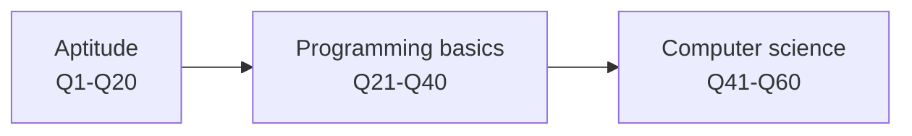

An online assessment of **60 multiple-choice questions** split evenly into **aptitude**, **programming basics** and **computer science**. This section holds every question with its options and a toggle that opens the answer and a short, plain explanation.

## At a glance

| | |
|---|---|
| **Stage covered** | Online assessment (HirePro) |
| **Questions** | 60 MCQs, 4 options each |
| **Aptitude** | Q1–Q20: problem solving, puzzles, logical reasoning, data analysis |
| **Programming basics** | Q21–Q40: number systems, logic gates, C output tracing, scheduling, linked lists, searching |
| **Computer science** | Q41–Q60: architecture, data structures, C pointers, OOP, operating systems |
| **Heavy topics** | C pointer and `printf` tracing (about 15 of 60), OS and architecture basics, one lantern puzzle with five questions |
| **Time limit, marking scheme, cut-off, later rounds** | *not stated* |

## The assessment

## Pages


  
  
  
  

