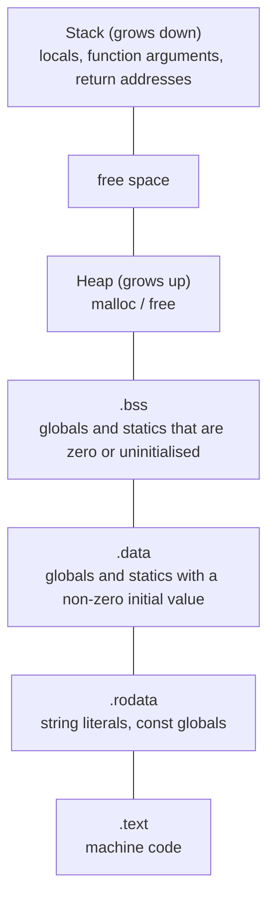
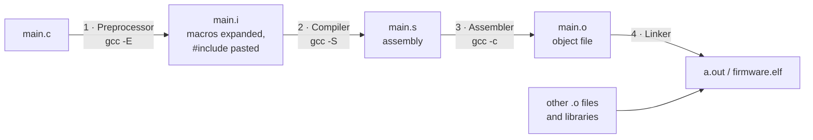

TI's slide lists five topics for **both NCG and interns**: **struct size calculation, bit manipulation, memory layout of a C program, `static` and `volatile`, and compilation stages.** This is the page that sets TI apart from software companies, and three of TI's four sample problems come from it.

## Part 1 · Struct size: alignment and padding

A CPU reads memory fastest when an `n`-byte value starts at an address that is a multiple of `n`. So the compiler puts each struct member at an **aligned** offset and adds unused **padding** bytes where needed.

**The two rules** (typical 32-bit and 64-bit targets):

1. Each member starts at an offset that is a multiple of **its own alignment**. Usually that is its size: `char` 1, `short` 2, `int` 4, `float` 4, `double` 8, a pointer 4 on 32-bit or 8 on 64-bit.
2. The **total size** is rounded up to a multiple of the **largest** alignment in the struct, so that arrays of the struct stay aligned.

**Worked example.** `struct A { char a; int b; char c; };`

| Member | Size | Placed at offset | Padding before |
|---|---|---|---|
| `char a` | 1 | 0 | — |
| `int b` | 4 | 4 (next multiple of 4) | 3 bytes |
| `char c` | 1 | 8 | — |
| *end* | | 9, rounded up to 12 | 3 bytes |

`sizeof(struct A)` = **12**. Reorder the members largest first, `struct B { int b; char a; char c; };`, and it becomes **8**: 4 + 1 + 1 = 6, rounded up to 8. **Member order matters.**

Other things that change the size (all compiled and checked with gcc, x86-64):

| Declaration | `sizeof` | Why |
|---|---|---|
| `struct { char a; int b; char c; }` | 12 | padding after `a` and at the end |
| `struct { int b; char a; char c; }` | 8 | largest first |
| same as the first, inside `#pragma pack(1)` | 6 | packing removes all padding (slower, and unaligned access can fault on some CPUs) |
| `struct { char c; double d; int i; }` | 24 | 1 + 7 pad + 8 + 4 + 4 pad |
| `union { int i; char c[10]; double d; }` | 16 | a union is as big as its largest member (10), rounded up to its largest alignment (8) |
| `struct { unsigned a:3; unsigned b:5; unsigned c:9; }` | 4 | 17 bits of bit-fields fit in one `unsigned` |


**Pointers inside a struct** are 4 bytes on a 32-bit system and 8 on a 64-bit one. TI questions always say which, so read the first line of the question carefully.


## Part 2 · Bit manipulation

Embedded code configures hardware by setting single bits in **registers**, so TI tests bit operations every year.

| Operator | Meaning | Example (`x = 0b1100`) |
|---|---|---|
| `&` | AND: 1 only if both are 1 | `x & 0b1010` = `1000` |
| <code>&#124;</code> | OR: 1 if either is 1 | <code>x &#124; 0b0011</code> = `1111` |
| `^` | XOR: 1 if they differ | `x ^ 0b1010` = `0110` |
| `~` | NOT: flip every bit | `~x` flips all 32 bits |
| `<<` `>>` | shift left / right | `1 << 3` = `1000` |

**The four macros every embedded engineer writes** (compiled and tested):

```c
#define SET_BIT(r, n) ((r) |=  (1u << (n)))   // force bit n to 1
#define CLR_BIT(r, n) ((r) &= ~(1u << (n)))   // force bit n to 0
#define TGL_BIT(r, n) ((r) ^=  (1u << (n)))   // flip bit n
#define CHK_BIT(r, n) (((r) >> (n)) & 1u)     // read bit n (0 or 1)
```

**Tricks worth knowing:**

- `x & 1` → 1 if x is odd. Even/odd test without `%`.
- `x & (x - 1)` → x with its **lowest set bit cleared**. So `x && !(x & (x - 1))` tests "x is a power of 2", and repeating it until x is 0 counts the set bits.
- `x & -x` → only the lowest set bit.
- Swap the nibbles of a byte: `((x & 0x0F) << 4) | ((x & 0xF0) >> 4)` (0xAB → 0xBA).
- Swap without a temporary: `a ^= b; b ^= a; a ^= b;` (fails if `a` and `b` are the same variable).

**Integer promotion trap.** In an expression, a `char` or `unsigned char` is first converted to `int`. So `x << 6` on an `unsigned char` does **not** lose the high bits until you store or cast the result back to 8 bits. Question E9 below shows this.

**Shifting signed values.** Right-shifting a negative `int` is implementation-defined (gcc does an arithmetic shift, so `-8 >> 1` is `-4`). Left-shifting into the sign bit is undefined. Use `unsigned` types for registers and masks.

## Part 3 · Memory layout of a C program

A compiled C program is split into **sections**. Every variable lives in one of them, decided by where and how it is declared.



High addresses are at the top, low addresses at the bottom.

| Declaration | Section | Starts as |
|---|---|---|
| `int g = 5;` (global) | `.data` | 5 |
| `int g;` or `int g = 0;` (global) | `.bss` | 0 (zeroed by start-up code) |
| `static int s = 3;` inside a function | `.data` | 3, once only |
| `static int s;` inside a function | `.bss` | 0 |
| `int x;` inside a function | stack | **garbage** |
| `malloc(100)` | heap | garbage (`calloc` zeroes it) |
| `"hello"` string literal | `.rodata` | read-only: writing to it is undefined |
| `const int k = 7;` (global) | `.rodata` | 7 |
| the code of `main` | `.text` | |

**Why it matters on a microcontroller.** `.text` and `.rodata` sit in **Flash** (non-volatile, read-only at run time). `.data`, `.bss`, heap and stack sit in **RAM**. At reset, the start-up code copies `.data`'s initial values from Flash into RAM and fills `.bss` with zeros, then calls `main`. On a chip with fast and slow RAM, the section a variable lands in also decides how fast it is to access; TI's sample problem E15 is built on exactly this.

## Part 4 · `static` and `volatile`

**`static` has three meanings, depending on where it is used:**

| Where | Effect |
|---|---|
| Local variable inside a function | Keeps its value between calls. Lives in `.data`/`.bss`, not on the stack. Initialised **once**. |
| Global variable at file scope | **Internal linkage**: visible only inside this `.c` file. Other files cannot `extern` it. |
| Function at file scope | Same: callable only from this file. Hides helpers, avoids name clashes. |

```c
int counter(void) { static int n = 0; return ++n; }
// counter(); counter(); counter() returns 3   (tested)
```

**`volatile`** tells the compiler: *this value can change behind your back, so read it from memory every time and write it every time.* Without it, the optimiser may keep the value in a register, or delete reads it thinks are redundant.

Use `volatile` for:

1. **Memory-mapped hardware registers**, for example a status register that the hardware updates.
2. **Variables changed in an interrupt service routine** and read in the main loop.
3. **Variables shared between threads or tasks** on a single core. `volatile` stops caching in registers, but it is **not** a lock and does **not** make `x++` atomic.

**Proof that it matters.** Here is gcc `-O2` output for the same loop, with and without `volatile`:

```c
int flag;             void wait_plain(void) { while (!flag); }
volatile int vflag;   void wait_vol(void)   { while (!vflag); }
```

```asm
wait_plain:                     wait_vol:
    movl  flag(%rip), %eax      .L6:
    testl %eax, %eax                movl  vflag(%rip), %eax   ; re-read every pass
    je    .L3                       testl %eax, %eax
    ret                             je    .L6
.L3:                                ret
    jmp   .L3      ; spins forever, never re-reads flag
```

Without `volatile`, `flag` is read **once**. If it was 0, the loop becomes `jmp .L3` to itself, so an interrupt that later sets `flag = 1` is never seen.

**`const volatile`** is legal and common: `const volatile uint32_t *STATUS` is a read-only hardware register. Your code may not write it (`const`), but the hardware changes it (`volatile`).

**Where the qualifier sits:**

| Declaration | What is volatile |
|---|---|
| `volatile int *p` | the `int` that p points to (a hardware register) |
| `int *volatile p` | the pointer itself (changed by an ISR) |
| `volatile int *volatile p` | both |

## Part 5 · Compilation stages



| Stage | Does | Typical error it reports |
|---|---|---|
| Preprocessor | Expands `#define`, pastes `#include` files, handles `#if`/`#ifdef`, removes comments | `No such file or directory` for a missing header |
| Compiler | Checks syntax and types, optimises, produces assembly | Syntax errors, type mismatches, undeclared identifiers |
| Assembler | Turns assembly into machine code in an object file with a symbol table | Rarely seen in C |
| Linker | Joins object files and libraries, resolves symbols, assigns final addresses (a **linker script** places sections in Flash and RAM on a microcontroller) | `undefined reference to 'foo'`, `multiple definition of 'foo'` |

**Macros are text substitution**, done before the compiler sees the code. They do not respect precedence or evaluate arguments once:

```c
#define SQUARE(x) x * x
SQUARE(2 + 3)        // becomes 2 + 3 * 2 + 3 = 11, not 25   (tested)
#define SQ(x) ((x) * (x))
SQ(2 + 3)            // 25: always bracket the argument and the whole body
```

`SQ(i++)` still increments `i` twice. That is the reason to prefer `static inline` functions in modern embedded code.


**Remember.** Struct size: align each member, then round the total up to the largest alignment. `x & (x - 1)` clears the lowest set bit. Zero and uninitialised globals go in `.bss`, initialised ones in `.data`, locals on the stack. `static` means "keep the value" inside a function and "this file only" outside. `volatile` means "always re-read": use it for hardware registers and ISR flags. Preprocess → compile → assemble → link, and "undefined reference" is a linker error.


---

## Questions

### Struct size

#### E1 · Size of a struct array

*TI · IIT BHU 2023*

On a **32-bit** system:

```c
typedef struct {
    float angle, radius;
    char *next;
} VECTOR;
VECTOR v[10];
printf("%d", sizeof(v));
```

- **A.** 120
- **B.** 160
- **C.** 200
- **D.** 320


**Answer: A. 120** (tested with 4-byte pointers). Each struct is 4 + 4 + 4 = 12 bytes with no padding, and 10 of them make 120. Candidates who picked 160 or 200 were wrong. On a 64-bit system it would be 4 + 4 + 8 = 16 per struct, so 160.


#### E2 · An array of struct pointers

*TI · BITS Pilani*

On a **64-bit** system:

```c
struct {
    float angle, radius;
} *vector[10];
```

What is `sizeof(vector)`?

- **A.** 20
- **B.** 32
- **C.** 64
- **D.** 80


**Answer: D. 80.** The `*` makes `vector` an array of 10 **pointers**, not 10 structs. Each pointer is 8 bytes on 64-bit, so 80. The struct's own size (8) is irrelevant.


#### E3 · Member order changes the size

*MathWorks · IIIT Delhi 2024*

```c
struct Student { double height; int ID; short int Roll_num; };
struct Teacher { int ID; double height; short int Roll_num; };
```

What are `sizeof(struct Student)` and `sizeof(struct Teacher)`?

- **A.** 16 and 16
- **B.** 14 and 14
- **C.** 16 and 24
- **D.** None of the above


**Answer: C. 16 and 24** (tested). Student: 8 + 4 + 2 = 14, rounded up to a multiple of 8 = 16. Teacher: `int` at 0 (4), 4 bytes of padding so `double` starts at 8, `double` (8) to 16, `short` (2) to 18, rounded up to 24.


#### E4 · Padding, packing and unions

*Practice*

On a 64-bit gcc build, give `sizeof` for:

1. `struct { char a; int b; char c; }`
2. the same struct inside `#pragma pack(push, 1)` … `#pragma pack(pop)`
3. `union { int i; char c[10]; double d; }`


**12, 6, 16** (compiled and run).

1. 1 + 3 padding + 4 + 1 + 3 padding = 12.
2. Packing removes padding: 1 + 4 + 1 = 6. The `int` is now misaligned. That is fine on x86, but can fault or be slow on some embedded cores.
3. A union's size is its largest member (10 bytes), rounded up to its strictest alignment (8, from `double`) = 16.


#### E5 · sizeof a node class

*TI · NIT Calicut 2023*

```cpp
class temp {
    int x;
    temp node;
    float y;
};
main() {
    temp head = new temp();
    display(sizeof(head), sizeof(temp));
}
```

- **A.** 8 24
- **B.** 24 24
- **C.** 4 12
- **D.** 8 12


As printed, **it does not compile**: a class cannot contain a member of its own type (the size would be infinite), and `new` returns a pointer. The intended code is `temp *node;` and `temp *head`. Then on 64-bit: `sizeof(head)` is a pointer = 8. `sizeof(temp)` is `int` 4 + 4 padding + pointer 8 + `float` 4 + 4 padding = 24. So **A. 8 24** is the intended answer (*unverified* against the official key).


### Bit manipulation

#### E6 · Reading with a bad low byte

*TI prep guide (official sample problem)*

A 16K × 8 memory is read 4 bytes at a time with `read4bytes(addr)`, which returns bytes `addr` … `addr+3` packed into a 32-bit value, the byte at `addr` in the top 8 bits and the byte at `addr+3` in the bottom 8 bits. At 105 °C the **least significant byte of every read is garbage**. Write a function that returns a correct 4-byte read.


Read twice and splice (TI's official solution):

```c
uint32_t safe_read4(uint32_t addr) {
    uint32_t hi = read4bytes(addr);       // addr, addr+1, addr+2 good; addr+3 (low byte) bad
    uint32_t lo = read4bytes(addr + 1);   // addr+1 .. addr+4; addr+3 now sits in bits 15..8
    return (hi & ~0xFFu) | ((lo >> 8) & 0xFFu);
}
```

| Bits | 31–24 | 23–16 | 15–8 | 7–0 |
|---|---|---|---|---|
| first read, at `addr` | addr | addr+1 | addr+2 | addr+3 **bad** |
| second read, at `addr+1` | addr+1 | addr+2 | **addr+3 good** | addr+4 bad |

`hi & ~0xFF` keeps the three good upper bytes of the first read. `(lo >> 8) & 0xFF` moves the good copy of `addr+3` from the second read into the low byte. OR them together. The idea TI wants: **read again, shifted so the needed byte lands in a good position, then mask and OR the pieces.** In the interview, also say how you would test it: write a known pattern, read it back at temperature, compare.


#### E7 · Even or odd without `%`

*MathWorks · IIT Bombay 2024*

To test whether an integer is even or odd without the `%` operator, use:

- **A.** addition and subtraction
- **B.** multiplication and division
- **C.** bitwise operators
- **D.** bit fields


**Answer: C.** `n & 1` is 1 for odd and 0 for even, because bit 0 has place value 1 and every other bit is even.


#### E8 · `n & (n - 1)`

*MathWorks · NIT Delhi 2024*

If `(n & (n - 1)) == 0`, what can you say about the integer n?

- **A.** n is even
- **B.** n is a power of 2
- **C.** n is odd
- **D.** n is not a power of 2


**Answer: B.** `n - 1` flips the lowest set bit and every bit below it, so the AND clears exactly the lowest set bit. The result is 0 only if n had a single set bit, i.e. n is a power of 2 (or n = 0, so real code writes `n && !(n & (n - 1))`).


#### E9 · Rotating a byte

*Practice*

```c
unsigned char x = 0x96;
printf("%x ", x >> 2 | x << 6);
printf("%x",  (unsigned char)(x >> 2 | x << 6));
```


**Output: `25a5 a5`** (compiled and run). `x` is promoted to `int` before shifting, so `x << 6` = 0x2580 keeps its high bits, and OR with `x >> 2` = 0x25 gives 0x25A5. Only the cast back to `unsigned char` keeps the low 8 bits, 0xA5. That is the real "rotate right by 2" of 1001 0110 → 1010 0101. In register code, always mask or cast after shifting a narrow type.


#### E10 · Set, clear, toggle

*Practice*

`unsigned r = 0x0F;` Apply `SET_BIT(r, 7)`, then `CLR_BIT(r, 0)`, then `TGL_BIT(r, 1)` (the macros from Part 2). What is `r` in hex, and what does `CHK_BIT(r, 3)` return?


**`r = 0x8C`, and `CHK_BIT(r, 3)` = 1** (compiled and run).

- 0000 1111 → set bit 7 → 1000 1111 (0x8F)
- clear bit 0 → 1000 1110 (0x8E)
- toggle bit 1 → 1000 1100 (0x8C)
- bit 3 is still 1


#### E11 · Count the set bits

*Practice*

```c
int count(unsigned x) { int c = 0; while (x) { x &= x - 1; c++; } return c; }
```

What do `count(0xF0)` and `count(0x5A5A)` return? How many loop iterations does it take?


**4 and 8** (compiled and run). Each `x &= x - 1` removes one set bit, so the loop runs once per **set** bit, not once per bit position. This is Brian Kernighan's method: 0xF0 = 1111 0000 needs 4 passes, where a shift-and-test loop would need 8.


#### E12 · Swap the nibbles

*Practice*

Write one expression that swaps the two 4-bit halves of an `unsigned char x`, so 0xAB becomes 0xBA.


```c
(unsigned char)(((x & 0x0F) << 4) | ((x & 0xF0) >> 4))   // 0xAB -> 0xBA, tested
```

Mask out the low nibble and move it up, mask out the high nibble and move it down, then OR them. `(x << 4) | (x >> 4)` also works if you cast to `unsigned char` at the end.


### Memory layout

#### E13 · Find the bug

*TI prep guide (official sample problem)*

```c
int length;
void foo(int sg) {
    int reverse_sg;
    while (sg > 0) {
        length = length + 1;
        reverse_sg = reverse_sg * 10 + (sg % 10);
        sg = sg / 10;
    }
}
```


**`reverse_sg` is never initialised.** It is a local, so it lives on the stack (or in a register) and starts as garbage. The fix is `int reverse_sg = 0;`. `length` is fine: it is a global in `.bss`, and the start-up code zeroes `.bss` before `main` runs. TI asks this to check that you know the memory layout, not just C syntax.


#### E14 · Which section?

*Practice*

Where does each one live: `int a = 5;` (global), `int b;` (global), `static int c;` (inside a function), `int d;` (inside a function), `char *s = "hi";` (inside a function: both `s` and the text `"hi"`), and `p = malloc(8)`?


| Item | Section |
|---|---|
| `a` | `.data` (initialised, non-zero) |
| `b` | `.bss` (zeroed at start-up) |
| `c` | `.bss` (static storage, keeps its value between calls) |
| `d` | stack (garbage until assigned) |
| `s` (the pointer) | stack |
| `"hi"` (the characters) | `.rodata` (read-only; `s[0] = 'H'` is undefined behaviour) |
| the 8 bytes from `malloc` | heap (`p` itself is wherever `p` was declared) |


#### E15 · Which implementation is fastest?

*TI prep guide (official sample problem)*

A processor with **no cache** has three memories, fastest first: **L1 RAM > L2 RAM > Flash**. The linker places `.bss` and `.stack` in L1, and `.data` and `.heap` in L2. `compute_sum` adds up a range of numbers in a loop, written three ways:

1. adds straight into a global `global_sum`
2. adds into a local `local_sum`, then copies it to `global_sum` at the end
3. adds into `static int local_sum = 0;`, then copies it at the end

Which is slowest and which is fastest?


**(3) is slowest and (2) is fastest** (TI's official answer).

- (2) The local lives on the **stack in L1** (or in a register), the fastest place, and the slow global is touched only once.
- (3) TI's answer places the `static` in **`.data` in L2** and touches it on every iteration, so it is slowest.
- (1) Touches the global on every iteration as well.

*Note:* most compilers put a zero-initialised static in `.bss`, not `.data`, which here would be L1. In the interview, give TI's answer and mention the caveat: it shows you know both the rule and the real toolchain behaviour.


#### E16 · Returning a local's address

*MathWorks · IIT Bombay 2024*

```c
int *inc(int val) { int a = val; a++; return &a; }
int main(void) {
    int a = 10;
    int *val = inc(a);
    printf("Incremented value is [%d]\n", *val);
}
```

Does it print the incremented value?

- **A.** Yes
- **B.** No
- **C.** Runtime error
- **D.** Compiler error


**Answer: C, runtime error in practice.** `a` lives in `inc`'s stack frame, which is gone once `inc` returns, so `*val` is undefined behaviour. When tested, gcc warned and returned a null pointer, and the program crashed. Some compilers happen to print 11. The fix is to return the value, or to use `static int a` or `malloc`.


### `static` and `volatile`

#### E17 · Automatically zero

*MathWorks · IIITDM Kancheepuram 2025*

A variable declared with which keyword is automatically initialised to 0?

- **A.** `auto`
- **B.** `static`
- **C.** `extern`
- **D.** `register`


**Answer: B. `static`.** Objects with static storage duration (statics and globals) go in `.bss` and are zeroed at start-up. `auto` and `register` locals hold garbage. `extern` only declares; the definition elsewhere decides.


#### E18 · A static counter in a `for` loop

*MathWorks · IIIT Delhi 2024*

```c
int fun() { static int num = 15; return num--; }
int main() {
    for (fun(); fun(); fun())
        printf("%d ", fun());
    return 0;
}
```

What is the sum of the values printed?

- **A.** 99
- **B.** 100
- **C.** 101
- **D.** It enters an infinite loop


**Answer: D. Infinite loop** (tested). `num` keeps its value across calls and drops by 1 on every call. Each pass makes three calls (condition, body, update): the condition sees 14, 11, 8, 5, 2, −1, … and never exactly 0, so the loop never stops. The body prints 13, 10, 7, 4, 1, −2, …


#### E19 · Where `volatile` is needed

*Practice*

Which of these need `volatile`?

1. A pointer to a memory-mapped UART status register
2. A global flag set inside a timer ISR and polled in `main`
3. A loop counter inside a function
4. A global read by two RTOS tasks on one core


**1, 2 and 4.**

1. The hardware changes the register, so every read must reach the device.
2. The ISR changes the flag outside normal program flow. Without `volatile`, `-O2` turns the polling loop into an endless jump (see the assembly in Part 4).
3. No: only this function touches it.
4. Yes, so each task re-reads it. `volatile` still does **not** make read-modify-write operations atomic. For that you need a mutex, or interrupts disabled around the update.


#### E20 · `const volatile`

*Practice*

Can a variable be both `const` and `volatile`? Give an example.


**Yes.** `const` restricts *your code* (it may not write the variable). `volatile` says *something else* may change it. The standard example is a read-only hardware status register:

```c
#define STATUS (*(const volatile uint32_t *)0x40001000u)
while (!(STATUS & (1u << 5)));    // wait for "ready", re-reading the register every pass
```

(The address is made up for the example.)


#### E21 · `static` at file scope

*Practice*

`file1.c` contains `static int count = 0;` and `static void helper(void) { … }`. `file2.c` declares `extern int count;` and calls `helper()`. What happens?


**Link error: `undefined reference` to `count` and `helper`.** `static` at file scope gives internal linkage, so neither name is exported from `file1.o`. Each file compiles on its own; the error appears only at the **linker** stage. That is the point of file-scope `static`: hide a module's internals.


### Compilation stages

#### E22 · Macro expansion

*MathWorks · IISc 2024*

```c
#define ADD(x) x + x
#define SUB(x) x - x
int main() {
    int y = ADD(3) / SUB(3);
    printf("%d", ADD(y));
}
```

- **A.** 2
- **B.** Divide by zero exception at runtime
- **C.** 1
- **D.** −2


**Answer: A. 2.** The preprocessor pastes text: `3 + 3 / 3 - 3` = 3 + 1 − 3 = 1, so y = 1, and `ADD(y)` = 1 + 1 = 2. The `/` binds only to the 3s next to it, so no division by zero ever happens.


#### E23 · `SQUARE(2 + 3)`

*Practice*

```c
#define SQUARE(x) x * x
printf("%d", SQUARE(2 + 3));
```


**11** (compiled and run). It expands to `2 + 3 * 2 + 3` = 2 + 6 + 3. Fix: `#define SQUARE(x) ((x) * (x))` gives 25. Even then `SQUARE(i++)` increments `i` twice, so prefer a `static inline` function.


#### E24 · Which stage?

*Practice*

Match each to the stage that handles it or reports it:

1. `#include "uart.h"` is replaced by the file's contents
2. `error: expected ';' before '}'`
3. `undefined reference to 'uart_init'`
4. `.c` → `.s`
5. Placing `.text` at Flash address 0x0000 and `.data` in RAM


1. **Preprocessor** (`gcc -E` shows the result)
2. **Compiler** (syntax error)
3. **Linker**: `uart_init` was declared but no object file or library defines it
4. **Compiler** (`gcc -S`)
5. **Linker**, using the linker script


#### E25 · Taking a register variable's address

*Qualcomm · HirePro 2025*

```c
#include <stdio.h>
int main()
{
    register int number = 130;
    char *nu = (char*)&number;           //Line 1
    printf("%d ", ++*nu++);
    nu -= 1;
    nu--;
    printf("%d ", --*nu--);
    return 0;
}
```

Which option is correct?

- **A.** Compile-time error at Line 1
- **B.** 131 129
- **C.** 132 130
- **D.** 131 130


**Answer: A. Compile-time error at Line 1.** C forbids taking the address of a `register` variable (gcc: *address of register variable requested*), because it may have no memory address at all. It is a **compiler** error, not a linker or runtime one. (C++ allowed it until C++17 removed `register`.) The pointer tricks after Line 1 are a distraction: the program never compiles.

