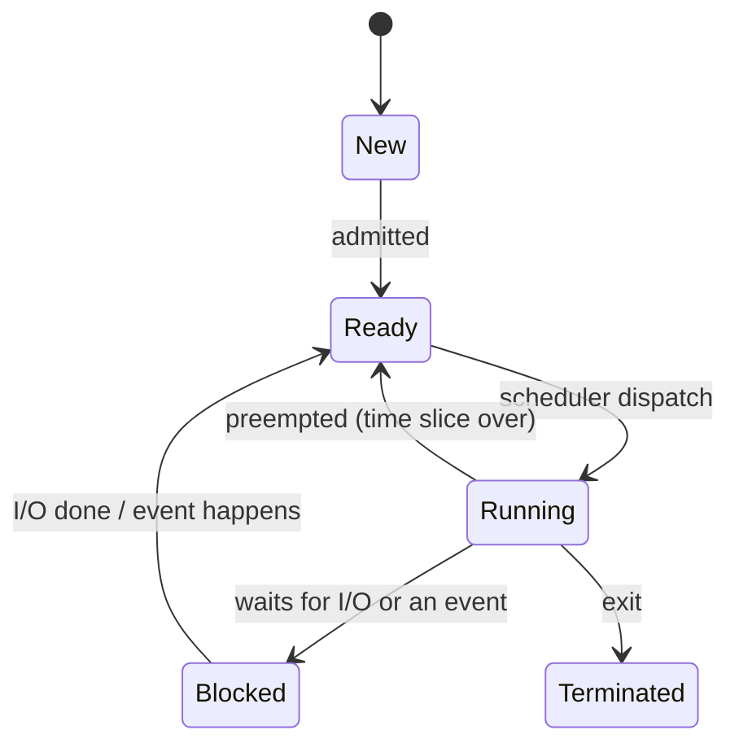
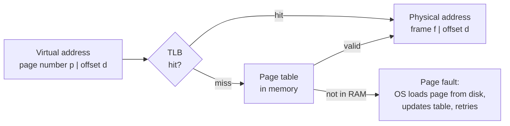

TI's slide lists three OS topics for NCG: **scheduling algorithms, multi-process synchronisation techniques, and virtual and physical memory.** Interns need **synchronisation only** (Part 3). TI papers also ask about memory allocation and fragmentation, so Part 5 covers that.

Embedded products often run a small **RTOS** (real-time operating system) rather than Linux, but the ideas here are the same.


**Intern?** Read Part 1 (two minutes) and Part 3. The questions for you are O8–O15.


## Part 1 · Processes and their states

A **program** is a file on disk; a **process** is a program being run, with its own memory, registers and open files. A **thread** is a path of execution inside a process; threads share the process's memory but each has its own stack and registers.

The OS keeps each process's details in a **process control block** (PCB): state, program counter, registers, memory map, open files. Switching the CPU from one process to another means saving one PCB and loading another. This is a **context switch**, and it is pure overhead.



**There is no Blocked → Running arrow.** When its I/O completes, a blocked process goes back to Ready and waits for the scheduler like everyone else.

## Part 2 · CPU scheduling

The **scheduler** picks which Ready process runs next. **Preemptive** schedulers can take the CPU away mid-burst; **non-preemptive** ones wait until the process blocks or exits.

**The quantities** (all per process):

- **Turnaround time** = completion time − arrival time
- **Waiting time** = turnaround time − burst time (time spent in the Ready queue)
- **Response time** = first time it runs − arrival time

| Algorithm | Rule | Preemptive? | Good | Bad |
|---|---|:-:|---|---|
| FCFS | first come, first served | no | simple, no starvation | **convoy effect**: short jobs wait behind a long one |
| SJF | shortest burst next | no | lowest average waiting time (non-preemptive) | needs burst lengths; long jobs can **starve** |
| SRTF | shortest *remaining* time next | yes | optimal average waiting time | starvation, more context switches |
| Priority | highest priority next | either | urgent work first | starvation, fixed by **aging** (raise priority while waiting) |
| Round robin | each gets a time quantum *q*, in turn | yes | fair, good response time | large *q* → becomes FCFS; tiny *q* → all overhead |

**Worked example.** Four processes (arrival, burst): P1 (0, 8), P2 (1, 4), P3 (2, 9), P4 (3, 5). Computed by script:

```text
FCFS : | P1 0-8 | P2 8-12 | P3 12-21 | P4 21-26 |              avg waiting 8.75
SJF  : | P1 0-8 | P2 8-12 | P4 12-17 | P3 17-26 |              avg waiting 7.75
SRTF : | P1 0-1 | P2 1-5 | P4 5-10 | P1 10-17 | P3 17-26 |     avg waiting 6.50
```

SRTF waiting times: P1 = 17 − 0 − 8 = 9, P2 = 5 − 1 − 4 = 0, P3 = 26 − 2 − 9 = 15, P4 = 10 − 3 − 5 = 2, so (9 + 0 + 15 + 2)/4 = **6.5**.

**Real-time scheduling** (what an RTOS does): every task has a fixed priority, and the highest-priority ready task always runs (preemptive priority scheduling). A task's deadline matters more than average waiting time.

## Part 3 · Synchronisation

**The problem.** When two threads update shared data, the result can depend on timing. This is a **race condition**. `count++` looks like one step but compiles to *load, add, store*, and two threads can interleave those three steps and lose an update.

The code that touches shared data is the **critical section**. A correct solution needs:

1. **Mutual exclusion**: at most one thread inside at a time.
2. **Progress**: if nobody is inside, a thread that wants to enter is not kept waiting forever by threads that do not want to.
3. **Bounded waiting**: no thread waits forever while others keep entering.

**Tools, from lowest to highest level:**

| Tool | What it is |
|---|---|
| Disabling interrupts | On a single-core microcontroller, the simplest critical section: nothing can preempt you. Keep it very short. |
| Atomic hardware instructions | **Test-and-set**, **compare-and-swap**: read and write in one indivisible step. Used to build locks. |
| Peterson's solution | Pure **software** solution for two threads using a `flag[]` array and a `turn` variable. Teaching tool; breaks on modern CPUs without memory barriers. |
| **Mutex** | A lock with an **owner**: only the thread that locked it may unlock it. For mutual exclusion. |
| **Semaphore** | An integer with two atomic operations: **wait** (P, down) and **signal** (V, up). No owner. |
| Monitor / condition variable | Language-level lock plus "wait until a condition holds". |

**Semaphores in detail:**

```c
wait(S):   while (S <= 0) ;  // block instead of spinning in a real OS
           S = S - 1;
signal(S): S = S + 1;        // wakes one waiting thread
```

- A **binary semaphore** (0 or 1) can act like a lock.
- A **counting semaphore** counts resources: start it at N for N identical buffers.
- **Arithmetic shortcut:** final value = initial − (number of waits) + (number of signals).

**Producer–consumer with a bounded buffer** (the classic):

```c
semaphore empty = N, full = 0, mutex = 1;

producer:                    consumer:
  wait(empty);                 wait(full);
  wait(mutex);                 wait(mutex);
  put item in buffer;          take item from buffer;
  signal(mutex);               signal(mutex);
  signal(full);                signal(empty);
```

Swapping `wait(empty)` and `wait(mutex)` in the producer can **deadlock**: it holds the mutex while sleeping on a full buffer, so the consumer can never get in to empty it.

**Mutex vs semaphore** (a favourite interview question): a mutex is for **mutual exclusion** and has an owner. A semaphore is for **signalling and counting**: an ISR can `signal` a semaphore to wake a task, but it should never unlock a mutex.

**Priority inversion** (embedded favourite): a low-priority task holds a mutex that a high-priority task needs, and a medium-priority task preempts the low one, so the high task waits indefinitely. Fix: **priority inheritance**, where the holder temporarily gets the waiter's priority. This bug famously hit the Mars Pathfinder lander.

**Deadlock** needs all four **Coffman conditions** at the same time:

1. **Mutual exclusion**: resources cannot be shared.
2. **Hold and wait**: a process holds one resource while waiting for another.
3. **No preemption**: resources cannot be taken away.
4. **Circular wait**: P1 waits for P2, which waits for … Pn, which waits for P1.

Break any one and deadlock is **prevented**. The usual practical fix is to **always acquire locks in the same global order**, which kills circular wait. **Avoidance** (the Banker's algorithm) grants a request only if the system stays in a safe state. **Livelock** is when processes keep reacting to each other and changing state, but none makes progress.

## Part 4 · Virtual and physical memory

**Physical memory** is the real RAM, addressed by physical addresses. **Virtual memory** gives each process its own address space starting at 0. The **MMU** (memory management unit) translates every virtual address to a physical one on the fly. This gives isolation (one process cannot touch another's memory), lets programs be bigger than RAM, and lets the OS place pages anywhere.

**Paging.** Virtual memory is cut into fixed-size **pages** and physical memory into **frames** of the same size (commonly 4 KB). A **page table** maps page number → frame number.



**Splitting an address.** With page size 2<sup>k</sup> bytes, the low k bits are the **offset**, and the rest is the **page number**.

> 32-bit virtual address, 4 KB pages (2¹²): offset = 12 bits, page number = 20 bits, so the page table has 2²⁰ entries. At 4 bytes per entry that is **4 MB** per process. That is why real systems use **multi-level page tables**.

**TLB** (translation lookaside buffer): a small, fast cache of recent page-table entries. Without it every memory access would cost two (table + data).

> **Effective access time** = h × (TLB + memory) + (1 − h) × (TLB + 2 × memory)
> With TLB 20 ns, memory 100 ns, hit ratio 80 %: 0.8 × 120 + 0.2 × 220 = **140 ns**.

**Page replacement**: when RAM is full and a page fault happens, which page goes out?

| Policy | Evicts | Note |
|---|---|---|
| FIFO | the page loaded earliest | can suffer **Belady's anomaly**: more frames, *more* faults |
| LRU | the page unused for the longest time | good in practice; no Belady anomaly |
| Optimal (OPT) | the page used farthest in the future | the lowest possible; impossible to implement, used as a benchmark |

Reference string 7 0 1 2 0 3 0 4 2 3 0 3 2 with 3 frames: **FIFO 10, LRU 9, OPT 7** faults (computed by script).

**Thrashing**: the processes together need more pages than there are frames, so the system spends its time paging instead of working. Fix: reduce the degree of multiprogramming, or add RAM.

**Segmentation** splits memory into variable-sized logical units (code, data, stack). It suffers external fragmentation; paging does not, but it has internal fragmentation in the last page.


**On microcontrollers.** Small MCUs (8051, Cortex-M0) have **no MMU**: every address is physical, so there is no virtual memory. Many Cortex-M parts have an **MPU** (memory protection unit) that can mark regions read-only or no-execute, but it does not translate addresses. TI's application processors (Cortex-A, as in TI's sample problem) do have MMUs and run Linux.


## Part 5 · Allocation and fragmentation

When memory is handed out in variable-sized pieces:

- **First fit**: take the first hole big enough. Fast.
- **Best fit**: take the smallest hole big enough. Leaves tiny useless holes.
- **Worst fit**: take the largest hole. Leaves big holes.

**Internal fragmentation**: space wasted *inside* an allocated block (a 200 KB process in a 600 KB fixed partition wastes 400 KB). **External fragmentation**: enough total free memory exists, but it is split into holes too small to use. **Compaction** fixes external fragmentation by moving processes together. Paging removes it completely.


**Remember.** Blocked → Ready, never Blocked → Running. Waiting = turnaround − burst. SJF/SRTF can starve; RR with a huge quantum is FCFS. Semaphore: final = initial − waits + signals. Mutex has an owner; semaphore does not. Deadlock needs all four Coffman conditions. Offset bits = log₂(page size). EAT = h(t + m) + (1 − h)(t + 2m). FIFO can show Belady's anomaly.


---

## Questions

### Processes and scheduling

#### O1 · Process states

*TI · IISc (second set)*

Which transition is **not** possible?

- **A.** Blocked to Running
- **B.** Ready to Running
- **C.** Blocked to Ready
- **D.** Running to Blocked


**Answer: A. Blocked to Running.** When its event happens, a blocked process becomes Ready. Only the scheduler moves a process from Ready to Running.


#### O2 · CPU and I/O busy together

*TI · BITS Pilani*

Which keeps the CPU and the I/O devices busy at the same time?

- **A.** Preemptive scheduling
- **B.** Multiprogramming
- **C.** Spooling
- **D.** All of these


**Answer: D. All of these**, per the candidate key (*unverified*). The textbook answers are **multiprogramming** (when one process waits for I/O, another uses the CPU) and **spooling** (I/O is queued on disk while the CPU continues). Preemption helps too, by switching away from a process that is about to wait. If "All of these" is offered, it is the safest pick.


#### O3 · Starvation

*MathWorks · IISc 2024*

Which scheduling algorithms can cause starvation? (more than one answer)

- **A.** Shortest job next
- **B.** Shortest remaining time first
- **C.** Round robin


**A and B.** A steady stream of short jobs can postpone a long job forever. Round robin gives every process a turn, so nothing starves.


#### O4 · Round robin with a huge quantum

*Qualcomm · IISc*

As the time quantum of round-robin scheduling increases, the algorithm behaves like:

- **A.** Shortest Job First
- **B.** Optimal algorithm
- **C.** First Come First Serve
- **D.** Priority scheduling


**Answer: C. FCFS.** Once the quantum is longer than every burst, nothing is ever preempted, and processes run in arrival order.


#### O5 · Scheduling statements

*Qualcomm · Nov 2024*

(I) The throughput of Shortest Process Next (SPN) is higher than FCFS. (II) The overhead of round robin is lower than SPN. (III) Starvation is possible in FCFS.

- **A.** Only I and III
- **B.** Only II and III
- **C.** Only II
- **D.** Only I and II


**Answer: D. Only I and II** (as in Stallings' comparison table: SPN throughput is high; RR overhead is minimal while SPN's can be high). III is false: FCFS serves everyone in turn, so no process starves. It can be slow, but it always progresses.


#### O6 · Gantt chart

*Practice*

Processes (arrival, burst): P1 (0, 8), P2 (1, 4), P3 (2, 9), P4 (3, 5). Find the average waiting time under (a) FCFS, (b) non-preemptive SJF, (c) SRTF.


**(a) 8.75, (b) 7.75, (c) 6.5** (computed by script; the Gantt charts are in Part 2).

- FCFS waits: 0, 7, 10, 18 → 35/4
- SJF: P1 runs first (it is alone at t = 0), then P2 (4), P4 (5), P3 (9). Waits: 0, 7, 15, 9 → 31/4
- SRTF: P2 preempts P1 at t = 1 (4 < 7 remaining). Waits: 9, 0, 15, 2 → 26/4

SRTF gives the lowest average, as theory says.


#### O7 · Round robin

*Practice*

Same four processes, round robin with quantum 2. A process arriving during a slice joins the queue **before** the preempted process. When does each finish, and what is the average waiting time?


**Completion: P1 22, P2 12, P3 26, P4 23. Average waiting 12.75** (computed by script).

Order: P1 0–2, P2 2–4, P3 4–6, P1 6–8, P4 8–10, P2 10–12 (P2 done), P3 12–14, P1 14–16, P4 16–18, P3 18–20, P1 20–22 (P1 done), P4 22–23 (P4 done), P3 23–26 (P3 done).

Waits = completion − arrival − burst: P1 14, P2 7, P3 15, P4 15 → 51/4 = 12.75. Worse average than SJF, but no process waits long for its *first* turn. That is what round robin is for.


### Synchronisation and deadlock

#### O8 · Initial semaphore value

*NVIDIA · Nov 2024*

After 10 wait operations and 7 signal operations on a counting semaphore, its value is 6. What was its initial value?

- **A.** 3
- **B.** 9
- **C.** 4
- **D.** 11


**Answer: B. 9.** S − 10 + 7 = 6, so S = 9.


#### O9 · Number of signals

*NVIDIA · Nov 2024*

A counting semaphore has value 7. After 20 wait operations and some signal operations, its value is 5. How many signals were performed?

- **A.** 18
- **B.** 22
- **C.** 10
- **D.** 20


**Answer: A. 18.** 7 − 20 + s = 5, so s = 18.


#### O10 · Hardware solutions to the critical section

*Qualcomm · Nov 2024*

Which are hardware-based solutions to the critical-section problem? (I) `test_and_set()` (II) `compare_and_swap()` (III) Peterson's solution

- **A.** Only I and II
- **B.** Only I and III
- **C.** All three
- **D.** Only I


**Answer: A. Only I and II.** Both are atomic CPU instructions. Peterson's solution uses only ordinary loads and stores, so it is a **software** solution.


#### O11 · Circular wait

*TI · BITS Pilani*

A: Circular wait is **necessary** for deadlock. B: Circular wait is **sufficient** for deadlock.


**A is true, B is false.** All four Coffman conditions must hold together. A cycle in the wait-for graph is necessary, but if, say, resources can be preempted, the cycle can be broken. (With single-instance resources, a cycle in the *resource-allocation graph* does mean deadlock; with several instances it does not.)


#### O12 · Preventing deadlocks

*TI · IIT BHU 2023*

A: Permitting resource preemption alone will prevent deadlocks. B: Preventing circular wait alone will prevent deadlocks.

- **A.** Both true
- **B.** A true, B false
- **C.** A false, B true
- **D.** Both false


**Answer: A. Both true** (*unverified*). Breaking **any one** of the four necessary conditions prevents deadlock, so both statements hold in theory. Many candidate keys say **C** (A false, B true), arguing that preemption cannot be applied to every resource, such as a printer halfway through a page. If the question stresses "practical", C is the answer they expect.


#### O13 · Livelock

*Qualcomm · IISc*

Two or more processes keep changing state in response to each other without doing useful work. This is:

- **A.** Atomic operation
- **B.** Deadlock
- **C.** Critical section
- **D.** Livelock


**Answer: D. Livelock.** In a deadlock the processes are stuck waiting; in a livelock they are busy but make no progress, like two people stepping aside the same way in a corridor.


#### O14 · Producer–consumer order

*Practice*

In the bounded-buffer solution of Part 3, a programmer swaps the producer's first two lines to `wait(mutex); wait(empty);`. What can go wrong?


**Deadlock when the buffer is full.** The producer takes `mutex`, then sleeps on `empty` (0, since the buffer is full) while still holding `mutex`. The consumer needs `mutex` to remove an item and signal `empty`, so it blocks too. Neither can proceed. Rule: **wait on the counting semaphore first, then the mutex.**


#### O15 · Mutex or semaphore?

*Practice*

An ISR runs when a UART byte arrives. A task should sleep until data is available. Should the ISR signal a mutex or a semaphore? Why?


**A (binary or counting) semaphore.** This is signalling between an ISR and a task, not mutual exclusion. A mutex has an **owner**: only the task that locked it may unlock it, and an ISR is not a task and must never block. A counting semaphore can also count how many bytes are waiting. Use a mutex only when two tasks share one resource, such as the UART transmit buffer.


### Virtual memory and allocation

#### O16 · Why "virtual"?

*Oracle · HackerRank test*

Why is a virtual memory address called "virtual"?

- **A.** It does not map to the actual memory cell with that address number.
- **B.** It is the same as physical memory.
- **C.** Applications cannot access it at run time.
- **D.** It is still present after a restart.


**Answer: A.** The MMU translates it through the page tables to some physical frame (or the page may not be in RAM at all), so the number is not the physical location.


#### O17 · Thrashing

*MathWorks · IISc 2024*

Which of these reduce thrashing? (more than one answer)

- **A.** Decrease the degree of multiprogramming
- **B.** Increase the RAM
- **C.** Decrease the page size
- **D.** None of these


**A and B.** Both leave each process enough frames for its working set. A smaller page size does not fix a shortage of frames.


#### O18 · Page table size

*Practice*

A system has 32-bit virtual addresses, 4 KB pages and 4-byte page-table entries. How many bits are the offset and the page number, and how big is a single-level page table?


**Offset 12 bits, page number 20 bits, page table 4 MB.** 4 KB = 2¹² → 12 offset bits; 32 − 12 = 20 bits → 2²⁰ entries × 4 B = 4 MB per process. That is far too much to keep for every process, which is why real systems use two-level or multi-level tables that only fill in the parts that are used.


#### O19 · Effective access time

*Practice*

A TLB lookup takes 20 ns, a memory access 100 ns, and the TLB hit ratio is 80 %. What is the effective memory access time?


**140 ns.** Hit: 20 + 100 = 120 ns. Miss: 20 + 100 (page table) + 100 (data) = 220 ns. EAT = 0.8 × 120 + 0.2 × 220 = 96 + 44 = 140 ns. Without a TLB every access would cost 200 ns.


#### O20 · Page replacement

*Practice*

Reference string: 7 0 1 2 0 3 0 4 2 3 0 3 2, with 3 frames, initially empty. Count the page faults under FIFO, LRU and Optimal.


**FIFO 10, LRU 9, Optimal 7** (computed by script). The first three references always fault (cold start). Optimal is always the lowest, and LRU usually comes closest to it.


#### O21 · Belady's anomaly

*Practice*

With FIFO replacement and the reference string 1 2 3 4 1 2 5 1 2 3 4 5, how many faults occur with 3 frames and with 4 frames?


**9 faults with 3 frames, 10 with 4** (computed by script). More memory gave *more* faults. This is **Belady's anomaly**, and it can happen with FIFO. LRU and Optimal are "stack algorithms" and never show it.


#### O22 · Fixed partitions

*TI · IIT BHU 2023*

Fixed partitions of 600, 200, 100 and 500 KB (from a diagram). Three processes of 200 KB each are placed by first fit. What is the ratio of internal to external fragmentation?

- **A.** 1:1
- **B.** 2:3
- **C.** 2:1
- **D.** 1:2


*Unverified.* First fit puts the processes in the 600, 200 and 500 partitions, wasting 400 + 0 + 300 = **700 KB internally**. The 100 KB partition stays free. Whether it counts as "external" fragmentation depends on the paper's definition, and no option matches the textbook figures cleanly. The candidate chose **A. 1:1**. Learn the method, not the letter: internal = waste inside used partitions; external = free space that cannot be used.


#### O23 · Free holes

*TI · IIT ISM 2024*

With variable partitions of 100, 200 and 300 KB, some processes end and holes of 50, 150 and 250 KB remain, scattered through memory. What kind of fragmentation is this?


**External fragmentation.** The free memory (450 KB in total) is split into separate holes, so a 300 KB request fails even though the total would fit. Compaction or paging fixes it.


#### O24 · First fit with fixed blocks

*TI · IIT ISM 2024*

Fixed blocks of 120, 80, 200 and 60 KB. Requests of 70, 90, 50 and 130 KB arrive in that order and are placed by first fit. What kind of fragmentation results?


**Both** (*unverified*). 70 → 120 block (50 wasted inside), 90 → 200 block (110 wasted), 50 → 80 block (30 wasted): that waste is **internal**. Then 130 cannot be placed: only the 60 block is free, so it fails even though 50 + 110 + 30 + 60 = 250 KB is unused in total. Space exists but cannot be used, which is the external kind.

