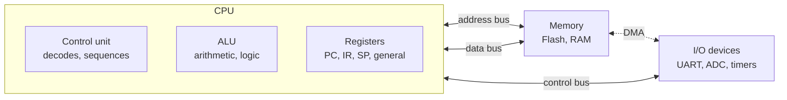
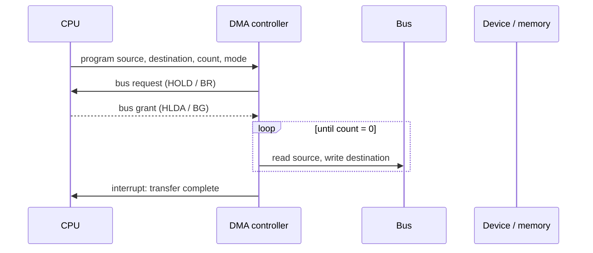

TI's slide lists four topics, **for NCG only**: **caches, DMA, organisation, and pipeline.** Interns can skip this page (DMA comes up again for everyone on the [microcontrollers page](/companies/texas-instruments/05-microcontrollers/)). TI papers also ask about memory types and number formats, which are covered under organisation.

## Part 1 · Organisation: how a computer is put together

A computer has three parts joined by **buses**:



- **Control unit**: fetches each instruction, decodes it and tells the other parts what to do.
- **ALU**: does the arithmetic and logic, and sets flags (zero, carry, overflow, sign).
- **Registers**: the fastest storage. Special ones: **PC** (program counter: address of the next instruction), **IR** (instruction register), **SP** (stack pointer), status/flags register.
- **Address bus** width decides how much memory can be addressed: *n* address lines → 2<sup>n</sup> locations. **Data bus** width decides how many bits move per transfer.

**The instruction cycle**: fetch (read the instruction at PC, increment PC) → decode → execute → (memory access) → write back. Then repeat.

**Von Neumann vs Harvard**

| | Von Neumann | Harvard |
|---|---|---|
| Memories | one memory and bus for code and data | separate memories and buses for code and data |
| Speed | instruction fetch and data access take turns (the "von Neumann bottleneck") | both at once |
| Where | most PCs (at the main-memory level) | **8051**, most microcontrollers and DSPs. Modern CPUs use split L1 instruction/data caches, a "modified Harvard" design. |

**RISC vs CISC**

| RISC (ARM, RISC-V) | CISC (x86, and the 8051 is CISC-like) |
|---|---|
| Few, simple, fixed-length instructions | Many, complex, variable-length instructions |
| Mostly one cycle each; easy to pipeline | Several cycles each |
| Only load/store touch memory | Instructions can operate on memory directly |
| More registers, compiler does more work | Fewer registers, hardware does more work |

**Memory types**

| Type | Volatile? | Notes |
|---|:-:|---|
| SRAM | yes | 6 transistors per bit, fast, expensive, no refresh. Used for **caches** and MCU RAM. |
| DRAM | yes | 1 transistor + 1 capacitor per bit, dense and cheap, must be **refreshed**. Used for **main memory**. |
| ROM / PROM / EPROM | no | factory-written / write-once / UV-erasable |
| EEPROM | no | electrically erasable **byte by byte**, slow writes. Used for settings and calibration data. |
| Flash | no | erasable only in **blocks or sectors**, limited write cycles. Used for program storage. NOR flash allows execute-in-place; NAND flash is denser (SSDs). |

**Number formats** (for an n-bit word):

| Format | −5 in 4 bits | Range in n bits | Note |
|---|---|---|---|
| Sign-magnitude | 1101 | −(2<sup>n−1</sup>−1) … +(2<sup>n−1</sup>−1) | two zeros (+0, −0) |
| 1's complement | 1010 | same as above | flip all bits; two zeros |
| 2's complement | 1011 | −2<sup>n−1</sup> … +(2<sup>n−1</sup>−1) | flip and add 1; one zero; what every CPU uses |

**Endianness**: how a multi-byte value is stored in memory. **Little-endian** puts the least significant byte at the lowest address (x86, most ARM, the TI MSP430). **Big-endian** puts the most significant byte first (network byte order). Storing `0x12345678` at address 1000:

| Address | 1000 | 1001 | 1002 | 1003 |
|---|---|---|---|---|
| Little-endian | 78 | 56 | 34 | 12 |
| Big-endian | 12 | 34 | 56 | 78 |

Checked on x86: `((unsigned char *)&x)[0]` is `0x78`.

## Part 2 · Memory hierarchy and caches

```text
Registers  <  1 ns    bytes
L1 cache   ~  1 ns    tens of KB       SRAM, on the core
L2 / L3    ~  5-20 ns hundreds of KB-MB
Main RAM   ~ 60-100ns GB               DRAM
Flash/SSD  ~ µs                        non-volatile
```

The further from the CPU, the bigger, slower and cheaper per byte. A **cache** keeps copies of recently used memory close to the CPU. It works because programs show **locality**:

- **Temporal locality**: something used now will probably be used again soon (loop variables).
- **Spatial locality**: things next to it will probably be used soon (array elements). So the cache fetches a whole **block** (or **line**, typically 32–64 bytes) at a time.

**Practical consequence (TI's own sample problem):** looping over an **array** is much faster than a linked list, because array elements are next to each other. C stores 2-D arrays **row-major**, so loop over rows in the outer loop and columns in the inner loop.

**Mapping: where can a block go?**

| Mapping | A block can go | Address split | Trade-off |
|---|---|---|---|
| Direct-mapped | exactly one line | tag \| index \| offset | simple and fast, but **conflict misses** |
| k-way set-associative | any of the k lines in one set | tag \| set index \| offset | the usual compromise |
| Fully associative | any line | tag \| offset | no conflicts; expensive to search |

**Splitting an address**, step by step:

1. **Offset bits** = log₂(block size)
2. **Number of lines** = cache size / block size
3. **Number of sets** = lines / associativity, and **index bits** = log₂(sets)
4. **Tag bits** = address bits − index bits − offset bits

> 32-bit address, 64 KB direct-mapped cache, 32-byte blocks: offset = 5, lines = 2048 → index = 11, tag = 32 − 11 − 5 = **16**. The same cache 4-way: sets = 512 → index = 9, tag = **18**.

**Three kinds of miss** (the "3 Cs"):

- **Compulsory (cold)**: first ever access to a block.
- **Capacity**: the working set is bigger than the cache.
- **Conflict**: too many blocks map to the same set, even though the cache has space elsewhere.

**Writes**

| Policy | On a write hit | Note |
|---|---|---|
| **Write-through** | update cache *and* memory | simple, memory always up to date; more bus traffic (use a write buffer) |
| **Write-back** | update cache only; mark the line **dirty**; write it to memory when evicted | less traffic; memory can be stale, which matters for DMA |

**Performance**

> **AMAT** (average memory access time) = hit time + miss rate × miss penalty
> Hit time 1 cycle, miss rate 5 %, miss penalty 100 cycles → 1 + 0.05 × 100 = **6 cycles**.

With two levels, an access reaches main memory only if it misses **both**: fraction = (1 − h₁)(1 − h₂), where h₂ is the L2 hit rate among L1 misses.

## Part 3 · DMA (direct memory access)

Moving data between a device and memory through the CPU means one load and one store per word, plus an interrupt per byte or block. A **DMA controller** moves the data **directly between device and memory** while the CPU does other work.



**Three transfer modes:**

| Mode | How | CPU impact |
|---|---|---|
| **Burst (block)** | DMA keeps the bus for the whole block | fastest transfer; CPU locked out of the bus meanwhile |
| **Cycle stealing** | DMA takes the bus for one word at a time, between CPU cycles | CPU slowed a little, never stopped for long |
| **Transparent** | DMA uses the bus only when the CPU is not using it | no CPU slowdown; slowest transfer |

**Programmed I/O vs interrupt-driven vs DMA**: with programmed I/O the CPU polls and copies everything. With interrupts it copies, but only when the device is ready. With DMA it only sets up the transfer and handles one interrupt at the end. Reading a 4 KB block one byte per interrupt costs 4096 interrupts; with DMA it costs one.

**Cache coherence with DMA**: if the cache is write-back, memory may hold stale data when DMA reads it, and DMA writes to memory leave stale copies in the cache. Drivers **clean (flush)** the cache before a DMA read from memory and **invalidate** it after a DMA write to memory, or use non-cacheable buffers.

On TI parts, DMA is everywhere: for example, ADC samples streamed into a RAM buffer, or UART and SPI transfers without CPU involvement.

## Part 4 · Pipelining

Without a pipeline, each instruction finishes all its stages before the next one starts. A **pipeline** overlaps them, like an assembly line. The classic RISC pipeline has **5 stages**:

**IF** (fetch) → **ID** (decode, read registers) → **EX** (ALU) → **MEM** (load/store) → **WB** (write back)

```text
cycle:   1   2   3   4   5   6   7
I1       IF  ID  EX  MEM WB
I2           IF  ID  EX  MEM WB
I3               IF  ID  EX  MEM WB
```

**Timing.** With k stages and n instructions, in an ideal pipeline:

- Pipelined time = (k + n − 1) cycles
- Unpipelined time = n × k cycles
- **Speedup** = nk / (k + n − 1), which approaches k for large n

> 5 stages, 100 instructions: 104 cycles instead of 500, a speedup of **4.81**.

The pipeline's clock cycle is set by the **slowest stage** (plus latch overhead). Unequal stages waste time.

**Hazards: things that break the ideal flow**

| Hazard | Cause | Fix |
|---|---|---|
| **Structural** | two instructions need the same hardware in the same cycle (one memory port) | duplicate the hardware (split I/D caches, Harvard) |
| **Data** | an instruction needs a result that is not written yet | **forwarding (bypassing)**; stalls (bubbles); compiler reordering |
| **Control** | a branch: the next instruction is not known yet | **branch prediction**, delayed branches, flushing wrong-path instructions |

**Data dependences**, named by what happens in program order (instruction i before j):

| Name | Meaning | Real or false? |
|---|---|---|
| **RAW** (read after write), true dependence | j reads what i writes | real: must wait or forward |
| **WAR** (write after read), anti-dependence | j writes what i reads | false: fixed by **register renaming** |
| **WAW** (write after write), output dependence | j writes what i writes | false: fixed by register renaming |

A **load-use** hazard (using a loaded value in the very next instruction) costs one stall even with forwarding, because the data only arrives at the end of MEM.

**CPU performance equation**: time = instruction count × CPI × clock period. Average CPI = Σ (CPI of each type × its fraction).


**Remember.** n address lines → 2ⁿ locations. Harvard = separate code and data paths (8051). Offset = log₂(block), index = log₂(sets), tag = the rest. AMAT = hit + miss rate × penalty. The 3 Cs: compulsory, capacity, conflict. DMA modes: burst, cycle stealing, transparent. Pipeline: k + n − 1 cycles. RAW is real; WAR and WAW are false dependences.


---

## Questions

### Organisation and memory

#### A1 · Memory size from pins

*TI · IISc 2023*

A memory chip has 8 data lines and 16 address lines. What is its size?

- **A.** 128 KB
- **B.** 256 KB
- **C.** 512 KB
- **D.** 1024 KB
- **E.** None of these


**Answer: E. None of these.** 16 address lines → 2¹⁶ = 65 536 locations, each 8 bits (1 byte) wide → **64 KB**.


#### A2 · A large memory

*TI · IISc 2023*

A microcomputer needs a large memory. Which choice is best?


**SRAM as cache combined with DRAM as main memory.** DRAM is dense and cheap, so it gives capacity; a small fast SRAM cache hides its latency. All-SRAM would be too expensive and large; all-DRAM would be slow.


#### A3 · Flash memory

*TI · NIT Calicut 2023*

Which statement does **not** describe Flash memory?

- **A.** It can erase data byte-wise
- **B.** It is used to rewrite data frequently
- **C.** NOR gates are used to design this memory
- **D.** Both A and C
- **E.** None of these


**Answer: A** (*unverified*). Flash erases whole **blocks or sectors**, never single bytes (that is EEPROM's feature). NOR flash exists, so C does describe flash. B is doubtful too, since flash has limited write endurance, but no option pairs A with B, so A is the best pick.


#### A4 · Reading a DRAM cell

*TI · NIT Calicut 2023*

Reading a DRAM cell: (1) precharge the bit line to half the threshold; (2) assert one row (word) line; (3) the bit line moves slightly above or below the threshold depending on the stored bit; (4) sense and amplify. Which step is directly hurt by a **small storage capacitor**?

- **A.** 1
- **B.** 2
- **C.** 3
- **D.** 4


**Answer: C. Step 3.** The cell shares its charge with the much larger bit-line capacitance, so the voltage swing is proportional to the cell capacitance. A smaller cell gives a smaller swing that is harder to sense. This is also why DRAM reads are destructive and the value must be written back.


#### A5 · Sign-magnitude

*TI · IIT BHU 2023*

The sign-magnitude representation of −15 is:

- **A.** 1111
- **B.** 1111 (printed twice in the screenshot)
- **C.** 11111
- **D.** 1110


**Answer: C. 11111.** 15 needs 4 magnitude bits (1111), and the sign bit 1 goes in front. In 4 bits sign-magnitude can only reach ±7, so 1111 there would mean −7. (Options A and B were identical in the screenshot.)


#### A6 · Number format for low power

*TI · NIT Calicut 2023*

Data fluctuate slightly around a steady value of 0. Which number format minimises **dynamic power** on the data bus?

- **A.** 1's complement
- **B.** 2's complement
- **C.** Signed magnitude
- **D.** Dynamic power does not depend on the representation


**Answer: C. Signed magnitude.** Dynamic power grows with the number of bits that toggle. Going from +1 to −1 in sign-magnitude flips only the sign bit (0001 → 1001). In 2's complement it flips almost every bit (0001 → 1111).


#### A7 · Endianness

*Practice*

`uint32_t x = 0x12345678;` is stored at address 0x2000 on a little-endian MCU. What byte is at 0x2000, and what does `*(uint8_t *)&x` read?


**0x78 in both cases** (checked on x86, which is little-endian). The least significant byte goes to the lowest address. On a big-endian machine the answer would be 0x12. Endianness matters whenever bytes cross between systems: network packets, files, or a peripheral that sends the high byte first.


#### A8 · Memory interleaving

*MathWorks · IISc 2024*

In (low-order) memory interleaving, the lower-order bits of the address are used to:

- **A.** get the data
- **B.** get the address of the module
- **C.** get the address of the data within the module
- **D.** all of these


**Answer: B. Select the module.** Consecutive words go to consecutive modules, so the low bits pick the module and the high bits pick the word inside it. Sequential accesses then hit different modules and can overlap.


### Caches

#### A9 · Number of cache sets

*TI · NIT Calicut 2023*

A 16-bit microprocessor has a 2-way set-associative cache of 256 bytes with 8-byte lines. How many sets does it have?

- **A.** 8
- **B.** 16
- **C.** 32
- **D.** 64


**Answer: B. 16.** 256 / 8 = 32 lines; 2 lines per set → 16 sets. Going further: offset = 3 bits, index = 4 bits, tag = 16 − 4 − 3 = 9 bits.


#### A10 · Locality on a Cortex-A72

*TI prep guide (official sample problem)*

On a Cortex-A72 (with caches): (1) Which linear data structure is fastest to loop over? (2) Should a C 2-D matrix be traversed row-major or column-major? (3) How do you detect a loop in a linked list?


**(1) An array. (2) Row-major. (3) Floyd's cycle-finding algorithm.**

(1) and (2) are both about **spatial locality**: array elements are contiguous, so one cache-line fill brings in the next several elements, whereas linked-list nodes are scattered and each one can miss. C stores `a[i][j]` row by row, so the inner loop should run over `j`. Going down a column jumps a whole row each step and wastes most of every cache line.


#### A11 · Type of cache miss

*Qualcomm · Nov 2024*

Which type of cache miss happens when the working set of a process is larger than the cache?

- **A.** Memory miss
- **B.** Cold miss
- **C.** Conflict miss
- **D.** Capacity miss


**Answer: D. Capacity miss.** Cold misses are first references; conflict misses come from limited associativity. Capacity misses would happen even in a fully associative cache of the same size.


#### A12 · Two levels of cache

*Qualcomm · HirePro 2025*

L1 and L2 hit rates are 0.58 and 0.76. What fraction of memory accesses reach main memory?

- **A.** 0.15
- **B.** 0.58
- **C.** 0.3036
- **D.** 0.1008


**Answer: D. 0.1008** = (1 − 0.58)(1 − 0.76) = 0.42 × 0.24. An access reaches memory only if it misses both levels; the L2 rate is measured among L1 misses.


#### A13 · Address split

*Practice*

A byte-addressed machine has 32-bit addresses and a 64 KB cache with 32-byte blocks. Find the tag, index and offset widths if the cache is (a) direct-mapped, (b) 4-way set-associative.


Offset = log₂ 32 = **5** bits in both. Lines = 64 KB / 32 B = 2048.

- (a) Direct-mapped: 2048 sets → index **11**, tag 32 − 11 − 5 = **16**.
- (b) 4-way: 2048 / 4 = 512 sets → index **9**, tag **18**.

More associativity means fewer index bits and more tag bits (more comparators).


#### A14 · AMAT

*Practice*

A cache has a 1-cycle hit time, a 5 % miss rate and a 100-cycle miss penalty. What is the average memory access time? What if the miss rate drops to 2 %?


**6 cycles, then 3 cycles.** AMAT = 1 + 0.05 × 100 = 6; with 2 %, 1 + 2 = 3. Cutting the miss rate by 3 percentage points halved the average access time, which is why cache-friendly code (arrays, row-major loops) matters so much.


#### A15 · Write-back and DMA

*Practice*

A driver fills a buffer in RAM and then starts a DMA transfer that sends it to a SPI peripheral. The data cache is write-back. Sometimes old data goes out. Why, and what is the fix?


**The new data is still in dirty cache lines and has not been written to RAM**, and DMA reads RAM directly, not the cache. Fix: **clean (flush) the cache lines** of the buffer before starting the DMA, or put the buffer in a non-cacheable region. For the opposite direction (DMA writes into RAM, then the CPU reads), **invalidate** the lines first so the CPU does not read stale cached copies.


### DMA

#### A16 · DMA modes

*Practice*

Match each DMA mode to its description: burst, cycle stealing, transparent.

1. The DMA controller uses the bus only when the CPU is not using it.
2. The DMA controller takes the bus for one word, gives it back, and repeats.
3. The DMA controller keeps the bus until the whole block is transferred.


**1 – transparent, 2 – cycle stealing, 3 – burst.** Burst is fastest for the transfer but locks the CPU out of the bus. Transparent never slows the CPU but is slowest. Cycle stealing is in between.


#### A17 · What the CPU does during DMA

*Practice*

Which statement about a DMA transfer is **false**?

- **A.** The CPU programs the source, destination and count before the transfer.
- **B.** The CPU copies each word from the device to memory.
- **C.** The DMA controller requests the bus and the CPU grants it.
- **D.** The DMA controller usually interrupts the CPU when the transfer completes.


**Answer: B.** The whole point of DMA is that data moves between device and memory **without** passing through the CPU. The CPU only sets up the transfer (A), hands over the bus (C, the HOLD/HLDA or BR/BG handshake), and handles the completion interrupt (D).


### Pipelining

#### A18 · RISC stages

*TI · NIT Calicut 2023*

In how many stages does a classic RISC instruction execute?

- **A.** 4
- **B.** 5
- **C.** 3
- **D.** 7


**Answer: B. 5**: IF, ID, EX, MEM, WB (the classic MIPS pipeline).


#### A19 · A pipeline with unequal stages

*TI · IIT ISM 2024*

A pipeline's four stages take 2, 1, 3 and 1 cycles. A new instruction starts every cycle. How many cycles do 5 instructions take?

- **A.** 10
- **B.** 11
- **C.** 12
- **D.** 13


**Answer: B. 11** as intended (*unverified*): the first instruction takes 2 + 1 + 3 + 1 = 7 cycles, and each of the other 4 finishes one cycle later, so 7 + 4 = 11. Physically, a 3-cycle stage that is not itself pipelined could accept a new instruction only every 3 cycles, which would give 7 + 4 × 3 = 19. The question's "a new instruction starts every cycle" tells you to use the first model.


#### A20 · Instruction dependence

*TI · BITS Pilani*

Instruction j writes a register that an earlier instruction i reads. What kind of dependence is this?


**Anti-dependence (WAR, write after read).** It is a "false" dependence, since no data flows from i to j, and **register renaming** removes it. If j read what i wrote, it would be a true dependence (RAW); if both wrote, an output dependence (WAW).


#### A21 · What speeds up a pipelined program?

*Cisco · OA, Sep 2025*

In a pipelined RISC computer where all arithmetic instructions have the same CPI, which actions improve the execution time of a typical program?

1. Increasing the clock rate.
2. Disallowing forwarding in the pipeline.
3. Doubling the instruction and data cache sizes without changing the clock cycle time.

- **A.** II only
- **B.** I only
- **C.** III only
- **D.** I and III


**Answer: D. I and III.** Time = instructions × CPI × cycle time. A faster clock (I) shortens the cycle. Bigger caches (III) mean fewer misses, so fewer stall cycles and a lower effective CPI. Removing forwarding (II) adds data-hazard stalls and makes things slower.


#### A22 · Pipeline speedup

*Practice*

A 5-stage pipeline with 1 cycle per stage runs 100 instructions with no stalls. How many cycles does it take, and what is the speedup over the unpipelined version?


**104 cycles; speedup 500 / 104 ≈ 4.81.** The first instruction takes 5 cycles to fill the pipeline, and each of the other 99 completes one cycle later: k + n − 1 = 5 + 99. As n grows, the speedup approaches 5, the number of stages. Stalls and the latch overhead between stages keep real pipelines below that.

