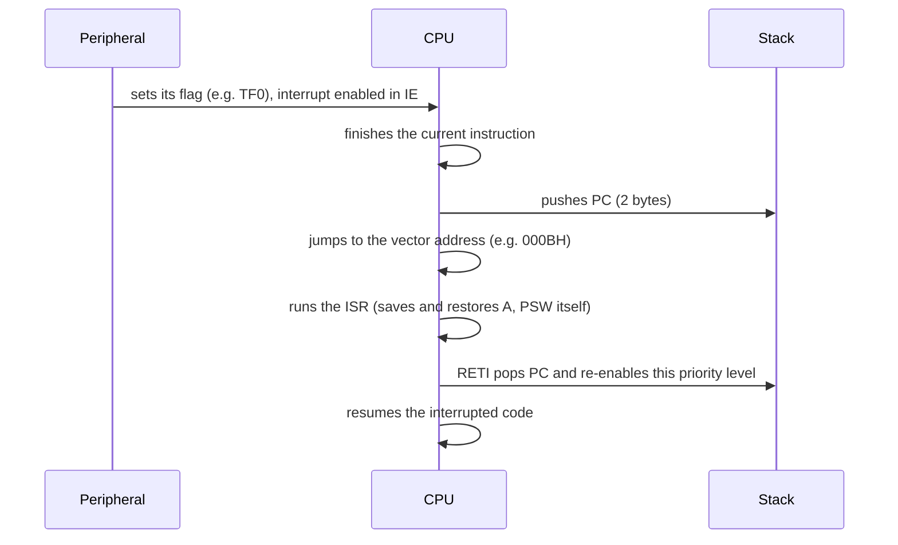

TI's slide lists, for **both NCG and interns**: **8051 assembly; interrupts and their processing; DMA, timers, memories, ADC, DAC, GPIO and SPI.** TI papers have asked 8051 and 8085 assembly, a UART driver bug, and ADC step sizes. A **microcontroller** (MCU) is a whole small computer on one chip: CPU, Flash, RAM and peripherals (timers, UART, ADC, GPIO). TI makes many of them (MSP430, C2000, and the Arm-based MSPM0 and Sitara families), but the 8051 is the one TI's test and slides ask about, so this page is built around it.

## Part 1 · The 8051 at a glance

| Feature | 8051 |
|---|---|
| CPU | 8-bit, with accumulator **A** and register **B** |
| On-chip program memory | 4 KB ROM (8052: 8 KB) |
| On-chip data RAM | 128 bytes (8052: 256) |
| External memory | up to 64 KB code + 64 KB data |
| I/O | 4 ports, P0–P3, 8 pins each = 32 pins |
| Timers | 2 × 16-bit (Timer 0, Timer 1) |
| Serial | 1 full-duplex UART |
| Interrupts | 5 sources: INT0, Timer 0, INT1, Timer 1, Serial |
| Architecture | **Harvard**: separate code and data spaces |
| Timing | 1 machine cycle = **12 oscillator periods**. At 11.0592 MHz that is 1.085 µs. |

**Internal RAM map (128 bytes)**

| Address | Use |
|---|---|
| 00h–1Fh | **4 register banks** of R0–R7. Bank chosen by bits RS1, RS0 in PSW. Bank 0 at reset. |
| 20h–2Fh | **Bit-addressable** area: 16 bytes = 128 bits, bit addresses 00h–7Fh |
| 30h–7Fh | General-purpose scratch RAM (the stack usually goes here) |
| 80h–FFh | **SFRs** (special function registers: A, B, PSW, SP, DPTR, P0–P3, TMOD, TCON, SCON, SBUF, IE, IP…), reachable only by direct addressing |

**SP is 07h after reset**, and the stack grows **upward**, so the first `PUSH` writes to 08h, on top of register bank 1. Programs that use bank 1 move SP higher first.

**PSW (program status word)**

| Bit | 7 | 6 | 5 | 4 | 3 | 2 | 1 | 0 |
|---|---|---|---|---|---|---|---|---|
| Flag | **CY** carry | **AC** auxiliary carry (from bit 3) | F0 user flag | **RS1** | **RS0** | **OV** overflow | — | **P** parity of A (1 if A has an odd number of 1s) |

**Ports.** P0 is **open-drain** and needs external pull-up resistors; it also carries the low address/data byte for external memory. P2 carries the high address byte. P3 pins have second functions: P3.0 RXD, P3.1 TXD, P3.2 INT0, P3.3 INT1, P3.4 T0, P3.5 T1, P3.6 WR, P3.7 RD. **To use a pin as an input, first write 1 to it** (8051 ports are quasi-bidirectional: the pin is weakly pulled high, and an external device can pull it low).

## Part 2 · 8051 assembly

**Addressing modes**

| Mode | Example | Meaning |
|---|---|---|
| Immediate | `MOV A, #25H` | the constant 25h |
| Register | `MOV A, R3` | contents of R3 |
| Direct | `MOV A, 40H` | contents of RAM address 40h (or an SFR) |
| Register indirect | `MOV A, @R0` | contents of the address held in R0 (only R0 or R1) |
| Indexed | `MOVC A, @A+DPTR` | read **code memory** at DPTR + A (lookup tables) |
| External | `MOVX A, @DPTR` | read external data memory |

**Key instructions**

| Group | Instructions | Notes |
|---|---|---|
| Move | `MOV`, `MOVC`, `MOVX`, `PUSH`, `POP`, `XCH` | `PUSH`/`POP` take a direct address only (`PUSH ACC`, not `PUSH A`) |
| Arithmetic | `ADD`, `ADDC`, `SUBB`, `INC`, `DEC`, `MUL AB`, `DIV AB`, `DA A` | **No plain SUB**: clear the carry with `CLR C`, then `SUBB` |
| Logic | `ANL`, `ORL`, `XRL`, `CPL`, `CLR`, `RL`, `RR`, `RLC`, `RRC`, `SWAP A` | `SWAP A` exchanges A's nibbles |
| Bit | `SETB`, `CLR`, `CPL`, `MOV C, bit`, `ANL C, bit` | work on single bits, like `SETB P1.0` |
| Jumps | `SJMP` (±127 bytes), `AJMP` (same 2 KB page), `LJMP` (anywhere in 64 KB) | |
| Conditional | `JZ`/`JNZ` (test A), `JC`/`JNC` (carry), **`JB`/`JNB`/`JBC`** (any bit), `DJNZ` (decrement and jump if not zero), `CJNE` (compare and jump if not equal) | all are short relative jumps |
| Calls | `ACALL`, `LCALL`, `RET`, **`RETI`** (return from interrupt) | |

**A complete example**: toggle pin P1.0 forever with a software delay.

```asm
        ORG   0000H
MAIN:   CPL   P1.0          ; flip the LED pin
        ACALL DELAY
        SJMP  MAIN

DELAY:  MOV   R2, #200      ; 1 cycle
WAIT:   DJNZ  R2, WAIT      ; 2 cycles, 200 times
        RET
        END
```

`DELAY` takes 1 + 200 × 2 = 401 machine cycles (plus the call and return) ≈ 435 µs at 11.0592 MHz. Nest a second `DJNZ` loop for longer delays, or use a timer (Part 4).

**Flags after `ADD`**: CY is the carry out of bit 7, AC the carry out of bit 3, OV is set if the signed result is wrong (two positives giving a negative, or two negatives giving a positive), and P is the parity of the result.

## Part 3 · Interrupts and their processing

An **interrupt** is a hardware signal that makes the CPU pause what it is doing, run a short function called the **interrupt service routine (ISR)**, and then carry on. The alternative, **polling** (checking a flag in a loop), wastes CPU time and can miss short events.

**What happens, step by step, on the 8051:**



**The 8051 does not save A, PSW or any register automatically**: only the PC. The ISR must `PUSH ACC` / `PUSH PSW` and pop them before `RETI`, or switch register banks.

**Vector table**

| Source | Flag | Vector | Default priority |
|---|---|---|:-:|
| Reset | — | 0000h | — |
| External 0 (INT0, pin P3.2) | IE0 | **0003h** | 1 (highest) |
| Timer 0 overflow | TF0 | **000Bh** | 2 |
| External 1 (INT1, pin P3.3) | IE1 | **0013h** | 3 |
| Timer 1 overflow | TF1 | **001Bh** | 4 |
| Serial port | RI or TI | **0023h** | 5 (lowest) |

Vectors are 8 bytes apart, so an ISR longer than that starts with a jump to the real routine.

**Control registers**

- **IE** (interrupt enable): `EA` (bit 7, global enable) plus one enable bit per source: `ES` (serial), `ET1`, `EX1`, `ET0`, `EX0`. A source works only if both its bit and `EA` are 1.
- **IP** (interrupt priority): set a source's bit to make it **high priority**. A high-priority interrupt can interrupt a low-priority ISR; within one level, the default order above decides.
- **TCON** bits `IT0`/`IT1`: 1 = external interrupt is **edge-triggered** (falling edge), 0 = **level-triggered** (low level).

**Who clears the flag?** TF0, TF1 and edge-triggered IE0/IE1 are cleared **by hardware** when the CPU vectors to the ISR. **RI and TI are not**: the serial ISR must clear them in software, or it will be re-entered forever.

**General terms TI may ask:**

- **Maskable** interrupts can be disabled (masked); **non-maskable** ones (NMI) cannot, and are kept for emergencies like power failure. The 8051's five are all maskable.
- **Vectored**: the hardware supplies the ISR address. **Non-vectored**: software must find out the source.
- **Interrupt latency**: the time from the event to the first ISR instruction. It is longer if interrupts are disabled or a higher-priority ISR is running.
- **Nested** interrupts: a higher-priority interrupt preempts a running ISR.

**Rules for writing ISRs** (interview favourites): keep them **short**: set a flag or copy data into a buffer, and do the heavy work in the main loop. Never block or wait inside an ISR, and avoid `printf` and `malloc` (slow and not re-entrant). Variables shared with the main code must be **`volatile`**, and multi-byte ones must be read with interrupts briefly disabled ([Embedded C, Part 4](/companies/texas-instruments/02-embedded-c/)).

## Part 4 · Timers and the UART

Each 8051 timer is a 16-bit counter, **TH**x:**TL**x, that counts **machine cycles** (timer mode) or pulses on pin T0/T1 (counter mode). When it overflows from FFFFh to 0000h it sets **TF**x, which can raise an interrupt.

**TMOD** (upper nibble Timer 1, lower nibble Timer 0): `GATE | C/T | M1 | M0`

| M1 M0 | Mode | Use |
|---|---|---|
| 0 0 | 0: 13-bit | legacy |
| 0 1 | **1: 16-bit** | delays: reload TH/TL by software each time |
| 1 0 | **2: 8-bit auto-reload** | TL counts, reloads from TH automatically. **Baud-rate generation.** |
| 1 1 | 3: split | Timer 0 becomes two 8-bit timers |

**Delay calculation (mode 1)**

1. Machine cycle = 12 / f<sub>osc</sub> = 1.085 µs at 11.0592 MHz.
2. Counts needed = delay / machine cycle.
3. Initial value = 65536 − counts. Put the high byte in TH0 and the low byte in TL0.

> 1 ms: 1000 / 1.085 ≈ 922 counts → 65536 − 922 = 64614 = **FC66h**: TH0 = FCh, TL0 = 66h.

```asm
        MOV  TMOD, #01H      ; Timer 0, mode 1
        MOV  TH0, #0FCH
        MOV  TL0, #66H
        SETB TR0             ; start
HERE:   JNB  TF0, HERE       ; wait for overflow
        CLR  TR0             ; stop
        CLR  TF0             ; clear the flag (polling, so no ISR clears it)
```

**UART (serial port).** The UART sends one byte as a frame: a **start bit** (0), 5–9 data bits **LSB first**, an optional parity bit, and **stop bit(s)** (1). The common format "8N1" (8 data bits, no parity, 1 stop bit) is **10 bits per byte**, so 9600 baud carries 960 bytes per second.

On the 8051, `SCON = 50h` selects mode 1 (8-bit UART) with the receiver enabled. Timer 1 in mode 2 sets the baud rate:

> TH1 = 256 − f<sub>osc</sub> / (384 × baud) (with SMOD = 0). At 11.0592 MHz: f<sub>osc</sub>/384 = 28 800, so **9600 → TH1 = 256 − 3 = FDh**, 4800 → FAh, 2400 → F4h.

11.0592 MHz is chosen precisely because it divides evenly into the standard baud rates.

Writing a byte to **SBUF** starts transmission; **TI** goes to 1 when the byte has been sent. A received byte appears in SBUF and sets **RI**. Both must be cleared by software.

## Part 5 · Memories on a microcontroller

| Memory | Holds | Volatile? |
|---|---|:-:|
| **Flash** (or ROM) | program code (`.text`) and constants (`.rodata`) | no |
| **SRAM** | variables, stack, heap | yes |
| **EEPROM** (or data flash) | settings and calibration data that must survive power-off and change occasionally | no |
| Registers and SFRs | CPU state and peripheral configuration | yes |

Peripherals are controlled through **memory-mapped registers**: each peripheral's control and status registers sit at fixed addresses, and C code reads and writes them through `volatile` pointers. TI's MSP430, for example, has `P1DIR`, `P1OUT` and `P1IN` for port 1. **DMA** on an MCU works exactly as on the [architecture page](/companies/texas-instruments/04-computer-architecture/): it streams ADC results into RAM or feeds the UART or SPI without the CPU copying each byte.

## Part 6 · ADC and DAC

**ADC** (analog-to-digital converter): measures a voltage and gives a number.

- **Resolution** n bits → 2<sup>n</sup> levels.
- **Step size (1 LSB)** = V<sub>ref</sub> / 2<sup>n</sup>. Some books use 2<sup>n</sup> − 1; say which one you use.
- **Digital output** = floor(V<sub>in</sub> / step).
- **Quantisation error**: at most ±½ LSB with rounding (1 LSB with truncation).
- **Sampling (Nyquist)**: sample at more than **twice** the highest signal frequency, or the signal **aliases**. An anti-aliasing low-pass filter goes before the ADC.

> 10-bit ADC, 0–5 V: step = 5 / 1024 = 4.88 mV. An input of 2.5 V reads 512.

| ADC type | Speed | Resolution | Where |
|---|---|---|---|
| **SAR** (successive approximation): binary search, one bit per clock | medium | 8–16 bit | **most microcontrollers** (MSP430, Cortex-M parts) |
| Flash: 2<sup>n</sup> − 1 comparators in parallel | fastest | low (≤ 8 bit) | oscilloscopes, video |
| Sigma-delta: oversampling plus filtering | slow | very high (16–24 bit) | audio, precision sensors |
| Dual-slope (integrating) | slowest | high, rejects noise | digital multimeters |

**DAC** (digital-to-analog converter): turns a number into a voltage.

> **V<sub>out</sub> = V<sub>ref</sub> × D / 2<sup>n</sup>**. 8-bit, 5 V reference, D = 80h (128) → 2.5 V. The largest code, FFh, gives 4.98 V, not 5 V.

Common designs: the **R-2R ladder** (only two resistor values, easy to make accurately) and the binary-weighted resistor DAC (needs many precise values). An MCU without a DAC can fake one with **PWM** plus a low-pass filter.

## Part 7 · GPIO

A **GPIO** (general-purpose input/output) pin is configured through a few registers: **direction** (input or output), **output value**, **input value**, and often **pull-up/pull-down enable** and **alternate function** select.

- **Push-pull output**: drives both high and low. **Open-drain**: can only pull low; needs a pull-up resistor. Used for wired-AND buses such as I²C, and for the 8051's P0.
- A floating input (nothing connected, no pull resistor) reads random values. Always enable a pull-up or pull-down.
- **Switch debouncing**: a mechanical switch bounces for a few milliseconds when pressed, giving many edges. Fix it in software (sample, wait about 10–20 ms, sample again) or hardware (RC filter plus a Schmitt trigger).
- A GPIO can usually also be an **interrupt source** on a rising or falling edge.

## Part 8 · SPI (and how it compares)

**SPI** (serial peripheral interface) is a **synchronous, full-duplex** bus with one master and one or more slaves, on four wires:

| Wire | Direction | Job |
|---|---|---|
| **SCLK** | master → slave | clock, generated by the master |
| **MOSI** | master → slave | data out of the master |
| **MISO** | slave → master | data out of the slave |
| **SS / CS** | master → slave | slave select, **active low**, one per slave |

Master and slave each hold a shift register, and they are wired in a ring: on every clock, one bit leaves each side, so after 8 clocks the two bytes have been **exchanged**. To read, the master must send something (often a dummy 0xFF). There is no addressing and no acknowledgement; the CS line picks the slave.

**SPI modes**: CPOL is the clock's idle level, and CPHA selects which edge samples the data.

| Mode | CPOL | CPHA | Clock idles | Data sampled on |
|:-:|:-:|:-:|---|---|
| 0 | 0 | 0 | low | rising (first) edge |
| 1 | 0 | 1 | low | falling (second) edge |
| 2 | 1 | 0 | high | falling (first) edge |
| 3 | 1 | 1 | high | rising (second) edge |

Master and slave must use the same mode. A mismatch is a classic reason for "SPI reads garbage".

**UART vs SPI vs I²C**

| | UART | SPI | I²C |
|---|---|---|---|
| Wires | 2 (TX, RX) + ground | 4 (+1 CS per extra slave) | 2 (SDA, SCL), open-drain with pull-ups |
| Clock | none: both sides agree on the baud rate | shared, from the master | shared, from the master |
| Duplex | full | full | half |
| Devices | point to point | one master, many slaves | **multi-master, multi-slave** |
| Selecting a device | — | a CS line per slave | 7-bit (or 10-bit) address in each message |
| Acknowledge | no (optional parity) | no | yes, ACK/NACK after every byte |
| Typical speed | up to ~1 Mbit/s | tens of MHz | 100 k, 400 k, 1 M, 3.4 Mbit/s |
| Good for | debug console, GPS, Bluetooth modules | Flash, SD cards, displays, fast ADCs | many slow sensors on two wires |


**Remember.** 8051: 4 KB ROM, 128 B RAM, 4 register banks at 00h–1Fh, SP = 07h at reset, 12 clocks per machine cycle. Vectors 0003h INT0, 000Bh T0, 0013h INT1, 001Bh T1, 0023h serial. Only the PC is saved on an interrupt; RI and TI are cleared by software. Timer mode 1 = 16-bit, mode 2 = 8-bit auto-reload. TH1 = FDh for 9600 baud at 11.0592 MHz. ADC step = V<sub>ref</sub>/2ⁿ; sample above twice the highest frequency. SPI: SCLK, MOSI, MISO, CS, full duplex, modes from CPOL/CPHA.


---

## Questions

### 8051 and assembly

#### M1 · Jump if bit set

*TI · IIT ISM 2024*

Which 8051 instruction jumps if a given bit is set?

- **A.** JC
- **B.** JZ
- **C.** JB
- **D.** JNZ


**Answer: C. JB** (jump if bit = 1), for example `JB P1.0, LABEL`. JC tests only the carry flag; JZ and JNZ test whether the accumulator is zero.


#### M2 · 8085 multiply routine

*TI · IIT BHU 2023*

An 8085 routine multiplies D by B through repeated addition:

```asm
MULTIPLY:      MOV E, B
               MVI A, 00H
MULTIPLYLOOP:  ADD D
               XXX
               MOV D, A
               RET
```

What replaces `XXX`?

- **A.** `DCR E` then `JNZ MULTIPLYLOOP`
- **B.** `DCR E`
- **C.** `JNZ MULTIPLYLOOP`
- **D.** `HLT`


**Answer: A.** E is the loop counter (a copy of B). Each pass adds D to A, then `DCR E` decrements the counter and sets the zero flag, and `JNZ` loops back until E reaches 0. Without `DCR E` the loop never ends; without `JNZ` it adds only once. (The paper called it part of a factorial program; this routine is the multiply step. TI still asks 8085 alongside 8051.)


#### M3 · Flags after ADD

*Practice*

```asm
MOV A, #9CH
ADD A, #64H
```

What are A, CY, AC and OV afterwards?


**A = 00h, CY = 1, AC = 1, OV = 0** (and P = 0, since 00h has an even number of 1s).

9Ch + 64h = 156 + 100 = 256 = 1 00h, so A keeps 00h and the ninth bit goes to CY. The low nibbles C + 4 = 10h carry out of bit 3, so AC = 1. As signed numbers this is −100 + 100 = 0, which is correct, so OV = 0.


#### M4 · Indirect addressing

*Practice*

```asm
MOV R0, #40H
MOV @R0, #25H
MOV A, 40H
INC R0
MOV @R0, A
```

What are A, R0, and RAM locations 40h and 41h afterwards?


**A = 25h, R0 = 41h, [40h] = 25h, [41h] = 25h.** `MOV @R0, #25H` writes 25h to the address held in R0 (40h). `MOV A, 40H` reads it back by direct addressing. `INC R0` moves the pointer to 41h, and the last line copies A there. Only R0 and R1 can be used as `@` pointers.


#### M5 · Subtraction on the 8051

*Practice*

You want A = A − 05h. Why is `SUBB A, #05H` alone not enough?


The 8051 has **no plain SUB**. `SUBB` computes A − operand − **CY**, so if the carry happens to be 1 from an earlier instruction, the result is one less. Write:

```asm
CLR  C
SUBB A, #05H
```

The same idea applies to `ADDC` (add with carry), which is meant for multi-byte additions.


#### M6 · Stack after reset

*Practice*

Right after reset, a program executes `PUSH ACC`. Where does the byte go, and why can that be a problem?


**To address 08h.** SP is 07h after reset, and the 8051's `PUSH` increments SP first and then writes. 08h–0Fh is **register bank 1** (R0–R7), so the stack overwrites bank 1 if the program also uses it. Programs usually set `MOV SP, #2FH` (or higher) at start-up, so the stack lives in the scratch area above the bit-addressable bytes.


### Interrupts

#### M7 · Where an interrupt goes

*MathWorks · IISc 2024*

An interrupt diverts the execution of the processor to:

- **A.** the interrupt service routine
- **B.** the counter word register
- **C.** the execution unit
- **D.** the control unit


**Answer: A. The interrupt service routine.** The CPU finishes the current instruction, saves the PC, and jumps to the ISR, usually through a vector address.


#### M8 · An interrupt that can be ignored

*MathWorks · IISc 2024*

An interrupt that can be temporarily ignored is a:

- **A.** vectored interrupt
- **B.** non-maskable interrupt
- **C.** maskable interrupt
- **D.** negative-priority interrupt


**Answer: C. Maskable interrupt.** Software can disable (mask) it through an enable register, as with the 8051's IE register. A non-maskable interrupt (NMI) cannot be disabled.


#### M9 · Vector address

*Practice*

What is the 8051 vector address of the Timer 1 overflow interrupt, and which interrupt has the highest default priority?


**001Bh. External interrupt 0 (INT0)** has the highest default priority. The order is INT0 (0003h) > Timer 0 (000Bh) > INT1 (0013h) > Timer 1 (001Bh) > Serial (0023h). The IP register can raise any of them to the high-priority level.


#### M10 · An ISR that never stops running

*Practice*

A serial-port ISR on the 8051 reads `SBUF` into a buffer and returns with `RETI`. After the first byte arrives, the CPU seems to spend all its time in the ISR. Why?


**The ISR never clears RI.** Unlike TF0, TF1 and edge-triggered IE0/IE1, the serial flags RI and TI are **not** cleared by hardware when the CPU vectors to the ISR. RI stays 1, so the interrupt fires again immediately after `RETI`. Fix: `CLR RI` inside the ISR (and check TI too, since both share vector 0023h).


#### M11 · Saving context

*Practice*

An 8051 Timer 0 ISR uses the accumulator and an `ADD` instruction. The main program also uses A. What must the ISR do?


**Save and restore A and PSW itself:**

```asm
T0_ISR: PUSH ACC
        PUSH PSW
        ...             ; the ISR's work, which changes A and the flags
        POP  PSW
        POP  ACC
        RETI
```

The 8051 pushes only the PC on an interrupt. Without this, the main program would find A and the carry flag changed at random moments. (Pop in reverse order. A C compiler for the 8051 generates this code for you.)


### Timers and the UART

#### M12 · 8051 UART transmit

*TI · BITS Pilani*

```c
void UART_TxChar(char ch) {
    SBUF = ch;
    while (TI == 0);
}
```

What is missing?

- **A.** TI is not cleared
- **B.** TI is not initialised
- **C.** Both
- **D.** Neither


**Answer: A. TI is not cleared.** After the wait, add `TI = 0;`. Otherwise TI stays 1, the `while` loop for the next character exits at once, and that byte is written to SBUF while the previous one is still being sent. The hardware sets TI but never clears it.


#### M13 · Timer reload for 5 ms

*Practice*

An 8051 runs at 11.0592 MHz. What values go into TH0 and TL0 for a 5 ms delay with Timer 0 in mode 1?


**TH0 = EEh, TL0 = 00h.** Machine cycle = 12 / 11.0592 MHz = 1.085 µs. Counts = 5 ms / 1.085 µs = 4608. Start value = 65536 − 4608 = 60928 = **EE00h**.


#### M14 · Auto-reload

*Practice*

Same crystal. Timer 0 in **mode 2** must overflow every 100 µs, to make a periodic tick without software reloading. What goes into TH0?


**TH0 = A4h** (approximately). Counts = 100 / 1.085 ≈ 92, and TH0 = 256 − 92 = 164 = A4h. In mode 2, TL0 counts and is reloaded from TH0 by hardware on every overflow, so the period stays exact with no software reload. That is also why mode 2 is used for baud-rate generation.


#### M15 · Baud rate

*Practice*

With an 11.0592 MHz crystal and SMOD = 0, what TH1 value gives 9600 baud? And 4800?


**FDh and FAh.** TH1 = 256 − 11 059 200 / (384 × baud) = 256 − 28 800 / baud. For 9600: 256 − 3 = 253 = FDh. For 4800: 256 − 6 = 250 = FAh. Timer 1 must be in mode 2 (`TMOD = 20h`). Setting SMOD = 1 doubles the rate, giving 19 200 baud with FDh.


#### M16 · UART throughput

*Practice*

A UART runs at 9600 baud in 8N1 format. How long does one byte take, and how many bytes per second can it send?


**About 1.04 ms per byte, 960 bytes per second.** 8N1 = 1 start + 8 data + 1 stop = 10 bits per byte. 10 / 9600 s = 1.04 ms, and 9600 / 10 = 960.


### Memories, ADC and DAC

#### M17 · Microcontroller memories

*TI · IISc 2023*

Which memories can a microcontroller have on chip?


**SRAM, EEPROM and Flash** (and ROM on older parts). Flash holds the program, SRAM the variables and stack, and EEPROM small non-volatile data such as calibration constants. Large DRAM is normally external.


#### M18 · AVR branch range

*TI · IISc 2023*

An AVR loop ends with `BRNE LOOP`. What is true about the branch target?


**Conditional branches are short relative jumps** (*unverified*, since the options were not captured): the AVR's `BRNE` holds a 7-bit signed word offset, so the target must lie within −64 to +63 words of the branch. A loop body longer than that needs an inverted branch around an `RJMP`/`JMP`. The 8051's `SJMP`, `DJNZ` and `JB` have the same kind of limit: ±127 bytes.


#### M19 · ADC step size

*TI · NIT Calicut 2023*

What is the step size of a 10-bit ADC with a 0–10 V range?


**9.77 mV** = 10 V / 1024. (With the 2<sup>n</sup> − 1 convention it is 10 / 1023 = 9.78 mV; either is accepted, so just be consistent.)


#### M20 · Reference ripple

*TI · NIT Calicut 2023*

A 10-bit ADC uses a 5 V reference. What is the maximum peak-to-peak ripple allowed on the reference?


**About 5 mV**, roughly 1 LSB = 5 / 1024 = 4.9 mV. Every reading is scaled by V<sub>ref</sub>, so ripple bigger than an LSB changes the output code even when the input is steady. Strict designs aim for less than ½ LSB.


#### M21 · Reading an ADC

*Practice*

An 8-bit ADC with a 5 V reference measures 3.2 V. What is the step size, and what code does it output?


**Step = 19.53 mV; code = 163 = A3h.** Step = 5 / 256 = 19.53 mV. 3.2 / 0.01953 = 163.8, which the ADC truncates to 163. Converting back, 163 × 19.53 mV = 3.18 V: the 20 mV difference is quantisation error, less than 1 LSB.


#### M22 · DAC output and sampling

*Practice*

(a) An 8-bit DAC has a 5 V reference. What does it output for input 80h, and for FFh? (b) A sensor signal contains frequencies up to 4 kHz. What is the minimum ADC sampling rate?


(a) **2.5 V and 4.98 V.** V<sub>out</sub> = 5 × D / 256: D = 128 gives 2.5 V, and D = 255 gives 4.98 V. The full 5 V is never reached.

(b) **8 kHz** (Nyquist: more than twice the highest frequency, in practice with some margin). Telephone audio is sampled at exactly 8 kHz for this reason. Sampling slower makes the high frequencies **alias** into false low frequencies.


### GPIO and SPI

#### M23 · SPI wiring and modes

*Practice*

(a) A master talks to 3 SPI slaves, each with its own select line. How many signal lines leave the master? (b) A sensor's datasheet says the clock idles high and data is sampled on the first clock edge. Which SPI mode is that?


(a) **6**: SCLK, MOSI and MISO are shared by all slaves, plus one active-low CS per slave (3). Only the selected slave drives MISO; the others leave it high-impedance.

(b) **Mode 2** (CPOL = 1, CPHA = 0): the clock idles high, so the first edge is a falling edge, and data is sampled there.


#### M24 · I²C and button bounce

*MathWorks · IISc 2024* (part a), *Practice* (part b)

(a) I²C is a:

- **A.** single-master, single-slave bus
- **B.** multi-master, single-slave bus
- **C.** single-master, multi-slave bus
- **D.** multi-master, multi-slave bus

(b) A push button on a GPIO pin is set to interrupt on a falling edge. Each press increments a counter by 3 to 5 instead of 1. Why, and how do you fix it?


(a) **D. Multi-master, multi-slave.** Every device has an address, and any master can start a transfer. When two masters start together, **arbitration** on SDA decides who wins: a master that sends 1 but reads 0 backs off. The open-drain wiring makes this safe.

(b) **Switch bounce.** The contacts make and break several times over a few milliseconds, and each falling edge fires the interrupt. Fix in software: in the ISR, ignore edges for about 20 ms after the first one (or sample the pin on a timer and accept a change only after it is stable for several samples). Fix in hardware: an RC filter followed by a Schmitt-trigger input.

