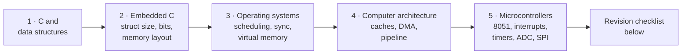

Texas Instruments (TI) hires software freshers mostly for **embedded software**: code that runs on TI's microcontrollers and processors. The written test and the interviews both stay close to the hardware, so TI checks C, data structures, OS, computer architecture and microcontrollers rather than LeetCode-hard problems.

This section follows TI's own topic list (the "Topics – for both written test and interview" slides from TI's *Preparation Tips – Embedded SW* deck). Each subject on the list has a page of its own with **theory from scratch first, then questions**. Every question has an answer toggle.

## At a glance

| | |
|---|---|
| **Role covered** | Embedded software: NCG (new college graduate, full-time) and intern |
| **Online test** | Aptitude (20 questions, 30 minutes) plus a technical section for the role: software (C, DS, OS, architecture, 8051/8085) or analog and digital electronics |
| **What TI says it looks for** | Strong basics, perseverance, sharpness, thoroughness |
| **Interviews** | Same topic list as the written test (TI's slide covers both) |
| **Books TI names** | K&R (*The C Programming Language*), Lyla B. Das (embedded / microprocessors), Tanenbaum and Stallings (OS, architecture) |
| **Papers the questions come from** | IIT BHU 2023, IISc 2023, IISc (second set), NIT Calicut 2023, BITS Pilani, IIT ISM 2024, and the four sample problems in TI's prep slides |
| **Time per section, cut-off, number of interview rounds** | *not stated* |

## TI's topic list, NCG vs intern

The slides split each subject by role. **Interns** get a lighter version of three subjects; the rest is the same for both.

| Subject | NCG (full-time) | Intern | Page |
|---|---|---|---|
| Basic C programming | Pointers, algorithms, stacks/queues; DS up to basic graphs: BST, hashing, linked lists | Same C; DS **only up to linked lists** | [1 · C and data structures](01-c-and-data-structures) |
| Embedded C | Struct size, bit manipulation, memory layout of a C program, `static` and `volatile`, compilation stages | Same | [2 · Embedded C](02-embedded-c) |
| Operating systems | Scheduling, multi-process synchronisation, virtual and physical memory | **Synchronisation only** | [3 · Operating systems](03-operating-systems) |
| Computer architecture | Caches, DMA, organisation, pipeline | **Not listed** | [4 · Computer architecture](04-computer-architecture) |
| Microcontroller | 8051 assembly, interrupts, DMA, timers, memories, ADC, DAC, GPIO, SPI | Same | [5 · Microcontrollers](05-microcontrollers) |

## How to study this section

Go in the order of the pages. Each one builds on the previous: C first, then C as it is used on hardware, then the OS that runs it, then the processor underneath, then the microcontroller that brings it together.

On each page:

1. Read the theory. It starts from zero and ends with a short "Remember" box.
2. Try every question **before** opening its toggle. For C questions, trace the code on paper first.
3. Re-read the "Remember" box on the morning of the test.

## Where the questions come from

Every question carries a label so you know how much to trust it:

| Label | Meaning |
|---|---|
| **TI · *paper*** | Asked in a real TI test (or one of the four sample problems in TI's own slides). Taken from the company-questions database. |
| ***Company* · *paper*** | Asked by another company (Qualcomm, MathWorks, NVIDIA, Cisco, Oracle) on a topic where the TI papers are thin. Same style, same level. |
| **Practice** | A standard question written for a topic on TI's list that no collected paper covers. C answers were compiled and run (gcc, x86-64); numeric answers were computed by script. |

Some TI keys circulated by candidates are wrong. Where the answer here differs from the candidate key, the toggle says so. *Unverified* in a toggle means the photo was blurred or the question is ambiguous, and the reasoning is given so you can judge.

## Pages


  
  
  
  
  


## Revision checklist (the night before)

Tick each line only if you can explain it aloud without notes.

**C and data structures**
- [ ] Pointer arithmetic moves by `sizeof(*p)`; `p - q` counts elements, not bytes
- [ ] `const int *p` vs `int *const p`; function pointer syntax `void (*fp)(int)`
- [ ] Reverse a linked list, detect a loop (Floyd), insert/delete in a circular list
- [ ] BST insert and the three traversals; hashing with linear probing; BFS vs DFS

**Embedded C**
- [ ] Struct size: each member at a multiple of its alignment, total a multiple of the largest alignment
- [ ] Set, clear, toggle, test bit `n`; `x & (x - 1)`; swap nibbles
- [ ] Text, rodata, data, bss, heap, stack: which variable lives where
- [ ] Three meanings of `static`; why a flag set in an ISR must be `volatile`
- [ ] Preprocess → compile → assemble → link, and which stage gives which error

**Operating systems**
- [ ] Gantt chart for FCFS, SJF, SRTF, RR; waiting time = turnaround − burst
- [ ] Semaphore wait/signal arithmetic; mutex vs semaphore; the four Coffman conditions
- [ ] Logical address → page number + offset; TLB effective access time; FIFO, LRU, OPT faults

**Computer architecture**
- [ ] Tag / index / offset split; AMAT = hit time + miss rate × miss penalty
- [ ] DMA steps and modes (burst, cycle stealing, transparent)
- [ ] Pipeline cycles = k + n − 1; RAW, WAR, WAW; forwarding and stalls

**Microcontrollers**
- [ ] 8051 memory map, register banks, PSW flags, the five interrupt vectors
- [ ] Timer reload value for a delay at 11.0592 MHz; TH1 for 9600 baud = FDh
- [ ] ADC step = Vref / 2n; SPI wires and modes; SPI vs I²C vs UART
