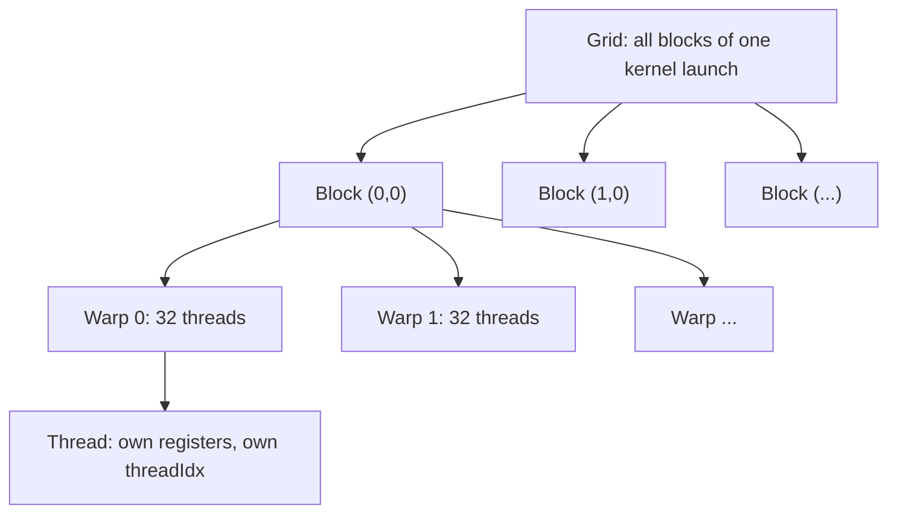

This page covers only the GPU ideas that the two projects actually use, in the order you need them. For each one: what it is, why it matters, and **where it shows up in the code**. If an interviewer asks about your projects, nearly every question is a disguised version of one item below.

Hardware figures here are <span style="color:#f7921d"><strong>[Rule of thumb]</strong></span> values for mainstream NVIDIA GPUs. Exact numbers differ by architecture, so say "typically".

## 1.1 CPU vs GPU in one paragraph

A CPU has a few powerful cores built to make **one thread fast** (big caches, branch prediction, out-of-order execution). A GPU has thousands of simple lanes built for **throughput**: it hides memory latency not with caches but by keeping *so many threads in flight* that while some wait for memory, others compute. A GPU wins when the work is (a) data-parallel, (b) large enough to fill the machine, and (c) arithmetic-heavy relative to the data moved over PCIe.

## 1.2 The execution hierarchy



| Level | What it is | Key facts |
|---|---|---|
| **Thread** | One instance of the kernel function | Has private registers; identified by `threadIdx` |
| **Warp** | 32 consecutive threads of a block | The real unit of execution (SIMT): all 32 run the same instruction together |
| **Block** | A group of up to 1024 threads | Runs on **one** streaming multiprocessor (SM); threads share **shared memory** and can `__syncthreads()` |
| **Grid** | All blocks of a launch | Blocks are **independent**: no ordering, no barrier between blocks inside one kernel |
| **SM** | A hardware multiprocessor | Holds several resident blocks at once if registers and shared memory allow |

Launch syntax: `kernel<<<grid, block, dynamicSharedBytes>>>(args)`. Global thread id for a 1-D launch:

```cpp
int i = blockIdx.x * blockDim.x + threadIdx.x;   // used in almost every MST kernel
if (i < n) { ... }                                // guard: the grid is rounded up to whole blocks
```

**Why the guard:** the number of threads is `ceil(n / block) * block`, so the last block has surplus threads. They must not touch memory beyond `n`.

**Where it shows up.** The MST kernels are all 1-D (`vblocks` for per-vertex kernels, `mblocks`/`eblocks` for per-edge kernels). The convolution uses a 3-D grid `(ceil(W/BX), ceil(H/BY), K)`: x and y tile the image, z selects the filter.


**Launch limits to remember.** Up to 1024 threads per block. `gridDim.x` can be huge (about 2³¹−1), but `gridDim.y` and `gridDim.z` are limited to **65535**. The convolution wrapper checks this and throws if `K > 65535` or the number of row tiles exceeds 65535 (`conv2d_gpu`).


## 1.3 SIMT, warps and divergence

All 32 threads of a warp execute one instruction at a time. If threads in the same warp take **different branches** (`if (x) A else B`), the hardware runs A with some lanes masked off, then B with the others masked off. That is **warp divergence**: the warp pays for both paths.

- Divergence only hurts *within* a warp. Different warps can branch differently for free.
- A bounds check like `if (i < n)` diverges only in the single boundary warp, so it is cheap.

**Where it shows up.** Very little, by design. `min_weight_kernel` has `if (cu != cv)`, but the edge list is compacted to crossing edges just before those kernels run, so the branch is effectively always taken (it is a safety guard). The only divergence of note is the bounds check in the last warp of each launch. <span style="color:#7c3aed"><strong>[Reasoned]</strong></span>

## 1.4 The memory hierarchy

Fast and tiny at the top, big and slow at the bottom.

| Memory | Scope | Size (typical) | Speed | Used here for |
|---|---|---|---|---|
| **Registers** | one thread | ~64K per SM | fastest | `acc` in the convolution, loop indices |
| **Shared memory** | one block | up to 48 KB static per block (more with opt-in) | ~register-like if no conflicts | convolution tile + filter slice; scan buffer |
| **L1 / L2 cache** | automatic | L1 per SM, L2 shared | fast / medium | why naive convolution is not slower than tiled at 3×3 |
| **Global memory** | whole grid, and the host via `cudaMemcpy` | GBs | hundreds of cycles latency | image, filters, edge lists, `comp`, `minW`, `minE` |
| **Constant memory** | whole grid, read-only | 64 KB | fast when all threads read the same address | not used yet (listed as a next step for filters) |

**The central rule of GPU performance:** most kernels are limited by *memory*, not arithmetic. So the game is to (a) read each byte from global memory as few times as possible, (b) read it in the right pattern, and (c) keep enough threads in flight to hide the latency.

## 1.5 Coalescing

When the 32 threads of a warp load from global memory, the hardware merges their requests into as few **memory transactions** (cache lines of 32 or 128 bytes) as it can. If thread `t` reads `base + t` (consecutive 4-byte words), the whole warp is served by one or two transactions. If threads read scattered or strided addresses, the same warp needs up to 32 transactions: up to 32× less effective bandwidth.

```text
Coalesced   : thread 0 -> a[0]   thread 1 -> a[1]   thread 2 -> a[2] ...   (1-2 transactions)
Strided x32 : thread 0 -> a[0]   thread 1 -> a[32]  thread 2 -> a[64] ...  (32 transactions)
```

This is why the **fast-varying thread index `threadIdx.x` should map to the fast-varying (contiguous) array index**.

**Where it shows up.**
- Convolution: the block is `32 × 8`, so `threadIdx.x` spans 32 = exactly one warp across a row. In the tile load, consecutive `tid` values read consecutive `img[...]` addresses along a row, and the output store `out[(k*H + y)*W + x]` is consecutive in `x`.
- MST: `eu[i]`, `ev[i]`, `ew[i]` are read by consecutive `i`, so those loads coalesce. But `comp[eu[i]]` is a **gather**: threads read `comp` at essentially random vertex ids, so it is *not* coalesced. That is inherent to graph algorithms. Say so if asked "what is the bottleneck of your MST?".

## 1.6 Shared memory, `__syncthreads()` and bank conflicts

**Shared memory** is an on-chip scratchpad that *you* manage. A block loads data into it once, then all its threads reuse it at near-register speed. It is the tool for **data reuse**.

`__syncthreads()` is a **barrier for the whole block**: no thread continues until all threads of the block have reached it, and all prior shared-memory writes are visible. Two classic rules:

1. You need a barrier between *writing* shared memory and *reading* what other threads wrote.
2. You need another barrier before *overwriting* a buffer that others may still be reading. The convolution has exactly this second barrier at the end of each channel iteration.


**Barrier divergence is undefined behaviour.** Every thread of the block must reach the same `__syncthreads()`. That is why `conv2d_tiled_kernel` does **not** `return` early for out-of-range threads: those threads still help load the tile and still hit the barriers; only the final compute and store are guarded by `if (x < W && y < H)`. The *naive* kernel can `return` early because it has no barrier.


**Banks.** Shared memory is split into **32 banks** (4-byte words, word `w` lives in bank `w mod 32`). The 32 threads of a warp can access it in one cycle if they hit **different banks**, or if they all read the **same word** (broadcast). Two threads hitting different words in the *same* bank cause a **bank conflict** and the accesses are serialised: an n-way conflict is n times slower.

**Where it shows up.**
- Convolution inner loop: `tile[(ty + r)*tileW + tx + s]` with `tx = threadIdx.x`, so a warp reads 32 consecutive words: all different banks, **no conflict**. `fs[r*S + s]` is the same address for every thread: **broadcast**, no conflict. <span style="color:#7c3aed"><strong>[Reasoned]</strong></span>
- Scan: the Blelloch sweeps access `s[idx]` and `s[idx - d]` with stride `2d` between active threads, which causes bank conflicts for larger `d` (stride 2 gives 2-way, stride 4 gives 4-way, up to 32-way). The standard fix is to pad the index (`idx += idx >> 5`) so that strided accesses spread over banks. This code does **not** do that: say it as a known improvement. <span style="color:#009b55"><strong>[Code]</strong></span>

## 1.7 Occupancy and latency hiding

**Occupancy** = resident warps on an SM ÷ the maximum the SM supports. An SM switches between resident warps every cycle at zero cost, so while one warp waits ~hundreds of cycles for global memory, another runs. More resident warps means better latency hiding.

Three resources limit how many blocks fit on an SM: **registers per thread**, **shared memory per block**, and **threads per block** (plus a hard cap on blocks per SM).

- Higher occupancy is *not* always faster. A kernel with plenty of independent instructions per thread can saturate the machine at low occupancy.
- The tiled convolution uses about 1.4 KB of shared memory per block at 3×3 (see [2a](../02-2d-convolution/)), so shared memory is not what limits occupancy there. Large filters change that.

## 1.8 Arithmetic intensity, memory-bound vs compute-bound

**Arithmetic intensity** = useful operations per byte moved from global memory. A kernel below the device's "ridge point" is **memory-bound** (speed set by bandwidth), above it **compute-bound**.

- Convolution has intensity that grows with the filter size (`R·S·C` multiply-adds per output pixel), which is why shared-memory reuse *should* help more for big filters.
- The MST kernels do very little arithmetic per byte (mostly compares and atomics on gathered data), so they are firmly **memory/latency-bound**.

Related and just as important for these programs: **PCIe transfers**. Copying data between host and device is far slower than device memory bandwidth. Both benchmarks time the *whole* call including `cudaMalloc` and both copies, so transfer cost is inside the number (see [2c](../04-testing-and-results/)).

## 1.9 Atomics

An **atomic** operation (`atomicMin`, `atomicAdd`, `atomicCAS` …) does a read-modify-write on one address as an indivisible step, so concurrent threads cannot lose updates. Costs: atomics on the **same address** from many threads are **serialised** (contention); atomics on different addresses proceed in parallel.

**Where it shows up (all in `boruvka.cuh`).**
- `min_weight_kernel`: `atomicMin(&minW[comp], weight)` on 64-bit values. Thread = edge, many edges hit the same component.
- `min_edge_kernel`: `atomicMin(&minE[comp], i)` to break ties by smallest edge index.
- `break_cycles_kernel`: `atomicAdd(total, w)` and `atomicAdd(count, 1)`: a **global counter** that *every* contributing component hits. A cheap-looking but contended pattern; a block-level reduction first would be better. <span style="color:#7c3aed"><strong>[Reasoned]</strong></span>

64-bit `atomicMin` on `unsigned long long` needs compute capability 3.5 or higher, which any GPU you would meet today has.

## 1.10 Parallel primitives you must be able to explain

### Reduction
Combine `n` values into one with an associative operator in `O(log n)` steps by pairing up elements in a tree. The *up-sweep* of the scan is a reduction.

### Prefix sum (scan)
`out[i] = in[0] + … + in[i-1]` (**exclusive**) or including `in[i]` (**inclusive**). It looks sequential but is parallelisable and is the basic tool for turning "which elements survive" into "where do they go".

| Algorithm | Work | Steps | Note |
|---|---|---|---|
| Sequential | `O(n)` | `O(n)` | |
| Hillis-Steele | `O(n log n)` | `O(log n)` | simple, but does extra work |
| **Blelloch** (this repo) | **`O(n)`** | `O(log n)` | work-efficient; an up-sweep then a down-sweep |

A scan over more elements than one block holds: scan each block, scan the **block totals** (recursively), then add each block's offset back. `exclusive_scan` in `scan.cuh` does exactly this and calls itself on the block sums, so `n` is unlimited.

Worked Blelloch trace on 8 elements is in [2b](../03-boruvka-mst/#the-blelloch-scan).

### Stream compaction
Keep only elements satisfying a predicate, preserving order. Recipe: **flag** (0/1) → **exclusive scan** of flags (gives each kept element its output slot) → **scatter**. Used every round in the MST to drop edges that became internal to a component.

### Pointer jumping
Given `next[]` forming trees, replace `next[i]` by `next[next[i]]` repeatedly. Every pointer path **halves** each step, so any tree flattens so that all nodes point at the root in `O(log depth)` steps. Needs **double buffering** (read array A, write array B, swap) so no thread reads a value another thread has already overwritten in the same step. This is `pointer_jump_kernel`.

## 1.11 Race conditions and memory visibility

A **race** is two threads accessing the same location, at least one writing, with no ordering between them. Common GPU sources: missing `__syncthreads()`, two threads writing the same global word, or reading a value another thread is updating in the same kernel. Remedies: barriers, atomics, double buffering, or restructuring so each thread owns its output.

Blocks cannot synchronise inside a kernel. When one phase needs *all* results of the previous phase (e.g. all `minW` values before choosing edges), the standard solution is **separate kernel launches**: kernel boundaries on the same stream are global barriers. That is exactly why the MST round is split into many small kernels.

## 1.12 Host/device model, errors and tools

- **Host** = CPU code, **device** = GPU. Device memory is separate: `cudaMalloc`, `cudaMemcpy` (H2D / D2H), `cudaFree`.
- **Kernel launches are asynchronous** with respect to the host. `cudaMemcpy` (the non-async form) and `cudaDeviceSynchronize()` wait.
- **Errors are asynchronous too.** A launch can "succeed" and the kernel fail later. Check `cudaGetLastError()` right after a launch (launch errors) and the status of the next synchronising call (execution errors). The repo does both: `CUDA_CHECK(cudaGetLastError())` after launches and `sync_and_check()` at the end.
- **RAII** wrapper `DevBuf<T>` frees device memory in its destructor, so an exception thrown mid-algorithm cannot leak (`cuda_check.h`).
- **Tools.** `nvcc` (compiler), `compute-sanitizer` (`memcheck` out-of-bounds/leaks, `racecheck` shared-memory races, `synccheck` bad barriers, `initcheck` uninitialised reads), `cuda-gdb`, Nsight Compute (per-kernel metrics: occupancy, bandwidth, bank conflicts), Nsight Systems (timeline: kernels vs copies).

## 1.13 Quick glossary

| Term | One-line meaning |
|---|---|
| SIMT | Single Instruction, Multiple Threads: the warp executes in lock-step |
| Warp | 32 threads executed together |
| SM | Streaming multiprocessor, runs blocks |
| Halo / ghost cells | Extra border cells a tile loads from its neighbours so edge outputs can be computed |
| Coalescing | Merging a warp's global accesses into few transactions |
| Bank conflict | Several threads of a warp hitting the same shared-memory bank |
| Occupancy | Resident warps ÷ maximum warps per SM |
| Arithmetic intensity | Operations per byte of global traffic |
| Stream compaction | Filter while preserving order, via flag + scan + scatter |
| Pointer jumping | `next[i] = next[next[i]]` to flatten trees in log steps |
| Double buffering | Read one array, write another, swap, to avoid read-after-overwrite races |

## Check yourself



1. Why is `if (i < n)` needed in a 1-D kernel?
2. Two threads of one warp take different sides of an `if`. What happens, and when does it matter?
3. Why must `threadIdx.x` map to the contiguous array index?
4. What is wrong with an early `return` before a `__syncthreads()`?
5. A warp reads `s[2*t]` from shared memory. What goes wrong and what is the fix?
6. Why does a kernel's work have to be split across several launches when phase 2 needs every result of phase 1?
7. What are the three steps of stream compaction?





1. The launch is rounded up to whole blocks, so surplus threads exist and must not read or write past the end.
2. The warp runs both paths one after the other with inactive lanes masked. It only costs when the divergence is *inside* a warp.
3. So the 32 threads of a warp touch 32 consecutive addresses and the hardware coalesces them into one or two transactions.
4. If only some threads of a block reach the barrier the behaviour is undefined (deadlock or wrong results). All threads must reach the same barrier, so guard the work, not the barrier.
5. Stride 2 gives a 2-way bank conflict (threads t and t+16 share a bank), so accesses are serialised. Fix: pad indices or change the access pattern.
6. Blocks cannot synchronise with each other inside a kernel; the boundary between two kernel launches on one stream is the global barrier.
7. Flag survivors with 0/1, run an exclusive scan on the flags to get output positions, scatter each survivor to its position.



## Remember

- Warp = 32 threads in lock-step; block = up to 1024 threads sharing shared memory and barriers; blocks are independent.
- Performance is mostly memory: coalesce, reuse through shared memory, hide latency with many warps.
- Barriers must be reached by every thread of the block; between blocks, use a new kernel launch.
- Scan + scatter is how you filter in parallel; pointer jumping flattens trees in `O(log n)`; atomics fix races but serialise on hot addresses.
