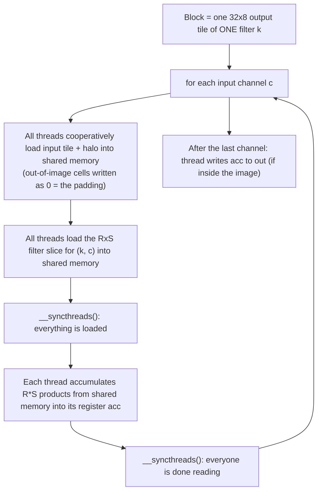

Source: `2d-convolution/conv2d.cuh` (kernels and host wrapper), `main.cu` (stdin/stdout driver), `test.cu` (tests). Evidence labels are explained on the [section landing page](../).

## What it computes

Input: an image of `C` channels, each `H × W`, and `K` filters, each of shape `C × R × S` (`R`, `S` odd). Output: `K` maps, each `H × W`.

$$
\text{out}[k][y][x] = \sum_{c=0}^{C-1}\sum_{r=0}^{R-1}\sum_{s=0}^{S-1} \text{img}\bigl[c\bigr]\bigl[y + r - \lfloor R/2\rfloor\bigr]\bigl[x + s - \lfloor S/2\rfloor\bigr]\cdot \text{flt}[k][c][r][s]
$$

- **Zero padding**: any pixel outside the image counts as 0, so the output has the same `H × W` as the input.
- **Stride 1**, filter centre aligned with each output pixel.
- It is **cross-correlation**: the filter is **not flipped**. This is what deep-learning frameworks call "convolution". A mathematical convolution would flip the filter first.
- Types: image and filter values are `int` (32-bit), the accumulator and output are `long long` (64-bit), so large sums cannot overflow.

### Worked example

1 channel, 3×3 image, one 3×3 filter of all ones (a box sum). `samples/conv2d_ex1.in`:

```text
image            output (sum of the 3x3 neighbourhood, zeros outside)
1 2 3            12 21 16
4 5 6      ->    27 45 33
7 8 9            24 39 28
```

Corner `12 = 1+2+4+5` (only four real pixels, the rest is padding). Centre `45 = 1+…+9`. Edge `21 = 1+2+3+4+5+6`.

Input file format (`main.cu`): line `H W C`; then `H·C` rows of `W` numbers (channels stacked); then a line `C R S K`; then `K·C·R` rows of `S` numbers; the output is `K·H` rows of `W` numbers.

## Data layout

Everything is a flat array in row-major order with the channel as the slowest axis.

| Array | Index | Shape |
|---|---|---|
| `img` | `(c*H + y)*W + x` | `C × H × W` |
| `flt` | `((k*C + c)*R + r)*S + s` | `K × C × R × S` |
| `out` | `(k*H + y)*W + x` | `K × H × W` |

Index arithmetic is done in `long long` where it could exceed 2³¹ (`(long long)c * H + gy`), a detail worth pointing out.

## Why a plain kernel is wasteful

One thread per output pixel reading everything from global memory (this is `conv2d_naive_kernel`) reads each input pixel up to `R·S` times, once per neighbouring output. The data is the same, only the access repeats. **Tiling** loads each pixel into fast shared memory once per block and lets the block's threads reuse it.

## The tiled kernel, step by step

`conv2d_tiled_kernel`, launched with block `32 × 8` (= 256 threads = 8 warps) and grid `(ceil(W/32), ceil(H/8), K)`.



1. **Mapping.** `blockIdx.z` = filter `k`. `(blockIdx.x, blockIdx.y)` pick the tile, `(threadIdx.x, threadIdx.y)` the pixel inside it. Thread `(x, y)` owns output `(k, y, x)` for its whole life and keeps the running sum in a register (`acc`).
2. **Shared memory layout.** One dynamic buffer, split in two: `tile` of size `tileH × tileW` where `tileH = blockDim.y + R − 1` and `tileW = blockDim.x + S − 1`, followed by `fs` of size `R × S`.
3. **The halo.** To compute a `32 × 8` tile of outputs you need inputs from `R/2` rows above and below and `S/2` columns left and right: an input region of `(8+R−1) × (32+S−1)`. The extra border is the **halo** (ghost cells). Without it, threads at the tile edge would have no neighbours.
4. **Cooperative load.** There are more tile cells (e.g. 340 for 3×3) than threads (256), so each thread loops `for (idx = tid; idx < tileH*tileW; idx += nthr)`. Consecutive `tid` read consecutive addresses along a row: **coalesced**. A cell with global coordinates outside `[0,H)×[0,W)` is stored as **0**, which implements the zero padding with no special case in the compute loop.
5. **Barrier #1** after the loads, so no thread reads a cell another thread has not written yet.
6. **Compute.** `acc += tile[(ty + r)*tileW + tx + s] * fs[r*S + s]` for all `r, s`, cast to `long long` before multiplying.
7. **Barrier #2** before the next channel overwrites `tile` and `fs`. Forgetting it is a classic race: a fast thread would start loading channel `c+1` while a slow one is still reading channel `c`.
8. **Store.** Only threads with `x < W && y < H` write; the others only helped load.

### Shared memory budget

$$
\text{bytes} = \bigl((BY + R - 1)(BX + S - 1) + R\cdot S\bigr)\cdot 4
$$

For the default 32×8 tile and a 3×3 filter: `(10 × 34 + 9) × 4 = 1396` bytes. <span style="color:#7c3aed"><strong>[Reasoned]</strong></span>

`kMaxStaticSharedBytes` is 48 KB. In `Auto` mode, if `conv2d_tiled_smem_bytes(R, S)` exceeds it, the host falls back to the naive kernel; forcing `Tiled` in that case throws. With the default tile the largest odd square filter that fits is **67 × 67** (68 is even; 69 needs 12 361 ints > 12 288). <span style="color:#7c3aed"><strong>[Reasoned]</strong></span>

### The three execution modes

| `ConvMode` | Behaviour |
|---|---|
| `Auto` | Tiled if it fits in 48 KB, else naive. Reports which one ran via `used_tiled`. |
| `Tiled` | Force tiled; throws if it does not fit |
| `Naive` | Force the global-memory kernel; also the **second implementation used to cross-check** the tiled one in tests |

## Costs, by reasoning

For 3×3, per channel, per 32×8 tile (256 outputs): <span style="color:#7c3aed"><strong>[Reasoned]</strong></span>

| | Naive | Tiled |
|---|---|---|
| Global reads of input | up to `256 × 9 = 2304` (before caches) | `340` (tile + halo) |
| Halo overhead | none | `340 / 256 ≈ 1.33` loads per output |
| Multiply-adds | 2304 | 2304 (same) |

Halo overhead per output is `(BX+S−1)(BY+R−1) / (BX·BY)`. It shrinks with a larger tile and grows with a larger filter, which is the tile-size trade-off: a bigger tile means less halo but more shared memory per block (lower occupancy).

## What the measurement showed

<span style="color:#0071bc"><strong>[Measured]</strong></span> 1024 × 1024 × 3 image, 8 filters of 3×3, one run, time includes `cudaMalloc` and both copies:

| Version | Time |
|---|---|
| CPU reference | 729 ms |
| GPU tiled | 54.7 ms |
| GPU naive | 54.3 ms |

**The tiled kernel gave no gain.** The honest explanation, from the repo notes, is that for a 3×3 filter neighbouring reads are already served by the L1/L2 caches, and the wall time is dominated by moving the `int64` output (8 maps × 1 M pixels × 8 bytes ≈ 67 MB) back to the host. <span style="color:#7c3aed"><strong>[Reasoned]</strong></span>: this is the likely cause but it was **not profiled**. A profiler run (Nsight Systems for copy vs kernel time, Nsight Compute for DRAM traffic) would confirm it. Larger filters are where tiling should pay off, and that was not measured. See [2c](../04-testing-and-results/).

## Known limits and next steps

State these as things you know, not things already done.

- **Redundant loads across filters.** Each of the `K` blocks along `z` reloads the same input tile for its own filter. Better: one block computes several filters from one staged tile.
- **Filter staged per channel per block** although it is tiny; for small filters it could live in `__constant__` memory (broadcast reads, no staging).
- **No register tiling** (each thread computing a small patch of outputs to reuse loaded values) and **no vectorised loads** (`int4`).
- **`int` image with `long long` output** doubles the output traffic; at this size the copy dominates the run.
- **Integer division and modulo** in the tile-load index (`idx / tileW`, `idx % tileW`) inside the channel loop: minor but real.
- **Not implemented**: stride, dilation, non-zero padding, batching, FFT or Winograd/im2col+GEMM approaches. Real libraries (cuDNN) use the latter; mention that convolution is usually turned into a matrix multiplication on tensor cores.

## Check yourself



1. Why does the tiled kernel keep all threads alive even when `x >= W`?
2. What does the `0` written into the halo implement?
3. Compute the shared-memory bytes for a 5×5 filter with the default tile.
4. Where are the two barriers and what race does each prevent?
5. Why is `threadIdx.x` the 32-wide axis?
6. Why is tiled ≈ naive in your measurement, and how would you find out for sure?





1. They are needed to help load the tile and must reach every `__syncthreads()`; only the compute and store are guarded.
2. The zero padding: cells outside the image contribute 0 to the sum.
3. `(8+4)·(32+4) + 25 = 12·36 + 25 = 457` ints = 1828 bytes.
4. After loads (so nobody reads unloaded cells) and after compute (so nobody overwrites cells others still read in the next channel iteration).
5. A warp is 32 threads; giving it 32 consecutive `x` positions makes its loads and stores contiguous, hence coalesced.
6. Small filters are cache-friendly and the int64 output copy dominates. Confirm with Nsight Systems (kernel vs memcpy time) and Nsight Compute (global-memory traffic of each kernel), and try a 7×7 or 15×15 filter.



## Remember

- Tile + halo into shared memory, barrier, compute from shared memory, barrier, next channel.
- Zero in the halo **is** the padding; all threads reach the barriers.
- Halo cost is `(BX+S−1)(BY+R−1)` loads for `BX·BY` outputs.
- Measured: tiling did **not** help at 3×3; know why, and say it before being asked.
