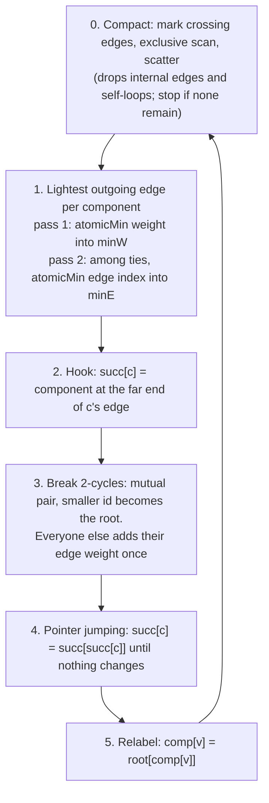

Source: `boruvka-mst/boruvka.cuh` (all MST kernels and the host loop), `scan.cuh` (prefix sum), `main.cu` (driver), `test.cu` (tests). Evidence labels are explained on the [section landing page](../).

## The problem

A road network with `V` junctions and `E` roads. Each road has a base cost and a terrain type. Find the **minimum total cost** set of roads connecting everything (a minimum spanning tree; a *forest* if the graph is disconnected).

Terrain multiplies the base cost: `green × 2`, `traffic × 5`, `dept × 3`, anything else `× 1`. The answer is the total adjusted cost **modulo 10⁹+7**, applied only at the very end. Edges are compared by their exact adjusted cost, using 64-bit integers (base costs up to about 10⁹ times 5 do not fit in 32 bits).

Input (`main.cu`): `V E`, then `E` lines `u v wt type`. Output: one number.

### Worked example (`samples/mst_sample.in`, answer 14)

| Edge | u–v | base | terrain | adjusted |
|---|---|---|---|---|
| e0 | 0–1 | 3 | green ×2 | 6 |
| e1 | 0–2 | 2 | traffic ×5 | 10 |
| e2 | 1–2 | 1 | normal ×1 | 1 |
| e3 | 1–3 | 4 | dept ×3 | 12 |
| e4 | 2–3 | 2 | green ×2 | 4 |
| e5 | 2–4 | 5 | traffic ×5 | 25 |
| e6 | 3–4 | 3 | normal ×1 | 3 |

MST picks e2 (1), e6 (3), e4 (4), e0 (6): total **14** with `V−1 = 4` edges. A hand trace of the GPU algorithm on this graph is [further down](#a-hand-trace-on-the-sample).

## Why Borůvka for a GPU

| Algorithm | Idea | GPU fit |
|---|---|---|
| **Kruskal** | Sort edges, add the lightest that joins two components (union-find) | Poor: each decision depends on all earlier ones |
| **Prim** | Grow one tree one edge at a time | Poor: one frontier, one edge at a time |
| **Borůvka** | **Every component simultaneously** picks its lightest outgoing edge; merge; repeat | **Good**: each round is data-parallel over components and edges, and takes at most `⌈log₂ V⌉` rounds |

Why at most `⌈log₂ V⌉` rounds: every component that still has an outgoing edge attaches to another one, so every group in the merged result contains at least two old components. The number of active components at least halves each round. <strong>[Reasoned]</strong>

## Data structures

| Array | Size | Meaning |
|---|---|---|
| `eu`, `ev`, `ew` | `E` (shrinks) | The edge list: endpoints and adjusted weight (`u64`). Double-buffered with `eu2`, `ev2`, `ew2` |
| `comp[v]` | `V` | Component label of vertex `v`, always the **root vertex id** of its component |
| `minW[c]` | `V` | Lightest outgoing weight seen for component `c` this round |
| `minE[c]` | `V` | Index of the chosen edge for component `c` |
| `succ`, `succ2` | `V` | The "hook" graph: component `c` points to the component at the other end of its chosen edge |
| `keep`, `pos` | `E` | Compaction flag and scan output |
| `d_total`, `d_count` | 1 | Running MST weight and edge count (atomics) |

The graph is an **edge list**, not an adjacency list (CSR). That makes per-edge kernels trivial to launch and balanced across threads, at the price of no direct neighbour access.

## One round, step by step

Each box is one or more kernel launches. They are separate launches on purpose: the next step needs **every** result of the previous one, and the only global barrier inside a GPU program is a kernel boundary ([1.11](../01-gpu-concepts/#111-race-conditions-and-memory-visibility)).

### Step 1: lightest outgoing edge (`min_weight_kernel`, `min_edge_kernel`)

One thread per edge. For edge `i` joining components `cu` and `cv` (they differ, since the list was just compacted) the edge is a candidate for **both** endpoints.

- **Pass 1**: `atomicMin(&minW[cu], w)` and `atomicMin(&minW[cv], w)`. After this, `minW[c]` is the lightest outgoing weight.
- **Pass 2**: `if (w == minW[cu]) atomicMin(&minE[cu], i)` (same for `cv`). Among edges that tie on weight, the **smallest index** wins.

Two passes are used instead of packing `(weight, index)` into one 64-bit key because adjusted weights can need more than 32 bits, so a packed key would overflow. <strong>[Code]</strong> comment plus the test with weights up to 5·10⁹.

### Step 2 and 3: hooking and cycle breaking (`pick_successor_kernel`, `break_cycles_kernel`)

`succ[c]` is the component at the other end of `c`'s chosen edge, or `c` itself if it has none. Think of this as a graph with one outgoing arrow per component.

If `c` points to `d` and `d` points back to `c`, they chose the **same edge** (a 2-cycle). The smaller id becomes the root (`succ2[c] = c`) and **only the other one pays** for the edge, so the edge weight is counted exactly once (`atomicAdd` into `total` and `count`). Every other component adds its own chosen edge's weight.

### Step 4: pointer jumping (`pointer_jump_kernel`)

After step 3 the hook graph is a forest of trees whose roots point to themselves. Repeating `out[c] = in[in[c]]` doubles the jump length each time, so all nodes reach the root in `O(log depth)` iterations. The kernel reads array `in` and writes array `out` (swapped each iteration) so no thread reads a half-updated entry, and raises a flag if anything changed. The host reads the flag each iteration to decide whether to stop.

### Step 5: relabel (`relabel_kernel`)

`comp[v] = root[comp[v]]`: each vertex now carries the root id of its merged component.

### Step 0 (at the start of the next round): compaction

Mark `keep[i] = (comp[eu[i]] != comp[ev[i]])`, exclusive-scan `keep` to `pos`, scatter kept edges to `pos[i]`, swap buffers. Number of survivors is `pos[m−1] + keep[m−1]` (read back with two small `cudaMemcpy`). If it is 0, the algorithm ends. Order is preserved, so the edge-index tie-break stays consistent.

## Why ties would break it, and why the total order fixes it

If two edges have equal weight, three components `A, B, C` in a triangle with all edges equal could each pick a **different** edge: `A→B`, `B→C`, `C→A`. That is a cycle of length 3 in the hook graph, no root exists, and pointer jumping never terminates sensibly.

Fix: compare edges by the pair `(weight, index)`, which is a **strict total order** (no two distinct edges are equal). Then:

- Let `e_c` be the edge chosen by `c`, and `d = succ(c)`. Edge `e_c` is also an outgoing edge of `d`, so `d`'s choice satisfies `key(e_d) ≤ key(e_c)`.
- So along any path `c → succ(c) → …` the chosen keys are **non-increasing**.
- A cycle would need all its keys equal, which under a strict order means **the same edge**, and one edge connects exactly two components. Hence the only possible cycles have length 2.

<strong>[Reasoned]</strong> This is the argument to give at a whiteboard. (The repo README phrases it as "strictly decrease"; the careful version is "non-increasing, and a cycle forces equality".)

The tests include a weight mode with only the values 1 to 3, giving enormous numbers of ties, plus a mutation check in which the tie-break is made inconsistent and the tests catch it ([2c](../04-testing-and-results/)).

## The Blelloch scan

`exclusive_scan(d_in, d_out, n)` in `scan.cuh`. It is used for compaction, and is the clearest example of a work-efficient parallel primitive.

**Per block (`scan_block_kernel`)**, `BLOCK` elements in shared memory, one per thread:

1. **Up-sweep (reduce):** for `d = 1, 2, 4, …`: thread `t` with `idx = (t+1)·2d − 1 < BLOCK` does `s[idx] += s[idx − d]`. After the loop `s[BLOCK−1]` is the block total.
2. Thread 0 saves the total into `block_sums[blockIdx.x]` and sets `s[BLOCK−1] = 0` (the identity, to make the scan **exclusive**).
3. **Down-sweep:** for `d = BLOCK/2, …, 1`: with the same `idx`, `left = s[idx−d]; s[idx−d] = s[idx]; s[idx] += left`.
4. Write `s[t]` to the output.

**Across blocks:** recursively `exclusive_scan(block_sums, block_sums, blocks)` when there is more than one block, then `scan_add_offsets_kernel` adds each block's scanned total to its elements (block 0 needs none). For `n = 1.2 M` and `BLOCK = 256` that is 4 688 blocks → 19 → 1: three levels. <strong>[Reasoned]</strong>

### Trace on 8 elements

Input `[3, 1, 7, 0, 4, 1, 6, 3]`, `BLOCK = 8`.

| Phase | `d` | Array after |
|---|---|---|
| start | | `[3, 1, 7, 0, 4, 1, 6, 3]` |
| up-sweep | 1 | `[3, 4, 7, 7, 4, 5, 6, 9]` |
| up-sweep | 2 | `[3, 4, 7, 11, 4, 5, 6, 14]` |
| up-sweep | 4 | `[3, 4, 7, 11, 4, 5, 6, 25]`, total = 25 |
| set root to 0 | | `[3, 4, 7, 11, 4, 5, 6, 0]` |
| down-sweep | 4 | `[3, 4, 7, 0, 4, 5, 6, 11]` |
| down-sweep | 2 | `[3, 0, 7, 4, 4, 11, 6, 16]` |
| down-sweep | 1 | `[0, 3, 4, 11, 11, 15, 16, 22]` |

The last row is the exclusive prefix sum. (Hand-computed to confirm the kernel's indexing; the repo's tests check the kernel against a sequential scan.)

**Costs.** `O(n)` total additions (vs `O(n log n)` for Hillis-Steele), `2 log BLOCK` barrier steps per block. **Known weakness:** strided shared-memory access causes bank conflicts for the larger `d`; the usual fix is index padding, not implemented here.

## A hand trace on the sample

Edges (index: endpoints, adjusted): e0 (0,1,6), e1 (0,2,10), e2 (1,2,1), e3 (1,3,12), e4 (2,3,4), e5 (2,4,25), e6 (3,4,3). Initially `comp[v] = v`.

**Round 1.** All 7 edges cross components, so compaction keeps all of them.

| Component | Candidate edges (weight) | Chosen `minE` | `succ` |
|---|---|---|---|
| 0 | e0 (6), e1 (10) | e0 | 1 |
| 1 | e0 (6), e2 (1), e3 (12) | e2 | 2 |
| 2 | e1 (10), e2 (1), e4 (4), e5 (25) | e2 | 1 |
| 3 | e3 (12), e4 (4), e6 (3) | e6 | 4 |
| 4 | e5 (25), e6 (3) | e6 | 3 |

Cycle breaking: 1↔2 mutual → root = 1; component 2 pays e2 (1). 3↔4 mutual → root = 3; component 4 pays e6 (3). Component 0 pays e0 (6). Running total **10**, 3 edges. Pointer jumping finds nothing to change. Relabel: `comp = [1, 1, 1, 3, 3]`.

**Round 2.** Compaction keeps only edges between components 1 and 3: e3 (12), e4 (4), e5 (25), renumbered 0, 1, 2. Component 1 picks weight 4, component 3 picks weight 4, the same edge: mutual, root = 1, component 3 pays **4**. Total **14**, 4 edges.

**Next compaction:** no crossing edge is left → stop. Two rounds were counted.

Answer 14 with `V − 1 = 4` edges, so the graph is connected.

## Design choices you should be able to defend

| Choice | Reason |
|---|---|
| Total order `(weight, index)` | Guarantees only 2-cycles; without it the hook graph can have longer cycles |
| Two atomic passes, not a packed key | Weights can exceed 32 bits so a packed 64-bit key would overflow |
| 64-bit sums, `mod` once at the end | Edges must be compared by true cost; modding early would corrupt comparisons |
| `O(1)` 2-cycle test (`succ[succ[c]] == c`) | No `O(V²)` search for a mirror edge |
| Recursive scan | No cap on `n` (a single-block scan of block sums would cap it near `BLOCK²` elements) |
| Double-buffered pointer jumping | No thread reads a value that another is overwriting in the same step |
| Edge compaction every round | Later rounds touch fewer edges |
| RAII `DevBuf` | Exceptions cannot leak device memory |

## Known limits (be upfront)

- **Atomic contention** on hot components: a hub with a huge number of incident edges makes many threads `atomicMin` the same word. Alternatives: sort edges by component and do a **segmented min-reduce**, or reduce within a warp or block first.
- **`minW`/`minE`/`succ` are `O(V)` every round** even when few components remain; no compaction of vertices.
- **Host synchronisation each iteration**: the compaction count (two `cudaMemcpy`) and the pointer-jumping flag are read on the host every time. That forces a wait per iteration and adds launch/latency overhead. Alternatives: do a fixed `⌈log₂ V⌉` jumps with no check, keep counts on the device, use CUDA graphs or dynamic parallelism.
- **Edge-list representation, not CSR.** Fine for this algorithm; not what you would use for traversal-heavy ones (BFS).
- **`break_cycles_kernel` uses global `atomicAdd` for total and count.** A block-level reduction first would cut contention. <strong>[Reasoned]</strong>
- **Disconnected graph**: gives a minimum spanning *forest* (`edges < V−1`); `main.cu` prints a warning to stderr.
- Not done: weak or negative weights (negative base cost is rejected), multi-GPU, graphs that do not fit in device memory.

## Check yourself



1. Why can Kruskal not be parallelised the same way?
2. What is `minE` used for and why a second pass?
3. Show a case where equal weights would create a 3-cycle.
4. Why is it safe to count the weight only for the component with the larger id in a mutual pair?
5. Run an exclusive scan on `[2, 1, 3]`.
6. How many rounds can a graph with 1 000 000 vertices need at most?
7. Where does the host talk to the device inside the loop, and why is that a cost?





1. Kruskal's decision for edge `i` depends on all lighter edges having been processed (union-find state), so it is inherently sequential.
2. `minE[c]` is the *index* of the chosen edge; the second pass breaks weight ties by smallest index so `(weight, index)` is a strict total order.
3. Triangle `A, B, C` with all three edges weight 1: `A` picks `AB`, `B` picks `BC`, `C` picks `CA`.
4. In a mutual pair both chose the same edge; exactly one of them must pay for it, and the rule "the non-root pays" chooses one deterministically.
5. `[0, 2, 3]`.
6. At most `⌈log₂ 10⁶⌉ = 20`.
7. After `exclusive_scan` (two `cudaMemcpy` for the survivor count) and after every pointer-jump iteration (flag read). Each forces a device-to-host wait and prevents the GPU from running ahead.



## Remember

- Each round: lightest edge per component → hook → break mutual pairs → pointer-jump to roots → relabel → compact with scan.
- `(weight, index)` is a strict total order, so the only cycles are mutual pairs.
- At most `⌈log₂ V⌉` rounds; compaction makes later rounds cheaper.
- Weaknesses: atomic contention, `O(V)` arrays per round, host syncs. Know them before the interviewer does.
