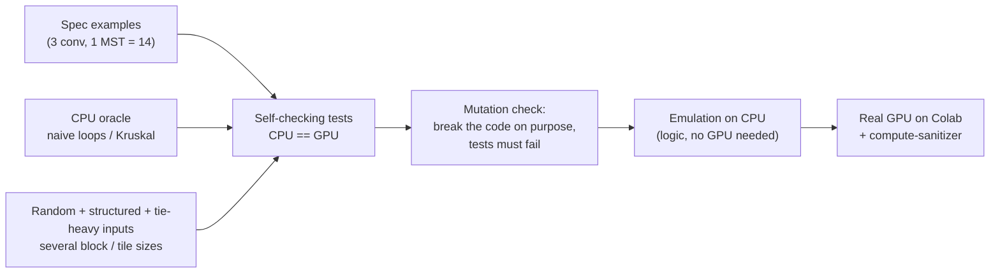

"How do you know it is correct?" and "what does the benchmark prove?" are the two follow-ups an interviewer is most likely to push on. This page gives the full answer, using only what the repository records. Evidence labels are explained on the [section landing page](../).

## The testing strategy in one picture



## 1. Independent oracles

A test is only as good as its reference.

| Project | Oracle | Why it is independent |
|---|---|---|
| Convolution | `conv_ref` in `test.cu`: the textbook definition as six nested loops with an explicit bounds check, **no tiling, no shared memory** | Different code path from both GPU kernels; the naive GPU kernel is also compared, so there are three implementations |
| MST | `kruskal` in `test.cu`: sort edges (stable, same weights) + union-find | A different algorithm entirely. Compares **total weight and edge count** |
| Scan | A sequential running sum | Trivially correct |

Comparing the edge count as well as the weight matters for disconnected inputs: it checks that the result is a forest of the right size, not just a right-looking number.

## 2. What the inputs cover

**Convolution** (`test.cu`)
- The three worked examples from the problem statement (one with negative filter weights and 2 channels, one with 2 filters).
- Random shapes sized around the tile (`H` up to `3·BY+5`, `W` up to `3·BX+5`) so partial tiles occur on every side; `C, K` from 1 to 3; filter sides `1, 3, 5, 7`.
- A filter **larger than the image** (all padding), a `1×1` image, `1×1` filter, `1×40` and `40×1` degenerate images.
- A filter so tall that tile + halo exceeds 48 KB, to confirm `Auto` falls back to the naive kernel.
- Every case is run through `Auto` (tiled when it fits) and `Naive` and compared to the oracle.

**MST and scan** (`test.cu`)
- Scan sizes `1, 2, 3, BLOCK−1, BLOCK, BLOCK+1, 2·BLOCK, BLOCK²−1, BLOCK², BLOCK²+1, 3·BLOCK²+17, 5000, 100000`, which exercise the **recursive** multi-level scan; each both out-of-place and in place.
- Structured graphs: single vertex, no edges, only self-loops, paths (many rounds), stars (one high-degree hub, atomic contention), "all-equal weights" graphs (worst case for ties), a complete graph with equal weights, two disjoint cliques (forest of 8 edges), plus the sample answering 14.
- Random graphs including self-loops and parallel edges, in three weight modes: only values 1 to 3 (massive ties), 1 to 1000, and up to about 5·10⁹ (needs 64-bit).

## 3. Different block and tile sizes

The same tests are rebuilt and re-run with different `-DBLOCK` and `-DCONV_BX/BY`. Bugs often hide at one shape, such as the partial last block or a tile that does not divide the image.

| Where | MST/scan `BLOCK` | Conv tile |
|---|---|---|
| Emulation (`emu_test.sh`) | 4, 32, 64 | 8×4, 5×3, 1×1, 16×2 |
| Real GPU (`colab_verify.sh`) | 32, 128, 256, 1024 | 32×8, 16×16, 8×4 |

`BLOCK = 4` in emulation deliberately forces many levels of recursion in the scan.

## 4. Mutation testing: testing the tests

A passing test suite does not prove it can fail. The repository records that these deliberately seeded bugs **are caught** (recorded in the repository README as "yes"; the individual runs are not logged there):

- broken zero padding in the convolution;
- a missing `__syncthreads()`;
- dropped scan offsets;
- no 2-cycle breaking in Borůvka;
- an inconsistent tie-break.

This is a strong answer to "how do you know the tests are any good?".

## 5. Emulating CUDA on a CPU

There was no GPU on the development machine, so `shim/cuda_runtime.h` compiles the **unchanged** kernel source with `g++` and runs it on the CPU:

- A block runs at a time; the threads of a block are user-space **fibers** (`ucontext`) scheduled round-robin.
- `__syncthreads()` yields to the scheduler, so "every thread reaches the barrier before any continues" holds exactly.
- `scripts/cuda_to_cpp.py` rewrites `kernel<<<g, b, s>>>(...)` launches into shim calls. Linux/WSL only.

What it **can** check: indexing, algorithm logic, barrier placement. What it **cannot**: warps and divergence, real concurrency and races between blocks, memory ordering, atomics under contention, anything `nvcc` would reject, performance. That gap is why the real-GPU run mattered.

## 6. Real GPU on Colab

`scripts/colab_verify.sh` (driven from `Verify_on_Colab.ipynb`) builds and runs everything with `nvcc -arch=native -O2 -std=c++17 -lineinfo`. <span style="color:#0071bc"><strong>[Measured]</strong></span> on 2026-10-22:

- MST tests 577 to 581 checks at `BLOCK` 32, 128, 256, 1024; conv tests 619 checks at three tile shapes; the sample inputs through the real programs.
- **`compute-sanitizer`** with `memcheck` (out-of-bounds, leaks), `racecheck` (shared-memory races) and `synccheck` (bad barriers): **0 errors** on both test programs (run on small inputs because sanitizers are slow).
- The script prints `GPU VERIFICATION: ALL PASS` only if every step succeeded.

## 7. The benchmark, and what it does and does not show

<span style="color:#0071bc"><strong>[Measured]</strong></span> Colab GPU, single run, `--big` mode (each GPU timing is the whole call, including `cudaMalloc` and host copies, taken after one warm-up call):

| Workload | CPU | GPU | Note |
|---|---|---|---|
| MST, `V = 200 000`, `E = 1.2 M` (random + a path to keep it connected) | Kruskal **258.7 ms** | Borůvka **19.6 ms** (7 rounds) | about **13×** |
| Conv, 1024×1024×3, 8 filters 3×3 | **729 ms** | tiled **54.7 ms**, naive **54.3 ms** | tiling: no gain |

**What this supports:** on this input size and this one GPU, the end-to-end call (copies included) was about 13× faster for MST. That is a fair, conservative framing because the copies are *inside* the GPU time.

**What it does not support** (say these yourself before being asked):

- It is **one run** on **one** Colab GPU (the specific model was not recorded in the notes). No repeated trials, no variance, no confidence interval.
- The CPU baseline is a straightforward Kruskal with union-find, single-threaded and not heavily optimised. A faster CPU baseline (parallel, or Prim/other variants with better locality) would shrink the ratio.
- It is **one graph family** (uniform random with a spanning path). Real road networks are sparse with low, near-planar structure and may behave differently (more rounds, less contention).
- No kernel-level profile, so *where* the 19.6 ms goes (kernels vs copies vs host syncs) is not known. <span style="color:#7c3aed"><strong>[Reasoned]</strong></span> Copies and per-iteration host synchronisation are likely significant.
- Speedup depends on size: for small graphs the GPU's fixed costs (context, launches, copies) dominate and the CPU wins.
- The convolution run is **not a win**. Do not claim shared-memory tiling "helped".


**What goes on the resume:** only the MST figure ("about 13× over sequential Kruskal on a 200K-vertex, 1.2M-edge graph") is on the resume. Keep saying "about 13× in one run, including transfers". Never round it up or drop the qualifier.


## 8. How to re-run it all

```bash
bash scripts/colab_verify.sh            # full: build, tests, sanitizers, benchmark (needs an NVIDIA GPU + nvcc)
QUICK=1 bash scripts/colab_verify.sh    # skip sanitizers and the big benchmark
bash scripts/emu_test.sh                # no GPU: emulation, Linux or WSL
./mst_test --n=500 --big                # one test binary directly
```

## How to profile it properly (what you would do next)

1. **Nsight Systems** (`nsys profile ./mst_main < graph.in`): timeline of kernels vs `cudaMemcpy` vs gaps. Shows how much of 19.6 ms is copies and host syncs.
2. **Nsight Compute** (`ncu --set full ...`): per-kernel achieved occupancy, DRAM throughput, atomic stalls, shared-memory bank conflicts.
3. Re-run each benchmark many times, report median and spread; use `cudaEvent` timers around kernels only and separately around the whole call.
4. Sweep size (`V`, `E`), filter size (3, 7, 15, 31) and `BLOCK` / tile shape; plot speedup versus size.
5. Compare against a stronger CPU baseline and, for convolution, against cuDNN.

## Check yourself



1. Name three independent ways the repo checks the convolution.
2. Why compare the edge count of the MST and not only the weight?
3. What can the CPU emulation not tell you?
4. What does mutation testing demonstrate?
5. Give two reasons the 13× figure should not be over-sold.





1. The CPU `conv_ref`; the naive GPU kernel; the three spec examples with known outputs (and random cases through both modes, several tile shapes).
2. To confirm a correct forest on disconnected graphs and to catch a missed or duplicated edge that happens to leave the weight unchanged.
3. Warp behaviour, real races and ordering, atomics under contention, `nvcc` compile errors, and performance.
4. That the test suite can fail: it detects specific seeded bugs, so a pass is meaningful.
5. One run on one GPU with no variance, and a single-threaded CPU baseline on a single random graph family; also the GPU time includes copies and was never profiled.



## Remember

- Three layers of confidence: CPU oracle, emulation, real GPU with sanitizers; plus mutation checks on the tests.
- MST about 13× (19.6 vs 258.7 ms), one run, copies included. Conv: tiled ≈ naive, honest negative result.
- Know the limits of your own benchmark and say them first.
