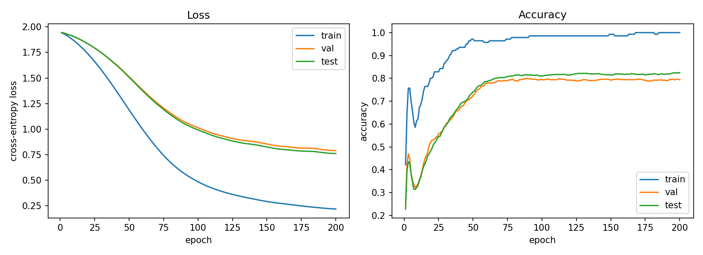
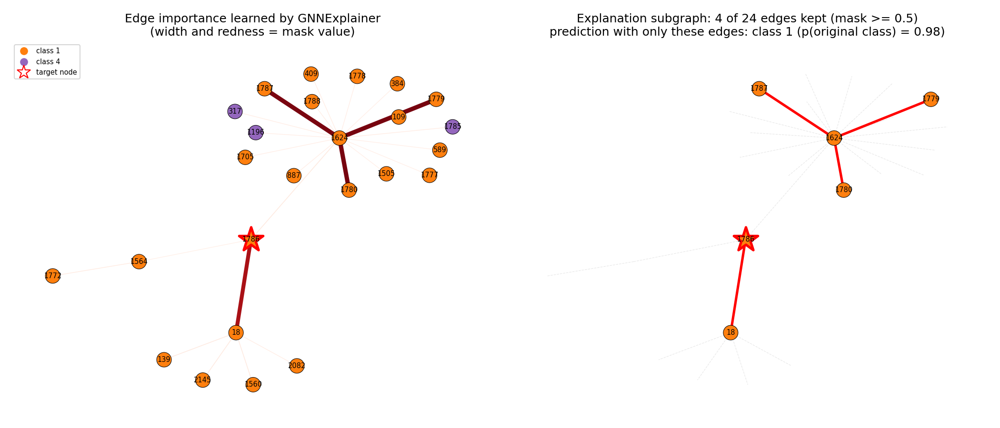

<div class="nb-proto">

<em><span>Prototypical example for this section:</span> node $1786$ of Cora. The model predicts class $1$ with probability $0.83$; keeping only $4$ of the $24$ edges in its $2$-hop neighbourhood raises that probability to $0.98$.</em>

</div>

## 1.3.i What the bullet means {#s1-3-i}

“From source papers” means that neither model is a call to a ready-made class. The GCN layer is a dozen lines around `scatter`; the explainer is my own optimisation loop around a frozen model. PyTorch Geometric [&#91;FL19&#93;](../references/#ref-fey2019) is used only for plumbing: loading the Planetoid copy of Cora, `add_self_loops`, `scatter`, `k_hop_subgraph`, and `GCNConv` as the reference that the layer is checked against.

The code lives in `final implementations/GCN and GNNexplainer/`: `src/` (seven modules), `scripts/` (five), `docs/` (eleven beginner-level chapters mapping every equation to a line), an executed notebook and `results/`. It was built on 6 September 2026 on my Windows laptop (CPU only, about $15$ s to train, about $3$ s per explanation) and polished on 15 September (six-seed accuracy, the connectivity flag of [Section 1.3.viii](#sec-mtp-conn)). Its purpose was to be able to explain both methods line by line, and to have a transparent reference against which the PyG-based pipelines of [Section 1.5](../synthetic/) and [Section 1.7](../sweep/) can be cross-checked.

## 1.3.ii The data and the split {#s1-3-ii}

Cora [&#91;Sen+08&#93;](../references/#ref-sen2008) is a citation network of machine-learning papers; I use the Planetoid copy [&#91;YCS16&#93;](../references/#ref-yang2016).

| Quantity | Value <span style="color:#009b55"><strong>[R]</strong></span> |
|:--|:--|
| nodes (papers) | $2708$ |
| edges | $5278$ undirected, stored as $10{,}556$ directed entries; no self-loops |
| features | $1433$ binary bag-of-words; $1.27\%$ non-zero, $18.17$ words per paper (min $1$, max $30$) |
| after `NormalizeFeatures` | every row sums to $1$ |
| classes | $7$ |
| split | $140$ train ($20$ per class), $500$ validation, $1000$ test; pairwise disjoint |
| degree | median $3$, maximum $168$ |

Kipf and Welling’s Table 1 lists $5429$ edges; the PyG copy has $5278$ after removing duplicates. This is a known bookkeeping difference between sources, not an error. The vocabulary is not distributed with the files, so a feature dimension such as $404$ is “some word” and the project only ever reports feature <em>indices</em>.

What each split may be used for is the rule that prevents label leakage, and it is checked in the code: the loss uses `train_mask` only (`cora_train.py:76`); validation is used to choose the epoch and to stop; the test split is read to report the final number and never to decide anything.

## 1.3.iii The GCN, line by line {#sec-mtp-gcncode}

```python {filename="cora_gcn.py, lines 39–57",linenos=table,linenostart=39}
    if edge_weight is None:
        edge_weight = torch.ones(edge_index.size(1), device=edge_index.device)

    # A~ = A + I : append one self-loop per node, each with weight 1.
    edge_index_with_loops, edge_weight = add_self_loops(
        edge_index, edge_weight, fill_value=1.0, num_nodes=num_nodes
    )
    # PyG convention: edge_index[0] is the source node, edge_index[1] the target node,
    # and a message travels source -> target.
    source, target = edge_index_with_loops

    # D~_ii = sum_j A~_ij : (weighted) degree of each node, including its self-loop.
    deg = scatter(edge_weight, target, dim=0, dim_size=num_nodes, reduce="sum")
    deg_inv_sqrt = deg.pow(-0.5)
    deg_inv_sqrt[deg_inv_sqrt == float("inf")] = 0  # isolated nodes (degree 0) -> 0, not inf

    # Entry (i, j) of D~^{-1/2} A~ D~^{-1/2}  is  A~_ij / sqrt(d_i * d_j).
    norm = deg_inv_sqrt[source] * edge_weight * deg_inv_sqrt[target]
    return edge_index_with_loops, norm
```

This is $\hat A = \tilde D^{-1/2}\tilde A\,\tilde D^{-1/2}$ in sparse form: instead of an $N\times N$ matrix ($2708^2 \approx 7.3$ million entries, only $10{,}556$ non-zero) it returns the edge list of $\tilde A$ and the value of $\hat A$ at each edge. PyG’s convention, used throughout: `edge_index` has shape $[2, E]$, row $0$ holds the <em>source</em> and row $1$ the <em>target</em> of every directed edge, and a message travels from source to target (`cora_gcn.py:46-48`); an undirected graph stores each edge twice.

- Lines 43–45 append one self-loop per node ($\tilde A = A + I$). Line 51 sums the weights of the edges <em>arriving</em> at each node: that is the diagonal of $\tilde D$. Lines 52–53 take $\tilde d^{-1/2}$ and set infinities, which only isolated nodes without a self-loop would produce, to $0$. Line 56 is $\tilde A_{ij}/\sqrt{\tilde d_i\tilde d_j}$.
- `edge_weight` is not in the paper. It exists because GNNExplainer’s mask must enter the model somewhere, and it does so as a weight on each edge. Because the degrees are <em>recomputed from the weights</em>, an edge with weight near $0$ also stops counting towards its endpoints’ degrees, exactly as if it had been removed.

```python {filename="cora_gcn.py, lines 80–90",linenos=table,linenostart=80}
        num_nodes = x.size(0)

        # Step 1: X W  -- transform the features of every node. [N, in] @ [in, out] -> [N, out]
        x = x @ self.weight

        # Step 2: A_hat (X W) -- for each edge j -> i, send norm_ij * (XW)_j to node i and add up.
        edge_index_with_loops, norm = normalized_adjacency(edge_index, num_nodes, edge_weight)
        source, target = edge_index_with_loops
        messages = norm.unsqueeze(-1) * x[source]        # one message per edge, [E + N, out]
        out = scatter(messages, target, dim=0, dim_size=num_nodes, reduce="sum")  # sum at target
        return out
```

Lines 83 and 88–89 are $X W$ followed by the neighbourhood sum $\sum_j \hat A_{ij}(XW)_j$. Multiplying by $W$ <em>first</em> is cheaper, because the feature width drops from $1433$ to $16$ before the sum, and the result is identical. The layer has no bias, as in Eq. 8 of the paper, and its weight is Glorot-initialised (`cora_gcn.py:71-72`).

```python {filename="cora_gcn.py, lines 116–122",linenos=table,linenostart=116}
        # Dropout is only active in training mode (model.train()); it is a no-op in model.eval().
        x = F.dropout(x, p=self.dropout, training=self.training)
        x = self.conv1(x, edge_index, edge_weight)        # A_hat X W^(0)
        x = F.relu(x)                                     # ReLU(...)
        x = F.dropout(x, p=self.dropout, training=self.training)
        x = self.conv2(x, edge_index, edge_weight)        # A_hat (...) W^(1)
        return x                                          # logits, [N, num_classes]
```

The model returns <em>logits</em>, not probabilities: `F.cross_entropy` applies the log-softmax internally and is numerically safer, and the explainer calls `softmax` itself when it needs probabilities. Dropout is applied to the <em>input</em> of each of the two layers; the paper gives the rate ($0.5$) but not the placement, and the project’s notes say that this placement follows the authors’ released TensorFlow code (which I did not read) <span style="color:#f7921d"><strong>[L]</strong></span>. The total is $1433\cdot16+16\cdot7=23{,}040$ parameters <span style="color:#009b55"><strong>[R]</strong></span>.

## 1.3.iv Bit-exact against `GCNConv` {#sec-mtp-bitexact}

The project’s own test (`cora_sanity.py:46-60`) copies one layer’s weights into a `GCNConv(bias=False)` and compares outputs, with and without random edge weights:

```python {filename="cora_sanity.py, lines 48–60",linenos=table,linenostart=48}
    layer = GCNLayer(dataset.num_features, 8).to(device)
    reference = GCNConv(dataset.num_features, 8, bias=False).to(device)
    reference.lin.weight.data = layer.weight.data.t().clone()
    with torch.no_grad():
        ours = layer(data.x, data.edge_index)
        theirs = reference(data.x, data.edge_index)
        check("GCNLayer matches torch_geometric GCNConv (unweighted)", torch.allclose(ours, theirs, atol=1e-6),
              f"max |diff| = {(ours - theirs).abs().max():.2e}")
        w = torch.rand(data.edge_index.size(1), device=device)
        ours = layer(data.x, data.edge_index, w)
        theirs = reference(data.x, data.edge_index, w)
        check("GCNLayer matches GCNConv with edge weights", torch.allclose(ours, theirs, atol=1e-6),
              f"max |diff| = {(ours - theirs).abs().max():.2e}")
```

Two caveats. First, `allclose(atol=1e-6)` is a <em>tolerance</em>; what makes it a bit-exact claim is the printed maximum difference, which is exactly $0.00\mathrm{e}{+}00$ in both cases. Second, that is one layer, one random draw, one thread count. To make “bit-exact” literally defensible I wrote a stricter test (`data/mtp/verify/verify_bitexact.py`) that uses `torch.equal`, which is true only if every one of the $2708\times16$ floats is identical.

| threads | random layers | `torch.equal`, no weights | `torch.equal`, edge weights | max $\vert \mathrm{diff}\vert$ |
|--:|--:|--:|--:|--:|
| 1 | 6 | 6 of 6 | 6 of 6 | $0$ |
| 2 | 6 | 6 of 6 | 6 of 6 | $0$ |
| 14 | 6 | 6 of 6 | 6 of 6 | $0$ |

<span style="color:#009b55"><strong>[R]</strong></span> I also built a two-layer twin from two `GCNConv(bias=False)` modules with the trained weights and compared the whole model in eval mode: the logits for all $2708$ nodes are identical (`torch.equal` is true, maximum difference $0.0$), all predictions agree, and the test accuracy is $0.8250$ for both.

<div class="nb nb-remark" id="remark-1-3-1">

<strong>Remark 1.3.1</strong> (Why the equality is exact, and when it would not be) — My reasoning, not a measurement. `GCNConv` computes $XW$, adds self-loops with `add_remaining_self_loops`, forms the degrees with a sum-scatter over the target nodes, takes $d^{-1/2}$ with infinities set to $0$, multiplies $d_i^{-1/2} w_{ij} d_j^{-1/2}$, scales each message and sums with a scatter. My layer does the same floating-point operations in the same order on the same edge list, so every intermediate float is identical. I would expect differences near $10^{-7}$ on a GPU, with a different edge order (the summation order changes), or if a bias were added. None of that was tested.

</div>

## 1.3.v Training, and where $81.5\%$ comes from {#sec-mtp-coraacc}

The recipe is the paper’s (Sections 5.2 and 6.1) and nothing was tuned:

```python {filename="cora_config.py, lines 37–42",linenos=table,linenostart=37}
HIDDEN_DIM = 16         # H in W^(0) in R^{C x H}
DROPOUT = 0.5           # dropout rate, applied to the input of both layers
LEARNING_RATE = 0.01    # Adam learning rate
WEIGHT_DECAY = 5e-4     # L2 regularisation, applied to the FIRST layer only
EPOCHS = 200            # maximum number of training epochs
EARLY_STOPPING_PATIENCE = 10  # stop when validation loss has not improved for this many epochs
```

```python {filename="cora_train.py, lines 57–64",linenos=table,linenostart=57}
    # L2 regularisation (weight decay) on the first layer only, as in the paper.
    optimizer = torch.optim.Adam(
        [
            {"params": model.conv1.parameters(), "weight_decay": weight_decay},
            {"params": model.conv2.parameters(), "weight_decay": 0.0},
        ],
        lr=learning_rate,
    )
```

Weight decay is applied to the first layer only, as in the paper; Adam’s `weight_decay` adds $\lambda w$ to the gradient, which is the gradient of the L2 penalty $\tfrac \lambda2\lVert W\rVert^2$. Each epoch is one full-batch step over the whole graph.

```python {filename="cora_train.py, lines 92–105",linenos=table,linenostart=92}
        # ---- early stopping on validation loss (Kipf & Welling: window of 10) ----
        if metrics["val_loss"] < best_val_loss:
            best_val_loss = metrics["val_loss"]
            best_state = copy.deepcopy(model.state_dict())
            epochs_without_improvement = 0
        else:
            epochs_without_improvement += 1
            if early_stopping_patience is not None and epochs_without_improvement >= early_stopping_patience:
                if verbose:
                    print(f"early stopping at epoch {epoch} (best val loss {best_val_loss:.4f})")
                break

    # Restore the best-validation weights so the caller gets the selected model.
    model.load_state_dict(best_state)
```

Early stopping follows the paper’s rule, a window of $10$ epochs on <em>validation loss</em>, and the weights of the best-validation epoch are restored. (Validation loss rather than accuracy, because with $500$ nodes accuracy moves in steps of $0.2\%$ and creates ties.) With these settings the validation loss is still falling at epoch $200$, so early stopping never triggers and the selected epoch is $200$ on every seed <span style="color:#009b55"><strong>[R]</strong></span>. The loop also computes test metrics every epoch, but only to draw the curves; nothing is selected on them.

<figure class="nb-fig nb-img"></figure>

| seed | selected epoch | train acc | val acc | <strong>test acc</strong> |
|--:|:-:|:-:|:-:|:-:|
| 42 (saved checkpoint) | 200 | 1.000 | 0.794 | 0.825 |
| 0 | 200 | 0.993 | 0.786 | 0.804 |
| 1 | 200 | 1.000 | 0.790 | 0.816 |
| 2 | 200 | 0.986 | 0.794 | 0.825 |
| 3 | 200 | 1.000 | 0.790 | 0.813 |
| 4 | 200 | 1.000 | 0.798 | 0.808 |
| <strong>mean</strong> |  |  |  | <strong>0.8152</strong> |
| population s.d. / sample s.d. |  |  |  | $0.0079$ / $0.0087$ |

<span style="color:#009b55"><strong>[R]</strong></span> I re-trained all six seeds with the project’s own code at $14$ threads and again at $1$ thread: every per-seed accuracy in the table, and therefore the mean, is identical in both runs and identical to the values logged on 15 September. Kipf and Welling report $81.5\%$ (their Table 2) for this model and the fixed Planetoid split, and their Section 6.1 says this is the “mean accuracy of $100$ runs with random weight initializations”: the same protocol as mine (fixed split, different initialisations), with many more runs; on random splits they report $80.1 \pm 0.5\%$ <span style="color:#009b55"><strong>[R]</strong></span> (read in the PDF). The saved checkpoint is seed $42$, at $0.825$, the top of the range. Why six seeds and not five or ten is <strong>UNKNOWN</strong>; the aim was to replace one number by a spread. The “$\pm 0.008$” quoted in the project’s notes is the <em>population</em> standard deviation (`ddof` $=0$); the sample value is $0.009$.

## 1.3.vi The explainer, line by line {#sec-mtp-explainer}

<strong>Step 1: the computation graph.</strong>

```python {filename="cora_explain.py, lines 67–80",linenos=table,linenostart=67}
    # Hop distance of every node from the target: 0 for the target, -1 if further than num_hops.
    hop_of_node = torch.full((num_nodes,), -1, dtype=torch.long)
    hop_of_node[target_node] = 0
    for h in range(1, num_hops + 1):
        reached, _, _, _ = k_hop_subgraph(target_node, h, edge_index, num_nodes=num_nodes)
        newly_reached = reached[hop_of_node[reached] == -1]
        hop_of_node[newly_reached] = h

    nodes = (hop_of_node >= 0).nonzero().flatten()

    source, target = edge_index
    in_graph = (hop_of_node[source] >= 0) & (hop_of_node[target] >= 0)
    can_reach_target = hop_of_node[target] <= num_hops - 1
    edge_ids = (in_graph & can_reach_target).nonzero().flatten()
```

Lines 68–73 compute each node’s hop distance from the target. Line 79 is [Proposition 1.2.1](../background/#proposition-1-2-1) for $L=2$: a directed edge $a\to b$ can carry a message to the target only if $b$ is within $1$ hop of it. So an edge between two nodes that are both exactly $2$ hops away is left out; PyG’s `k_hop_subgraph` would include it. Strictly, such an edge could still nudge the prediction through the degree normalisation of its endpoints ([Section 1.2.viii](../background/#sec-mtp-compgraph)), but it carries no message, so it is not part of $G_c$ in the sense of the paper’s Figure 2.

<strong>Step 2: freeze the model and create the only learnable objects.</strong>

```python {filename="cora_explain.py, lines 183–208",linenos=table,linenostart=183}
        # Step 4: freeze the GCN. Dropout off, no parameter gradients, remember the weights.
        model.eval()
        requires_grad_before = [p.requires_grad for p in model.parameters()]
        for p in model.parameters():
            p.requires_grad_(False)
        params_before = [p.detach().clone() for p in model.parameters()]

        # Step 2: the prediction we want to explain (no masks at all).
        with torch.no_grad():
            original_probs = self._target_probs(x, edge_index, None, target_node)
        predicted_label = int(original_probs.argmax())

        # Step 3: computation graph.
        cg = extract_computation_graph(target_node, self.num_hops, edge_index, num_nodes)
        assert cg.num_undirected_edges > 0, f"node {target_node} has no edges; nothing to explain"

        # Steps 5-6: the ONLY learnable objects. Small random values -> sigmoid ~ 0.5.
        raw_edge_mask = torch.nn.Parameter(0.1 * torch.randn(cg.num_undirected_edges, device=x.device))
        raw_feature_mask = torch.nn.Parameter(0.1 * torch.randn(num_features, device=x.device))
        optimizer = torch.optim.Adam([raw_edge_mask, raw_feature_mask], lr=self.lr)

        # Sanity: an all-ones mask must reproduce the original prediction exactly.
        with torch.no_grad():
            ones_weight = self._full_edge_weight(cg, torch.ones(cg.num_undirected_edges), num_edges)
            probs_all_ones = self._target_probs(x, edge_index, ones_weight, target_node)
        checks["all_ones_mask_reproduces_original"] = bool(torch.allclose(probs_all_ones, original_probs, atol=1e-5))
```

The model is switched to eval mode (dropout off), every parameter gets `requires_grad=False`, and a copy of the weights is kept so the code can <em>prove</em> afterwards that nothing changed (`gcn_parameters_unchanged`, line 274). There is one mask value per <em>undirected</em> edge, not per direction: two independent values for $j\to k$ and $k\to j$ would be hard to read, and keeping a citation in one direction only has no meaning. The feature mask has one value per feature dimension, shared by all nodes. Initial values are $0.1\cdot \mathcal N(0,1)$, so every sigmoid starts near $0.5\pm0.03$. The mask goes into the model as an edge weight on the <em>full</em> graph, with weight $1$ for edges outside $G_c$ (`cora_explain.py:158-167`). I do not cut $G_c$ out and run on it alone, because a $2$-hop node’s degree counts edges to $3$-hop nodes, and a cut-out graph would lose them and change the unmasked prediction. With the full graph, an all-ones mask reproduces the original probabilities exactly, which is the check at lines 204–208.

<strong>Step 3: optimise.</strong>

```python {filename="cora_explain.py, lines 211–245",linenos=table,linenostart=211}
        for epoch in range(1, self.epochs + 1):
            optimizer.zero_grad()

            # Step 7: sigmoid maps the unconstrained masks into (0, 1).
            edge_mask = torch.sigmoid(raw_edge_mask)          # [P]
            feature_mask = torch.sigmoid(raw_feature_mask)    # [num_features]

            # Steps 8-9: apply the masks.   A_c * sigmoid(M)   and   X * sigmoid(F)
            edge_weight = self._full_edge_weight(cg, edge_mask, num_edges)
            x_masked = x * feature_mask                       # broadcast over nodes

            # Step 10: run the frozen GCN on the masked input.
            probs = self._target_probs(x_masked, edge_index, edge_weight, target_node)

            # Step 11: prediction loss = -log P(predicted class | masked input)   (Eq. 5)
            prediction_loss = -torch.log(probs[predicted_label] + 1e-15)

            # Step 12: regularisation.
            edge_size = self.edge_size_coeff * edge_mask.sum()
            edge_entropy = self.edge_entropy_coeff * binary_entropy(edge_mask).mean()
            feature_size = self.feature_size_coeff * feature_mask.mean()
            feature_entropy = self.feature_entropy_coeff * binary_entropy(feature_mask).mean()

            loss = prediction_loss + edge_size + edge_entropy + feature_size + feature_entropy

            # Step 13: gradients flow into the masks only.
            loss.backward()
            if epoch == 1:
                checks["edge_mask_has_gradient"] = raw_edge_mask.grad is not None and bool(
                    torch.isfinite(raw_edge_mask.grad).all()
                )
                checks["feature_mask_has_gradient"] = raw_feature_mask.grad is not None and bool(
                    torch.isfinite(raw_feature_mask.grad).all()
                )
            optimizer.step()
```

Per epoch: sigmoid, apply both masks, run the frozen GCN, take the loss of Eq. 5 on the <em>predicted</em> class (the paper’s footnote 2 explains that using the true label answers a different question), add four regularisers, and step Adam on the two raw masks only. The loss is

$$
-\log p_{\hat y} \;+\; 0.005\sum_e \sigma(M_e) \;+\; 1.0\,\overline H(\sigma(M)) \;+\; 1.0\,\overline{\sigma(F)} \;+\; 0.1\,\overline H(\sigma(F)),
$$

with $300$ epochs at learning rate $0.01$. The paper gives none of these coefficients. They are the defaults of PyG’s `GNNExplainer` and the entries of the coefficient dictionary in the authors’ code (`explainer/explain.py:621-628` of `RexYing/gnn-model-explainer` at commit `47e6973`: size $0.005$, feat\_size $1.0$, ent $1.0$, feat\_ent $0.1$) <span style="color:#009b55"><strong>[R]</strong></span>. The authors’ loss differs from mine in three ways I read on 2 October: its prediction term uses the <em>true</em> label (`explain.py:748-750`), it adds a Laplacian term (lines 787–790), and the total at line 805 leaves out the feature-entropy term although its coefficient exists. The edge penalty is a <em>sum</em>, so larger neighbourhoods are punished more; the feature penalty is a mean over $1433$ dimensions. The coefficient matters: with an edge-size coefficient of $0.05$, nodes $1786$ and $1792$ keep a single edge (of $24$ and $12$) while node $1794$ still keeps three; with $0.005$ the three nodes keep $4$, $3$ and $3$ edges, which preserve the prediction <span style="color:#009b55"><strong>[R]</strong></span>.

<strong>Step 4: read off the explanation.</strong> `important_edge_indices` keeps edges with mask $\ge 0.5$ (`cora_explain.py:298-308`); `predict_with_hard_mask` then re-runs the model with kept edges at weight $1$ and every other $G_c$ edge at $0$, features unmasked (lines 334–350). That is the honest test: does the model still make the same prediction when it can see only the kept edges?

<div class="nb nb-remark" id="remark-1-3-2">

<strong>Remark 1.3.2</strong> (What differs from the paper) — Four differences between the paper and my version.

- <strong>Feature mask.</strong> The paper marginalises over feature values with a Monte-Carlo estimate, $X = Z + (X_S - Z)\odot F$; I use the plain $X\odot \sigma(F)$ that the paper states first. A word that is absent from every node in $G_c$ therefore cannot get a high mask value.
- <strong>Mask per undirected edge</strong>, and the exclusion of edges between two $2$-hop nodes, as above.
- <strong>Not implemented:</strong> multi-instance explanations (prototypes), link prediction, graph classification.
- <strong>Not measured:</strong> explanation accuracy, because Cora has no ground-truth explanation.

</div>

## 1.3.vii Results on three nodes {#s1-3-vii}

Nodes were chosen deterministically by the script (the lowest-id test nodes whose computation graph has $8$ to $40$ edges, two correctly classified of different classes and one misclassified), threshold $0.5$, seed $42$. <span style="color:#009b55"><strong>[R]</strong></span> Every value below was recomputed on 2 October and matches the saved file.

|  | node $1786$ (correct) | node $1794$ (correct) | node $1792$ (<strong>wrong</strong>) |
|:--|:-:|:-:|:-:|
| true / predicted class | $1$ / $1$ | $4$ / $4$ | $3$ / $6$ |
| probability of the predicted class | $0.830$ | $0.341$ | $0.268$ |
| computation graph (nodes, undirected edges) | $25$, $24$ | $10$, $12$ | $13$, $12$ |
| <strong>edges kept</strong> (mask $\ge 0.5$) | $4$ | $3$ | $3$ |
| of which connected to the target | $1$ | $3$ | $3$ |
| probability, soft masks | $0.934$ | $0.600$ | $0.482$ |
| probability, kept edges only | $0.977$ | $0.534$ | $0.363$ |
| prediction preserved? | yes | yes | yes (still class $6$) |

<figure class="nb-fig nb-img"></figure>

- <strong>Node 1794</strong> is the textbook case: all $10$ nodes in its neighbourhood are class $4$, and the explainer keeps the three edges from the target to its direct neighbours and drops everything two hops out. With only those three citations the probability of class $4$ rises from $0.34$ to $0.53$: the $2$-hop nodes were adding noise, not evidence.
- <strong>Node 1792</strong> is misclassified (true class $3$, predicted class $6$ with low confidence $0.27$). Apart from the target itself, its neighbourhood contains no class-$3$ node at all: the direct neighbours are $581$ (class $1$) and $2485$ (class $5$), and the $2$-hop nodes are classes $1$, $5$ and $6$. The explanation keeps the path $454$–$581$–$1792$–$2485$ and still predicts class $6$. It explains <em>why the model was wrong</em>, not what is right, which is the use of explanations the paper advertises for finding systematic errors.
- <strong>Probability rises under the explanation</strong> for all three nodes ($0.83\to0.98$, $0.34\to0.53$, $0.27\to0.36$): the removed edges were diluting the signal.

### Threshold and seed stability (node 1786) {#threshold-and-seed-stability-node-1786}

<span style="color:#009b55"><strong>[R]</strong></span> With one trained model and one learned mask, thresholds $0.1,\dots,0.8$ all keep the same $4$ edges and the same probability $0.977$; at $0.9$ only $3$ edges remain and the probability falls to $0.770$. The entropy regulariser has made every mask value either above $0.86$ or below $0.07$, so the threshold is not a delicate choice. Re-running the explainer with seeds $0, 1, 2$ keeps $4$, $5$ and $5$ edges; the same four edges are kept by every seed, seeds $1$ and $2$ also keep edge $1564$–$1786$, and the pairwise Jaccard similarities are $0.80$, $0.80$ and $1.00$ (mean $0.867$). This is one node and three seeds: it illustrates stability, it does not quantify it.

## 1.3.viii A caveat the explainer taught me {#sec-mtp-conn}

For node $1786$ the four kept edges are $1624$–$1779$, $1624$–$1780$, $1624$–$1787$ (all around the hub $1624$) and $18$–$1786$. The edge joining the hub to the target, $1624$–$1786$, has mask value only $0.068$, so after thresholding the three hub edges are <em>disconnected from the target</em>. <span style="color:#009b55"><strong>[R]</strong></span> Hub $1624$ has degree $17$: $14$ class-$1$ and $3$ class-$4$ neighbours. The probability is $0.977$ with the four kept edges, $0.977$ with edge $18$–$1786$ alone, and $0.770$ with no edges at all (self-loop only). So the model’s confidence rests on the target’s own features plus neighbour $18$, and the three hub edges are an artefact of the soft optimisation: the connecting edge is at $0.068$, not $0$, so messages still trickle through it, and keeping some of the hub’s edges changes the hub’s degree normalisation in a way the optimiser liked. The paper says explanations <em>tend</em> to be connected; for a GCN this is not guaranteed. I did not add a connectivity term to the objective, because the paper’s objective has none. The authors’ code cleans up only afterwards (`denoise_graph(..., max_component=True)` keeps one connected component before drawing). The equivalent here is a <em>reported</em> quantity, not a silent filter: `connected_to_target` walks from the target along kept edges (`cora_explain.py:319-331`), every edge in the JSON carries a `connected_to_target` flag, and the report prints the prediction using only the connected kept edges.

## 1.3.ix How I know the implementation is right {#sec-mtp-checks}

`scripts/run_sanity_checks.py` runs $20$ checks and exits non-zero if any fails. <span style="color:#009b55"><strong>[R]</strong></span> All $20$ pass:

1. the dataset has the right shapes, labels and disjoint masks (1);
2. the layer equals `GCNConv`, unweighted and weighted, to a maximum difference of $0$ (2);
3. the checkpoint exists, its test accuracy exceeds $0.70$, and the output shape is $[N, 7]$ (3);
4. <strong>receptive field</strong>: changing the features of a node $3$ hops away leaves the target’s logits <em>bit-for-bit</em> unchanged, while changing a $2$-hop node’s features changes them (2);
5. the target exists, its computation graph is non-empty, and every edge maps to exactly one undirected pair (3);
6. the explainer’s own checks: the all-ones mask reproduces the original prediction; the edge mask and the feature mask both receive finite gradients; the GCN parameters are unchanged; both masks have the right shape (6);
7. both masks lie strictly inside $(0,1)$, and `requires_grad` was restored on the model (3).

The receptive-field test is the one that checks [Proposition 1.2.1](../background/#proposition-1-2-1) empirically and ties the explainer’s definition of $G_c$ to what the model really sees.

## 1.3.x What B1 does not claim {#s1-3-x}

- No improvement over Kipf and Welling: $0.8152$ <em>equals</em> the paper, and a single seed can land anywhere in $0.804$–$0.825$.
- No claim that the explainer is correct in the sense of explanation <em>accuracy</em>: Cora has no ground truth. The $20$ checks show that the optimisation does what its equations say, not that the explanations match any truth. That measurement is the subject of the following sections.
- No claim about blockchain data.

## 1.3.xi Questions this bullet invites {#s1-3-xi}

Derive the propagation rule and say why $\tilde A$ and the symmetric normalisation are used ([Section 1.2](../background/)); explain why $L$ layers see exactly $L$ hops and how the test proves it; say what “bit-exact” means and how it was checked, and what could break it; explain every term of the explainer’s loss and why the target is the predicted class; say where the coefficients come from; say what the connected-edges caveat is and why it happens; say why the saved checkpoint scores higher than the six-seed mean. Worked answers are in the problems at the end of the chapter.
