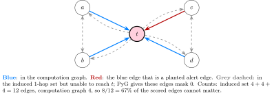
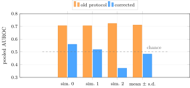

<div class="nb-proto">

<em><span>Prototypical example for this section:</span> a node whose neighbours are connected to each other. In a one-layer GCN those neighbour–neighbour edges cannot influence the node’s prediction, yet they were being scored as if they could.</em>

</div>

## 1.4.i How the $0.71$ came about {#sec-mtp-v1}

The $0.71$ was my headline of 31 August. It is worth knowing the path, because an interviewer may ask why I believed it.

1. <strong>First attempt.</strong> I copied the BA-Shapes pipeline onto AMLSim: a $3$-layer GCN (hidden $32$, learning rate $0.01$, no dropout, gradient clip $2.0$, $1000$ epochs, stratified $80/10/10$ node split), a class-weighted loss, and model selection by validation SAR-F1. GNNExplainer was run for every SAR node and its mask scored against the planted alert edges inside PyG’s $k$-hop subgraph with $k=3$. Pooled AUROC: $0.4219 \pm 0.0188$, below chance on all three seeds (test SAR-F1 $0.2704 \pm 0.1460$) <span style="color:#0071bc"><strong>[F]</strong></span>.
2. <strong>Two hypotheses, tested and rejected.</strong> (A) The explainer explains whatever the model <em>predicted</em>, and for many SAR nodes that is “licit”. Splitting the AUROC by whether the prediction was right changed almost nothing ($0.417$ against $0.430$ on seed $0$). (B) The node features let the model skip the graph. Replacing them by a constant $1.0$, as in BA-Shapes, gave the same number ($0.4186$ against $0.4219$). <span style="color:#f7921d"><strong>[L]</strong></span>
3. <strong>The cause as I understood it then.</strong> A SAR node’s $3$-hop neighbourhood covers $93$–$95\%$ of all edges, so the “local” comparison was nearly global. (The September script and my re-run measure $97\%$; the August script is kept only on the Studio, so the small difference is <strong>UNKNOWN</strong>.)
4. <strong>A fix that looked principled.</strong> Because the neighbourhood depends on the depth, I swept the depth on one simulation: a $1$-layer GCN has a median neighbourhood of $0.1\%$ of the graph and AUROC $0.7057$; $2$ layers: $45\%$ and $0.5712$; $3$ layers: $98\%$ and $0.4164$. Three independent simulations at one layer gave <strong>$0.7111 \pm 0.0082$</strong> (seeds $0.7057, 0.7049, 0.7227$). I wrote this up as “GNNExplainer works on AMLSim once the depth matches the graph’s locality”. <span style="color:#f7921d"><strong>[L]</strong></span>

That conclusion was wrong. The explainer and the models were fine; the <em>scoring set</em> was not.

## 1.4.ii The audit {#sec-mtp-audit-b2}

On 12 September I started a pass whose goal was to improve classification <em>and</em> explanation at once. Before training a single new model I asked what the existing evaluation actually compares, and counted. For each SAR node I computed two edge sets and their sizes:

- the <strong>induced</strong> set, what `k_hop_subgraph(node, k)` returns and what the pipeline had scored: every edge whose <em>both</em> endpoints lie within $k$ hops;
- the <strong>computation graph</strong>: only the edges that can carry a message to the node within $k$ layers, which by [Proposition 1.2.1](../background/#proposition-1-2-1) are the edges whose receiving node lies within $k-1$ hops (`aml_evaluation.py:45-49`).

```python {filename="aml_evaluation.py, lines 31–56",linenos=table,linenostart=31}
def nodes_within_hops(node_idx, num_hops, edge_index, num_nodes):
    """Boolean mask of every node whose message can reach `node_idx` in at
    most `num_hops` steps (following edges src -> dst)."""
    src, dst = edge_index
    reached = torch.zeros(num_nodes, dtype=torch.bool)
    reached[node_idx] = True
    for _ in range(num_hops):
        edges_into_reached = reached[dst]
        newly_reached = torch.zeros(num_nodes, dtype=torch.bool)
        newly_reached[src[edges_into_reached]] = True
        reached = reached | newly_reached
    return reached


def computation_graph_edges(node_idx, num_layers, edge_index, num_nodes):
    """Boolean mask over edges: True if the edge can influence `node_idx`'s
    output of a `num_layers`-layer message-passing model."""
    receivers = nodes_within_hops(node_idx, num_layers - 1, edge_index, num_nodes)
    return receivers[edge_index[1]]


def induced_subgraph_edges(node_idx, num_hops, edge_index):
    """The original pipeline's edge set (PyG `k_hop_subgraph` rule)."""
    _, _, _, mask = k_hop_subgraph(node_idx, num_hops, edge_index,
                                   relabel_nodes=False)
    return mask
```

<span style="color:#009b55"><strong>[R]</strong></span> Median over SAR nodes, on each of three AMLSim simulations that I regenerated on this laptop:

| $k$ | sim. | induced set<br>edges | % of graph | computation graph<br>edges | % of graph | share of the induced<br>set that cannot matter |
|:-:|:-:|--:|--:|--:|--:|--:|
| 1 | 0 | 15 | 0.11 | 5 | 0.04 | 68.3% |
| 1 | 1 | 16 | 0.12 | 5 | 0.04 | 70.0% |
| 1 | 2 | 12 | 0.09 | 4 | 0.03 | 65.5% |
| 2 | 0 | 6266 | 44.9 | 351 | 2.51 | 93.9% |
| 2 | 1 | 6290 | 45.1 | 349 | 2.50 | 92.8% |
| 2 | 2 | 5895 | 42.1 | 296 | 2.12 | 93.8% |
| 3 | 0 | 13641 | 97.7 | 9519 | 68.1 | 30.2% |
| 3 | 1 | 13614 | 97.6 | 9500 | 68.1 | 30.3% |
| 3 | 2 | 13539 | 96.6 | 9198 | 65.7 | 32.1% |

These match the numbers in the project’s notes. At one layer, about two thirds of the scored edges cannot influence the prediction ($65$ to $70\%$); at two layers, about $93\%$ cannot. Three layers really do cover two thirds of the graph, so that depth stays out for a different reason: its evaluation set is not local.

<figure class="nb-fig"></figure>

The three grey groups in the picture are exactly what the audit found: the reverse copies $t\to a$ and so on (symmetrisation made every edge two-way, and the reverse copy carries $t$’s features <em>away</em>), and the edges between two neighbours of $t$.

## 1.4.iii Why those edges are scored as zero, and why that inflates AUROC {#sec-mtp-flawmech}

PyTorch Geometric’s `GNNExplainer` learns one mask value per edge of the <em>whole</em> graph, but it knows which entries can matter. After the first optimisation step it records which entries received a non-zero gradient (`hard_edge_mask = edge_mask.grad != 0`, `gnn_explainer.py:242-243, 468` of PyG 2.8.0.post1), and in post-processing every other entry is set to exactly $0.0$ (`_post_process_mask`, `base.py:97-114`, whose docstring says it removes “attributions of elements not involved during message passing”). I checked this empirically (`aml_sanity_edge_sets.py`): for six SAR nodes at depths $1$, $2$ and $3$, the set of edges with mask $>0$ is <em>identical</em> to the computation graph in all $18$ of $18$ cases <span style="color:#009b55"><strong>[R]</strong></span>.

| layers | nodes checked | identical sets | in computation graph but mask $0$ | non-zero but outside it |
|:-:|:-:|:-:|:--|:--|
| 1, 2, 3 | 6 SAR nodes each | 18 of 18 | 0 | 0 |

On these six nodes the smallest learned score of any edge that can matter was $0.0776$, so “can matter” and “non-zero” separate cleanly. A caveat on this check: those six nodes are the first six SAR nodes by index and they are <em>hubs</em> (their one-layer computation graphs have $88$ to $176$ edges), so I extended the test to every SAR node ([Section 1.4.iv](#sec-mtp-alltest)).

Now the mechanism. In the old protocol, two thirds of the scored edges were tied at exactly $0$, while every edge that can matter had a learned score of at least about $0.06$ ([Section 1.4.iv](#sec-mtp-alltest)). Almost all the zero-scored edges are negatives (an edge between two neighbours of a hub is not an alert edge), so the ranking gets those pairs “right” for free, and AUROC rises although the explainer ranked nothing there (the arithmetic is in [Section 1.2.xi](../background/#sec-mtp-toy)). The few zero-scored <em>positives</em> (the reverse copy of an alert edge) pull the other way, but there are far fewer of them.

## 1.4.iv Extending the check to every SAR node {#sec-mtp-alltest}

<span style="color:#009b55"><strong>[R]</strong></span> For <em>every</em> SAR node of simulation $0$ ($72$ nodes), with a one-layer and with a two-layer GCN ($144$ explanations), I compared the set of edges with mask $>0$ with the computation graph, in both directions:

| layers | SAR nodes | identical sets | computation-graph edges with mask $0$ | non-zero edges outside it | smallest non-zero score |
|:-:|:-:|:-:|:--|:--|:--|
| 1 | 72 | 72 of 72 | 0 | 0 | $0.0710$ |
| 2 | 72 | 72 of 72 | 0 | 0 | $0.0569$ |

So the equivalence is not an artefact of the six hubs: it holds for every SAR node at both depths, and the learned scores of edges that can matter stay above about $0.06$, well clear of the exact zero of the edges that cannot.

## 1.4.v The correction {#sec-mtp-correction}

The corrected protocol scores only the computation graph. This is a correction of the measurement, not a tuning of it: the computation graph is not “the set that makes the number look right”, it is the set of edges that provably have a path to the prediction. The models and the explanation masks are the same objects; only the set of edges they are scored on changes. In one run, for every SAR node, the same mask is scored both ways (`aml_run_configs.py:153-159`).

| 1-layer GCN (`gcn1`) | simulation 0 | simulation 1 | simulation 2 |
|:--|:-:|:-:|:-:|
| old protocol (induced $1$-hop set) | $0.7057$ | $0.7049$ | $0.7227$ |
| corrected (computation graph) | $0.5596$ | $0.5181$ | $0.3717$ |

<figure class="nb-fig"></figure>

Mean $\pm$ population standard deviation over the three simulations: $0.7111 \pm 0.0082 \to \mathbf{0.4832 \pm 0.0806}$ <span style="color:#0071bc"><strong>[F]</strong></span> <span style="color:#009b55"><strong>[R]</strong></span>. <span style="color:#009b55"><strong>[R]</strong></span> I regenerated the three simulations on this laptop and re-ran the whole `gcn1` configuration through the project’s own runner on a different PyTorch version (2.11, against 2.8 on the Studio). Every number matched to every printed digit, including the best epoch, validation F1, test F1, both AUROCs and Fidelity$^+$ of every seed: the baseline reproduces exactly. (The second configuration, `gcn2_rich`, does <em>not</em> reproduce to the last digit; see [Section Sensitivity to the software environment](../sweep/#sec-mtp-envdiff).)

## 1.4.vi What “chance” means, and what it does not {#s1-4-vi}

- <strong>Chance</strong> means indistinguishable from $0.5$. The three corrected values are $0.560$, $0.518$ and $0.372$: two slightly above and one clearly below, with a standard deviation of $0.081$. With three simulations I cannot say the true value is $0.48$ rather than $0.50$; I can say it is nowhere near $0.71$.
- It does <em>not</em> show that GNNExplainer is bad. This model is a $1$-layer GCN, which is a single linear map of mean-aggregated neighbour features. In [Section 1.7.vii](../sweep/#sec-mtp-heur) I show that its own beliefs about which neighbours are suspicious are <em>anti</em>-correlated with the truth (AUROC $0.29$), so an explainer that faithfully reports what the model used is bound to look bad.
- It does not depend on a tuned threshold or a re-run: nothing was selected to produce $0.48$.
- The explanation set also changes the <em>interpretation</em> of depth. The August claim that only $1$ layer keeps the evaluation local was partly an artefact of the same definition: in the corrected sense, a $2$-layer model’s evaluation set is $2.1$ to $2.5\%$ of the graph, which is local, so $2$-layer models became admissible (and turned out to be the best ones, [Section 1.7](../sweep/)).

## 1.4.vii The same bug elsewhere {#s1-4-vii}

- <strong>The synthetic benchmarks.</strong> My earlier synthetic pipeline used the same $k$-hop rule at $k=3$. <span style="color:#009b55"><strong>[R]</strong></span> Over the $300$ nodes the current pipeline explains, the share of the induced set (counted as the directed entries that the explainer actually scores) that cannot reach the node is (mean over the nodes, maximum in brackets):

  |  | BA-Shapes | BA-Community | Tree-Cycles | Tree-Grid |
  |:--|:-:|:-:|:-:|:-:|
  | directed entries | $36.9\%$ ($81.3\%$) | $48.2\%$ ($77.5\%$) | $20.6\%$ ($29.2\%$) | $23.2\%$ ($33.3\%$) |
  | undirected pairs | $19.0\%$ ($65.5\%$) | $23.8\%$ ($59.3\%$) | $0.0\%$ ($0.0\%$) | $0.2\%$ ($6.2\%$) |

  The project’s notes quote “$0\%$ on Tree-Cycles, $0$–$6\%$ on Tree-Grid, up to $51\%$ on BA-Shapes”. I reproduce the first two only when counting <em>undirected pairs</em>, which a tree makes reachable in one direction or the other; but masks are per directed entry, and the reverse copy of an outer-layer tree edge is in the induced set and gets mask $0$, so on the trees about a fifth of the scored entries <em>were</em> unreachable. The bug therefore touched every dataset, by much more on BA-Shapes (hubs create many redundant edges) than on trees. Scores of the old and new synthetic pipelines (Kipf GCN, <span style="color:#0071bc"><strong>[F]</strong></span>): BA-Shapes $0.862 \to 0.463$, BA-Community $0.791 \to 0.731$, Tree-Cycles $0.600 \to 0.534$, Tree-Grid $0.604 \to 0.471$ (the new pipeline also uses own-motif labels, $100$ random nodes and the paper’s binary Tree-Grid task, so only BA-Shapes has a like-for-like re-score: $0.862\to0.455$ <span style="color:#f7921d"><strong>[L]</strong></span>; archive: `results/archive/gcn_gnnexplainer_induced-protocol_2026-08-31/`). So the “Tree-Cycles anomaly” of my own earlier run, a near-perfect classifier with chance-level explanations, was not Tree-Cycles being odd; it was BA-Shapes looking good for the wrong reason.
- <strong>PyG’s own example.</strong> The official script `examples/explain/gnn_explainer_ba_shapes.py` computes `hard_edge_mask` with `k_hop_subgraph(node_index, num_hops=3, ...)` and scores `explanation.edge_mask[hard_edge_mask]` against the global motif labels <span style="color:#009b55"><strong>[R]</strong></span> (fetched 2 October 2026). That is the protocol I retired.

## 1.4.viii How to avoid this kind of error {#s1-4-viii}

Before trusting an explanation AUROC, check: <strong>(1)</strong> which edges are scored, and whether each can reach the prediction; <strong>(2)</strong> the <em>tie structure</em> of the scores (a large block at exactly one value is a warning); <strong>(3)</strong> a random baseline and trivial rankings ([Section 1.7.vii](../sweep/#sec-mtp-heur)); <strong>(4)</strong> the same number after randomising the model’s weights, which a faithful explanation metric should destroy; <strong>(5)</strong> whether the ground truth contains edges the model cannot see ([Section The ground truth counts other alerts’ edges as positive (two-layer models)](../sweep/#sec-mtp-ownalert)). Item (3) was run for the two-layer models only on 2 October, and it matters ([Section The same control at two hops (new: run on 2 October for these notes; not part of the project’s own results)](../sweep/#sec-mtp-heur2): simple rules beat the explainer there); item (4) has still not been run.

## 1.4.ix Questions this bullet invites {#s1-4-ix}

Why does an explainer assign exactly $0$ to some edges? Define the computation graph and prove it. Give a numerical example of how ties inflate AUROC. Why did you believe $0.71$ in August? What changed between the two numbers: the model, the mask, or the metric? Is $0.48$ “bad explainer” or “bad model”? How would you detect this bug in someone else’s pipeline? Worked answers are in the problems at the end of the chapter.
