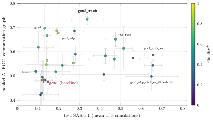

<div class="nb-proto">

<em><span>Prototypical example for this section:</span> `gcn1` against `gcn2_rich`: the original one-layer linear GCN on five features, and a two-layer GCN on twenty transaction-derived features. Same explainer, same data, same scoring.</em>

</div>

## 1.7.i From simulator output to a graph {#sec-mtp-amlgraph}

One simulation becomes one PyG graph (`aml_dataset.py:50-124`). The decisions, and the evidence for each:

- <strong>Node</strong> = account; <strong>label</strong> $y=1$ if the account is in `sar_accounts.csv` with `IS_SAR = YES`.
- <strong>Edge</strong> = one per <em>unique ordered pair</em> (`orig_acct`, `bene_acct`), not one per transaction. Simulation 0 has $121{,}457$ transactions but only $6984$ pairs; one edge per transaction would make GNNExplainer’s per-edge mask roughly $17$ times more expensive for no extra resolution, because alert labels collapse cleanly onto pairs. An edge is a <em>ground-truth positive</em> if <em>any</em> transaction on the pair belongs to an alert.
- <strong>Symmetrised</strong>: every edge is stored in both directions, as in BA-Shapes, so the graph has $13{,}968$ directed entries ($6984\times2$) and $130$ positive entries ($65$ alert pairs $\times2$) in simulation 0 <span style="color:#009b55"><strong>[R]</strong></span>.
- <strong>Features</strong>: five numbers, z-scored: `initial_deposit`, outgoing and incoming transaction <em>count</em>, outgoing and incoming <em>amount</em>.

```python {filename="aml_dataset.py, lines 85–108",linenos=table,linenostart=85}
    alert_pairs = {(row["orig_acct"], row["bene_acct"]) for row in alert_transactions}

    out_stats = {a: [0, 0.0] for a in acct_ids}  # [count, total amount] outgoing
    in_stats = {a: [0, 0.0] for a in acct_ids}   # [count, total amount] incoming
    pair_seen = {}  # (orig, bene) -> None, insertion-ordered unique pairs
    for row in transactions:
        o, b, amt = row["orig_acct"], row["bene_acct"], float(row["base_amt"])
        if o not in idx_of or b not in idx_of:
            continue
        pair_seen.setdefault((o, b), None)
        out_stats[o][0] += 1
        out_stats[o][1] += amt
        in_stats[b][0] += 1
        in_stats[b][1] += amt

    pairs = list(pair_seen.keys())
    src = [idx_of[o] for o, b in pairs]
    dst = [idx_of[b] for o, b in pairs]
    label = [1.0 if p in alert_pairs else 0.0 for p in pairs]

    # Symmetrize for undirected message passing, matching the BA-Shapes
    # convention (every edge stored as both directed entries).
    edge_index = torch.tensor([src + dst, dst + src], dtype=torch.long)
    edge_mask = torch.tensor(label + label, dtype=torch.float)
```

Two data problems found while building it:

1. <strong>A label leak caught before any model saw it.</strong> `accounts.csv` has a boolean column `prior_sar_count`. It is true for <em>every</em> SAR account and almost no others: simulation 0: $72$ of $72$ SAR accounts against $1$ of $1374$ others; the other five simulations I generated show $100\%$ against $0$ to $2$ others <span style="color:#009b55"><strong>[R]</strong></span>. It is the simulator recording the account’s role in the scenario it is about to generate, which no real detector has. It was dropped before any training. The other categorical columns (type, status, currency, branch, bank, …) take a single value in the whole parameter set <span style="color:#009b55"><strong>[R]</strong></span> and were dropped too.
2. <strong>Reciprocal pairs create duplicate directed edges.</strong> The <em>mutual</em> behaviour model makes $A\to B$ and $B\to A$ both exist as separate pairs; symmetrising then yields two copies of each direction. In the three simulations, $1900$, $1926$ and $1856$ directed edges appear twice, about $16\%$ of the unique directed edges <span style="color:#009b55"><strong>[R]</strong></span>. The GCN counts such a neighbour twice in its degree normalisation and GNNExplainer learns two mask entries for it. Only $0$, $4$ and $2$ positive entries carry conflicting labels between their copies <span style="color:#f7921d"><strong>[L]</strong></span>, so no reported number moves, but it is a property of the construction to know.

## 1.7.ii The classification protocol {#s1-7-ii}

Every configuration uses the same protocol, so only the model and its inputs differ (`aml_training.py:41-166`).

- <strong>Split</strong>: class-stratified $80/10/10$ over <em>nodes</em>, different for each simulation, with the whole graph visible in every forward pass (transductive; only the training labels enter the loss).
- <strong>Loss</strong>: cross-entropy with inverse-class-frequency weights computed on the training split.
- <strong>Optimisation</strong>: Adam, learning rate $0.01$, hidden width $32$, no dropout, no weight decay, gradient clipping at $2.0$, $1000$ epochs.
- <strong>Selection</strong>: the epoch with the best <em>validation</em> SAR-F1, ties broken by validation loss. Test data never decides anything inside a configuration.
- <strong>Metric</strong>: SAR-F1 on the test split.

<span style="color:#009b55"><strong>[R]</strong></span> From the project’s own `make_masks`, the test splits hold $146$, $147$ and $146$ nodes of which only $8$, $8$ and $7$ are SAR; the training splits hold $57$, $53$ and $56$ SAR nodes and the validation splits $7$, $6$ and $7$. This is why test F1 is noisy: one extra true positive moves it by about $0.04$.

## 1.7.iii What the sweep varied {#sec-mtp-axes}

The registry is the dictionary `CONFIGS` (`aml_run_configs.py:40-81`); it has exactly $30$ entries <span style="color:#009b55"><strong>[R]</strong></span>.

```python {filename="aml_run_configs.py, lines 40–81",linenos=table,linenostart=40}
CONFIGS = {
    # the original pipeline, re-run through this runner as the reference point
    'gcn1': dict(),
    # depth
    'gcn2': dict(num_layers=2),
    'gcn3': dict(num_layers=3),
    # class balance / decision threshold at 1 layer
    'gcn1_threshold': dict(tune_threshold=True),
    'gcn1_sqrtweight': dict(class_weight='sqrt'),
    'gcn1_sqrtweight_threshold': dict(class_weight='sqrt', tune_threshold=True),
    # more capacity, same 1-hop receptive field
    'gcn1_mlp': dict(model='gcn_mlp'),
    'gcn1_mlp_threshold': dict(model='gcn_mlp', tune_threshold=True),
    'sage1': dict(model='sage'),
    'sage1_threshold': dict(model='sage', tune_threshold=True),
    'gat1': dict(model='gat'),
    'gat1_threshold': dict(model='gat', tune_threshold=True),
    # 2 hops but the head still sees the 1-hop representation
    'jk2': dict(model='jk', num_layers=2),
    'jk2_threshold': dict(model='jk', num_layers=2, tune_threshold=True),
    # richer transaction-derived node features (see rich_features.py)
    'gcn1_rich': dict(feature_set='rich'),
    'gcn1_rich_threshold': dict(feature_set='rich', tune_threshold=True),
    'gcn1_mlp_rich': dict(model='gcn_mlp', feature_set='rich'),
    'gcn1_mlp_rich_threshold': dict(model='gcn_mlp', feature_set='rich', tune_threshold=True),
    'sage1_rich': dict(model='sage', feature_set='rich'),
    'gat1_rich': dict(model='gat', feature_set='rich'),
    'gcn2_rich': dict(num_layers=2, feature_set='rich'),
    'jk2_rich': dict(model='jk', num_layers=2, feature_set='rich'),
    'jk2_rich_threshold': dict(model='jk', num_layers=2, feature_set='rich', tune_threshold=True),
    # edge weights = 1 / raw transaction count on the pair (see rich_features.py);
    # 'log_count' is the opposite weighting, kept as a control
    'gcn1_ew': dict(edge_weight='inverse_count'),
    'gcn1_ew_logcontrol': dict(edge_weight='log_count'),
    'gcn1_mlp_ew_threshold': dict(model='gcn_mlp', edge_weight='inverse_count', tune_threshold=True),
    'gcn1_mlp_rich_ew_threshold': dict(model='gcn_mlp', feature_set='rich',
                                       edge_weight='inverse_count', tune_threshold=True),
    'gcn2_ew': dict(num_layers=2, edge_weight='inverse_count'),
    'gcn2_rich_ew': dict(num_layers=2, feature_set='rich', edge_weight='inverse_count'),
    'jk2_rich_ew_threshold': dict(model='jk', num_layers=2, feature_set='rich',
                                  edge_weight='inverse_count', tune_threshold=True),
}
```

In words, along six axes:

- <strong>Depth</strong> ($3$): `gcn1`, `gcn2`, `gcn3`.
- <strong>Class balance and decision threshold at one layer</strong> ($3$): a gentler square-root class weighting (`sqrtweight`); and `*_threshold`, which after training picks the logit-margin threshold that maximises <em>validation</em> F1 and folds it into the output bias, so that the explainer and the fidelity metrics see exactly the model that is scored (`aml_training.py:87-106`).
- <strong>Capacity at one hop</strong> ($6$): `gcn1_mlp` wraps one `GCNConv` in a Linear–ReLU before and a Linear after, still one hop; `sage1` (GraphSAGE, separate self weight); `gat1` (four-head attention); each with and without a tuned threshold.
- <strong>Jumping knowledge</strong> ($2$): `jk2`, a two-layer GCN whose head sees the one-hop and two-hop representations concatenated.
- <strong>Richer node features</strong> ($9$), the `*_rich` configurations: twenty features instead of five.
- <strong>Edge weights</strong> ($7$), the `*_ew` configurations: `inverse_count` gives each edge the weight $1/$(raw transactions on the pair), `log_count` the opposite, kept as a control.

Each configuration is run on three simulations, so the sweep is $90$ trained models; each model explains every SAR node ($72+67+70 = 209$ per configuration), so $6270$ GNNExplainer runs in all. The explainer is PyG’s `GNNExplainer` with its defaults ($200$ epochs, learning rate $0.01$, edge-size coefficient $0.005$ on a sum, edge-entropy coefficient $1.0$), `explanation_type='model'` (explain what the model predicted), edges only, and nothing was tuned against the ground truth (`aml_run_configs.py:99-108`).

## 1.7.iv Richer features, and the leak screen {#sec-mtp-rich}

The five original features describe volume only. The twenty `rich` features add who an account deals with, how amounts are spread, and how activity is spread over time (`aml_rich_features.py:29-36`): initial deposit; outgoing and incoming count, amount sum, mean, standard deviation and maximum; the number of distinct outgoing and incoming counterparties; the number of reciprocal counterparties; the number of active days out and in; the maximum transactions on one day out and in; net flow; and the in/out count ratio. All are computed from the four transaction columns a detector legitimately has (`orig_acct`, `bene_acct`, `base_amt`, `tran_timestamp`); `is_sar` and `alert_id` are never read (stated in the module and confirmed in the 15 September review). Heavy tails are tamed by a sign-preserving $\log(1+|x|)$ before the usual z-scoring.

Because `prior_sar_count` had been a leak, every new feature was screened first: the AUROC of each single feature against the SAR label lies between $0.47$ and $0.69$ on all three simulations (maximum $0.693$: `out_unique_counterparties`, simulation 0) <span style="color:#0071bc"><strong>[F]</strong></span>, whereas `prior_sar_count` would score about $1.0$. Nothing resembles a leak, and no single feature is strong, which is also why detection stays hard.

## 1.7.v Results {#sec-mtp-sweepres}

Mean $\pm$ population standard deviation over the three simulations; “AUROC” is the pooled computation-graph AUROC over <em>all</em> SAR nodes (train, validation and test), “pred.-SAR” restricts it to SAR nodes the classifier actually flagged, “old” is the retired induced-subgraph protocol, kept only for continuity with $0.7111$. <span style="color:#0071bc"><strong>[F]</strong></span> (the table is generated from `results/amlsim/configs/*.json`).

| Configuration | layers | test SAR-F1 | <strong>AUROC</strong> | AUROC pred.-SAR | AUROC old | Fid$^+$ |
|:--|:-:|:-:|:-:|:-:|:-:|:-:|
| <strong>`gcn1`</strong> | 1 | <strong>0.127 $\pm$ 0.045</strong> | <strong>0.483 $\pm$ 0.081</strong> | 0.549 | 0.711 | 0.49 |
| `gcn2` | 2 | 0.133 $\pm$ 0.061 | 0.697 $\pm$ 0.095 | 0.721 | 0.586 | 0.72 |
| `gcn3` | 3 | 0.270 $\pm$ 0.146 | 0.554 $\pm$ 0.025 | – | 0.422 | 0.79 |
| `gcn1_threshold` | 1 | 0.112 $\pm$ 0.086 | 0.422 $\pm$ 0.088 | – | 0.710 | 0.12 |
| `gcn1_sqrtweight` | 1 | 0.090 $\pm$ 0.063 | 0.519 $\pm$ 0.014 | – | 0.712 | 0.42 |
| `gcn1_sqrtweight_threshold` | 1 | 0.121 $\pm$ 0.035 | 0.495 $\pm$ 0.066 | – | 0.711 | 0.39 |
| `gcn1_mlp` | 1 | 0.197 $\pm$ 0.080 | 0.677 $\pm$ 0.003 | 0.748 | 0.716 | 0.83 |
| `gcn1_mlp_threshold` | 1 | 0.190 $\pm$ 0.073 | 0.686 $\pm$ 0.016 | 0.755 | 0.716 | 0.82 |
| `sage1` | 1 | 0.218 $\pm$ 0.105 | 0.544 $\pm$ 0.045 | 0.555 | 0.713 | 0.60 |
| `sage1_threshold` | 1 | 0.185 $\pm$ 0.068 | 0.518 $\pm$ 0.024 | – | 0.712 | 0.57 |
| `gat1` | 1 | 0.144 $\pm$ 0.102 | 0.562 $\pm$ 0.080 | – | 0.713 | 0.84 |
| `gat1_threshold` | 1 | 0.141 $\pm$ 0.100 | 0.548 $\pm$ 0.081 | – | 0.713 | 0.84 |
| `jk2` | 2 | 0.144 $\pm$ 0.018 | 0.666 $\pm$ 0.053 | 0.722 | 0.585 | 0.69 |
| `jk2_threshold` | 2 | 0.101 $\pm$ 0.073 | 0.619 $\pm$ 0.064 | – | 0.582 | 0.61 |
| `gcn1_rich` | 1 | 0.280 $\pm$ 0.029 | 0.589 $\pm$ 0.039 | 0.635 | 0.714 | 0.41 |
| `gcn1_rich_threshold` | 1 | 0.559 $\pm$ 0.069 | 0.573 $\pm$ 0.031 | 0.638 | 0.713 | 0.29 |
| `gcn1_mlp_rich` | 1 | 0.427 $\pm$ 0.060 | 0.582 $\pm$ 0.032 | 0.600 | 0.713 | 0.57 |
| `gcn1_mlp_rich_threshold` | 1 | 0.427 $\pm$ 0.060 | 0.583 $\pm$ 0.031 | 0.601 | 0.714 | 0.57 |
| `sage1_rich` | 1 | 0.419 $\pm$ 0.214 | 0.506 $\pm$ 0.024 | 0.502 | 0.712 | 0.32 |
| `gat1_rich` | 1 | 0.469 $\pm$ 0.122 | 0.570 $\pm$ 0.038 | 0.573 | 0.713 | 0.61 |
| <strong>`gcn2_rich`</strong> | 2 | <strong>0.339 $\pm$ 0.077</strong> | <strong>0.734 $\pm$ 0.021</strong> | 0.768 | 0.589 | 0.68 |
| `jk2_rich` | 2 | 0.475 $\pm$ 0.046 | 0.652 $\pm$ 0.029 | 0.686 | 0.584 | 0.68 |
| `jk2_rich_threshold` | 2 | 0.475 $\pm$ 0.046 | 0.652 $\pm$ 0.029 | 0.686 | 0.584 | 0.68 |
| `gcn1_ew` | 1 | 0.149 $\pm$ 0.056 | 0.477 $\pm$ 0.028 | 0.521 | 0.711 | 0.45 |
| `gcn1_ew_logcontrol` | 1 | 0.117 $\pm$ 0.028 | 0.430 $\pm$ 0.093 | 0.495 | 0.710 | 0.54 |
| `gcn1_mlp_ew_threshold` | 1 | 0.514 $\pm$ 0.042 | 0.614 $\pm$ 0.090 | 0.660 | 0.714 | 0.65 |
| `gcn1_mlp_rich_ew_threshold` | 1 | 0.649 $\pm$ 0.128 | 0.497 $\pm$ 0.060 | 0.518 | 0.711 | 0.32 |
| `gcn2_ew` | 2 | 0.276 $\pm$ 0.045 | 0.686 $\pm$ 0.011 | 0.697 | 0.586 | 0.36 |
| `gcn2_rich_ew` | 2 | 0.658 $\pm$ 0.044 | 0.586 $\pm$ 0.022 | 0.590 | 0.580 | 0.35 |
| `jk2_rich_ew_threshold` | 2 | 0.656 $\pm$ 0.042 | 0.544 $\pm$ 0.022 | 0.554 | 0.577 | 0.36 |

<figure class="nb-fig"></figure>

Per simulation, for the two configurations of the headline (<span style="color:#0071bc"><strong>[F]</strong></span>):

| config | sim | SAR | flagged | test F1 | prec. | recall | AUROC | AUROC old | Fid$^+$ | med. $G_c$ |
|:--|:-:|--:|--:|--:|--:|--:|--:|--:|--:|--:|
| `gcn1` | 0 | 72 | 43 | 0.1500 | 0.083 | 0.750 | 0.5596 | 0.7057 | 0.556 | 5 |
| `gcn1` | 1 | 67 | 27 | 0.1667 | 0.100 | 0.500 | 0.5181 | 0.7049 | 0.493 | 5 |
| `gcn1` | 2 | 70 | 28 | 0.0645 | 0.036 | 0.286 | 0.3717 | 0.7227 | 0.414 | 4 |
| `gcn2_rich` | 0 | 72 | 64 | 0.4444 | 0.400 | 0.500 | 0.7646 | 0.5826 | 0.736 | 352 |
| `gcn2_rich` | 1 | 67 | 58 | 0.2609 | 0.200 | 0.375 | 0.7184 | 0.5794 | 0.672 | 349 |
| `gcn2_rich` | 2 | 70 | 63 | 0.3125 | 0.200 | 0.714 | 0.7202 | 0.6036 | 0.629 | 302 |

### Reading the table {#reading-the-table}

1. <strong>The old protocol cannot see any of this.</strong> Every one-hop configuration scores $0.71$–$0.72$ under it, whether its true explanation quality is $0.42$ or $0.69$, because the tied zeros dominate; every two-hop configuration scores $0.58$–$0.59$ for the same reason ($93\%$ tied zeros). The correction of [Section 1.4](../flaw/) was necessary before any comparison was possible.
2. <strong>Both axes can improve at once.</strong> Three configurations beat the baseline on classification, explanation <em>and</em> fidelity together: `gcn1_mlp` (F1 $0.13\to0.20$, AUROC $0.48\to0.68$, Fid$^+$ $0.49\to0.83$), `gcn2_rich` ($0.34$, $0.73$, $0.68$) and `jk2_rich` ($0.48$, $0.65$, $0.68$). The gains come from two independent sources: non-linear capacity (the baseline is a linear map) and a second hop (a cycle is only visible as a cycle at two or more hops, while the two-hop computation graph is still only $2.1$–$2.5\%$ of the graph).
3. <strong>There is a ceiling, and it is a trade-off.</strong> Every configuration with test SAR-F1 above $0.5$ (five of them: the twenty features combined with a non-linear head, a tuned threshold, and above all the inverse-count edge weight) has explanation AUROC between $0.50$ and $0.61$, and four of the five also have Fidelity$^+$ between $0.29$ and $0.36$: `gcn1_mlp_rich_ew_threshold` has F1 $0.65$ and AUROC $0.50$, `gcn2_rich_ew` F1 $0.66$ and AUROC $0.59$. Falling fidelity means the model no longer <em>relies</em> on any particular edge: once a node’s own statistics and the per-edge transaction count reveal the label, the classifier has no need to route information through the alert edges, so there is nothing edge-shaped left for GNNExplainer to find. This is the August hypothesis “features as a shortcut around the graph”: it was correctly rejected for five features and becomes true once the features are good enough.
4. <strong>Threshold tuning and class-weight variants do nothing for explanation quality on their own;</strong> they help F1 only once the features carry signal (`gcn1_rich` $0.28 \to$ `gcn1_rich_threshold` $0.56$).
5. <strong>GraphSAGE and GAT explain poorly here.</strong> SAGE’s separate self-weight lets it ignore the neighbourhood (AUROC $0.52$–$0.54$); GAT reaches high fidelity ($0.84$) but only $0.56$ AUROC: the edges it relies on are not the alert edges.
6. <strong>The control behaved as a control should.</strong> `inverse_count` helps classification wherever the model has capacity to use it; `log_count`, the opposite weighting, is one of the two worst one-hop configurations (AUROC $0.43$; only the tuned-threshold baseline, $0.42$, is lower). The project’s own write-up calls it “the worst”; the table says second worst.

## 1.7.vi The headline pair, and what actually changed {#sec-mtp-headline}

|  | `gcn1` (baseline) | `gcn2_rich` | change |
|:--|:-:|:-:|:-:|
| test SAR-F1 | $0.1271 \pm 0.0447$ | $0.3393 \pm 0.0773$ | $\times 2.67$ |
| test precision / recall | $0.07$ / $0.51$ | $0.27$ / $0.53$ |  |
| explanation AUROC, computation graph | $0.4832 \pm 0.0806$ | $0.7344 \pm 0.0214$ | $+0.251$ |
| explanation AUROC, flagged nodes only$^\dagger$ | $0.5493$ ($n=33$) | $0.7679$ ($n=62$) |  |
| Fidelity$^+$ / Fidelity$^-$ | $0.4875$ / $0.029$ | $0.6788$ / $0.000$ |  |
| characterisation score | $0.6475$ | $0.8078$ |  |
| nodes in the computation graph (median) | $4$–$5$ edges | $302$–$352$ edges |  |

$^\dagger$ SAR nodes that the classifier flagged as SAR; $n$ is their mean number per simulation.<br><span style="color:#0071bc"><strong>[F]</strong></span> The two configurations differ in exactly two things: depth ($1$ to $2$ layers) and the input features ($5$ to $20$). The sweep itself separates them: on the original simulations `gcn2` (two layers, five features) already has explanation AUROC $0.697$ but F1 $0.133$, and `gcn1_rich` (one layer, twenty features) has F1 $0.280$ but AUROC $0.590$. That suggests that depth buys the explanation and the features buy the classification. The first half does not hold up: on three fresh simulations plain `gcn2` falls to AUROC $0.44$ ([Section A held-out replication on three new simulations](#sec-mtp-fresh), which also replicates the headline itself), so depth alone does not reliably buy the explanation; with the twenty features it does.

### A held-out replication on three new simulations {#sec-mtp-fresh}

The headline pair was picked after looking at the three original simulations, which is the weakness discussed in [Section I picked one configuration out of thirty by looking at test-split numbers](#sec-mtp-bestof30). So on 2 October I generated three <em>new</em> simulations from the same parameter set (random seeds $3$, $4$, $5$; $67$, $69$ and $76$ SAR accounts) that no earlier run had touched, and ran three configurations through the project’s own runner, unchanged: the baseline `gcn1`, the headline `gcn2_rich`, and plain `gcn2` (to test the reading of [Section The ground truth counts other alerts’ edges as positive (two-layer models)](#sec-mtp-ownalert)). Nothing was selected on this data: three configurations were run and all three are reported. <span style="color:#009b55"><strong>[R]</strong></span> (PyTorch $2.11$, as in [Section Sensitivity to the software environment](#sec-mtp-envdiff).)

| configuration | simulations | test SAR-F1 | <strong>AUROC</strong> | AUROC flagged | Fid$^+$ |
|:--|:--|:-:|:-:|:-:|:-:|
| `gcn1` | 0–2 (original) | 0.127 $\pm$ 0.045 | <strong>0.483 $\pm$ 0.081</strong> | 0.549 | 0.49 |
|  | 3–5 (fresh) | 0.097 $\pm$ 0.009 | <strong>0.414 $\pm$ 0.052</strong> | 0.476 | 0.54 |
| `gcn2` | 0–2 (original) | 0.133 $\pm$ 0.061 | <strong>0.697 $\pm$ 0.095</strong> | 0.721 | 0.72 |
|  | 3–5 (fresh) | 0.143 $\pm$ 0.020 | <strong>0.442 $\pm$ 0.065</strong> | 0.478 | 0.55 |
| `gcn2_rich` | 0–2 (original) | 0.339 $\pm$ 0.077 | <strong>0.734 $\pm$ 0.021</strong> | 0.768 | 0.68 |
|  | 3–5 (fresh) | 0.400 $\pm$ 0.104 | <strong>0.731 $\pm$ 0.028</strong> | 0.769 | 0.71 |

(The “original” rows are the logged Studio values; the replication differs from them in the data and in the environment.) Per simulation:

| config | sim | SAR | flagged | test F1 | prec. | recall | AUROC | AUROC old | Fid$^+$ | med. $G_c$ |
|:--|:-:|--:|--:|--:|--:|--:|--:|--:|--:|--:|
| `gcn1` | 3 | 67 | 32 | 0.0923 | 0.053 | 0.375 | 0.3771 | 0.7036 | 0.507 | 5 |
| `gcn1` | 4 | 69 | 40 | 0.1099 | 0.060 | 0.625 | 0.4873 | 0.6952 | 0.652 | 4 |
| `gcn1` | 5 | 76 | 36 | 0.0889 | 0.056 | 0.222 | 0.3786 | 0.7011 | 0.474 | 5 |
| `gcn2` | 3 | 67 | 42 | 0.1159 | 0.066 | 0.500 | 0.4367 | 0.5758 | 0.582 | 364 |
| `gcn2` | 4 | 69 | 52 | 0.1509 | 0.089 | 0.500 | 0.5244 | 0.5659 | 0.812 | 378 |
| `gcn2` | 5 | 76 | 33 | 0.1622 | 0.107 | 0.333 | 0.3653 | 0.5571 | 0.250 | 379 |
| `gcn2_rich` | 3 | 67 | 60 | 0.4000 | 0.333 | 0.500 | 0.7698 | 0.5966 | 0.731 | 364 |
| `gcn2_rich` | 4 | 69 | 59 | 0.2727 | 0.214 | 0.375 | 0.7109 | 0.5812 | 0.739 | 378 |
| `gcn2_rich` | 5 | 76 | 67 | 0.5263 | 0.500 | 0.556 | 0.7114 | 0.5772 | 0.671 | 379 |

What replicates, and what does not.

1. <strong>The flaw of B2 replicates.</strong> The baseline scores $0.700$ under the old protocol (every simulation between $0.695$ and $0.704$) and $0.414$ under the corrected one; two of the three corrected values are below $0.40$.
2. <strong>The headline configuration replicates.</strong> `gcn2_rich` gets AUROC $0.731 \pm 0.028$ against $0.734 \pm 0.021$ originally, and in each of the six simulations it scores between $0.71$ and $0.77$. Its F1 is $0.40 \pm 0.10$ against $0.34 \pm 0.08$. In every fresh simulation it beats the baseline on both AUROC and F1, so the winner’s-curse worry of [Section I picked one configuration out of thirty by looking at test-split numbers](#sec-mtp-bestof30) does not apply to the explanation AUROC.
3. <strong>The F1 ratio does not replicate in size.</strong> It is $0.400/0.097 = 4.1$ here and $2.67$ originally; with eight, eight and nine positive test nodes, a single node moves F1 by about $0.04$. The safe statement is “several times higher, in every simulation”.
4. <strong>The reading of the own-alert section does not replicate.</strong> On the original simulations plain `gcn2` explained as well as `gcn2_rich`. On the fresh ones it scores $0.442 \pm 0.065$ ($0.437$, $0.524$, $0.365$), close to chance, with models that early stopping selected at epochs $33$, $441$ and $7$ (best validation F1 $0.12$, $0.16$ and $0.26$): barely trained. Over all six simulations `gcn2` ranges from $0.37$ to $0.78$ while `gcn2_rich` stays between $0.71$ and $0.77$. So the stable $\sim0.73$ belongs to two layers <em>and</em> the richer features together; the earlier statement that it belongs “to the two-layer GCN, not to the rich features” held on three simulations and fails on the next three.

What this does not show: that anything transfers to another AMLSim parameter set or to real data, that `gcn2_rich` beats the other twenty-seven configurations on new data (they were not run), or that picking it out of thirty was neutral. It shows that its own numbers hold on data it was not picked on.

<span style="color:#009b55"><strong>[R]</strong></span> Two of the configurations behind the ceiling (item 3 of “Reading the table”) were re-run on my laptop: `gcn2_rich_ew` gives F1 $0.70$, AUROC $0.59$ and Fidelity$^+$ $0.37$, and `gcn1_mlp_rich_ew_threshold` gives F1 $0.67$, AUROC $0.53$ and Fidelity$^+$ $0.32$ (logged: $0.66$, $0.59$, $0.35$ and $0.65$, $0.50$, $0.32$), so the pattern reproduces; the full logged-against-re-run comparison is in [Section Sensitivity to the software environment](#sec-mtp-envdiff).

## 1.7.vii Is the explainer doing anything a simple rule would not? {#sec-mtp-heur}

For a one-hop model, an explanation of a SAR node is just a ranking of its incoming edges, that is, of its neighbours. So I scored GNNExplainer’s mask against rankings that need no explainer, on the same computation-graph edges, pooled over the three simulations (the project’s `heuristic_baselines.py`, which I re-ran on 2 October with the project’s own code and exact AUROCs; <span style="color:#009b55"><strong>[R]</strong></span>):

| Ranking of a SAR node’s incoming edges | `gcn1`<br>all SAR nodes | flagged SAR | `gcn1_mlp`<br>all SAR nodes | flagged SAR |
|:--|:-:|:-:|:-:|:-:|
| GNNExplainer mask | $0.4732$ | $0.5450$ | $0.6817$ | $0.7459$ |
| random order | $0.4989$ | $0.5050$ | $0.5154$ | $0.5184$ |
| neighbour’s SAR probability under the same model | $0.2897$ | $0.3030$ | $\mathbf{0.8263}$ | $\mathbf{0.8241}$ |
| neighbour’s degree | $0.2722$ | $0.2489$ | $0.2722$ | $0.2704$ |
| neighbour’s degree, inverted | $0.7278$ | $0.7511$ | $0.7278$ | $0.7296$ |
| number of raw transactions between the two accounts | $0.1515$ | $0.2030$ | $0.1515$ | $0.1535$ |
| <em>the same, inverted (fewer transactions $\Rightarrow$ higher rank)</em> | $\mathbf{0.8485}$ | $0.7970$ | $\mathbf{0.8485}$ | $0.8465$ |

The `gcn1` columns reproduce the project’s saved log to the printed digit for every row that involves the model or the explainer; the degree and transaction-count rows differ, and so do the `gcn1_mlp` rows (next two paragraphs). Three things follow.

1. <strong>The data has a strong, explainer-independent signature.</strong> Alert edges connect to <em>low-degree</em> accounts (inverted degree: $0.73$) and, above all, carry <em>few</em> raw transactions (inverted count: $0.85$). In this parameter set an alert transfer is a one-off, whereas the normal models (<em>mutual</em>, <em>periodical</em>, <em>forward</em>) repeat transactions between the same pair many times. A plain GCN cannot see per-pair counts at all (it has no edge features), which motivated the edge-weight configurations.
2. <strong>The baseline’s explanations were worse than useless as a “suspicious neighbour” detector.</strong> Ranking a node’s neighbours by the model’s own SAR probability scores $0.29$ under `gcn1`: the linear one-layer model’s beliefs about who is suspicious are anti-correlated with the truth, and the mask ($0.47$) inherits that.
3. <strong>Once the model is any good, the explainer recovers most but not all of what the model knows.</strong> Under `gcn1_mlp`, ranking neighbours by the model’s SAR probability reaches $0.83$, above GNNExplainer’s $0.68$ ($0.75$ on flagged nodes). So part of the AUROC gain over the baseline is the <em>classifier</em> getting better, not the explainer. The two-hop models have no such one-line heuristic (their explanations cover two-hop paths), which is part of why `gcn2_rich` is the more interesting result.

<strong>Two corrections to the project’s own table.</strong> (i) <em>The degree and transaction-count rows.</em> The saved log (and the project’s write-up) shows neighbour’s degree $0.341$ and its inverse $0.720$, which cannot both be right, because inverting a ranking turns an AUROC $a$ into exactly $1-a$ ($0.341 + 0.720 = 1.06$); likewise transaction count $0.158$ and “inverted $= 0.84$” computed by hand. The cause is in the metric library: PyG’s `groundtruth_metrics` calls `torchmetrics`, which treats scores outside $[0,1]$ as logits and applies a sigmoid, and degrees and counts are far outside $[0,1]$. In float32 the sigmoid of any value from about $17$ upwards is exactly $1$, so every hub ties with every other hub, whereas the negated values keep their order much longer. <span style="color:#009b55"><strong>[R]</strong></span> I confirmed this on the model-free rows (they need no model): scikit-learn’s <em>exact</em> AUROCs are $0.2722$, $0.7278$ (sum $1$), $0.1515$ and $0.8485$, while PyG’s own `groundtruth_metrics` with `torchmetrics` $1.9.0$ gives $0.3408$, $0.7198$ and $0.1576$, the logged values to four decimals (the squashed degree and count rankings keep only $17$ distinct values each). A toy case shows the same effect: scores $30, 25, 3, 2, 1, 20, 18, 0.5$ against labels $1,0,1,0,0,1,0,0$ have exact AUROC $0.800$ but PyG’s call returns $0.733$. Mask values and probabilities lie in $[0,1]$ and are unaffected, which is why those rows match. The correction does not change a conclusion: inverted transaction count is $0.85$, not $0.84$; inverted degree $0.73$, not $0.72$; degree itself $0.27$, not $0.34$. (ii) <em>The `gcn1_mlp` column.</em> The saved log has $0.687$ and $0.809$ for the mask and the neighbour’s SAR probability; my re-run gives $0.682$ and $0.826$. This is the software-environment effect of [Section Sensitivity to the software environment](#sec-mtp-envdiff) (a non-linear model whose selected epoch changes), not an error; the conclusion that the model’s own probability out-ranks the mask is the same in both. The explainer’s own score for `gcn1` also differs a little between this script ($0.4732$) and the sweep ($0.4832$); both reproduce exactly on my laptop, so the difference is deterministic: the two scripts draw the explainer’s random initial masks from different random states (the heuristics script seeds once at the start, `heuristic_baselines.py:28`). The run-to-run noise of the explainer is therefore about $\pm0.01$ here, which is an inference from this one pair of numbers.

### The same control at two hops (new: run on 2 October for these notes; not part of the project’s own results) {#sec-mtp-heur2}

The project’s heuristic table is defined only for one-hop models. I computed the model-free rankings on the <em>two-hop</em> computation graph as well: for every SAR node, the edges of its two-hop computation graph are ranked by a rule that uses no model and no explainer, and scored exactly like the headline (pooled AUROC per simulation over all SAR nodes, then the mean over the three simulations), against the any-alert labels (the logged protocol) and the own-alert labels ([Section The ground truth counts other alerts’ edges as positive (two-layer models)](#sec-mtp-ownalert)). <span style="color:#009b55"><strong>[R]</strong></span> There are $230{,}587$ scored edges, $1985$ any-alert positives and $1437$ own-alert positives.

| Ranking of the two-hop edges | any-alert labels<br>mean (simulations 0, 1, 2) | own-alert labels<br>mean (simulations 0, 1, 2) |
|:--|:-:|:-:|
| fewer transactions on the pair first | $\mathbf{0.799}$ ($0.808, 0.732, 0.857$) | $\mathbf{0.820}$ ($0.836, 0.759, 0.865$) |
| lower sender degree first | $0.770$ ($0.762, 0.760, 0.789$) | $0.762$ ($0.751, 0.764, 0.771$) |
| random order | $0.499$ ($0.486, 0.513, 0.497$) | $0.500$ ($0.487, 0.514, 0.498$) |
| GNNExplainer, `gcn2_rich` (headline) | $0.734$ <span style="color:#0071bc"><strong>[F]</strong></span> | $0.729$ <span style="color:#f7921d"><strong>[L]</strong></span>; re-run $0.732$ <span style="color:#009b55"><strong>[R]</strong></span> |
| GNNExplainer, plain `gcn2` | $0.697$ <span style="color:#0071bc"><strong>[F]</strong></span> | $0.734$ <span style="color:#f7921d"><strong>[L]</strong></span>; re-run $0.723$ <span style="color:#009b55"><strong>[R]</strong></span> |

Two rules that need no learning, only the transaction table, rank the planted edges <em>above</em> the explainer on the headline model: by $0.06$ to $0.09$ on the transaction count, by $0.03$ to $0.04$ on the sender’s degree. Reading it:

- <strong>So $0.73$ is not a high bar.</strong> It is far above chance, but a one-line rule beats it. The honest statement is “the explainer finds the planted edges much better than random and worse than the simplest rule on the data”.
- <strong>It does not show that GNNExplainer is bad.</strong> The GCN has no edge features, so it cannot see the transaction count that the best rule uses; an explainer reports what the <em>model</em> used, and the model never had that information. Hence the rule can beat the explainer without the explainer failing at its task.
- <strong>It says something about the data.</strong> In this simulator the ground truth is easy to rank without any model, because alert transfers are one-off transfers between low-degree accounts. Part of every AUROC in B5 therefore measures the simulator’s signature, which is the reason the plan includes an audit of the alerts.
- <strong>What I did not run:</strong> edge betweenness and a model-randomisation test (a faithful explanation metric should fall to chance when the model’s weights are randomised).

## 1.7.viii Where the explanation quality comes from {#sec-mtp-breakdown}

For `gcn2_rich`, pooling the three simulations (`diagnose_breakdown.py`, $209$ SAR nodes, $230{,}587$ scored edges of which $1985$ are positive, <span style="color:#0071bc"><strong>[F]</strong></span>): all SAR nodes $0.740$; nodes the model flagged as SAR ($185$ of $209$) $0.777$ against nodes it called licit ($24$) $0.550$; by typology: cycle $0.780$, fan-out $0.765$ ($0.846$ on flagged nodes), fan-in $0.674$ ($0.706$). For `gcn1_mlp` the same split is $0.738$ against <strong>$0.368$</strong>: explanations of nodes the model calls licit are <em>below</em> chance against the alert edges, which is exactly what “explaining the wrong class” predicts. Cycles are the easiest shape (a cycle is visible as a cycle only at two hops), fan-in the hardest. (The breakdown script pools the three simulations into one AUROC and re-runs the explainer, so its overall $0.740$ differs slightly from the headline $0.7344$, which is the mean of three per-simulation pooled values.) <span style="color:#009b55"><strong>[R]</strong></span> I re-ran this breakdown for `gcn2_rich` on the regenerated simulations (explainer re-run, PyTorch $2.11$). The counts are identical ($209$ SAR nodes, $185$ flagged and $24$ called licit, $230{,}587$ scored edges, $1985$ positives, $205$ computation graphs above $20$ edges); the AUROCs move by at most $0.006$: all $0.742$, flagged $0.779$, called licit $0.545$, cycle $0.782$, fan-out $0.766$ ($0.849$ on flagged nodes), fan-in $0.675$ ($0.708$). The ordering (cycle $>$ fan-out $>$ fan-in, flagged $>$ licit) is the same.

## 1.7.ix Caveats that stay attached to the headline {#sec-mtp-caveats}

### The ground truth counts other alerts’ edges as positive (two-layer models) {#sec-mtp-ownalert}

An edge is positive if its account pair appears in <em>any</em> alert. For a one-layer model every scored edge touches the target, so an alert edge there always belongs to the target’s own alert (every alert account is in exactly one alert). For two-layer models the computation graph also contains edges into the target’s neighbours, and $548$ of $1985$ scored positive edges ($28\%$) belong to a <em>neighbouring</em> alert <span style="color:#f7921d"><strong>[L]</strong></span>. Re-labelled with own-alert ground truth from the saved scores <span style="color:#f7921d"><strong>[L]</strong></span>:

| Configuration (2 layers) | logged AUROC (any alert) | own-alert AUROC |
|:--|:-:|:-:|
| `gcn2` | $0.697$ | $\mathbf{0.734}$ |
| `gcn2_ew` | $0.686$ | $0.733$ |
| <strong>`gcn2_rich`</strong> (headline) | $\mathbf{0.734}$ | $\mathbf{0.729}$ |
| `gcn2_rich_ew` | $0.586$ | $0.572$ |
| `jk2` | $0.666$ | $0.719$ |
| `jk2_rich` | $0.652$ | $0.660$ |
| `jk2_rich_ew_threshold` | $0.544$ | $0.548$ |

The headline number stands ($0.734\to0.729$). On these three simulations plain `gcn2` explains as well as `gcn2_rich`, which was read as “the $\sim0.73$ explanation quality belongs to the two-layer GCN, not to the rich features, which buy classification (F1 $0.34$ against $0.13$) without costing explanation”. <strong>That reading did not survive the replication</strong> on three fresh simulations ([Section A held-out replication on three new simulations](#sec-mtp-fresh)): plain `gcn2` scores $0.44$ there, while `gcn2_rich` stays at $0.73$. The synthetic pipeline ([Section 1.5](../synthetic/)) already uses the own-motif rule. <span style="color:#009b55"><strong>[R]</strong></span> I redid this from scratch on the regenerated simulations (train, explain every SAR node, score the <em>same</em> masks against both label sets). The positives are the same: $1985$ any-alert positives of which $1437$ are the node’s own, so $27.6\%$ belong to another alert.

| my re-run, mean of 3 simulations | any-alert | own-alert | own-alert, simulations 0, 1, 2 |
|:--|:-:|:-:|:-:|
| `gcn2` | $0.687$ | $\mathbf{0.723}$ | $0.589, 0.764, 0.817$ |
| `gcn2_rich` (headline) | $\mathbf{0.736}$ | $\mathbf{0.732}$ | $0.758, 0.719, 0.718$ |

The headline barely moves ($0.736\to0.732$) and plain `gcn2` ends within $0.01$ of `gcn2_rich` on own-alert labels, the same picture as in the logged numbers (and, as just said, one that fresh simulations overturn). The re-run values differ from the logged ones by up to $0.011$ because the explainer’s random initial masks (and, for `gcn2`, the trained model) differ between the two environments ([Section Sensitivity to the software environment](#sec-mtp-envdiff)).

### I picked one configuration out of thirty by looking at test-split numbers {#sec-mtp-bestof30}

Inside each configuration nothing was selected on test data: epochs, thresholds and early stopping use validation only, and no explainer setting was tuned against the ground truth. But the table above is computed on the test split and on the explained SAR nodes, and `gcn2_rich` is the configuration with the highest explanation AUROC of the thirty ($0.7344$; the next are $0.697$, $0.686$, $0.686$, $0.677$). Quoting the best of thirty overstates what a fresh run would show: a winner’s-curse risk. Three things limit it: the improvement over the baseline ($+0.25$) is far larger than the spread between the top configurations, several independent two-layer configurations land at $0.65$–$0.70$, and the baseline itself was fixed before the sweep. What I do not have, from the original runs, is a confirmation on data not used to choose the configuration. [Section A held-out replication on three new simulations](#sec-mtp-fresh) is that confirmation for the headline configuration: on three simulations never used before, `gcn2_rich` scores AUROC $0.731$ against $0.734$ and F1 $0.40$ against $0.34$.

### F1 rests on seven or eight positive nodes {#f1-rests-on-seven-or-eight-positive-nodes}

The test SAR-F1 of each simulation is computed from $8$, $8$ and $7$ SAR nodes, so a single node changes it by about $0.04$, and the standard deviations ($0.04$ to $0.15$) are of the same order as many differences in the table. The $2.7\times$ improvement of F1 is therefore the least certain number on the resume; the AUROC (over $209$ SAR nodes and tens of thousands of edges) is far better determined.

### Sensitivity to the software environment {#sec-mtp-envdiff}

<span style="color:#009b55"><strong>[R]</strong></span> I re-ran seven of the configurations on three simulations regenerated locally, with the project’s own code, on PyTorch $2.11$ on Windows instead of $2.8$ on Linux (the Studio). Each cell is “logged / my re-run”:

| Configuration | test SAR-F1 | explanation AUROC | Fidelity$^+$ |
|:--|:-:|:-:|:-:|
| `gcn1` (baseline) | $0.1271$ / $0.1271$ | $0.4832$ / $0.4832$ | $0.4875$ / $0.4875$ |
| `gcn2` | $0.1328$ / $0.1246$ | $0.6970$ / $0.6820$ | $0.7172$ / $0.7081$ |
| `gcn2_rich` (headline) | $0.3393$ / $0.3480$ | $0.7344$ / $0.7336$ | $0.6788$ / $0.6837$ |
| `gcn1_mlp` | $0.1974$ / $0.2349$ | $0.6770$ / $0.7023$ | $0.8281$ / $0.8082$ |
| `jk2_rich` | $0.4750$ / $0.5353$ | $0.6518$ / $0.6412$ | $0.6788$ / $0.6418$ |
| `gcn2_rich_ew` | $0.6575$ / $0.7031$ | $0.5863$ / $0.5908$ | $0.3536$ / $0.3731$ |
| `gcn1_mlp_rich_ew_threshold` | $0.6486$ / $0.6695$ | $0.4974$ / $0.5346$ | $0.3230$ / $0.3234$ |

The one-layer linear baseline reproduces exactly (every number in every simulation, including the selected epoch). Every configuration with a hidden non-linearity moves: the explanation AUROC by $0.001$ to $0.037$, the test F1 by $0.008$ to $0.060$ (one or two test nodes), Fidelity$^+$ by up to $0.04$. The per-simulation output shows two mechanisms.

- <strong>A different tied epoch.</strong> For `gcn2_rich` the <em>validation</em> F1 at the selected epoch is identical in every simulation, but the <em>epoch</em> differs ($925$ against $899$, $542$ against $515$, $573$ against $552$): several epochs tie on validation F1 and ties are broken by validation loss. My inference (I did not log validation losses) is that the losses of neighbouring epochs differ by less than the floating-point differences between the two environments, so a different one of the tied checkpoints is selected. The explanation AUROC then moves by at most $0.004$ per simulation and the test F1 by one node (simulation 0: $0.4444\to0.4706$).
- <strong>A different trajectory.</strong> For `gcn2` and `gcn1_mlp` even the best validation F1 differs in some simulations (`gcn2`, simulation 2: $0.350$ against $0.304$), so the two trainings have diverged over $1000$ epochs of slightly different arithmetic. `gcn1_mlp` simulation 0 shows the consequence: the same validation F1 ($0.4706$) at epoch $741$ or $938$ gives test F1 $0.087$ or $0.222$ and AUROC $0.674$ or $0.732$. In one simulation of `gcn1_mlp_rich_ew_threshold` the tuned decision threshold itself differs ($-1.54$ against $0.0$).

Consequences. The resume’s $0.34$ is the Studio value and my laptop gives $0.35$; both lie well inside the seed noise. The numbers to remember are <em>AUROC $0.73$</em> (it moves by $0.001$ for the headline model) and <em>F1 about $0.34$–$0.35$</em>. Rankings between configurations that are close to each other are not stable (the logged order `gcn2` $>$ `gcn1_mlp` flips on my laptop), and neither is the sharp cut at F1 $=0.5$ used in the trade-off above: `jk2_rich` has F1 $0.475$ on the Studio and $0.535$ on my laptop, with AUROC $0.65$ and $0.64$ and fidelity $0.68$ and $0.64$. Read the trade-off as a trend (F1 up, explanation AUROC and fidelity down) and not as a wall at $0.5$; the qualitative findings (the baseline at chance, two layers and richer features better on both axes, the edge-weight configurations buying F1 at the cost of AUROC and fidelity) all hold in the re-run.

### Smaller points {#smaller-points}

- <strong>Hubs dominate the pooled AUROC.</strong> For `gcn2_rich`, $205$ of $209$ computation graphs have more than $20$ edges; for the baseline, $41$ hubs contribute $2833$ of the $3652$ scored edges. A hub’s incoming edges are mostly normal traffic with a few alert transfers mixed in.
- <strong>Class imbalance of the explanation task:</strong> $1985$ positives among $230{,}587$ scored edges ($0.9\%$) for `gcn2_rich`. AUROC is insensitive to prevalence, but precision at any threshold is not.
- <strong>Explaining the wrong class.</strong> `explanation_type='model'` explains the model’s <em>prediction</em>. The baseline flags only $98$ of the $209$ SAR nodes ($47\%$), so for the rest the explainer faithfully answers “why does this look licit?” — which has no reason to line up with the alert edges. This is why the table reports a flagged-SAR column, and why the baseline’s flagged-SAR AUROC ($0.549$) is slightly higher than its overall one ($0.483$).
- <strong>One parameter set, three simulations, untuned explainer, symmetrised graph.</strong> There is no directed model, though fan-in and fan-out are about direction, and no larger AMLSim parameter set.
- <strong>The leak screen is univariate:</strong> it tests single features; combinations of features are not screened.

## 1.7.x What B5 does not claim {#s1-7-x}

- That GNNExplainer “works” on AMLSim in any absolute sense, or that $0.73$ beats a simple rule: on 2 October I found that two model-free rules score $0.80$ and $0.77$ on the same two-hop edges ([Section The same control at two hops (new: run on 2 October for these notes; not part of the project’s own results)](#sec-mtp-heur2)).
- That the $2.7\times$ F1 gain is statistically established (seven or eight positives per test split).
- That the result transfers to real transaction data. The simulator’s alerts have a strong, simple signature (few repeated transfers, low-degree counterparties).

## 1.7.xi Questions this bullet invites {#s1-7-xi}

Walk me through the sweep: what varied, how many runs, how were models chosen, and what was held out? What is Fidelity? Which configuration is best and why? What is the trade-off you found between detection and explanation, and what is its mechanism? How do you know the explainer adds anything beyond a heuristic? What is the label leak and how did you catch it? Why is the test F1 so noisy? What is the own-alert caveat? Did you pick the best of thirty on the test set? Worked answers are in the problems at the end of the chapter.
