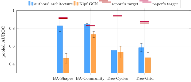

<div class="nb-proto">

<em><span>Prototypical example for this section:</span> BA-Shapes: a $300$-node Barabási–Albert graph with $80$ five-node “house” motifs attached. The explainer is asked why the model labelled a house node as it did, and is scored on whether it points at the house.</em>

</div>

## 1.5.i What the benchmark is {#s1-5-i}

Ying et al. [&#91;Yin+19&#93;](../references/#ref-ying2019) evaluate explanations on four node-classification graphs in which a motif is planted, so the <em>right</em> explanation is known: the motif’s edges. Explanation accuracy is the AUROC of the explainer’s edge mask against those edges. I rebuilt the four graphs from the authors’ released generators (`gengraph.py`, `utils/synthetic_structsim.py`), read directly, using PyG’s `ExplainerDataset` and then adding the authors’ random-edge perturbation (`syn_datasets.py:64-97`).

| Dataset | Construction (as I built it) | nodes | edges$^\ast$ | classes | motif nodes | motif edges$^\ast$ |
|:--|:--|--:|--:|--:|--:|--:|
| BA-Shapes | BA graph (300 nodes, $m=5$) + $80$ houses; constant feature $1.0$; perturbation $p=0.01$ | 700 | 4010 | 4 | 400 | 960 |
| BA-Community | two BA-Shapes-style graphs ($m=4$, $p=0.01$) joined by $350$ random edges; $10$-d Gaussian features, the first two encoding the community | 1400 | 7602 | 8 | 800 | 1920 |
| Tree-Cycles | balanced binary tree of depth $8$ (511 nodes) + $60$ six-node cycles; constant feature; $p=0.01$ | 871 | 1878 | 2 | 360 | 720 |
| Tree-Grid | the same tree + $80$ $3\times3$ grids; constant feature; $p=0.1$; task is grid-versus-tree | 1231 | 3410 | 2 | 720 | 1920 |

$^\ast$ directed entries (every edge is stored both ways). <span style="color:#009b55"><strong>[R]</strong></span> `python datasets.py` prints these counts and confirms that the same seed gives an identical graph in separate processes and a different seed a different one.

Two places where the paper’s prose and its own code disagree, both confirmed by reading the code, and in each case I followed the code because it produced the published numbers: the “$0.1N$” perturbation is a fraction <em>of the edges</em> (`int(num_edges * p)`), with $p=0.01$ except on Tree-Grid; and Tree-Cycles has $60$ cycles, not the $80$ of the paper’s text (the node counts $511+60\cdot6 = 871$ and $511+80\cdot9 = 1231$ corroborate it). Reproducibility needed one fix: PyG draws these graphs from <em>two</em> random generators (NumPy inside `barabasi_albert_graph`, torch inside `ExplainerDataset`), so seeding only torch leaves the graph random. `datasets.py` seeds both, which is why “three seeds” now means three different, regenerable graphs.

## 1.5.ii The pipeline {#s1-5-ii}

For each dataset, each of $3$ seeds is fully independent (graph, model initialisation, split) and does the following (`syn_run_experiment.py:98-130`): train a $3$-layer GCN; run PyG’s `GNNExplainer` ($200$ epochs, `explanation_type='model'`, edges only) on $100$ randomly chosen motif nodes; score each mask on the node’s <em>computation graph</em> against the edges of the node’s <em>own</em> motif; pool all scored edges and compute one AUROC; also report precision and recall of the edges kept at mask $\ge 0.5$.

```python {filename="syn_run_experiment.py, lines 74–85",linenos=table,linenostart=74}
def computation_graph_edges(node_idx, num_layers, edge_index, num_nodes):
    """Boolean mask over edges: True if the edge can influence `node_idx`'s output
    in a `num_layers`-layer message-passing model. Same rule as
    implementations/amlsim/evaluation.py."""
    src, dst = edge_index
    reached = torch.zeros(num_nodes, dtype=torch.bool)
    reached[node_idx] = True
    for _ in range(num_layers - 1):
        newly = torch.zeros(num_nodes, dtype=torch.bool)
        newly[src[reached[dst]]] = True
        reached |= newly
    return reached[dst]
```

Two choices matter. <strong>Computation-graph scoring</strong> is the correction of B2. <strong>Own-motif ground truth</strong> means a motif that merely happens to lie inside a node’s neighbourhood is not part of that node’s explanation (the authors’ `make_pred_real` labels it the same way). It matters on BA-Community: of the motif edges inside the explained nodes’ computation graphs, $31\%$ belong to other motifs (the project’s notes say $28\%$); the shares are $11.5\%$ on Tree-Grid, $5.0\%$ on BA-Shapes and $0.8\%$ on Tree-Cycles <span style="color:#009b55"><strong>[R]</strong></span>. Only $100$ nodes per seed are explained because explaining all $360$–$800$ motif nodes takes hours per model on a laptop; the authors explain one node per motif ($60$–$160$). Nothing is selected on test performance, and one set of hyperparameters is used for all four datasets within a model.

## 1.5.iii Two models, and why both are run {#s1-5-iii}

```python {filename="syn_train_gcn.py, lines 41–68",linenos=table,linenostart=41}
class PaperGCN(torch.nn.Module):
    def __init__(self, in_channels, hidden, out_channels):
        super().__init__()
        dims = [in_channels] + [hidden] * NUM_LAYERS
        self.convs = torch.nn.ModuleList(
            GCNConv(a, b, normalize=False, add_self_loops=False) for a, b in zip(dims[:-1], dims[1:]))
        self.out = torch.nn.Linear(hidden * NUM_LAYERS, out_channels)

    def forward(self, x, edge_index, edge_weight=None):
        outs = []
        for i, conv in enumerate(self.convs):
            x = F.normalize(conv(x, edge_index, edge_weight), p=2, dim=1)
            if i < NUM_LAYERS - 1:
                x = x.relu()
            outs.append(x)
        return self.out(torch.cat(outs, dim=1))


class KipfGCN(torch.nn.Module):
    def __init__(self, in_channels, hidden, out_channels):
        super().__init__()
        dims = [in_channels] + [hidden] * (NUM_LAYERS - 1) + [out_channels]
        self.convs = torch.nn.ModuleList(GCNConv(a, b) for a, b in zip(dims[:-1], dims[1:]))

    def forward(self, x, edge_index, edge_weight=None):
        for conv in self.convs[:-1]:
            x = conv(x, edge_index, edge_weight).relu()
        return self.convs[-1](x, edge_index, edge_weight)
```

- `PaperGCN` is the architecture behind the paper’s Table 1: `GcnEncoderNode` in the authors’ code. Sum aggregation with no self-loops and no degree normalisation (`normalize=False, add_self_loops=False`), a bias, the node embedding <strong>L2-normalised after every layer</strong> (`syn_train_gcn.py:52`), ReLU between layers, and the three layer outputs <em>concatenated</em> before a linear classifier. Hidden width $20$, Adam with learning rate $0.001$ and weight decay $0.005$, the authors’ training values.
- `KipfGCN` is the standard GCN (self-loops, symmetric normalisation), which is what the baseline report describes. Hidden width $32$, learning rate $0.01$, no dropout and no weight decay.

Both use $3$ layers (two layers plateau near $40\%$ accuracy on BA-Shapes, the majority-class rate), $1000$ epochs, gradient clipping at $2.0$ and a class-stratified $80/10/10$ split, and pick the epoch by validation accuracy with ties broken by validation <em>loss</em>: validation accuracy saturates at $1.0$ early, and PyG’s scatter is not bitwise reproducible across thread counts, so a pure accuracy tie would be broken by floating-point noise. Test accuracy is never used for selection. (Two earlier training problems are worth knowing: dropout $0.5$ on a constant one-dimensional feature destroys the only signal the network has, which, and not the lack of gradient clipping, caused test accuracy to swing between $0.47$ and $0.93$ across seeds; and a validation sweep, never a test sweep, chose the Kipf settings.)

## 1.5.iv Results {#sec-mtp-synthres}

Pooled AUROC on computation-graph edges, own-motif ground truth, $100$ motif nodes $\times$ $3$ seeds, mean $\pm$ population standard deviation. <span style="color:#0071bc"><strong>[F]</strong></span> The two targets are the baseline report’s Table 5.1 and the GNNExplainer paper’s Table 1 (read from page 8 of the paper’s PDF: $0.925$, $0.836$, $0.948$, $0.875$ <span style="color:#009b55"><strong>[R]</strong></span>).

| Model | Dataset | GCN test acc | <strong>pooled AUROC</strong> | kept prec. / rec. | report | paper |
|:--|:--|:-:|:-:|:-:|--:|--:|
| authors’ arch. | BA-Shapes | 0.971 $\pm$ 0.020 | <strong>0.829 $\pm$ 0.063</strong> | 0.78 / 0.55 | 0.912 | 0.925 |
| authors’ arch. | BA-Community | 0.817 $\pm$ 0.047 | <strong>0.844 $\pm$ 0.012</strong> | 0.46 / 0.56 | 0.828 | 0.836 |
| authors’ arch. | Tree-Cycles | 0.996 $\pm$ 0.005 | <strong>0.552 $\pm$ 0.083</strong> | 0.74 / 0.64 | 0.939 | 0.948 |
| authors’ arch. | Tree-Grid | 0.919 $\pm$ 0.011 | <strong>0.584 $\pm$ 0.046</strong> | 0.71 / 0.54 | 0.860 | 0.875 |
| Kipf GCN | BA-Shapes | 0.948 $\pm$ 0.024 | <strong>0.463 $\pm$ 0.054</strong> | 0.28 / 0.47 | 0.912 | 0.925 |
| Kipf GCN | BA-Community | 0.674 $\pm$ 0.028 | <strong>0.731 $\pm$ 0.032</strong> | 0.32 / 0.61 | 0.828 | 0.836 |
| Kipf GCN | Tree-Cycles | 0.962 $\pm$ 0.005 | <strong>0.534 $\pm$ 0.066</strong> | 0.87 / 0.60 | 0.939 | 0.948 |
| Kipf GCN | Tree-Grid | 0.825 $\pm$ 0.036 | <strong>0.471 $\pm$ 0.060</strong> | 0.86 / 0.09 | 0.860 | 0.875 |

<figure class="nb-fig"></figure>

Per seed:

| Model | Dataset | pooled AUROC, seeds 0, 1, 2 |  |  | GCN test accuracy, seeds 0, 1, 2 |  |  |
|:--|:--|:-:|:-:|:-:|:-:|:-:|:-:|
| authors’ arch. | BA-Shapes | 0.8165 | 0.7596 | 0.9121 | 0.943 | 0.986 | 0.986 |
| authors’ arch. | BA-Community | 0.8599 | 0.8319 | 0.8399 | 0.871 | 0.757 | 0.821 |
| authors’ arch. | Tree-Cycles | 0.6148 | 0.4346 | 0.6072 | 1.000 | 0.989 | 1.000 |
| authors’ arch. | Tree-Grid | 0.6446 | 0.5727 | 0.5337 | 0.927 | 0.927 | 0.903 |
| Kipf GCN | BA-Shapes | 0.4494 | 0.4053 | 0.5353 | 0.914 | 0.971 | 0.957 |
| Kipf GCN | BA-Community | 0.7607 | 0.6867 | 0.7468 | 0.700 | 0.636 | 0.686 |
| Kipf GCN | Tree-Cycles | 0.5367 | 0.6127 | 0.4514 | 0.955 | 0.966 | 0.966 |
| Kipf GCN | Tree-Grid | 0.5544 | 0.4168 | 0.4403 | 0.855 | 0.774 | 0.847 |

<span style="color:#009b55"><strong>[R]</strong></span> I re-ran both models through the project’s own code on all four datasets (all eight rows of the table), and every per-seed AUROC matches the logged value to every printed digit. Authors’ architecture: BA-Shapes $0.8165, 0.7596, 0.9121$ (mean $0.8294$, s.d. $0.0629$), BA-Community $0.8599, 0.8319, 0.8399$ ($0.8439$, $0.0118$), Tree-Cycles $0.6148, 0.4346, 0.6072$ ($0.5522$, $0.0832$), Tree-Grid $0.6446, 0.5727, 0.5337$ ($0.5837$, $0.0459$). Kipf GCN: BA-Shapes $0.4494, 0.4053, 0.5353$ ($0.4633$, $0.0540$), BA-Community $0.7607, 0.6867, 0.7468$ ($0.7314$, $0.0321$), Tree-Cycles $0.5367, 0.6127, 0.4514$ ($0.5336$, $0.0659$), Tree-Grid $0.5544, 0.4168, 0.4403$ ($0.4705$, $0.0601$). So the synthetic pipeline, unlike the AMLSim two-layer runs, is reproducible across the two environments.

### What “$2$ of $4$ within $0.01$–$0.10$” is made of {#what-2-of-4-within-0-01-0-10-is-made-of}

| Dataset | my mean | report target | distance | paper target | distance |
|:--|:-:|--:|--:|--:|--:|
| BA-Shapes | $0.8294$ | $0.912$ | $0.083$ below | $0.925$ | $0.096$ below |
| BA-Community | $0.8439$ | $0.828$ | $0.016$ above | $0.836$ | $0.008$ above |

The BA-Shapes mean hides a wide spread: one seed ($0.9121$) lands on the report’s $0.912$, the others are $0.817$ and $0.760$, which is why the standard deviation is $0.063$. The rest of the BA-Shapes gap is mostly the node protocol, not the model: the authors explain each motif’s <em>attachment</em> node, the easy case, because that node looks like a base node and its prediction has to rest on the motif; I explain random motif nodes. Their own code scores $0.997$ on their nodes ([Section 1.5.vii](#sec-mtp-authorsrun)) and my port of it, now lost, gave $0.915$ on their nodes against $0.83$ on random ones <span style="color:#f7921d"><strong>[L]</strong></span>.

## 1.5.v The undocumented detail: per-layer L2 normalisation {#sec-mtp-l2}

<strong>How it was found.</strong> The Kipf GCN, the model the baseline report describes, did <em>not</em> reproduce the paper once the scoring was corrected: BA-Shapes $0.463 \pm 0.054$ and, on the two structure-only tree datasets, chance. So I read the authors’ released model. The relevant code is two lines inside the convolution:

```python {filename="authors_models.py, lines 58–80",linenos=table,linenostart=58}
    def forward(self, x, adj):
        if self.dropout > 0.001:
            x = self.dropout_layer(x)
        # deg = torch.sum(adj, -1, keepdim=True)
        if self.att:
            x_att = torch.matmul(x, self.att_weight)
            # import pdb
            # pdb.set_trace()
            att = x_att @ x_att.permute(0, 2, 1)
            # att = self.softmax(att)
            adj = adj * att

        y = torch.matmul(adj, x)
        y = torch.matmul(y, self.weight)
        if self.add_self:
            self_emb = torch.matmul(x, self.self_weight)
            y += self_emb
        if self.bias is not None:
            y = y + self.bias
        if self.normalize_embedding:
            y = F.normalize(y, p=2, dim=2)
            # print(y[0][0])
        return y, adj
```

Line 70 is $AX$ with the <em>raw</em> adjacency: no self-loops (unless `add_self`), no degree normalisation. Lines 77–78 then replace each node’s output vector by the unit vector in the same direction, and `GcnEncoderGraph` builds every layer with `normalize=True` (`authors_models.py:114-122`), whatever the configuration says. The activation is applied after the normalisation, the three layer outputs are concatenated (`authors_models.py:230-267`), and a linear head classifies the concatenation. My `PaperGCN` is a port of that into sparse PyG form (the authors use a dense adjacency matrix).

<strong>It is undocumented.</strong> The paper PDF I have (12 pages, no appendix) contains no occurrence of “normali\*”, “L2”, “concat” or “hidden”; the baseline report’s single use of “normalization” refers to the adjacency normalisation of Kipf and Welling. <span style="color:#009b55"><strong>[R]</strong></span> (text search of both PDFs). The release is the only place the step is written down.

<strong>It matters, in both directions.</strong> On BA-Shapes, with the same $3$ seeds, $100$ nodes, scoring and hyperparameters as above, I changed one thing at a time: first removing the step from the authors’ architecture, then adding it alone to the Kipf GCN:

| Model | seed 0 | seed 1 | seed 2 | mean $\pm$ s.d. |
|:--|:-:|:-:|:-:|:-:|
| Kipf GCN (self-loops, sym. norm.) <span style="color:#0071bc"><strong>[F]</strong></span> | $0.4494$ | $0.4053$ | $0.5353$ | $0.463 \pm 0.054$ |
| authors’ architecture minus the L2 step <span style="color:#009b55"><strong>[R]</strong></span> | $0.5545$ | $0.6253$ | $0.6199$ | $0.600 \pm 0.032$ |
| authors’ architecture <span style="color:#0071bc"><strong>[F]</strong></span> <span style="color:#009b55"><strong>[R]</strong></span> | $0.8165$ | $0.7596$ | $0.9121$ | $0.829 \pm 0.063$ |
| Kipf GCN plus the L2 step <em>only</em> <span style="color:#009b55"><strong>[R]</strong></span> | $0.8840$ | $0.9307$ | $0.8720$ | $0.896 \pm 0.025$ |

(GCN test accuracy is $0.948$, $0.929$, $0.971$ and $0.886$ in the four rows. The accuracies sit within $0.09$ of each other while the explanation AUROCs span $0.46$ to $0.90$: accuracy does not predict explainability.) The first three rows are the <em>necessity</em> direction. Removing the L2 step costs $0.229$ AUROC, which is $63\%$ of the $0.366$ gap between the Kipf model and the authors’ model. The remaining $37\%$, between $0.600$ and $0.463$, comes from the other differences (sum aggregation without self-loops or normalisation, the concatenated readout, hidden width $20$, learning rate and weight decay), which I did not separate. The project’s notes record an earlier ablation on a smaller node sample, $0.455 \to 0.807 \to 0.477$ for Kipf, authors’ and authors’ without L2 <span style="color:#f7921d"><strong>[L]</strong></span>; the script that produced it was not saved, which is why the table above replaces it with the full protocol.

The last row is the <em>sufficiency</em> direction, a test I added on 2 October and that is not in the project’s results. I took the plain Kipf GCN (self-loops, symmetric normalisation, hidden width $32$) and changed exactly one thing: the output of every hidden layer is divided by its per-node L2 norm before the ReLU (`F.normalize(..., p=2, dim=1)`); the last layer’s logits are left alone. Same three seeds, $100$ nodes, scoring and explainer. The AUROC goes from $0.463$ to $0.896 \pm 0.025$, higher than the authors’ own architecture on this protocol ($0.829$), without sum aggregation, without dropping self-loops and without the concatenated readout. So on BA-Shapes the L2 step is both necessary (removing it from the authors’ model costs $0.23$) and sufficient (adding it alone to the Kipf GCN gains $0.43$). In seed $0$ no mask value reaches $0.5$, so the kept-edge precision and recall are both $0$, yet the AUROC is $0.884$: AUROC scores the ranking, not the thresholded set. What this does not show: why it works.

<strong>Other datasets.</strong> The necessity direction also holds on BA-Community <span style="color:#009b55"><strong>[R]</strong></span>: the authors’ architecture scores $0.844 \pm 0.012$, the same architecture without the L2 step $0.663 \pm 0.042$ (per seed $0.626, 0.641, 0.721$; GCN test accuracy falls from $0.82$ to $0.67$), below the Kipf GCN’s $0.731 \pm 0.032$. The sufficiency test, run the same way on the two other datasets I tried <span style="color:#009b55"><strong>[R]</strong></span>: on BA-Community the Kipf GCN plus the L2 step scores $0.790 \pm 0.019$ (per seed $0.776, 0.776, 0.817$), up from the Kipf GCN’s $0.731$ but short of the authors’ architecture’s $0.844$, so here it closes about half of the gap; on Tree-Cycles it scores $0.575 \pm 0.214$ (per seed $0.690, 0.760, 0.275$), no better than the Kipf GCN ($0.534$) or the authors’ architecture ($0.552$) given a spread this wide, with one seed below chance. Tree-Grid was not run. So the L2 step is sufficient on BA-Shapes, helps on BA-Community, and does nothing reliable on Tree-Cycles, which is the dataset that nothing reproduces.

<strong>Why would it matter?</strong> <strong>UNKNOWN</strong>; I did not test a mechanism. Two untested hypotheses: (i) with sum aggregation and no normalisation, a hub’s embedding is large and carries its degree, so the model can read “this is a hub” from magnitude; unit-length embeddings remove that shortcut and force the prediction to depend on <em>which</em> neighbours are present; (ii) normalised embeddings have a bounded response to removing one edge, so the mask’s gradient is better scaled. The documented statement is the weaker one: which edges a model <em>needs</em> is a property of its architecture, and GNNExplainer can only find edges the model needs.

## 1.5.vi The two datasets that did not reproduce {#sec-mtp-synthfail}

| Pooled AUROC | Tree-Cycles | Tree-Grid | where |
|:--|:-:|:-:|:-:|
| paper’s Table 1 | $0.948$ | $0.875$ |  |
| my pipeline, authors’ architecture | $0.552 \pm 0.083$ | $0.584 \pm 0.046$ | <span style="color:#0071bc"><strong>[F]</strong></span> |
| my pipeline, Kipf GCN | $0.534 \pm 0.066$ | $0.471 \pm 0.060$ | <span style="color:#0071bc"><strong>[F]</strong></span> |
| authors’ released code, as released | crashes | crashes | <span style="color:#0071bc"><strong>[F]</strong></span> |
| authors’ code, scoring fixed ([Section 1.5.vii](#sec-mtp-authorsrun)) | $0.647 \pm 0.091$ | $0.671 \pm 0.052$ | <span style="color:#0071bc"><strong>[F]</strong></span> |
| independent reproduction, [&#91;Ho21&#93;](../references/#ref-holdijk2021) | $0.540$ | $0.714$ | <span style="color:#f7921d"><strong>[L]</strong></span> |

So the count “$2$ of $4$” is not a failure of my pipeline specifically: four separate measurements (mine, an earlier port of the authors’ code that was not saved, the authors’ own code and an independent reproduction) land between $0.54$ and $0.65$ on Tree-Cycles, and the released code cannot even score Tree-Grid. What the masks look like on Tree-Cycles nodes explains why. <span style="color:#009b55"><strong>[R]</strong></span> On $20$ seeded nodes of simulation $0$ (masks are per <em>directed</em> entry, so $8$ entries are $4$ undirected edges): for the Kipf GCN, the computation graph has a median of $11$ entries, $10$ of them the cycle’s own (over all $300$ explained nodes the median is $13$ and $10$). The explainer keeps a median of $8$ entries at values $0.79$–$0.93$ with precision $0.90$ and recall $0.72$, and drives <em>everything else</em>, cycle edges and tree edges alike, to one common floor: the lowest, median and $90$th-percentile values of all other entries are $0.074$, $0.074$ and $0.079$. That is the objective working as designed: a small subset of the cycle is <em>sufficient</em> to keep the prediction, the size term removes the rest, and under Adam every entry whose gradient points downward travels the same distance regardless of its magnitude, so the order <em>inside</em> the floor is noise. The ground truth says “the whole cycle”, so recall is limited and the AUROC is decided by that noise. (The picture differs for the authors’ architecture: a median of $10$ entries kept, precision $0.81$, recall $0.83$, and the other entries are not flat but spread from $0.075$ to $0.40$, median $0.107$; that model’s masks carry more ranking information, yet its pooled Tree-Cycles AUROC is still only $0.552$.) The project’s notes add that turning the entropy regulariser off raises Tree-Cycles to about $0.72$ with the Kipf model <span style="color:#f7921d"><strong>[L]</strong></span>, and they read this as the entropy term binarising the masks, which AUROC punishes. <span style="color:#009b55"><strong>[R]</strong></span> I re-ran the Kipf GCN on Tree-Cycles with the edge-entropy coefficient set to $0$ and nothing else changed: $0.635, 0.901, 0.704$, mean $0.747 \pm 0.113$, against $0.534 \pm 0.066$ with it on. The direction and size agree with the notes ($0.72$ is inside the spread of three seeds), the binarisation reading is untested, and the spread is wide. I left the term on because it is part of the method.

Nine other explanations were tested on the same nodes and rejected, each with numbers (classifier over-confidence, size coefficient, the authors’ mask initialisation and optimiser, perturbation, PyG’s implementation against my hand-written one, the node set, readout, a Laplacian term, the target label) <span style="color:#f7921d"><strong>[L]</strong></span>; the table is in `documentations/gcn_gnnexplainer.md`, section 3c.

## 1.5.vii The authors’ released code, run unmodified {#sec-mtp-authorsrun}

On 27 September I ran `RexYing/gnn-model-explainer` itself (commit `bc98482`; Tree-Cycles training crashes at master because of a 2020 contributor commit, so that dataset ran from `47e6973`, which differs only in log paths, shown by a bit-identical re-run of BA-Shapes) on this laptop, with three seeds and Python 3.8 and `torch 1.6.0`. <span style="color:#0071bc"><strong>[F]</strong></span>

| Dataset | GCN test acc | authors’ scorer, as released | scoring fixed (first node of each motif) | paper |
|:--|:-:|:--|:--|:-:|
| BA-Shapes | $0.971 \pm 0.006$ | $0.997 \pm 0.001$ | same | $0.925$ |
| BA-Community | $0.887 \pm 0.015$ | $0.988 \pm 0.006$ | same | $0.836$ |
| Tree-Cycles | $0.983 \pm 0.005$ | crash (`IndexError`, node 405) | $0.647 \pm 0.091$ | $0.948$ |
| Tree-Grid | $0.906 \pm 0.013$ | crash (no `syn5` branch) | $0.671 \pm 0.052$ | $0.875$ |

Their scorer uses the node range `range(400, 700, 5)` for every dataset, which is the BA-Shapes houses and is out of range or meaningless on the trees. Scoring the same masks on computation-graph edges only changes every number by less than $0.01$ ($0.991$ and $0.980$ on the BA sets), so the explainer and model genuinely recover the house from its attachment node, and the induced-subgraph inflation of B2 does not explain their number. I also found that their loss uses the <em>true</em> label, not the model’s prediction. This experiment is not on the resume; it is the reason I can say the two missing datasets are not recoverable from the authors’ repository.

## 1.5.viii What B3 does not claim {#s1-5-viii}

- That I <em>reproduced the paper</em>: I reproduced two of four numbers, with a protocol (random motif nodes) that is harder than the authors’, and I report the other two as not reproduced.
- That L2 normalisation explains every number: on BA-Shapes it was necessary and sufficient in my tests, on BA-Community it closes about half the gap, and on Tree-Cycles and Tree-Grid it does not rescue the benchmark.
- That I know <em>why</em> it matters.

## 1.5.ix Questions this bullet invites {#s1-5-ix}

Which two datasets, and why only those? What are the published targets, and what does “within” mean? What is the undocumented detail, how did you find it, and how do you know it matters (the ablation)? Why three layers? Why pooled AUROC? Why did Tree-Cycles fail, and does that mean your pipeline is wrong? What is the difference between your protocol and the authors’? How were the graphs made reproducible? Worked answers are in the problems at the end of the chapter.
