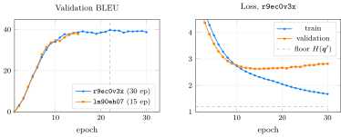
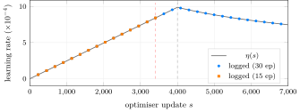
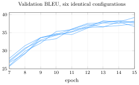
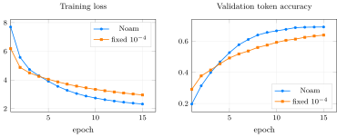
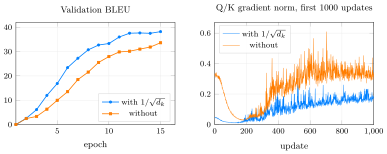
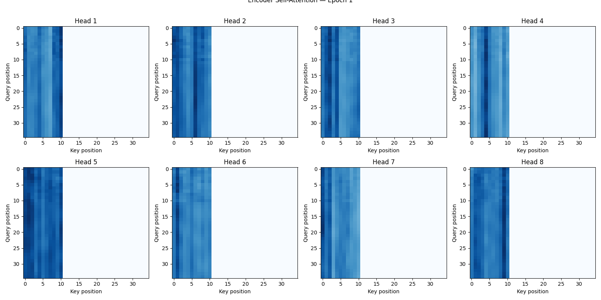
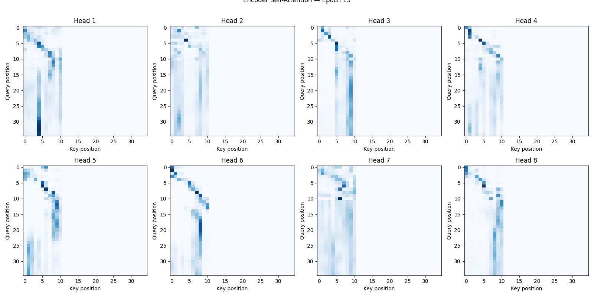
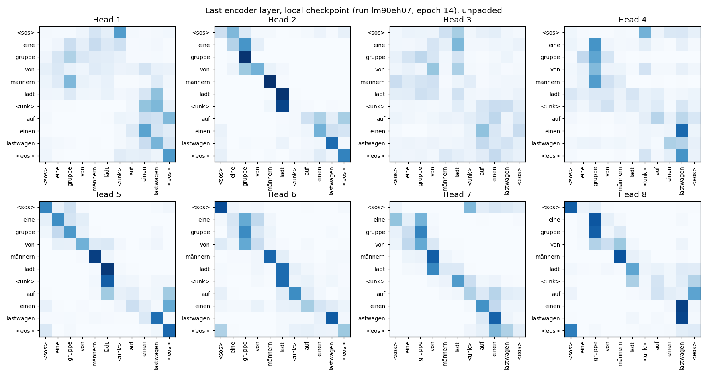
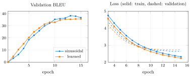
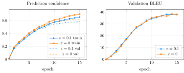

<em>Prototypical example for this section: the ablation pair `0kax3ah0` / `wptvqi13`: the same model trained with and without the $1/\sqrt{d_k}$ scaling.</em>

## 1.4.i The W&amp;B project {#s1-4-i}

All runs live in one W&amp;B project, `da6401-a3`. There are no sweeps, groups or tags: every run was started by hand with a descriptive name. Per-epoch metrics are `train_loss`, `val_loss`, `val_bleu`, `learning_rate`, and in the notebook runs also `train_perplexity`, `val_perplexity` and `val_token_accuracy`; each run ends by logging `test_bleu` and `best_val_bleu`. Ablation 2.2 additionally logs `qk_grad_norm` at every update, and 2.5 logs `train_confidence` and `val_confidence`.

| Run id | Name | State | Created (UTC) | Runtime (s) |
|:--|:--|:--|:--|--:|
| `ugbk035b` | `clear-butterfly-1` | failed | 2026-05-09 12:34 | 8 |
| `e1cwovk0` | `lemon-paper-2` | killed | 2026-05-09 12:41 | 100 |
| `nf0y7hbm` | `main_training` | finished | 2026-05-14 09:00 | 119 |
| `c7d0z5g9` | `main_training` | finished | 2026-05-14 09:02 | 322 |
| `u1gvkonn` | `main_training` | crashed | 2026-05-14 09:11 | – |
| `lm90eh07` | `main_training` | finished | 2026-05-14 09:27 | 1192 |
| `pc0p33lw` | `upload-checkpoint` | finished | 2026-05-14 09:47 | 2 |
| `ru9dp751` | `main_training` | crashed | 2026-05-14 09:58 | – |
| `e56jo7r4` | `main_training` | crashed | 2026-05-14 10:56 | 87 |
| `r9ec0v3x` | `main_training` | finished | 2026-05-14 11:04 | 2227 |
| `nk7bpdip` | `ablation_2_1_noam_scheduler` | finished | 2026-05-14 17:51 | 1146 |
| `vfe597s4` | `ablation_2_1_fixed_lr` | finished | 2026-05-14 18:10 | 1161 |
| `0kax3ah0` | `ablation_2_2_with_scaling` | finished | 2026-05-14 18:30 | 1168 |
| `wptvqi13` | `ablation_2_2_no_scaling` | finished | 2026-05-14 18:49 | 1113 |
| `t9jaqwy1` | `ablation_2_3_attention_heads` | finished | 2026-05-14 19:08 | 1152 |
| `965l9hi6` | `ablation_2_4_sinusoidal_pe` | finished | 2026-05-14 19:27 | 1112 |
| `9dg7ccnk` | `ablation_2_4_learned_pe` | finished | 2026-05-14 19:45 | 1087 |
| `xk9wrmw2` | `ablation_2_5_smoothing_0.1` | finished | 2026-05-14 20:04 | 1229 |
| `uc5mn6hd` | `ablation_2_5_no_smoothing` | finished | 2026-05-14 20:24 | 1204 |

Two model artifacts exist. `transformer-de-en:v0`, uploaded by the helper run `pc0p33lw`, has the same MD5 digest as the local file `transformer_de_en.pt`, so the local checkpoint is the best epoch of `lm90eh07`. `transformer_de_en:v0`, logged by `r9ec0v3x`, is described as “Best checkpoint — val BLEU=39.76, test BLEU=38.03”. The successful Kaggle runs report two Tesla T4 GPUs in their metadata; the code only ever uses `'cuda'`, so one GPU did the work.

## 1.4.ii How the solution evolved {#sec-a3-history}

Git records almost nothing: the GitHub repository has three commits made within twelve minutes on 19 May 2026, one of which adds all the code at once. The W&amp;B history and file timestamps tell the real story (times in UTC; IST is UTC$+5{:}30$).

- <strong>9 May, 12:34 and 12:41.</strong> Two runs from my laptop (Python 3.13.7, CPU). `ugbk035b` failed after $8$ s because the spaCy model `de_core_news_sm` was not installed; `e1cwovk0` was interrupted by hand after $100$ s of CPU training. Their tracebacks mention `train.py` line 529, `self.ff` and `linear1`, so the code was later refactored to its current names (`feed_forward`, `fc1`).
- <strong>14 May, 09:00–09:11.</strong> Three Kaggle attempts logged no metrics. The log of `nf0y7hbm` shows PyTorch refusing a Tesla P100 (“cuda capability 6.0”, below its minimum of $7.0$), and `u1gvkonn`’s metadata records a P100; the cause for `c7d0z5g9` is UNKNOWN.
- <strong>09:27–09:47.</strong> `lm90eh07`: the first complete run, 15 epochs on a T4. Its best checkpoint (epoch 14) was uploaded as `transformer-de-en:v0`.
- <strong>09:58–11:41.</strong> Two 30-epoch attempts crashed (`ru9dp751`, and `e56jo7r4` after one epoch; causes UNKNOWN); `r9ec0v3x` then ran all 30 epochs in $2{,}227$ s and uploaded its best checkpoint.
- <strong>17:51–20:44.</strong> The nine ablation runs, back to back, about $19$ minutes each.
- <strong>19 May.</strong> GitHub repository created; the W&amp;B report was last updated at 15:30.

## 1.4.iii Main training runs {#s1-4-iii}

<figure class="nb-fig"></figure>

- In the 30-epoch run, validation loss is lowest at epoch 14 ($2.623$) and then slowly rises to $2.817$, while validation BLEU keeps improving to its best, $39.76$ at epoch 22 (dashed line). Loss measures the probability given to every correct word, BLEU only what the argmax produces; a model can grow over-confident on its mistakes (higher loss) while its top choices still improve (higher BLEU). Selecting the checkpoint by BLEU rather than by loss was therefore the right call.
- Training loss falls to $1.673$ and would keep falling; it can never go below the label-smoothing floor $1.193$ of [Proposition 1.2.11](../theory/#proposition-1-2-11).
- Over the last ten epochs validation BLEU stays between $38.5$ and $39.8$: returns have flattened.

### The warm-up trap {#sec-a3-warmup-trap}

One epoch is $227$ updates, so $15$ epochs are $3{,}405$ updates, fewer than the $4{,}000$ warm-up steps. <em>Every 15-epoch run, including all nine ablations, ended while the learning rate was still rising.</em> The logged final rate $8.41 \times 10^{-4}$ is exactly $\eta(3406)$, $85\%$ of the peak. Only the 30-epoch run ($6{,}810$ updates) ever reached the decay phase.

<figure class="nb-fig"></figure>

The red dashed line is the end of a 15-epoch run, the grey one the end of warm-up. This matters for the interpretation of ablation 2.1 below.

## 1.4.iv How noisy is one run? {#sec-a3-noise}

There are no random seeds, and six runs happen to share exactly the baseline configuration (Noam, scaling on, sinusoidal PE, $\varepsilon = 0.1$, 15 epochs): `lm90eh07` and the “A” arm of ablations 2.1–2.5. Their spread is the noise floor for every comparison that follows.

<figure class="nb-fig"></figure>

| Six baseline runs | mean | std. dev. | min | max |
|:--|:-:|:-:|:-:|:-:|
| final validation BLEU (epoch 15) | $37.87$ | $0.82$ | $36.71$ | $39.18$ |
| best validation BLEU | $38.25$ | $0.56$ | $37.44$ | $39.18$ |
| test BLEU (final model) | $38.03$ | $0.73$ | $37.28$ | $38.80$ |

Two runs of the <em>same</em> configuration can differ by $2.5$ BLEU. A single-run difference smaller than about $1.5$ BLEU is not evidence of anything.

## 1.4.v Ablation 2.1: Noam schedule vs fixed learning rate {#sec-a3-abl21}

Run A (`nk7bpdip`) uses Noam; run B (`vfe597s4`) sets the learning rate to $10^{-4}$ for every update and has no scheduler.

<figure class="nb-fig"></figure>

|  | validation BLEU after epoch 1 | 2 | 3 | 4 | 15 | test BLEU |
|:--|:-:|:-:|:-:|:-:|:-:|:-:|
| Noam | $0.02$ | $2.71$ | $7.35$ | $12.02$ | $37.44$ | $37.42$ |
| fixed $10^{-4}$ | $2.44$ | $6.35$ | $8.03$ | $10.94$ | $29.52$ | $30.88$ |

- The fixed rate is <em>ahead</em> for the first three epochs (epoch-1 training loss $6.19$ against $7.70$). That is simply because Noam’s rate starts at $2.5 \times 10^{-7}$ and only passes $10^{-4}$ at update $405$, in the second epoch.
- From epoch 4 on Noam leads, and by epoch 15 its rate is $8.4$ times the fixed one; it finishes $7.9$ BLEU ahead on validation and $6.5$ on test, far outside the noise of [Section 1.4.iv](#sec-a3-noise).
- Neither run diverged. A fixed $10^{-4}$ is small and stable: this experiment shows that a <em>larger</em> rate reached through warm-up trains faster, not that training without warm-up is unstable.

<strong>Remark 1.4.1</strong> (What the report says vs what the data shows) — The report text written in the notebook says “the fixed lr run struggles early on while the Noam run converges much more smoothly”. The data shows the opposite in the first epochs. The question the spec asks, why warm-up prevents early divergence, needs a different run B: a constant rate near Noam’s <em>peak</em> ($\approx 10^{-3}$) with no warm-up, ideally over several seeds. With Post-LN, that is where Xiong et al. [&#91;Xio+20&#93;](../references/#ref-xiong2020) predict trouble.

## 1.4.vi Ablation 2.2: the $1/\sqrt{d_k}$ scaling {#sec-a3-abl22}

Run A (`0kax3ah0`) divides the scores by $\sqrt{32}$; run B (`wptvqi13`) does not. Both log `qk_grad_norm`: the $\ell_2$ norm of the gradients of every `W_q` and `W_k` weight and bias in the model, measured after `backward()` and <em>before</em> clipping, at every update.

<figure class="nb-fig"></figure>

|  | updates 1–1000 mean | median | min | max | mean over updates 1–100 | 101–500 | 501–1000 | last 1000 |
|:--|:-:|:-:|:-:|:-:|:-:|:-:|:-:|:-:|
| with $1/\sqrt{d_k}$ | 0.107 | 0.121 | 0.011 | 0.265 | 0.026 | 0.064 | 0.157 | 0.244 |
| without | 0.247 | 0.290 | 0.028 | 0.610 | 0.225 | 0.136 | 0.340 | 0.578 |

- Scaling clearly matters: without it the model is behind at every epoch and ends at $33.63$ validation / $33.80$ test BLEU, against $38.20$ / $38.75$. The gap of about $5$ BLEU is several times the noise.
- But the gradients did <em>not</em> vanish. Without scaling the Q/K gradient norm was $2.3$ times <em>larger</em> over the first $1000$ updates, and about $7$ times larger in the very first updates ($0.32$ against $0.044$).

<strong>Question 1.4.2</strong> — Why would removing the scale make the Q/K gradients larger, when the theory says the softmax saturates?

Two effects compete. The score is $s = \bm{q} \cdot \bm{k} / c$ with $c = \sqrt{d_k}$ or $c = 1$, so $\partial s / \partial \bm{q} = \bm{k} / c$: removing the scale multiplies every gradient reaching $\bm{W}^Q$ and $\bm{W}^K$ by $\sqrt{32} \approx 5.66$ <em>before</em> any saturation. Saturation shrinks the softmax Jacobian, but only once rows are nearly one-hot. At Xavier initialisation the projected queries and keys are small, so the unscaled logits are not yet large enough for saturation to win, and the first effect dominates. What the unscaled model shows instead is worse optimisation: its training loss is higher at every epoch ($4.96$ against $4.76$ after epoch 3, $2.78$ against $2.31$ at the end), consistent with sharper, less useful attention distributions. So the paper’s “vanishing gradient” mechanism is not what this run measured, and the report’s prediction that “without scaling these norms should be much smaller” did not hold.

## 1.4.vii Ablation 2.3: attention heads {#sec-a3-abl23}

Run `t9jaqwy1` plots, after every epoch, the $8$ attention maps of the last encoder layer for the first validation sentence ([Section 1.1](../data/)).

<figure class="nb-fig nb-img"></figure> <figure class="nb-fig nb-img"></figure> W&amp;B images from `t9jaqwy1`, after epoch 1 (top) and epoch 15 (bottom). Rows are queries, columns keys; positions $0$–$10$ are real tokens, $11$–$34$ padding.

After epoch 1 every head spreads its attention almost evenly over the $11$ real tokens. After epoch 15 the heads have separated: several show a diagonal band (each word attends to itself or a neighbour), others stay diffuse.

<strong>Remark 1.4.3</strong> (Three problems with this experiment as logged) — The run answers the question only partly.

1. <strong>The images are not in the run history.</strong> They were logged with `step=epoch_num`, but the metrics had already advanced W&amp;B’s step counter, and the log shows “Tried to log to step 0 that is less than the current step 1 … this data will be ignored” after every epoch. The image files were still uploaded to the run, but a report panel reads the history, so the report’s media panel probably shows nothing (UNKNOWN). Logging without `step=` would have worked.
2. <strong>The sentence is padded.</strong> It was taken from a padded batch, so rows $11$–$34$ are padding queries: $24$ of the $35$ rows in each map are meaningless.
3. <strong>It is not attention rollout.</strong> The spec’s title says “attention rollout”, which combines the attention of all layers [&#91;AZ20&#93;](../references/#ref-abnar2020); the code shows the raw weights of the last layer only. (The spec also says “a single English sentence”, but the encoder reads German, so German is the only sensible choice.)

To analyse the heads properly I recomputed the same sentence without padding, using the local checkpoint (the best epoch of `lm90eh07`, a different run of the same configuration):

<figure class="nb-fig nb-img"></figure>

| Head | entropy | self | previous | next | mean distance | most attended word |
|:-:|--:|--:|--:|--:|--:|:--|
| 1 | 1.65 | 0.20 | 0.08 | 0.12 | 2.45 | lastwagen |
| 2 | 0.85 | 0.55 | 0.15 | 0.17 | 0.92 | gruppe |
| 3 | 1.98 | 0.14 | 0.13 | 0.10 | 2.70 | lädt |
| 4 | 1.61 | 0.16 | 0.22 | 0.20 | 2.33 | gruppe |
| 5 | 0.98 | 0.55 | 0.17 | 0.06 | 1.00 | lädt |
| 6 | 1.13 | 0.46 | 0.26 | 0.12 | 1.20 | lädt |
| 7 | 1.14 | 0.17 | 0.48 | 0.09 | 1.65 | einen |
| 8 | 0.93 | 0.41 | 0.08 | 0.27 | 1.65 | lastwagen |

Entropy is the mean over rows in nats (a uniform row over $11$ tokens has $\log 11 = 2.40$); “self”, “previous” and “next” are the mean weight on the token itself and its two neighbours; mean distance is $\sum_j a_{ij} |i - j|$ averaged over rows.

- <strong>Identity heads: 2, 5, 6.</strong> About half of each row stays on the word itself. They are also the three most similar pairs of heads (Jensen–Shannon divergence $0.10$–$0.13$, against $0.33$–$0.37$ for the most different pairs): this is the <strong>head redundancy</strong> the spec asks about [&#91;MLN19&#93;](../references/#ref-michel2019).
- <strong>Previous-word head: 7</strong> puts $48\%$ of its weight on the preceding token.
- <strong>Article-to-noun heads: 4 and 8.</strong> In both, <em>eine</em> attends to <em>gruppe</em> and <em>einen</em> to <em>lastwagen</em>: determiners look at their nouns.
- <strong>Broad heads: 1 and 3</strong> have the highest entropy and the longest reach.
- The unknown word (<em>Baumwolle</em>, now `<unk>`) attends mostly to its verb <em>lädt</em> in heads 2, 5 and 6: with no embedding of its own, it borrows context.

This is the pattern Voita et al. [&#91;Voi+19&#93;](../references/#ref-voita2019) report for much larger models: a few positional and syntactic heads, plus heads that could be pruned. With one sentence and one checkpoint it is an illustration, not a measurement.

## 1.4.viii Ablation 2.4: sinusoidal vs learned positions {#sec-a3-abl24}

Run A (`965l9hi6`) uses the sinusoidal table; run B (`9dg7ccnk`) a learned `nn.Embedding(5000, 256)`, which adds $1{,}280{,}000$ parameters.

<figure class="nb-fig"></figure>

- The learned embeddings start faster (validation BLEU $10.38$ against $6.27$ after epoch 3) but level off at about $35$ from epoch 11; the sinusoidal run reaches $38.27$ at epoch 13. Test BLEU: $37.28$ sinusoidal, $35.46$ learned.
- The learned run has the <em>lower</em> training loss ($2.226$ against $2.318$) but the <em>higher</em> validation loss ($2.733$ against $2.633$): the extra parameters were used to fit the training set, not to generalise.
- $35.46$ is below all six baseline runs of [Section 1.4.iv](#sec-a3-noise) (the lowest was $37.28$), so the gap is probably real, though it rests on one run. The paper found the two “nearly identical” on a far larger dataset; with $29$k short sentences, the rarely used long positions of the learned table get very few updates.

<strong>Remark 1.4.4</strong> (Extrapolation, made precise) — Every training sequence has at most $46$ tokens, so rows $46$–$4999$ of the learned table never receive a gradient: they exist, but stay at their random initial values. A longer test sentence would be encoded with noise at those positions. The sinusoidal encoding is a formula, defined for every $pos$, and by [Proposition 1.2.8](../theory/#proposition-1-2-8) the relation between positions $pos$ and $pos + k$ is the same fixed rotation everywhere. That is the theoretical case for extrapolation. In this code both tables stop at $5000$ positions, but only the sinusoidal one could be extended without retraining.

## 1.4.ix Ablation 2.5: label smoothing {#sec-a3-abl25}

Run A (`xk9wrmw2`) trains with $\varepsilon = 0.1$, run B (`uc5mn6hd`) with $\varepsilon = 0$. Both log the <strong>prediction confidence</strong>: the mean softmax probability of the correct token over all non-pad positions, with teacher forcing.

<figure class="nb-fig"></figure>

|  | confidence train | val | train loss | train ppl. | best val BLEU | test BLEU |
|:--|:-:|:-:|:-:|:-:|:-:|:-:|
| $\varepsilon = 0.1$ | $0.653$ | $0.580$ | $2.309$ | $10.06$ | $38.08$ | $38.48$ |
| $\varepsilon = 0$ | $0.699$ | $0.620$ | $1.155$ | $3.17$ | $38.27$ | $37.76$ |

- Smoothing lowers confidence exactly as intended, at every epoch: $0.653$ against $0.699$ on training data and $0.580$ against $0.620$ on validation after epoch 15.
- The training loss and perplexity are much higher with smoothing ($10.06$ against $3.17$), as the spec says to expect. Most of that is the floor of [Proposition 1.2.11](../theory/#proposition-1-2-11): $2.309 - 1.193 = 1.116$, close to the unsmoothed $1.155$. The two losses measure different things and should not be compared directly.
- BLEU does not separate them: smoothing is $0.19$ behind on best validation BLEU and $0.72$ ahead on test, both inside the noise. The report’s prediction that the smoothed model “should do better on val\_bleu” is not supported by one run each.

Label smoothing is known mainly for improving calibration [&#91;MKH19&#93;](../references/#ref-muller2019); its effect on BLEU here is below what a single run can detect.

## 1.4.x All runs {#s1-4-x}

| Run | id | best val (ep.) | final val | test | train loss | val loss | val acc |
|:--|:--|:-:|:-:|:-:|:-:|:-:|:-:|
| `ablation_2_1_noam_scheduler` | `nk7bpdip` | 37.44 (15) | 37.44 | 37.42 | 2.320 | 2.641 | 0.692 |
| `ablation_2_1_fixed_lr` | `vfe597s4` | 29.52 (15) | 29.52 | 30.88 | 2.954 | 2.939 | 0.639 |
| `ablation_2_2_with_scaling` | `0kax3ah0` | 38.20 (15) | 38.20 | 38.75 | 2.313 | 2.618 | 0.695 |
| `ablation_2_2_no_scaling` | `wptvqi13` | 33.63 (15) | 33.63 | 33.80 | 2.779 | 2.815 | 0.655 |
| `ablation_2_3_attention_heads` | `t9jaqwy1` | 39.18 (15) | 39.18 | 38.80 | 2.322 | 2.626 | 0.700 |
| `ablation_2_4_sinusoidal_pe` | `965l9hi6` | 38.27 (13) | 36.71 | 37.28 | 2.318 | 2.633 | 0.692 |
| `ablation_2_4_learned_pe` | `9dg7ccnk` | 35.67 (15) | 35.67 | 35.46 | 2.226 | 2.733 | 0.679 |
| `ablation_2_5_smoothing_0.1` | `xk9wrmw2` | 38.08 (13) | 37.80 | 38.48 | 2.309 | 2.628 | 0.696 |
| `ablation_2_5_no_smoothing` | `uc5mn6hd` | 38.27 (14) | 37.99 | 37.76 | 1.155 | 1.589 | 0.693 |
| `main_training (15 ep)` | `lm90eh07` | 38.35 (14) | 37.88 | 37.43 | 2.316 | 2.616 | – |
| `main_training (30 ep)` | `r9ec0v3x` | 39.76 (22) | 38.72 | 38.03 | 1.673 | 2.817 | – |

BLEU columns use the project’s metric ([Section What the BLEU numbers really measure](../implementation/#sec-a3-bleu-caveat)). “Test” is always the model after the <em>last</em> epoch, because the code evaluates the test set with the in-memory model instead of reloading the best checkpoint (`train.py:427`). The checkpoint itself scores differently: my re-evaluation of `lm90eh07`’s best epoch gives $38.98$ test BLEU, where W&amp;B logged $37.43$ for its final epoch.

## 1.4.xi Best configuration and failure modes {#s1-4-xi}

The best model is the 30-epoch run `r9ec0v3x` at epoch 22: validation BLEU $39.76$. Its logged test BLEU, $38.03$, is for the final epoch; the test BLEU of the epoch-22 checkpoint was never computed and is UNKNOWN. Its configuration is the baseline: the only difference from the 15-epoch runs is that it trained long enough to finish warm-up.

The mistakes are easiest to see in real outputs. These come from my re-run of the local checkpoint on the test set (lower-case, tokenised output, exactly as the model produces it):

| German | Reference | Model |
|:--|:--|:--|
| Leute Reparieren das Dach eines Hauses. | People are fixing the roof of a house. | people repair the roof of a house . |
| Ein Boston Terrier läuft über saftig-grünes Gras vor einem weißen Zaun. | A Boston Terrier is running on lush green grass in front of a white fence. | a &lt;unk&gt; runs across grass in front of a white fence . |
| Ein Mädchen in einem Karateanzug bricht ein Brett mit einem Tritt. | A girl in karate uniform breaking a stick with a front kick. | a girl in a karate uniform is surfing with a board . |
| Eine Frau in einem pinken Pulli und einer Schürze putzt einen Tisch mit einem Schwamm. | A woman in a pink sweater and an apron, cleaning a table with a sponge. | a woman in a pink sweater and apron cleaning a table with a lamp and smoking . |
| Leute gehen auf einem Gehsteig neben einer Reihe von Geschäften. | People walking down sidewalk next to a line of stores. | people are walking on a sidewalk next to a row of shops . |

- <strong>Unknown words.</strong> Rare nouns (<em>Boston Terrier</em>) become `<unk>`, and modifiers the model is unsure of (<em>saftig-grünes</em>, lush green) are silently dropped.
- <strong>Hallucination.</strong> When a rare verb is missed (<em>bricht</em>, breaks) the decoder falls back on a frequent caption pattern (“surfing with a board”); greedy decoding cannot recover once it commits.
- <strong>Correct but penalised.</strong> “row of shops” for “line of stores” is a good translation that BLEU scores as wrong. Some references also contain typos (“starring at something”, “her young song”).
