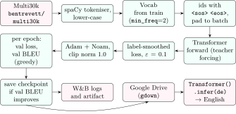
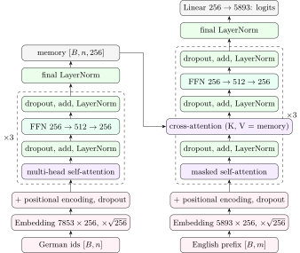

This is the core of the chapter: every module, with the math next to the code. The skeleton handed out by the course (`da6401_assignment_3-main.zip`) fixed the function and class <em>signatures</em> and raised `NotImplementedError` everywhere; every body shown below is mine.

## 1.3.i The whole pipeline {#s1-3-i}

<figure class="nb-fig"></figure>

## 1.3.ii The model at a glance {#s1-3-ii}

<figure class="nb-fig"></figure>

Here $B$ is the batch size, $n$ the padded source length and $m$ the padded length of the decoder input. Residual arrows are left out of the picture: every “dropout, add, LayerNorm” box adds its sub-layer’s input back before normalising.

| Tensor | Shape | Where |
|:--|:--|:--|
| source ids, source mask | $[B, n]$, $[B, 1, 1, n]$ | `model.py:74-81` |
| target input ids, target mask | $[B, m]$, $[B, 1, m, m]$ | `model.py:84-105` |
| embeddings after PE | $[B, n, 256]$ / $[B, m, 256]$ | `model.py:547-558` |
| $\bm{Q}, \bm{K}, \bm{V}$ after the head split | $[B, 8, n, 32]$ | `model.py:153-160` |
| encoder attention scores / weights | $[B, 8, n, n]$ | `model.py:48` |
| decoder cross-attention weights | $[B, 8, m, n]$ | `model.py:357` |
| FFN hidden layer | $[B, \cdot, 512]$ | `model.py:271` |
| memory | $[B, n, 256]$ | `model.py:552` |
| logits, then flattened for the loss | $[B, m, 5893]$, $[Bm, 5893]$ | `train.py:99` |

| Component | Formula | Parameters |
|:--|--:|--:|
| source embedding | $7853 \cdot 256$ | $2{,}010{,}368$ |
| target embedding | $5893 \cdot 256$ | $1{,}508{,}608$ |
| one encoder layer | MHA $+$ FFN $+ 2\,$LN | $527{,}104$ |
| encoder ($3$ layers $+$ final LN) | $3 \cdot 527104 + 512$ | $1{,}581{,}824$ |
| one decoder layer | $2\,$MHA $+$ FFN $+ 3\,$LN | $790{,}784$ |
| decoder ($3$ layers $+$ final LN) | $3 \cdot 790784 + 512$ | $2{,}372{,}864$ |
| output projection | $256 \cdot 5893 + 5893$ | $1{,}514{,}501$ |
| total |  | $8{,}988{,}165$ |

The per-component numbers are read from the checkpoint’s `state_dict`; they match the formulas with MHA $= 263{,}168$, FFN $= 262{,}912$ and LN $= 512$. The sinusoidal table is a buffer of shape $[1, 5000, 256]$ and is not counted. About $56\%$ of the parameters sit in the two embeddings and the output projection.

<div class="nb nb-remark" id="remark-1-3-1">

<strong>Remark 1.3.1</strong> (Not the paper’s “base” size) — The paper’s base model has $d_{\text{model}} = 512$, $N = 6$, $d_{\text{ff}} = 2048$, $h = 8$ (a single base encoder layer already has $3{,}152{,}384$ parameters). My configuration is the same <em>architecture</em> at a smaller size: $d_{\text{model}} = 256$, $N = 3$, $d_{\text{ff}} = 512$. The comment “using the base configuration from the paper” at `train.py:288` is therefore wrong. The reason for shrinking is not recorded; a smaller model is the usual choice for a 29k-sentence dataset and a free Kaggle GPU. The paper also ties the target embedding to the output projection; here they are separate, which costs $1.5$M parameters.

</div>

## 1.3.iii Scaled dot-product attention {#s1-3-iii}

```python {filename="model.py, lines 40–66",linenos=table,linenostart=40}
def scaled_dot_product_attention(Q, K, V, mask=None, use_scale=True):
    # d_k is the dimension of the key vectors
    d_k = Q.size(-1)

    # First compute the raw dot product between Q and K
    # Q shape: (batch, heads, seq_q, d_k)
    # K transposed shape: (batch, heads, d_k, seq_k)
    # scores shape: (batch, heads, seq_q, seq_k)
    scores = torch.matmul(Q, K.transpose(-2, -1))

    # Divide by sqrt(d_k) to avoid very large values going into softmax.
    # Without this, large d_k pushes softmax into saturation and gradients vanish.
    if use_scale:
        scores = scores / math.sqrt(d_k)

    # If there is a mask, we set the masked positions to a very large negative number
    # so that after softmax they become essentially zero
    if mask is not None:
        scores = scores.masked_fill(mask, float('-inf'))

    # Apply softmax to get attention weights that sum to 1 across key dimension
    attn_weights = F.softmax(scores, dim=-1)

    # Weighted sum of values
    output = torch.matmul(attn_weights, V)

    return output, attn_weights
```

- The mask convention follows the skeleton: `True` means “masked out”. `masked_fill` writes $-\infty$, so after the softmax those weights are exactly $0$.
- The function returns both the output and the weights, because the autograder checks that the weights sum to $1$ over keys and are $0$ at masked positions.
- `use_scale` is an extra keyword argument with a default, added for ablation 2.2; the autograder’s call `(Q, K, V, mask)` still works.
- Everything is batched over any leading dimensions, so one call handles all heads.

<div class="nb nb-remark" id="remark-1-3-2">

<strong>Remark 1.3.2</strong> (A row with every key masked) — If an entire row of `scores` were $-\infty$ the softmax would return `NaN`. That cannot happen here: every sequence starts with `<sos>`, which is never padding, and the causal mask always lets a position see itself. A common defensive alternative is a large finite negative number such as $-10^9$.

</div>

## 1.3.iv Masks {#s1-3-iv}

```python {filename="model.py, lines 74–105",linenos=table,linenostart=74}
def make_src_mask(src, pad_idx=1):
    # src shape: (batch_size, src_len)
    # We want to create a mask of shape (batch, 1, 1, src_len)
    # True means "this position is a pad, ignore it in attention"
    src_mask = (src == pad_idx)
    src_mask = src_mask.unsqueeze(1)
    src_mask = src_mask.unsqueeze(2)
    return src_mask


def make_tgt_mask(tgt, pad_idx=1):
    # tgt shape: (batch_size, tgt_len)
    tgt_len = tgt.size(1)

    # Padding mask - same idea as src mask but for target
    pad_mask = (tgt == pad_idx)
    pad_mask = pad_mask.unsqueeze(1)
    pad_mask = pad_mask.unsqueeze(2)
    # pad_mask shape: (batch, 1, 1, tgt_len)

    # Causal (look-ahead) mask - decoder cannot see future tokens.
    # torch.triu gives upper triangle. diagonal=1 means keep the diagonal,
    # fill upper part with 1s (which we treat as True = masked)
    causal = torch.triu(torch.ones(tgt_len, tgt_len, device=tgt.device), diagonal=1)
    causal = causal.bool()
    causal = causal.unsqueeze(0)
    causal = causal.unsqueeze(0)
    # causal shape: (1, 1, tgt_len, tgt_len)

    # Combine: a position is blocked if it is either padding OR a future position
    tgt_mask = pad_mask | causal
    return tgt_mask
```

The source mask has shape $[B, 1, 1, n]$, which broadcasts over the $8$ heads and over every query row. The target mask is the OR of a padding mask $[B, 1, 1, m]$ and the causal mask `torch.triu(ones, diagonal=1)` of shape $[1, 1, m, m]$, whose `True` entries are exactly the future positions $j > i$; the result is $[B, 1, m, m]$. Padded <em>query</em> rows are not masked. They compute garbage, but their outputs are never used: their loss terms are zeroed by the loss function.

## 1.3.v Multi-head attention {#sec-a3-impl-mha}

```python {filename="model.py, lines 143–178",linenos=table,linenostart=143}
    def forward(self, query, key, value, mask=None):
        batch_size = query.size(0)

        # Step 1: Project Q, K, V using the linear layers
        Q = self.W_q(query)
        K = self.W_k(key)
        V = self.W_v(value)

        # Step 2: Reshape to separate into individual heads
        # (batch, seq, d_model) -> (batch, seq, num_heads, d_k) -> (batch, num_heads, seq, d_k)
        Q = Q.view(batch_size, -1, self.num_heads, self.d_k)
        Q = Q.transpose(1, 2)

        K = K.view(batch_size, -1, self.num_heads, self.d_k)
        K = K.transpose(1, 2)

        V = V.view(batch_size, -1, self.num_heads, self.d_k)
        V = V.transpose(1, 2)

        # Step 3: Apply scaled dot-product attention for all heads at once
        attn_out, attn_weights = scaled_dot_product_attention(Q, K, V, mask, self.use_scale)

        # Save a copy of weights so we can visualize them later (for ablation 2.3)
        self.last_attn_weights = attn_weights.detach()

        attn_out = self.dropout_layer(attn_out)

        # Step 4: Concatenate heads back together
        # (batch, num_heads, seq, d_k) -> (batch, seq, num_heads, d_k) -> (batch, seq, d_model)
        attn_out = attn_out.transpose(1, 2)
        attn_out = attn_out.contiguous()
        attn_out = attn_out.view(batch_size, -1, self.d_model)

        # Step 5: Final output linear projection
        output = self.W_o(attn_out)
        return output
```

- The $h$ per-head projections $\bm{W}_i^Q$ are stored side by side as one `nn.Linear(256, 256)` (`model.py:131-133`); the head split is the `view` to $[B, n, 8, 32]$ and `transpose` to $[B, 8, n, 32]$.
- After attention, `transpose` makes the tensor non-contiguous in memory, so `.contiguous()` is required before `view` (`model.py:172-174`).
- The weights are saved in `last_attn_weights` (`model.py:166`) so that ablation 2.3 can plot them; `.detach()` keeps them out of the autograd graph.

<div class="nb nb-remark" id="remark-1-3-3">

<strong>Remark 1.3.3</strong> (Where the dropout goes) — The skeleton’s docstring describes dropout “applied to attention weights”. The code instead applies it to the attention <em>output</em> (`model.py:168`), and the encoder and decoder layers then apply their own dropout to the sub-layer output again (`model.py:310`). So the attention path gets two dropouts of $0.1$ and the attention weights none. It trains fine, but it is not what the docstring says.

</div>

## 1.3.vi Positional encodings {#s1-3-vi}

```python {filename="model.py, lines 190–226",linenos=table,linenostart=190}
class PositionalEncoding(nn.Module):

    def __init__(self, d_model, dropout=0.1, max_len=5000):
        super(PositionalEncoding, self).__init__()
        self.dropout_layer = nn.Dropout(p=dropout)

        # Build the positional encoding table once at init and store as a buffer.
        # Each row is a position, each column is a dimension.
        pe_table = torch.zeros(max_len, d_model)

        # Column vector of position indices: 0, 1, 2, ..., max_len-1
        pos_indices = torch.arange(0.0, max_len).unsqueeze(1)   # shape (max_len, 1)

        # For each even dimension index 2i, the paper says divide by 10000^(2i/d_model).
        # We compute the frequency = 1 / 10000^(2i/d_model) for each even dim.
        even_dims = torch.arange(0.0, d_model, 2)               # shape (d_model/2,)
        freq = 1.0 / (10000.0 ** (even_dims / d_model))         # shape (d_model/2,)

        # Outer product: each position times each frequency gives a (max_len, d_model/2) matrix
        angle_matrix = pos_indices * freq

        # Even dimensions get sin, odd dimensions get cos (per the paper formula)
        pe_table[:, 0::2] = torch.sin(angle_matrix)
        pe_table[:, 1::2] = torch.cos(angle_matrix)

        # Add batch dimension: (1, max_len, d_model) so it broadcasts over batches
        pe_table = pe_table.unsqueeze(0)

        # Register as buffer so it is saved with the checkpoint but is NOT trained
        self.register_buffer('pe', pe_table)

    def forward(self, x):
        # x shape: (batch, seq_len, d_model)
        # We add the positional encoding for positions 0 to seq_len-1
        seq_len = x.size(1)
        x = x + self.pe[:, :seq_len, :]
        return self.dropout_layer(x)
```

The table is computed once for $5000$ positions and registered with `register_buffer` (`model.py:219`). A buffer moves with `.to(device)` and is saved in the `state_dict`, but it is not a parameter, so the optimiser never changes it; the autograder checks exactly this. The frequencies are computed as `1 / 10000 ** (even_dims / d_model)`, which is $\omega_i = 10000^{-2i/d_{\text{model}}}$ since `even_dims` $= 2i$.

The learned alternative for ablation 2.4 is a plain embedding table:

```python {filename="model.py, lines 235–249",linenos=table,linenostart=235}
class LearnedPositionalEncoding(nn.Module):

    def __init__(self, d_model, dropout=0.1, max_len=5000):
        super(LearnedPositionalEncoding, self).__init__()
        self.dropout_layer = nn.Dropout(p=dropout)
        # Simple embedding table: one vector per position index
        self.pos_embed = nn.Embedding(max_len, d_model)

    def forward(self, x):
        seq_len = x.size(1)
        # Create position indices 0, 1, 2, ..., seq_len-1
        pos_indices = torch.arange(0, seq_len, device=x.device)
        pos_indices = pos_indices.unsqueeze(0)  # shape: (1, seq_len)
        x = x + self.pos_embed(pos_indices)
        return self.dropout_layer(x)
```

<div class="nb nb-remark" id="remark-1-3-4">

<strong>Remark 1.3.4</strong> (One module for both sides) — `Transformer` creates a single `self.pos_encoding` (`model.py:523-526`) and uses it in both `encode` and `decode`. For the sinusoidal table this changes nothing. For the learned table it means German and English positions share one set of embeddings.

</div>

## 1.3.vii Feed-forward network {#s1-3-vii}

```python {filename="model.py, lines 269–276",linenos=table,linenostart=269}
    def forward(self, x):
        # Apply first layer + ReLU activation
        out = self.fc1(x)
        out = F.relu(out)
        out = self.dropout_layer(out)
        # Apply second layer to bring back to d_model size
        out = self.fc2(out)
        return out
```

This is $\operatorname{FFN}(\bm{x}) = \max(0, \bm{x}\bm{W}_1 + \bm{b}_1)\bm{W}_2 + \bm{b}_2$ with a dropout after the ReLU, as in the skeleton’s docstring.

## 1.3.viii Encoder and decoder layers {#sec-a3-impl-layers}

```python {filename="model.py, lines 305–316",linenos=table,linenostart=305}
    def forward(self, x, src_mask):
        # Sub-layer 1: self-attention
        # Here the query, key and value all come from x itself (self-attention)
        attn_out = self.self_attention(x, x, x, src_mask)
        # Residual connection + dropout + layer norm (Post-LN style)
        x = self.norm1(x + self.dropout_layer(attn_out))

        # Sub-layer 2: position-wise feed-forward
        ff_out = self.feed_forward(x)
        x = self.norm2(x + self.dropout_layer(ff_out))

        return x
```

```python {filename="model.py, lines 349–364",linenos=table,linenostart=349}
    def forward(self, x, memory, src_mask, tgt_mask):
        # Sub-layer 1: masked self-attention on decoder input
        # tgt_mask prevents the decoder from cheating by seeing future tokens
        attn_out = self.self_attention(x, x, x, tgt_mask)
        x = self.norm1(x + self.dropout_layer(attn_out))

        # Sub-layer 2: cross-attention
        # Queries come from the decoder, but keys and values come from the encoder output
        cross_out = self.cross_attention(x, memory, memory, src_mask)
        x = self.norm2(x + self.dropout_layer(cross_out))

        # Sub-layer 3: feed-forward
        ff_out = self.feed_forward(x)
        x = self.norm3(x + self.dropout_layer(ff_out))

        return x
```

Each sub-layer is Post-LN: `x = norm(x + dropout(sublayer(x)))`. In cross-attention the queries come from the decoder and the keys and values from the encoder memory, with the <em>source</em> padding mask (`model.py:357`).

The stacks take a “template” layer, as the skeleton’s signature requires, but build $N$ <em>fresh</em> layers from its hyper-parameters instead of deep-copying it:

```python {filename="model.py, lines 378–401",linenos=table,linenostart=378}
        enc_d_model = single_layer.d_model

        # Read the configuration from the template layer so we can create fresh copies
        enc_num_heads = single_layer.self_attention.num_heads
        enc_d_ff = single_layer.feed_forward.fc1.out_features
        enc_dropout = single_layer.dropout_layer.p
        enc_use_scale = single_layer.self_attention.use_scale

        # Build num_layers independent encoder layers with shared configuration
        layer_list = []
        for k in range(num_layers):
            new_layer = EncoderLayer(enc_d_model, enc_num_heads, enc_d_ff, enc_dropout, enc_use_scale)
            layer_list.append(new_layer)
        self.layers = nn.ModuleList(layer_list)

        self.final_norm = nn.LayerNorm(enc_d_model)

    def forward(self, x, mask):
        # Pass through each encoder layer one by one
        for enc_layer in self.layers:
            x = enc_layer(x, mask)
        # Final layer normalization
        x = self.final_norm(x)
        return x
```

<div class="nb nb-remark" id="remark-1-3-5">

<strong>Remark 1.3.5</strong> (A redundant LayerNorm) — Every encoder layer already ends in a LayerNorm, and then `final_norm` normalises again (`model.py:393, 400`); the decoder does the same (`model.py:428, 434`). The skeleton’s docstring asks for this final LayerNorm, but it belongs to the Pre-LN design. With Post-LN it only re-normalises an already normalised vector, so its effect is to replace the last layer’s $\bm \gamma, \bm \beta$ with new ones ([Problem 1F](../wrapup/#problem-1f)). Harmless, just redundant.

</div>

## 1.3.ix The `Transformer` class {#s1-3-ix}

The constructor has two modes. When the vocabulary sizes are given (training), it just builds the network. When they are not, which is how the autograder calls `Transformer()`, it downloads and loads the trained model:

```python {filename="model.py, lines 480–507",linenos=table,linenostart=480}
        # If vocab sizes are not provided, we are being called for inference
        # So we need to download and load the trained checkpoint
        doing_inference = (src_vocab_size is None or tgt_vocab_size is None)

        if doing_inference:
            # Download the checkpoint file from Google Drive if not already present
            if not os.path.exists(checkpoint_path):
                print("Checkpoint not found locally. Downloading from Google Drive...")
                gdown.download(id=GDRIVE_FILE_ID, output=checkpoint_path, quiet=False)

            # Load the checkpoint dict
            saved = torch.load(checkpoint_path, map_location='cpu', weights_only=False)

            # Restore vocab objects that were saved at training time
            self.src_vocab = saved['src_vocab']
            self.tgt_vocab = saved['tgt_vocab']

            # Read all hyperparameters from the saved config
            cfg = saved['model_config']
            src_vocab_size    = cfg['src_vocab_size']
            tgt_vocab_size    = cfg['tgt_vocab_size']
            d_model           = cfg['d_model']
            N                 = cfg['N']
            num_heads         = cfg['num_heads']
            d_ff              = cfg['d_ff']
            dropout           = cfg['dropout']
            use_scale         = cfg.get('use_scale', True)
            pos_encoding_type = cfg.get('pos_encoding_type', 'sinusoidal')
```

It then builds the embeddings, positional encoding, stacks and output projection, initialises every matrix with Xavier-uniform [&#91;GB10&#93;](../references/#ref-glorot2010), and finally loads the weights:

```python {filename="model.py, lines 518–566",linenos=table,linenostart=518}
        # Build the embedding tables for source and target languages
        self.src_embedding = nn.Embedding(src_vocab_size, d_model)
        self.tgt_embedding = nn.Embedding(tgt_vocab_size, d_model)

        # Choose between sinusoidal or learned positional encoding
        if pos_encoding_type == 'learned':
            self.pos_encoding = LearnedPositionalEncoding(d_model, dropout)
        else:
            self.pos_encoding = PositionalEncoding(d_model, dropout)

        # Build encoder and decoder stacks
        one_enc_layer = EncoderLayer(d_model, num_heads, d_ff, dropout, use_scale)
        self.encoder = Encoder(one_enc_layer, N)

        one_dec_layer = DecoderLayer(d_model, num_heads, d_ff, dropout, use_scale)
        self.decoder = Decoder(one_dec_layer, N)

        # Final linear layer to project decoder output to vocabulary logits
        self.output_proj = nn.Linear(d_model, tgt_vocab_size)

        # Initialize parameters with Xavier uniform - helps with convergence
        for param in self.parameters():
            if param.dim() > 1:
                nn.init.xavier_uniform_(param)

        # In inference mode, load the trained weights into the architecture we just built
        if doing_inference:
            self.load_state_dict(saved['model_state_dict'])

    def encode(self, src, src_mask):
        # Scale the embeddings by sqrt(d_model) as mentioned in Section 3.4 of the paper
        emb = self.src_embedding(src)
        emb = emb * math.sqrt(self.d_model)
        emb = self.pos_encoding(emb)
        memory = self.encoder(emb, src_mask)
        return memory

    def decode(self, memory, src_mask, tgt, tgt_mask):
        emb = self.tgt_embedding(tgt)
        emb = emb * math.sqrt(self.d_model)
        emb = self.pos_encoding(emb)
        dec_out = self.decoder(emb, memory, src_mask, tgt_mask)
        logits = self.output_proj(dec_out)
        return logits

    def forward(self, src, tgt, src_mask, tgt_mask):
        memory = self.encode(src, src_mask)
        logits = self.decode(memory, src_mask, tgt, tgt_mask)
        return logits
```

- The spaCy pipelines are loaded, and downloaded if missing, inside `__init__` (`model.py:464-474`), as the announcement requires.
- Embeddings are multiplied by $\sqrt{d_{\text{model}}} = 16$ (`model.py:550, 557`), as in §3.4 of the paper. Xavier-uniform on a $7853 \times 256$ table draws from $\pm \sqrt{6/(7853+256)} \approx \pm 0.027$, so without the factor the embeddings would be tiny next to the positional encoding, whose entries are of size $1$.
- The checkpoint is loaded with `weights_only=False` because it contains pickled `Vocab` objects. Unpickling runs arbitrary code, which is fine for one’s own file but a reason never to load an untrusted checkpoint this way.

### `infer()` {#infer}

```python {filename="model.py, lines 574–628",linenos=table,linenostart=574}
    def infer(self, src_sentence):
        # This is the end-to-end translation pipeline.
        # The autograder calls: model = Transformer().to(device); model.infer(german_str)
        device = next(self.parameters()).device

        # Step 1: Tokenize the German sentence using spacy
        german_tokens = []
        for tok in self.spacy_de.tokenizer(src_sentence):
            german_tokens.append(tok.text.lower())

        # Step 2: Convert tokens to indices, add <sos> and <eos>
        src_ids = []
        src_ids.append(self.src_vocab['<sos>'])
        for tok in german_tokens:
            src_ids.append(self.src_vocab[tok])
        src_ids.append(self.src_vocab['<eos>'])

        src_tensor = torch.tensor([src_ids], device=device)
        src_mask = make_src_mask(src_tensor)

        # Get special token indices for target
        sos_idx = self.tgt_vocab['<sos>']
        eos_idx = self.tgt_vocab['<eos>']
        pad_idx = self.tgt_vocab['<pad>']

        self.eval()
        with torch.no_grad():
            # Step 3: Encode the source sentence
            memory = self.encode(src_tensor, src_mask)

            # Step 4: Greedy decoding - start with <sos>, generate one token at a time
            generated = torch.tensor([[sos_idx]], device=device)

            for _ in range(100):
                tgt_mask = make_tgt_mask(generated)
                logits = self.decode(memory, src_mask, generated, tgt_mask)

                # Pick the token with highest probability at the last position
                next_token = logits[:, -1, :].argmax(dim=-1, keepdim=True)
                generated = torch.cat([generated, next_token], dim=1)

                # Stop if we generated the end-of-sentence token
                if next_token.item() == eos_idx:
                    break

        # Step 5: Convert indices back to words, skip special tokens
        result_words = []
        for idx in generated[0].tolist():
            if idx == eos_idx:
                break
            if idx == sos_idx or idx == pad_idx:
                continue
            result_words.append(self.tgt_vocab.lookup_token(idx))

        return ' '.join(result_words)
```

The German sentence is tokenised and lower-cased exactly as in training, mapped to ids with `<sos>`/`<eos>`, encoded once, and then decoded greedily for at most $100$ steps. The memory is computed once and reused at every step; the decoder is re-run on the whole prefix each time (there is no key–value cache), which is fine for $15$-word sentences.

<div class="nb nb-remark" id="remark-1-3-6">

<strong>Remark 1.3.6</strong> (The output is not detokenised) — The skeleton asks `infer` to return “the fully translated English string, detokenized and clean”. The code joins tokens with spaces, so the output is lower-case, has spaces before punctuation, and can contain `<unk>`. For the first test sentence my re-run of the local checkpoint returns <em>“a man in an orange hat is &lt;unk&gt; something .”</em> If the hidden-test BLEU is computed against normal English references, this costs points ([Section What the BLEU numbers really measure](#sec-a3-bleu-caveat)).

</div>

## 1.3.x Loss: label smoothing {#s1-3-x}

```python {filename="train.py, lines 35–63",linenos=table,linenostart=35}
    def forward(self, logits, target):
        # logits shape: (N, vocab_size)  where N = batch_size * tgt_len
        # target shape: (N,)

        # Step 1: Create a soft target distribution
        # Every class gets smoothing / (vocab_size - 1) probability to start
        small_prob = self.smoothing / (self.vocab_size - 1)
        soft_target = torch.full(logits.shape, small_prob, device=logits.device)

        # Step 2: Put (1 - smoothing) probability on the correct token
        soft_target.scatter_(1, target.unsqueeze(1), 1.0 - self.smoothing)

        # Step 3: Pad positions should not contribute anything to the loss
        # We find all pad positions at once and zero them out in one GPU operation
        # (doing this with a for loop and .item() would cause thousands of GPU-CPU syncs)
        is_pad = (target == self.pad_idx)
        soft_target[is_pad] = 0.0

        # Step 4: KL divergence = sum of (soft_target * log_softmax(logits))
        log_probs = F.log_softmax(logits, dim=-1)
        loss_each = -(soft_target * log_probs).sum(dim=-1)

        # Step 5: Average over non-pad tokens only
        non_pad_count = (target != self.pad_idx).float().sum()
        if non_pad_count.item() < 1:
            non_pad_count = torch.tensor(1.0)

        final_loss = loss_each.sum() / non_pad_count
        return final_loss
```

- The soft target is built for all $Bm$ positions at once: $\varepsilon/(V-1)$ everywhere, then $1-\varepsilon$ scattered onto the gold index. This is the formula in the skeleton’s docstring and the $\bm{q}'$ of [Proposition 1.2.11](../theory/#proposition-1-2-11).
- Rows whose gold token is `<pad>` are zeroed, and the sum is divided by the number of non-pad tokens, so the loss is a per-real-token average.
- The comment calls it a KL divergence, but $-\sum_k q'_k \log p_k$ is the cross-entropy; the two differ by the constant $H(\bm{q}') \approx 1.193$ ([Proposition 1.2.11](../theory/#proposition-1-2-11)). The gradients are identical; the reported loss values are not.
- The `<pad>` <em>column</em> still receives $\varepsilon/(V-1)$ of target mass, so the model is taught to give `<pad>` a tiny probability; the skeleton’s docstring says `<pad>` should receive $0$. The effect is negligible ($1.7 \times 10^{-5}$).
- The comment at `train.py:48-49` proudly avoids per-token `.item()` calls, but `non_pad_count.item()` (`train.py:59`) still forces one GPU–CPU synchronisation per batch; `clamp(min=1)` would avoid it.
- With $\varepsilon = 0$ the same class is plain cross-entropy with padding ignored, which is how ablation 2.5 turns smoothing off.

## 1.3.xi Optimiser and Noam scheduler {#s1-3-xi}

```python {filename="lr_scheduler.py, lines 16–57",linenos=table,linenostart=16}
class NoamScheduler(LRScheduler):
    # Implementing the Noam scheduler as described in the paper.
    # This extends PyTorch's built-in LRScheduler base class.

    def __init__(self, optimizer, d_model, warmup_steps, last_epoch=-1):
        # IMPORTANT: we must set d_model and warmup_steps BEFORE calling
        # super().__init__(), because the parent __init__ calls step() internally,
        # which in turn calls get_lr(), which needs these attributes to be set.
        self.d_model = d_model
        self.warmup_steps = warmup_steps

        # Now call the parent class __init__
        super(NoamScheduler, self).__init__(optimizer, last_epoch)

    def _get_lr_scale(self):
        # Compute the Noam scaling factor for the current training step.
        # We add 1 to last_epoch to avoid division by zero at step 0.
        step = self.last_epoch + 1

        # Two terms: during warmup we use the linear increase, after that the decay
        term1 = step ** (-0.5)
        term2 = step * (self.warmup_steps ** (-1.5))

        # Take the minimum of the two terms (that is what the paper formula says)
        if term1 < term2:
            min_term = term1
        else:
            min_term = term2

        scale = (self.d_model ** (-0.5)) * min_term
        return scale

    def get_lr(self):
        # Return learning rate for each parameter group in the optimizer.
        # PyTorch calls this automatically each time scheduler.step() is called.
        scale = self._get_lr_scale()

        # Multiply each group's base learning rate by the Noam scale factor
        new_lrs = []
        for base_lr in self.base_lrs:
            new_lrs.append(base_lr * scale)
        return new_lrs
```

The scheduler subclasses PyTorch’s `LRScheduler`. Two details matter:

- `d_model` and `warmup_steps` are stored <em>before</em> `super().__init__`, because the parent constructor immediately calls `get_lr()` (`lr_scheduler.py:21-25`).
- The optimiser is created with `lr=1.0` (`train.py:373-375`), so `base_lr` $\times$ scale is exactly $\eta(s)$. `step = last_epoch + 1` means the $k$-th optimiser update uses $\eta(k)$, starting at $\eta(1)$, which is what the autograder tests.

<div class="nb nb-example nb-block" id="example-1-3-7">

<strong>Example 1.3.7</strong> (Checking the logged learning rate)

After $227$ updates (one epoch) the optimiser holds the rate for update $228$: $\eta(228) = 256^{-1/2} \cdot 228 \cdot 4000^{-3/2} = 5.6328 \times 10^{-5}$. W&amp;B logged `learning_rate` $= 5.632807 \times 10^{-5}$ after the first epoch of every Noam run. Likewise the saved checkpoint has `last_epoch` $= 3178$ ($= 14 \cdot 227$) and learning rate $\eta(3179) = 7.8538 \times 10^{-4}$.

</div>

## 1.3.xii Training loop {#s1-3-xii}

```python {filename="train.py, lines 82–111",linenos=table,linenostart=82}
    with torch.set_grad_enabled(is_train):
        for src_batch, tgt_batch in data_iter:
            src_batch = src_batch.to(device)
            tgt_batch = tgt_batch.to(device)

            # In teacher forcing the decoder input is everything except the last token
            # and the gold (expected) output is everything except the first token
            tgt_input = tgt_batch[:, :-1]
            tgt_gold  = tgt_batch[:, 1:]

            src_mask = make_src_mask(src_batch).to(device)
            tgt_mask = make_tgt_mask(tgt_input).to(device)

            logits = model(src_batch, tgt_input, src_mask, tgt_mask)

            # The loss function expects flat 2D logits and 1D targets
            # so we reshape from (batch, seq, vocab) to (batch*seq, vocab)
            logits_2d = logits.reshape(-1, logits.size(-1))
            gold_1d   = tgt_gold.reshape(-1)

            loss = loss_fn(logits_2d, gold_1d)

            if is_train:
                optimizer.zero_grad()
                loss.backward()
                # Clip gradients at max norm 1.0 so they do not explode
                torch.nn.utils.clip_grad_norm_(model.parameters(), max_norm=1.0)
                optimizer.step()
                if scheduler is not None:
                    scheduler.step()
```

- `torch.set_grad_enabled(is_train)` lets one function serve training and validation.
- The scheduler steps once per <em>batch</em>, not per epoch, as Noam requires.
- Gradients are clipped to a global norm of $1.0$ (`train.py:108`). This is not in the paper; it is a common safety net against a single bad batch.

<div class="nb nb-remark" id="remark-1-3-8">

<strong>Remark 1.3.8</strong> (Which loop actually ran) — Only the first successful run, `lm90eh07`, went through `run_epoch`: its log has the exact print format of `run_training_experiment`. The 30-epoch run `r9ec0v3x` and all nine ablations were produced by loops written inline in the notebooks (cell 6 of `train_kaggle.ipynb`, cell 9 of `wandb_experiments.ipynb`), which import the `.py` files and repeat the same logic plus extra metrics: perplexity $e^{\min(\text{loss}, 10)}$, validation token accuracy, prediction confidence and the Q/K gradient norm.

</div>

## 1.3.xiii Evaluation: greedy decoding and BLEU {#s1-3-xiii}

```python {filename="train.py, lines 132–158",linenos=table,linenostart=132}
def greedy_decode(model, src, src_mask, max_len, start_symbol, end_symbol, device='cpu'):
    model.eval()

    src      = src.to(device)
    src_mask = src_mask.to(device)

    with torch.no_grad():
        # Encode the source sentence
        memory = model.encode(src, src_mask)

        # Start with just the <sos> token
        ys = torch.tensor([[start_symbol]], device=device)

        # Keep adding tokens until we hit <eos> or reach max_len
        for _ in range(max_len - 1):
            tgt_mask = make_tgt_mask(ys).to(device)
            logits = model.decode(memory, src_mask, ys, tgt_mask)

            # Take the most probable next token at the last position
            next_token = logits[:, -1, :].argmax(dim=-1, keepdim=True)
            ys = torch.cat([ys, next_token], dim=1)

            # If we generated <eos>, stop here
            if next_token.item() == end_symbol:
                break

    return ys
```

```python {filename="train.py, lines 185–224",linenos=table,linenostart=185}
    with torch.no_grad():
        for src_batch, tgt_batch in test_dataloader:
            src_batch = src_batch.to(device)
            tgt_batch = tgt_batch.to(device)

            src_mask = make_src_mask(src_batch).to(device)

            # Decode each sentence separately since output lengths differ
            for i in range(src_batch.size(0)):
                one_src  = src_batch[i:i+1]
                one_mask = src_mask[i:i+1]

                output = greedy_decode(
                    model, one_src, one_mask, max_len, sos_idx, eos_idx, device
                )

                # Build the predicted sentence string
                pred_words = []
                for idx in output[0].tolist():
                    if idx == eos_idx:
                        break
                    if idx == sos_idx or idx == pad_idx:
                        continue
                    pred_words.append(get_word(idx))

                # Build the reference sentence string
                ref_words = []
                for idx in tgt_batch[i].tolist():
                    if idx == eos_idx:
                        break
                    if idx == sos_idx or idx == pad_idx:
                        continue
                    ref_words.append(get_word(idx))

                all_predictions.append(' '.join(pred_words))
                all_references.append(' '.join(ref_words))

    bleu_scorer = SacreBLEU()
    result = bleu_scorer.corpus_score(all_predictions, [all_references])
    return result.score
```

Every sentence is decoded on its own, with a batch of $1$. During training, validation BLEU is computed every epoch with `max_len=50` (`train.py:404`); the final test BLEU uses the default $100$.

### What the BLEU numbers really measure {#sec-a3-bleu-caveat}

Look at how the references are built: from the <em>token ids</em> of the target sentence (`train.py:211-217`), not from the original English text. Three things follow.

1. Every reference word that is not in the vocabulary has become `<unk>`; $178$ of the $1{,}000$ test references contain at least one. A hypothesis that outputs `<unk>` in the same place gets credit for it.
2. Hypotheses and references are lower-cased and spaCy-tokenised, while SacreBLEU assumes detokenised input and tokenises again. It warns about this in every log: “It looks like you forgot to detokenize your test data”.
3. So the numbers are internally consistent (every run is measured the same way) but are not comparable with published BLEU on Multi30k.

<div class="nb nb-example nb-block" id="example-1-3-9">

<strong>Example 1.3.9</strong> (Measuring the gap)

I re-scored the local checkpoint’s test output ([Section 1.3.xiv](#sec-a3-checkpoints)) four ways:

| References | BLEU |
|:--|--:|
| rebuilt from ids, as in `evaluate_bleu` | $38.98$ |
| original text, lower-cased and spaCy-tokenised (no `<unk>`) | $36.96$ |
| original text, SacreBLEU with `lowercase=True` | $36.34$ |
| original text, SacreBLEU defaults (cased) | $31.33$ |

The free `<unk>` matches are worth about $2$ BLEU; case and tokenisation about $5$–$6$ more. $2.4\%$ of the words the model outputs are `<unk>`.

</div>

## 1.3.xiv Checkpointing {#sec-a3-checkpoints}

`save_checkpoint` (`train.py:231-258`) stores the epoch, the model, optimiser and scheduler states, a `model_config` with every constructor argument, and the two `Vocab` objects, so that `Transformer()` can rebuild everything from one file. A checkpoint is written only when validation BLEU improves (`train.py:418-424`); the skeleton’s outline saved one every epoch.

<div class="nb nb-example nb-block" id="example-1-3-10">

<strong>Example 1.3.10</strong> (Why the file is 113.5 MB for a 9M-parameter model)

The local `transformer_de_en.pt` is $113{,}502{,}467$ bytes: parameters $8{,}988{,}165 \times 4$ bytes $= 35.95$ MB; Adam’s two moment tensors, twice that, $71.91$ MB; the sinusoidal buffer $5000 \times 256 \times 4 = 5.12$ MB; the remaining $0.52$ MB is the pickled vocabularies and overhead. Two-thirds of the download the autograder does is optimiser state it never uses; saving only `model_state_dict` plus the vocabularies would cut it to about $42$ MB.

</div>

## 1.3.xv Hyperparameters {#s1-3-xv}

| Name | Value | Paper (base) | Defined at |
|:--|:--|:--|:--|
| $d_{\text{model}}$ | $256$ | $512$ | `train.py:290`, `model.py:451` |
| layers $N$ | $3$ | $6$ | `train.py:291` |
| heads $h$ | $8$ | $8$ | `train.py:292` |
| $d_{\text{ff}}$ | $512$ | $2048$ | `train.py:293` |
| dropout | $0.1$ | $0.1$ | `train.py:294` |
| batch size | $128$ sentences | $\approx 25$k tokens | `train.py:295` |
| epochs | $15$ (ablations), $30$ (final run) | 100k steps | `train.py:296`, notebooks |
| warm-up | $4000$ steps | $4000$ | `train.py:297` |
| label smoothing $\varepsilon$ | $0.1$ | $0.1$ | `train.py:298` |
| `min_freq` | $2$ | – (BPE) | `train.py:299` |
| Adam $\beta_1, \beta_2, \epsilon$ | $0.9, 0.98, 10^{-9}$ | same | `train.py:373-375` |
| gradient clipping | $1.0$ | none | `train.py:108` |
| decode length | $50$ (val), $100$ (test) | – | `train.py:404, 427` |
| initialisation | Xavier-uniform | – | `model.py:539-541` |

There was no hyperparameter search: the W&amp;B project has no sweeps, and every run uses these values except for the one factor each ablation changes.
