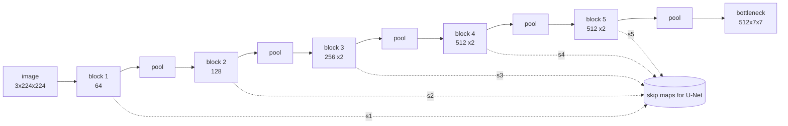

Source: `models/vgg11.py` (encoder and full model), `models/layers.py` (dropout). Evidence labels are explained on the [section landing page](../).

## Why VGG at all

VGG's idea is **depth from small filters**: stack 3×3 convolutions (stride 1, padding 1) and halve the resolution with 2×2 max-pools. <span style="color:#d6336c"><strong>[Paper]</strong></span> Two stacked 3×3 convs see a 5×5 region and three see 7×7, but with fewer weights (`2·9C²` for two against `25C²` for one 5×5, for `C` channels in and out) and **more non-linearities** in between. Configuration **A**, called VGG11, has **8 conv + 3 fully connected = 11 weight layers**, and about 133 M parameters with the 1000-class ImageNet head.

The assignment asks for exactly this topology with BatchNorm and your own Dropout added.

## The encoder, layer by layer

`VGG11Encoder` takes `[B, 3, 224, 224]` and returns a `[B, 512, 7, 7]` bottleneck. Each conv is **Conv2d(3×3, pad 1) → BatchNorm2d → ReLU**. Shapes below are <span style="color:#0071bc"><strong>[Measured]</strong></span> (a forward pass in eval mode) and agree with the comments in the code.

| Block | Convs (in → out) | Map before pool | After 2×2 max-pool | Skip name |
|---|---|---|---|---|
| 1 | 3 → 64 | 64 × 224 × 224 | 64 × 112 × 112 | `s1` |
| 2 | 64 → 128 | 128 × 112 × 112 | 128 × 56 × 56 | `s2` |
| 3 | 128 → 256, 256 → 256 | 256 × 56 × 56 | 256 × 28 × 28 | `s3` |
| 4 | 256 → 512, 512 → 512 | 512 × 28 × 28 | 512 × 14 × 14 | `s4` |
| 5 | 512 → 512, 512 → 512 | 512 × 14 × 14 | **512 × 7 × 7** | `s5` |



`forward(x, return_features=True)` returns the bottleneck **and** a dict `{"s1": …, "s5": …}` holding each block's output **before** its max-pool. That is the only change needed to make the same backbone usable as a U-Net encoder <span style="color:#009b55"><strong>[Code]</strong></span>. With `return_features=False` (the default) it returns only the bottleneck, which is what the classifier and localizer use.

The spatial size works out because `224 / 2⁵ = 7`. That is also why the input size is fixed: the first FC layer is `Linear(512·7·7, 4096)`, so any other resolution breaks it. <span style="color:#009b55"><strong>[Code]</strong></span>

## The classifier head

`VGG11` = encoder + head:

```text
flatten (512*7*7 = 25088)
Linear(25088, 4096) -> BatchNorm1d -> ReLU -> CustomDropout(p)
Linear(4096, 4096)  -> BatchNorm1d -> ReLU -> CustomDropout(p)
Linear(4096, 37)                                   # logits, no softmax
```

`p` defaults to 0.5 in the class and in `train.py`; the Kaggle run used `--dropout_p 0.3` for classification (see [section 4](../04-training-and-evaluation/)). The model returns raw **logits**; the loss applies the softmax. <span style="color:#009b55"><strong>[Code]</strong></span>

### Parameter counts

<span style="color:#0071bc"><strong>[Measured]</strong></span> (counting every parameter, including BatchNorm scale and shift):

| Part | Parameters |
|---|---|
| Encoder (8 convs + 8 BatchNorm2d) | **9 225 984** |
| of which the 8 conv layers | 9 220 480 |
| Classifier head (3 Linear + 2 BatchNorm1d) | 119 713 829 |
| **`VGG11` total** | **128 939 813** |

Two things to say out loud: **the conv backbone is only 7 % of the model; the two big FC layers hold 93 %.** The first layer alone is `25088 × 4096 ≈ 102.8 M` weights. This is the well-known weakness of VGG and the reason later networks replaced the FC head with global average pooling. <span style="color:#7c3aed"><strong>[Reasoned]</strong></span>

## Where BatchNorm and Dropout go, and why

The assignment says: you choose the placement, but you must justify it. The final code has this answer <span style="color:#009b55"><strong>[Code]</strong></span>:

| Choice | Placement | Reason |
|---|---|---|
| **BatchNorm2d** | After **every** conv, **before** the ReLU | Normalises the pre-activation, so the ReLU sees a stable, centred input. Allows larger learning rates and faster convergence, which is also what W&B experiment 2.1 asks you to show. <span style="color:#d6336c"><strong>[Paper]</strong></span> Ioffe and Szegedy (2015) |
| **BatchNorm1d** | After each of the first two FC layers, before the ReLU | The FC layers have 102 M and 17 M weights and are the hardest part to optimise from scratch; normalising them stabilises training |
| **CustomDropout** | After BN + ReLU of the **first two FC layers only** | That is where nearly all the parameters are, so co-adaptation (neurons memorising training images together) is worst there. Dropout after ReLU keeps the BatchNorm that precedes it free of the random mask (see the caveat below) |
| No dropout in conv blocks | | Convolutional features are spatially correlated; dropping single activations barely regularises them and the weight sharing already acts as regularisation. The original VGG also applied dropout only to the FC layers <span style="color:#d6336c"><strong>[Paper]</strong></span> |
| No dropout before the output layer | | The last layer produces the logits; masking its inputs right before the loss would make the output needlessly noisy |

An honest caveat on BN **plus** Dropout in one network: dropout changes the variance of activations between training and evaluation, so a BatchNorm layer downstream of a dropout can see a shifted variance at test time (the "variance shift" argument of Li et al., 2019). <span style="color:#d6336c"><strong>[Paper]</strong></span> Here the first BatchNorm1d precedes the first dropout and is unaffected, but the **second** BatchNorm1d follows a Linear layer that consumed dropped-out inputs, so it is exposed to exactly that effect. <span style="color:#7c3aed"><strong>[Reasoned]</strong></span> Whether it hurt was not tested. I did not run an ablation comparing placements; the choice follows convention and the reasons above, and the W&B experiment on p ∈ {0, 0.2, 0.5} is the place that would show a problem. The W&B report covers BN on/off and p ∈ {0, 0.2, 0.5} (see [section 4](../04-training-and-evaluation/)); read the numbers from there.

The earlier draft `REPORT.md` argued the **opposite** about BatchNorm1d (it omitted it from the FC head). The final code includes it. If an interviewer has read the old text, say the final design is the one in `vgg11.py`.

### Convs still have a bias

`nn.Conv2d(..., padding=1)` keeps its default `bias=True` even though a BatchNorm follows. The BN subtracts the per-channel mean, so the conv bias is redundant (BN's own shift `β` does the job). It costs 2 752 extra parameters in the whole encoder and does no harm. <span style="color:#7c3aed"><strong>[Reasoned]</strong></span> Setting `bias=False` is the cleaner choice.

## Initialisation

`_initialize_weights()` <span style="color:#009b55"><strong>[Code]</strong></span>:

- **Conv:** Kaiming normal, `mode="fan_out"`, ReLU gain; bias 0. Kaiming keeps the variance of activations roughly constant through ReLU layers.
- **BatchNorm:** weight 1, bias 0 (the default, set explicitly).
- **Linear:** `Normal(0, 0.01)`, bias 0. This matches the VGG paper's choice for its FC layers. <span style="color:#d6336c"><strong>[Paper]</strong></span> <span style="color:#0071bc"><strong>[Measured]</strong></span> The final layer's weight standard deviation came out at 0.0100.

Note that `VGG11Encoder` has **no** `_initialize_weights` of its own; the encoder is initialised through its parent (`VGG11`, `VGG11Localizer`). The `VGG11UNet` initialiser covers Conv2d and ConvTranspose2d with Kaiming normal for the whole module, **including the encoder** (it loops over `self.modules()`). That is harmless because the trained encoder weights are loaded afterwards.

## CustomDropout: the algorithm

`models/layers.py` implements **inverted dropout** <span style="color:#009b55"><strong>[Code]</strong></span>:

```python
if not self.training:
    return x                                   # evaluation: identity
keep_prob = 1.0 - self.p
mask = torch.bernoulli(torch.full(x.shape, keep_prob, dtype=x.dtype, device=x.device))
return (x * mask) / keep_prob                  # scale the survivors up
```

Why inverted? In training each unit survives with probability `1 − p`, so the expected output of a unit is `(1 − p)·x`. Dividing the survivors by `1 − p` makes the expectation equal to `x` **during training**, so at test time you simply use the layer as the identity and no rescaling is needed. The classic formulation scales at test time instead; the results are equivalent. The grader checks three things: the mask statistics, the `1/(1−p)` scaling, and that `eval()` is deterministic.

<span style="color:#0071bc"><strong>[Measured]</strong></span> On a tensor of 200 000 ones:

| `p` | Fraction zeroed | Value of a kept unit | Mean of output |
|---|---|---|---|
| 0.5 | 0.5012 | 2.0 | 0.9977 |
| 0.2 | 0.2015 | 1.25 | not printed |

In `eval()` the output was bit-identical to the input, and `p = −0.1` and `p = 1.0` raised `ValueError`. (`p = 1.0` has to be rejected because `1/(1−p)` would divide by zero.) `p = 0` is allowed and makes the layer an identity in practice.

Implementation notes an interviewer may probe:

- **A new mask per forward pass and per element.** It is element-wise dropout, right for FC layers. For feature maps, "spatial" dropout would drop whole channels instead.
- **The mask is sampled with `torch.bernoulli`**, which is on the autograd graph as a constant; the gradient flows only through the kept units, scaled by `1/(1−p)`.
- Allocating a `torch.full` tensor every call costs a little memory. `torch.rand_like(x) >= p` is the usual shorter form. <span style="color:#7c3aed"><strong>[Reasoned]</strong></span>
- The module has **no parameters**, so a checkpoint is unaffected by the value of `p`. That is why `multitask.py` can hard-code `0.5` and still load weights trained with `0.3`. And because it is switched off in `eval()`, the value is irrelevant at inference.
