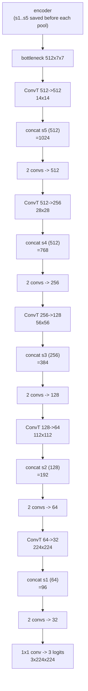
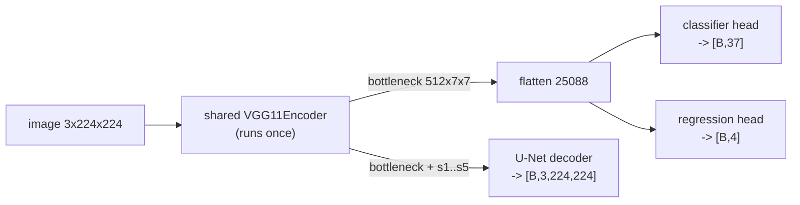

Source: `models/classification.py`, `models/localization.py`, `losses/iou_loss.py`, `models/segmentation.py`, `models/multitask.py`. Evidence labels are explained on the [section landing page](../).

All three heads sit on the same `VGG11Encoder` described in [section 2](../02-vgg11-architecture/). The classifier head is the one already shown there; this page covers the other two heads and how everything is joined.

## Task 1: classifier

`VGG11Classifier` is a thin wrapper that holds a `VGG11` and forwards to it. It exists because the skeleton asked for a class with that name. Loss: **cross-entropy on logits**, weighted by inverse class frequency (see [section 4](../04-training-and-evaluation/)). <span style="color:#009b55"><strong>[Code]</strong></span>

## Task 2: localizer

### Architecture

```text
encoder -> [B, 512, 7, 7] -> flatten (25088)
Linear(25088, 4096) -> BatchNorm1d -> ReLU -> CustomDropout(p)
Linear(4096, 1024)  -> BatchNorm1d -> ReLU -> CustomDropout(p)
Linear(1024, 4)                                  # x_center, y_center, width, height
```

<span style="color:#009b55"><strong>[Code]</strong></span> There is **no activation on the last layer**. <span style="color:#0071bc"><strong>[Measured]</strong></span> `VGG11Localizer` has 116 200 196 parameters, of which the head is 106 974 212.

Why a plain linear output? The targets are pixel coordinates in `[0, 224]` and the assignment says to keep the output "appropriate for your coordinate space". A sigmoid would squash everything into `[0, 1]` and need rescaling; a ReLU would forbid negative values the optimiser may pass through early on. A raw linear output is the simplest thing that can express any pixel value. The cost is that nothing forces `width, height ≥ 0` or the box to stay inside the image. <span style="color:#7c3aed"><strong>[Reasoned]</strong></span> The IoU loss copes with negative widths (see below), and a validation clamp would be a sensible post-processing step.

**Initial output is near zero.** The final `Linear` is initialised with `Normal(0, 0.01)`, so the network starts by predicting a degenerate box close to `(0, 0, 0, 0)` and has to grow it to pixel scale. <span style="color:#7c3aed"><strong>[Reasoned]</strong></span>

### The encoder is frozen

`train.py` loads the encoder from `classifier.pth` and sets `requires_grad = False` on every encoder parameter; only the regression head is given to the optimiser <span style="color:#009b55"><strong>[Code]</strong></span>. The stated reason in the code: a frozen encoder keeps the backbone **identical** across all three tasks, so `MultiTaskPerceptionModel` can load one encoder from `classifier.pth` and pair it with any head. This is the "state and justify freezing or fine-tuning" answer the assignment requires.

The price is that the box head must work with features trained for breed recognition. That is a real limitation, and one reason the transfer-learning experiment (frozen vs partial vs full fine-tuning) is in the report. And there is a subtle flaw in how the freeze is done, see [section 5](../05-checks-and-pitfalls/).

### The IoU loss

`IoULoss(eps=1e-6, reduction="mean")` computes `1 − IoU` for boxes in `(cx, cy, w, h)` pixel format <span style="color:#009b55"><strong>[Code]</strong></span>:

$$
\text{IoU} = \frac{I}{A_p + A_t - I + \varepsilon},\qquad \mathcal{L} = 1 - \text{IoU}
$$

Steps:

1. **Centre format to corners:** `x1 = cx − w/2`, `x2 = cx + w/2`, and likewise for `y`, for prediction and target.
2. **Intersection:** `ix1 = max(px1, tx1)`, `ix2 = min(px2, tx2)`, same for `y`; width and height are `clamp(·, min=0)`, so boxes that do not overlap get zero area instead of a negative one. `I = iw · ih`.
3. **Union:** `A = |w| · |h|` for each box (the `abs` stops a negative predicted width from producing a negative area and NaNs), `U = A_p + A_t − I`.
4. **Ratio:** `IoU = I / (U + ε)`. The `ε` avoids dividing by zero for empty boxes.
5. **Reduction:** `mean` (default), `sum`, or `none` (per-sample vector). Any other string raises `ValueError`. The skeleton required `mean` and `sum` and a value in `[0, 1]`.

<span style="color:#0071bc"><strong>[Measured]</strong></span> Hand-checkable cases, run on the real class:

| Case | Boxes | Loss |
|---|---|---|
| Identical | `(50,50,20,20)` vs itself | 0.0 |
| Disjoint | `(50,50,20,20)` vs `(150,150,20,20)` | 1.0 |
| Half overlap | shifted by 10 px in x (I = 200, U = 600) | 0.6667 = 1 − 1/3 |
| One inside the other | `(50,50,20,20)` vs `(50,50,10,10)` | 0.75 = 1 − 100/400 |
| Both zero-size | all zeros | 1.0 (finite, no NaN) |
| Negative predicted width | `(50,50,−20,20)` | 1.0, gradient finite |
| `mean` vs `sum` on a batch of two | losses 0 and 1 | 0.5 and 1.0 |

#### The gap in the IoU gradient

<span style="color:#0071bc"><strong>[Measured]</strong></span> For a prediction that **overlaps** the target (`(55,50,20,20)` vs `(50,50,20,20)`) the gradient was `[0.064, 0, −0.008, 0]` for `(cx, cy, w, h)`: moving the centre left reduces the loss, as it should. For a prediction that is **completely disjoint** from the target the gradient was **exactly zero** for all four numbers.

That is a property of IoU losses, not a bug: when the intersection is empty, `I = 0` locally and does not change with small moves. It is the standard motivation for GIoU, DIoU and CIoU. <span style="color:#d6336c"><strong>[Paper]</strong></span> It is also why the assignment pairs IoU with **MSE**: the MSE term pulls a far-off box towards the target and the IoU term then refines the overlap.

#### The two loss terms are on different scales

The localizer trains on `loss = MSE(pred, target) + IoULoss(pred, target)` <span style="color:#009b55"><strong>[Code]</strong></span>. The MSE is computed on raw **pixel** values, so with an initial prediction near zero and targets of order 100 it starts in the thousands, while the IoU term cannot exceed 1. <span style="color:#7c3aed"><strong>[Reasoned]</strong></span> Early training is therefore driven almost entirely by MSE, and the IoU term only matters once the boxes are already close. That is acceptable (it is what the assignment prescribes), but it is a fair point to raise if asked why IoU alone, or normalised coordinates, were not used.

### Metric

`compute_iou_scores` in `train.py` computes `1 − IoULoss(reduction="none")` per sample and averages. The checkpoint with the best **mean validation IoU** is kept. The grader scores **mAP**, which the repository does not implement; `inference.py` is an empty stub. <span style="color:#009b55"><strong>[Code]</strong></span>

## Task 3: U-Net on the VGG11 encoder

### Design

A U-Net has a contracting path that shrinks the image while enriching features, and an expansive path that grows it back, **fusing** the earlier high-resolution maps through skip connections. Here the contracting path is the VGG11 encoder and the decoder mirrors its **resolutions**. <span style="color:#009b55"><strong>[Code]</strong></span>



| Stage | Up-conv (in → out) | Skip | Concat channels | Conv block (in → mid → out) | Output |
|---|---|---|---|---|---|
| 1 | 512 → 512 | `s5` 512 @ 14 | 1024 | 1024 → 512 → 512 | 512 × 14 × 14 |
| 2 | 512 → 256 | `s4` 512 @ 28 | 768 | 768 → 512 → 256 | 256 × 28 × 28 |
| 3 | 256 → 128 | `s3` 256 @ 56 | 384 | 384 → 256 → 128 | 128 × 56 × 56 |
| 4 | 128 → 64 | `s2` 128 @ 112 | 192 | 192 → 128 → 64 | 64 × 112 × 112 |
| 5 | 64 → 32 | `s1` 64 @ 224 | 96 | 96 → 64 → 32 | 32 × 224 × 224 |
| head | 1×1 conv 32 → 3 | | | | **3 × 224 × 224** |

Every conv block is `Conv3×3 → BatchNorm2d → ReLU` twice. The up-convolution is `ConvTranspose2d(kernel_size=2, stride=2)`, which **exactly doubles** height and width and, because kernel equals stride, does not overlap its own outputs (so no checkerboard pattern from uneven overlap). <span style="color:#7c3aed"><strong>[Reasoned]</strong></span> The assignment forbids bilinear or unpooling for the main upsampling, and this uses learnable transposed convolutions throughout.

<span style="color:#0071bc"><strong>[Measured]</strong></span> The decoder has 15 098 147 parameters; with the 9 225 984-parameter encoder, `VGG11UNet` totals **24 324 131**. It has **no FC layers**, so it is 5× smaller than the classifier model.

Three details worth knowing:

- **Which feature feeds each skip.** The skip maps are the block outputs **before** the max-pool (`s5` is `512 × 14 × 14`, the same size as the up-sampled bottleneck). The bottleneck itself is *after* the last pool. This is standard U-Net wiring.
- **"Symmetric" means resolutions, not layer counts.** The encoder's block 1 has one conv; every decoder stage has two. The channel widths do not mirror exactly either (the decoder narrows to 32 at full resolution). <span style="color:#7c3aed"><strong>[Reasoned]</strong></span>
- `dropout_p` is accepted by `VGG11UNet.__init__` but unused ("reserved for future use"): **the U-Net has no dropout at all**. <span style="color:#009b55"><strong>[Code]</strong></span>

### Loss and metric

- **Loss:** `nn.CrossEntropyLoss()` on `[B, 3, 224, 224]` logits against `[B, 224, 224]` integer masks, averaged over all pixels. Justification stated in the code: the three trimap classes are mutually exclusive, so it is a per-pixel multi-class classification problem, and cross-entropy gives stable gradients from the first step. <span style="color:#009b55"><strong>[Code]</strong></span>
- **Metric:** `dice_score` takes the arg-max class per pixel and averages the Dice of the **three** classes, `2·|P∩G| / (|P|+|G|)` with `ε = 1e-6`. The checkpoint with the best validation Dice is kept. Note the Dice is computed from the **whole batch's** summed intersection, then averaged across batches weighted by batch size, so it is not exactly the mean of per-image Dice. <span style="color:#009b55"><strong>[Code]</strong></span> The grader's Dice may be defined differently (for instance foreground only), so a number from `train.py` is not directly comparable with the leaderboard score. <span style="color:#f7921d"><strong>[Not recorded]</strong></span>

Why Dice and pixel accuracy differ (assignment question 2.6): background pixels dominate a trimap, so a model that predicts "background" everywhere already has a high pixel accuracy while its foreground Dice is near 0. Dice is the harmonic mean of precision and recall of each class, `Dice = 2TP / (2TP + FP + FN)`, so it does not reward the majority class. <span style="color:#7c3aed"><strong>[Reasoned]</strong></span> `train.py` does not compute pixel accuracy; that comparison was made in the W&B notebooks.

## Task 4: the unified model

`MultiTaskPerceptionModel` has **one** encoder and the three heads as sibling modules:



<span style="color:#009b55"><strong>[Code]</strong></span> `forward(x)` calls `self.encoder(x, return_features=True)` **once**, feeds the flattened bottleneck to the classifier and the regression head, feeds the bottleneck and the five skips to the decoder, and returns:

```python
{"classification": [B, 37], "localization": [B, 4], "segmentation": [B, 3, 224, 224]}
```

<span style="color:#0071bc"><strong>[Measured]</strong></span> With random weights the shapes for a batch of 2 were `(2, 37)`, `(2, 4)`, `(2, 3, 224, 224)`, and the model has **251 012 172** parameters, which is exactly encoder + classifier head + regression head + decoder (9 225 984 + 119 713 829 + 106 974 212 + 15 098 147). Three tasks for the cost of one encoder pass is the whole point of sharing the backbone. The saving is in compute, not in parameters (the three heads still add 241.8 M); I did not time it. <span style="color:#7c3aed"><strong>[Reasoned]</strong></span>

### How the three checkpoints are merged

The three trainers each save `{"state_dict", "epoch", "best_metric"}` for their own whole model, as required by `checkpoints/checkpoints.md`. `MultiTaskPerceptionModel` rebuilds the pieces and loads each one by **key prefix** <span style="color:#009b55"><strong>[Code]</strong></span>:

| Checkpoint | Keys taken | Loaded into |
|---|---|---|
| `classifier.pth` | `encoder.*` | `self.encoder` |
| `classifier.pth` | `classifier.*` | `self.classifier` |
| `localizer.pth` | `regression_head.*` | `self.regression_head` |
| `unet.pth` | `up1.*`, `dec_block1.*` … `up5.*`, `dec_block5.*`, `final_conv.*` | the matching decoder modules |

The encoder is loaded **only** from the classifier checkpoint. The code comment justifies that by the freeze: all three checkpoints "share exactly the same encoder weights". The names of the modules in `MultiTaskPerceptionModel` must therefore match the names in `VGG11` (`encoder`, `classifier`), `VGG11Localizer` (`regression_head`) and `VGG11UNet` (`up1` … `final_conv`); the comments in the file say so ("must match … exactly").

`_unwrap_state_dict` accepts either a plain state dict or the `{"state_dict": …}` wrapper. If a file is missing the constructor prints a warning and leaves that part randomly initialised instead of failing.

The constructor starts with the three `gdown.download(id=…, output=…)` lines that the submission guide requires, so the trained weights come from Google Drive at construction time. The pitfalls this creates are in the [next section](../05-checks-and-pitfalls/).
