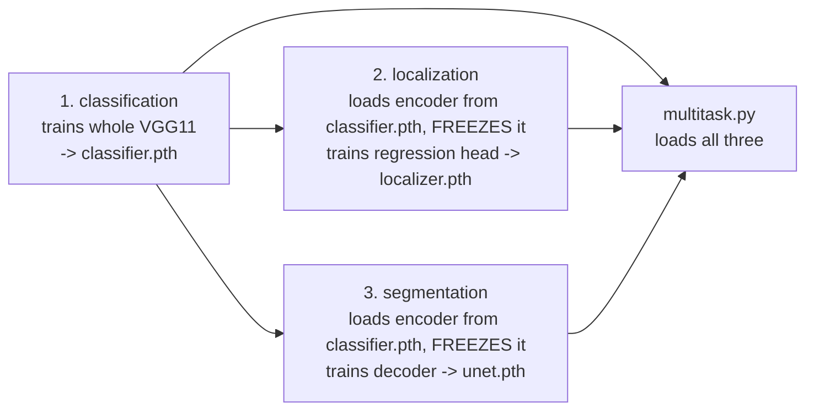

Source: `train.py`, and the Kaggle notebook `assignment2-2.ipynb` for the settings that were actually used. Evidence labels are explained on the [section landing page](../).

## The order matters

The three trainers are not independent. `python train.py --task all` runs them in this order <span style="color:#009b55"><strong>[Code]</strong></span>:



The classifier has to exist first because its encoder is the shared backbone. If `classifier.pth` is missing, `_load_encoder_weights` just returns and the localizer or U-Net would train on a **random, frozen** encoder, which is worthless. The function does not warn. <span style="color:#009b55"><strong>[Code]</strong></span>

## What each trainer does

| | Classification | Localization | Segmentation |
|---|---|---|---|
| Model | `VGG11(num_classes=37)` | `VGG11Localizer` | `VGG11UNet(num_classes=3)` |
| Trainable | everything | **regression head only** | **decoder only** (`name` not starting with `encoder.`) |
| Loss | `CrossEntropyLoss(weight=class_weights)` | `MSELoss + IoULoss` | `CrossEntropyLoss()` |
| Batches drawn | `WeightedRandomSampler` (inverse class frequency, with replacement) | shuffled | shuffled |
| Validation metric | accuracy, **macro-F1** (scikit-learn) | mean IoU | mean Dice (3 classes) |
| Checkpoint kept | best val **macro-F1** → `classifier.pth` | best val **IoU** → `localizer.pth` | best val **Dice** → `unet.pth` |

Shared by all three <span style="color:#009b55"><strong>[Code]</strong></span>:

- Optimiser **Adam** with `lr` and `weight_decay=1e-4`; scheduler **`StepLR(step_size=10, gamma=0.5)`**, i.e. the learning rate halves every 10 epochs.
- Training runs `model.train()`, validation runs `model.eval()` under `torch.no_grad()`.
- The checkpoint is a dict `{"state_dict", "epoch", "best_metric"}`, saved only when the selection metric improves, so the file on disk is the **best** epoch, not the last.
- One GPU (`cuda`) or CPU; there is no multi-GPU code.

### Class weighting is applied twice

For classification the code builds `class_weights = 1 / count` and uses it **both** to draw the batches (`WeightedRandomSampler`) **and** as the loss weight (`CrossEntropyLoss(weight=…)`). <span style="color:#009b55"><strong>[Code]</strong></span> Each technique alone already compensates for imbalance; together a rare class is corrected twice, roughly in proportion to `1/n²`. <span style="color:#7c3aed"><strong>[Reasoned]</strong></span> As far as I recall, the 37 breeds in Oxford-IIIT Pet are close to balanced (about 200 images each), so either effect is small and neither is likely to have hurt, but I did not run the ablation. Do not claim that the weighting "improved" the result.

Another consequence: the **validation loss** in the log is also class-weighted, so it is not comparable with an unweighted cross-entropy.

### Weight decay is L2, not decoupled

`Adam(…, weight_decay=1e-4)` adds `1e-4 · w` to the gradient before the adaptive scaling. That is L2 regularisation, which interacts with Adam's per-parameter scaling. Decoupled decay (`AdamW`) is the usual preference. <span style="color:#7c3aed"><strong>[Reasoned]</strong></span> The assignment allowed any optimiser.

## The recipe that was actually run

The defaults in `train.py` (`lr = 1e-4`, 30 epochs, batch 32, dropout 0.5) are **not** what produced the submitted checkpoints. The Kaggle notebook ran <span style="color:#009b55"><strong>[Code]</strong></span>:

| Task | Epochs | Batch | `lr` | `weight_decay` | `dropout_p` |
|---|---|---|---|---|---|
| Classification | 80 | 32 | 1e-3 | 1e-4 | **0.3** |
| Localization | 30 | 32 | 1e-3 | 1e-4 | default 0.5 |
| Segmentation | 40 | 16 | 1e-3 | 1e-4 | default 0.5 (unused: the U-Net has no dropout) |

The notebook then uploaded the three `.pth` files as a W&B artifact, and its last cell instantiated `MultiTaskPerceptionModel` and asserted the three output shapes.

With `StepLR(10, 0.5)` the learning rate decays as `lr₀ · 0.5^⌊(epoch−1)/10⌋`, so the last ten epochs of each run used <span style="color:#7c3aed"><strong>[Reasoned]</strong></span>:

| Task | Epochs | Final-stage learning rate |
|---|---|---|
| Classification | 71–80 | `1e-3 · 0.5⁷ ≈ 7.8e-6` |
| Localization | 21–30 | `1e-3 · 0.5² = 2.5e-4` |
| Segmentation | 31–40 | `1e-3 · 0.5³ = 1.25e-4` |

A learning rate of `1e-3` with Adam is on the high side for training a 129 M-parameter network from scratch; BatchNorm in every block is what makes it tolerable, which is also the point of W&B experiment 2.1. <span style="color:#7c3aed"><strong>[Reasoned]</strong></span> I did not test other values.

## How the metrics are defined

| Metric | Formula | Code |
|---|---|---|
| Accuracy | `correct / N` | `argmax` of logits |
| **Macro-F1** | unweighted mean of the 37 per-class F1 scores | `sklearn.metrics.f1_score(…, average="macro", zero_division=0)` over the full validation set |
| Mean IoU (boxes) | `mean(1 − IoULoss(reduction="none"))` | per-batch value weighted by batch size |
| Mean Dice (segmentation) | mean over classes 0,1,2 of `(2·∩ + ε)/(|P| + |G| + ε)` | batch-level counts, averaged over batches |

Macro-F1 averages over classes with equal weight, so a breed with few images counts as much as a common one. That is why it was chosen as the selection metric for the classifier: it is also the metric the grader uses.

## What the results show

<span style="color:#f7921d"><strong>[Not recorded]</strong></span> **There is no file in the project that stores the final F1, IoU, Dice or accuracy.** `train.py` prints them and the Kaggle notebook has no saved output. The public W&B report is the only record. Read the numbers from there; do not quote one from memory.

What the W&B part of the assignment asked you to show, and what the code supports:

| Question | What it needs | Supported by `train.py`? |
|---|---|---|
| 2.1 BatchNorm vs none: activation histogram of conv 3, convergence, max stable learning rate | A model **without** BN | **No switch.** BN is hard-wired in `VGG11Encoder`; this experiment needs a modified copy |
| 2.2 Dropout p = 0, 0.2, 0.5, train vs val loss | Three classifier runs | **Yes**: `--dropout_p 0`, `0.2`, `0.5` (`CustomDropout(0)` is valid) |
| 2.3 Frozen vs partial vs full fine-tuning for segmentation | Three U-Net runs | Only the **frozen** case. Partial and full need code changes |
| 2.4 Feature maps (first and last conv) | A forward hook | Not in `train.py` |
| 2.5 Box table with confidence and IoU | Logging code | Not in `train.py`; the localizer has no confidence output |
| 2.6 Dice vs pixel accuracy | Pixel accuracy | `train.py` computes only Dice |
| 2.7 Three internet images | Inference code | `inference.py` is an empty stub |
| 2.8 Reflection | Plots of train vs val | W&B only |

`train.py` contains **no `wandb` calls at all**. <span style="color:#009b55"><strong>[Code]</strong></span> The experiments for the report were therefore run in notebooks outside the repository. The one local W&B run folder (`results\wandb\run-20260408_145758-uz73s5b7`) lasted 5 seconds and holds no metrics. So when asked about an experiment, say what it was designed to show and point to the report, not to a local log.

A note on the box question 2.5: the localizer is a plain regressor and has no objectness or confidence output. Any "confidence" in a box table has to be defined by you (the earlier draft used the classifier's softmax probability). A high-confidence classification with a low-IoU box is not a contradiction because the two heads answer different questions from the same features.

## Running it

```bash
# Train in order (classifier first)
python train.py --task all --data_dir ./data/pets --epochs 30 --download

# Or one at a time, with the settings used on Kaggle
python train.py --task classification --data_dir ./data/pets --epochs 80 --batch_size 32 --lr 1e-3 --weight_decay 1e-4 --dropout_p 0.3
python train.py --task localization   --data_dir ./data/pets --epochs 30 --batch_size 32 --lr 1e-3 --weight_decay 1e-4
python train.py --task segmentation   --data_dir ./data/pets --epochs 40 --batch_size 16 --lr 1e-3 --weight_decay 1e-4
```

`--task all` uses one `--epochs` and one `--lr` for every task, so it does not reproduce the Kaggle run, which used different values per task. <span style="color:#009b55"><strong>[Code]</strong></span> Checkpoints land in `./checkpoints/` as `classifier.pth`, `localizer.pth`, `unet.pth`; those three names are mandatory for the autograder.
