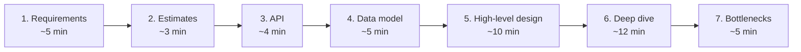

## Why this matters in an interview

A design question is deliberately vague ("design a URL shortener"). The interviewer is not
checking whether you know one right answer. They are checking whether you can **take a vague
problem, ask the right questions, and build a reasonable system step by step**.
A fixed routine is what stops you from freezing, so learn the routine before any topic.

## What "system design" means

Two different interviews use this name:

| | HLD (high-level design) | LLD (low-level design) |
|---|---|---|
| Question | "Design WhatsApp / a URL shortener" | "Design a parking lot / LRU cache / elevator" |
| You draw | Boxes: servers, databases, caches, queues | Classes, fields, methods, relationships |
| You discuss | Scale, speed, failures, storage | Objects, responsibilities, extensibility |
| Fresher weight | One light round, basics only | Usually the main round, with real code |

This track covers both. Chapters 01 to 17 are HLD, and 18 to 20 are LLD.

## The idea from scratch: the 7-step routine

Use the same order every time. Spend your 45 minutes roughly like this:



### 1. Requirements: ask before you draw

Split what you ask into two kinds.

- **Functional requirements**: what the system *does*. "Can a user create a short link? Can they pick a custom alias? Do links expire?"
- **Non-functional requirements**: how well it does it. Scale (how many users), speed (how fast must a redirect be), availability (can it ever go down), consistency (must everyone see the latest data instantly).

Then **say what you are leaving out**: "I'll skip analytics and user accounts unless you want them." This protects you from a huge scope and shows judgement.

### 2. Estimates: size the problem

A quick calculation of requests per second and storage tells you whether one server is enough or you need to spread the load. Chapter 07 teaches this properly. For now, remember that its only job is to **justify your design choices** ("this is read-heavy, so a cache will help").

### 3. API: how the outside world talks to it

List the 2 to 4 main operations as endpoints:

```text
POST /shorten      body: { longUrl }       -> { shortUrl }
GET  /{shortCode}                          -> redirect to longUrl
```

This forces you to agree with the interviewer on what the system actually does.

### 4. Data model: what you store

Name the main things and their fields. For the shortener: a `Url` record with `shortCode`, `longUrl`, `createdAt`, `expiresAt`. Then pick a type of database (chapter 04) and say why.

### 5. High-level design: the simple version first

Draw the **smallest system that works**: client, server, database. Walk one request through it. Only then add parts (load balancer, cache, queue) and say what problem each one solves. Never start with ten boxes.

### 6. Deep dive: go deep on one or two parts

The interviewer will point at something ("how do you generate the short code?"). Go deep there. This is where most of the marks are.

### 7. Bottlenecks and trade-offs

Finish by attacking your own design: "The database is a single point of failure, so I'd add a replica. A very popular link could overload one cache node, so..." Naming the weakness yourself is a strong signal.

## A tiny worked example: "design a pastebin"

You can do the whole routine in a few lines. This is only a demo of the *shape* of an answer.

| Step | What you'd say |
|---|---|
| Requirements | Users paste text and get a link. Anyone with the link can read it. Pastes expire after a set time. Skip accounts and editing. Reads are far more common than writes. |
| Estimates | Say 1 million new pastes a day. That is about 12 writes per second, which is tiny. Reads might be 10 times that. |
| API | `POST /paste` returns an id. `GET /paste/{id}` returns the text. |
| Data | `Paste(id, text, createdAt, expiresAt)`. Large text suggests keeping the body in blob storage and only metadata in the database. |
| High-level | Client → web server → database. Then add a cache for popular pastes because reads dominate. |
| Deep dive | How to make the unique `id`: random string vs counter. |
| Bottlenecks | Hot pastes, expired data cleanup, and the database as a single point of failure. |

## Trade-offs: how to behave in the room

| Do | Avoid |
|---|---|
| Think aloud, one step at a time | Silently drawing for five minutes |
| Start simple, then scale it | Starting with Kafka, sharding and microservices |
| Give a reason for every box | Dropping buzzwords with no reason |
| Say "the trade-off is..." | Saying "this is the best way" |
| Ask when stuck, and say your assumption | Guessing a requirement quietly |

## Interview angle

- **Open with:** "Before I design, I'd like to clarify the requirements."
- **If asked "how would this scale?":** go back to your estimate. Scale only the part that is actually the bottleneck.
- **If you don't know a technology:** describe what it *does* ("a fast in-memory store used as a cache") rather than bluffing its internals.
- **For freshers:** interviewers expect clear reasoning and the basics. They do not expect you to know how a specific company built its system.

## Check yourself

1. Why do you ask about non-functional requirements before drawing anything?
2. What is the difference between a functional and a non-functional requirement? Give one of each for a chat app.
3. Why start with the simplest design instead of the full architecture?
4. Which step usually earns the most marks, and why?
5. What does an HLD round draw, and what does an LLD round draw?



1. They decide the design. A system for 1,000 users and one for 100 million users look completely different, so you need the numbers first.
2. Functional: what it does, e.g. "send a message to another user". Non-functional: how well, e.g. "messages arrive within a second" or "the service stays up when one server fails".
3. It proves you understand the core flow, gives the interviewer something to correct early, and lets you add each piece with a reason.
4. The deep dive, because it shows real understanding of one hard part rather than a list of boxes.
5. HLD draws boxes (servers, databases, caches, queues). LLD draws classes, fields, methods and the relationships between them.



## Remember

- Same 7 steps every time: requirements, estimates, API, data model, high-level design, deep dive, bottlenecks.
- Ask first, and state what you are leaving out.
- Draw the smallest working system, then add parts one at a time with a reason each.
- Go deep on one or two parts instead of staying shallow everywhere.
- Attack your own design at the end and name the trade-offs.
