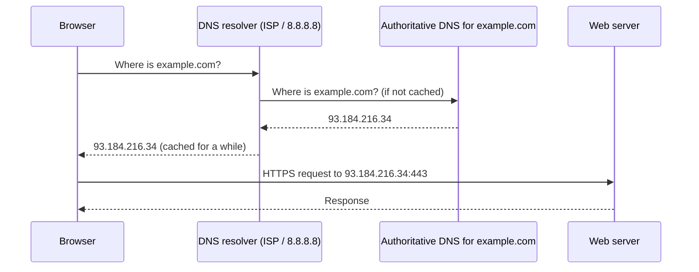
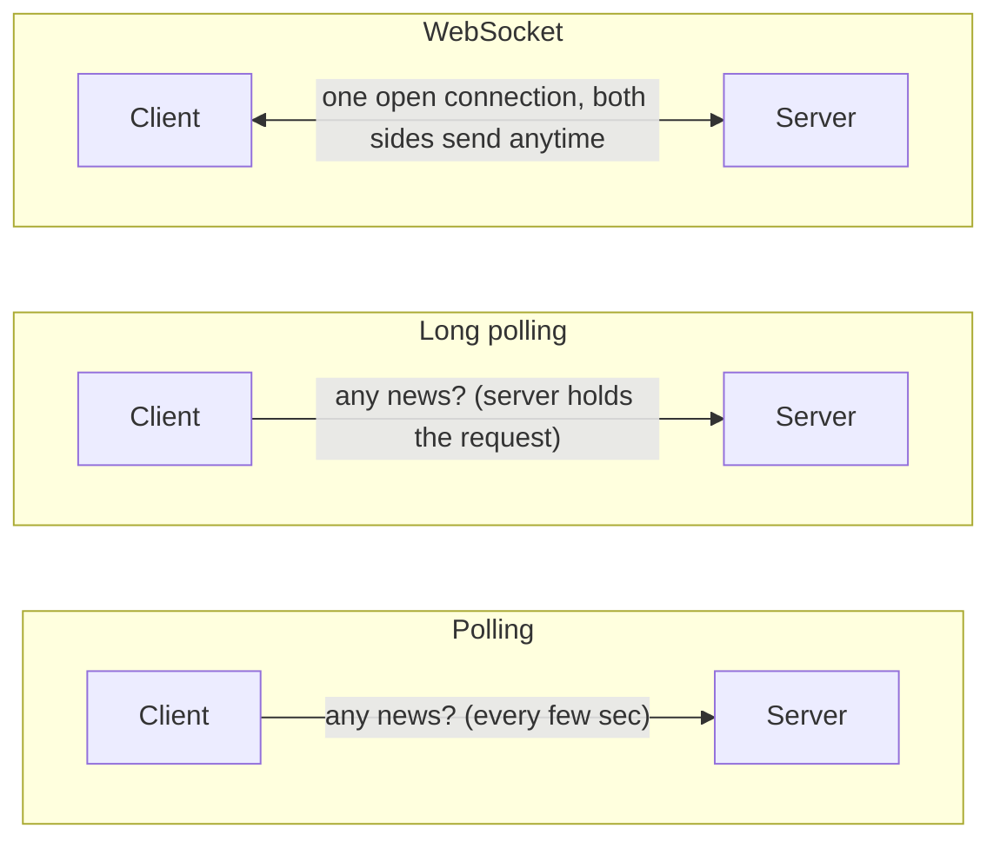

## Why this matters in an interview

Every HLD diagram has arrows between boxes, and each arrow is a network call. You do not need
to be a networking expert, but you must be able to say **how a browser reaches your server,
what protocol an arrow uses, and why it can be slow**. Interviewers ask "REST or WebSocket?" and
"TCP or UDP?" constantly.

## The idea from scratch

### Client and server

A **client** asks for something (your browser, a phone app). A **server** is a program on
another machine that answers. Every system you will design is clients talking to servers,
and servers talking to other servers.

### Addresses: IP and port

- An **IP address** identifies a machine, like `142.250.77.14`.
- A **port** identifies a program on that machine, like `443`. Web servers usually listen on 80 (HTTP) and 443 (HTTPS).

Humans do not remember IPs, so we use names like `example.com`.

### DNS: turning a name into an IP

**DNS** (Domain Name System) is the internet's phone book. Before your browser can talk to
`example.com`, it asks DNS for the IP.



Two things to remember: answers are **cached** (so DNS is fast after the first time), and DNS
can also hand out **different IPs to different users**, which is one way to spread traffic
across data centres.

### HTTP: the language of the web

**HTTP** is a request-response protocol. The client sends a request, the server sends one response.

```text
Request                                   Response
GET /users/42 HTTP/1.1                    HTTP/1.1 200 OK
Host: example.com                         Content-Type: application/json
Authorization: Bearer <token>
                                          { "id": 42, "name": "Asha" }
```

The **method** says what you want to do:

| Method | Meaning | Safe to repeat? |
|---|---|---|
| GET | Read | Yes |
| POST | Create / trigger an action | No, may create twice |
| PUT | Replace a whole thing | Yes |
| PATCH | Change part of a thing | Usually no |
| DELETE | Remove | Yes |

"Safe to repeat" is called **idempotent**. It matters when a request times out and the client
retries (chapter 08 returns to this).

The **status code** says what happened:

| Code | Meaning |
|---|---|
| 200 / 201 | OK / Created |
| 301 / 302 | Moved permanently / temporarily (a redirect, as in a URL shortener) |
| 400 | Bad request (client sent something wrong) |
| 401 / 403 | Not logged in / logged in but not allowed |
| 404 | Not found |
| 429 | Too many requests (rate limited) |
| 500 / 503 | Server error / service unavailable |

**HTTPS** is HTTP wrapped in TLS: the connection is encrypted and the server proves who it is
with a certificate. In an interview, "all client traffic goes over HTTPS" is enough.

### REST and RPC: two styles of API

| | REST | RPC (e.g. gRPC) |
|---|---|---|
| Thinks in | **Resources**: `GET /users/42` | **Actions**: `getUser(42)` |
| Format | Usually JSON over HTTP | Often a compact binary format |
| Strength | Simple, readable, works everywhere, good for public APIs | Fast, strongly typed, good between your own internal services |
| Typical use | Browser / mobile to your server | Server to server inside your system |

A safe default to say: **REST for the public API, RPC between internal services** if speed matters.

### TCP vs UDP: how bytes travel

| | TCP | UDP |
|---|---|---|
| Delivery | Reliable: lost packets are resent, order is kept | Best effort: packets may be lost or reordered |
| Setup | A handshake first | None |
| Speed | Slower, with overhead | Faster, lightweight |
| Used for | Web pages, APIs, email, file transfer | Live video, voice calls, gaming, DNS queries |

Rule: if you **cannot afford to lose data**, TCP. If **late data is worthless anyway** (a video
frame from two seconds ago), UDP. HTTP normally runs on top of TCP.

### Getting updates from a server: polling, long polling, WebSocket

Plain HTTP only lets the client ask. For things like chat, the server must push.



| | Polling | Long polling | WebSocket |
|---|---|---|---|
| How | Ask repeatedly | Ask, server waits until it has news | One persistent two-way connection |
| Cost | Many wasted requests | Fewer, but ties up connections | Efficient once open, but the server holds many open connections |
| Pick when | Updates are rare, simplicity matters | You need near-real-time but cannot use WebSocket | Chat, live scores, collaborative editing |

### Latency vs throughput

- **Latency**: how long **one** request takes (milliseconds). "A page load took 200 ms."
- **Throughput**: how many requests the system handles **per second**. "It serves 5,000 requests per second."

Think of a water pipe: latency is how long one drop takes to travel through, throughput is how
much water flows out per second. They are related but different. You can add more servers to
raise throughput without making any single request faster. Fixing latency usually means
doing less work per request, moving data closer to users (chapter 06), or avoiding a slow call.

**Bandwidth** is the maximum data a link can carry per second. It is a limit on throughput, not on latency.

## Trade-offs

| Decision | Choose A when... | Choose B when... |
|---|---|---|
| REST vs RPC | A: public API, many kinds of clients | B: internal calls where speed and types matter |
| TCP vs UDP | A: data must arrive intact | B: speed matters more than the occasional loss |
| Polling vs WebSocket | A: updates are infrequent | B: you need live two-way updates |
| HTTP vs HTTPS | Always HTTPS for anything user-facing | |

## Interview angle

- When you draw an arrow, be ready to say its protocol: "the app calls the API over HTTPS using REST."
- For real-time features say: "I'd use WebSocket so the server can push messages, since polling would waste requests."
- If asked "why is it slow?", separate **latency** (one call is slow) from **throughput** (too many calls at once). They have different fixes.
- Common follow-ups: What happens when you type a URL in the browser? What is the difference between 401 and 403? Why is a retry on POST dangerous?

## Check yourself

1. What does DNS do, and why are its answers cached?
2. Why is it a problem to blindly retry a `POST /payment` request that timed out?
3. REST or RPC for a public mobile-app API? For two internal services that call each other thousands of times a second?
4. A live video call drops one frame. Should it use TCP or UDP, and why?
5. Your app serves each request in 50 ms but falls over at high traffic. Is that a latency or a throughput problem, and what is the first thing to try?
6. Name two ways a server can tell a client about new data, and one downside of each.



1. It maps a name to an IP address. Answers are cached so the lookup is skipped most of the time and pages load faster, and so DNS servers are not hit by every request.
2. POST is not idempotent, so a retry may charge the customer twice if the first one actually succeeded. You need an idempotency key (chapter 08).
3. REST for the public mobile API (simple, universal). RPC for the internal pair, where lower overhead and typed contracts help.
4. UDP. A lost old frame is not worth waiting for, and resending it would only add delay.
5. Throughput. Each request is fast, but the server cannot take enough of them at once. The first move is to add more servers behind a load balancer (chapter 03).
6. Polling (wastes requests when nothing changed) and WebSocket (the server keeps many open connections). Long polling is a third option that holds requests open.



## Remember

- Name → IP via DNS (cached) → HTTPS request → response with a status code.
- GET, PUT and DELETE are safe to repeat; POST is not. Retries need idempotency.
- REST for public APIs, RPC between internal services.
- TCP when data must arrive intact, UDP when speed beats completeness.
- Latency is one request's time, throughput is requests per second. Fix them differently.


**Further reading:** the networking-related sections of the
[System Design Primer](https://github.com/donnemartin/system-design-primer) (DNS, TCP/UDP, RPC vs REST).
Read them after this page, not instead of it.

