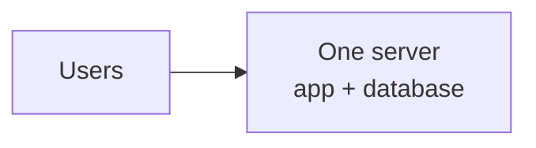
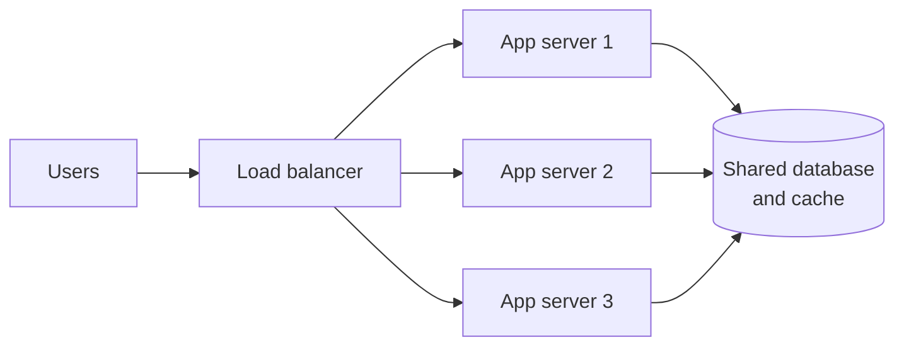

## Why this matters in an interview

"What happens when traffic grows 100 times?" is the most common follow-up in any HLD round.
The answer is almost always built from the ideas on this page: **add more machines, keep them
identical, and put something in front that spreads the traffic**.

## The idea from scratch

### Start with one server

Every system begins here: one machine runs the application and the database.



It works until the machine runs out of CPU, memory, disk or network. That is the moment you
have to **scale**. There are two ways.

### Vertical scaling: a bigger machine

Buy a machine with more CPU and RAM. No code change, no new complexity.

- **Good:** simple. Fine for small systems.
- **Bad:** there is a ceiling (the biggest machine you can buy), it gets expensive fast, and it is still **one machine**: if it dies, everything is down (a *single point of failure*).

### Horizontal scaling: more machines

Run many ordinary machines and share the work among them.

- **Good:** no hard ceiling, cheaper per unit, and losing one machine does not take the service down.
- **Bad:** you need a way to spread requests, and your code must cope with requests landing on different machines.

Interviews expect you to say: *"Vertical scaling first because it is simple, but for real scale and
availability I'd scale horizontally."*

### The catch: stateless servers

If a user logs in on server A, and their next request goes to server B, will B know who they
are? Only if the server **does not keep user data in its own memory**.

- A **stateful** server remembers things between requests (a session stored in its RAM). Requests from one user must keep going to the same machine, which is awkward.
- A **stateless** server keeps nothing between requests. Everything it needs arrives with the request (a token) or sits in a shared store (a database or cache). **Any** server can serve **any** request.



The design rule: **make the app tier stateless, and push state into the data tier** (database,
cache). Then you can add or remove app servers freely. This one sentence is worth saying out loud in an interview.

### Load balancer: the traffic spreader

A **load balancer (LB)** sits in front of the servers. Clients talk to one address (the LB),
and it forwards each request to one of the healthy servers behind it.

It does three jobs:
1. **Spreads load** so no server is overloaded.
2. **Health checks**: it stops sending traffic to a server that stopped responding.
3. **Hides the servers**: clients never need to know how many there are.

**How it picks a server** (the algorithm):

| Algorithm | How | Use when |
|---|---|---|
| Round robin | Servers in turn: 1, 2, 3, 1, 2, 3... | Servers are identical and requests cost about the same |
| Least connections | Send to the server with the fewest active connections | Requests vary a lot in duration |
| Weighted | Bigger machines get a bigger share | Servers have different capacity |
| IP hash | Hash the client IP, so the same client lands on the same server | You need a client to stick to one server |

**Layer 4 vs Layer 7.** Network traffic has layers. A load balancer can work at two of them:

| | L4 (transport) | L7 (application) |
|---|---|---|
| Looks at | IP address and port only | The full HTTP request: URL, headers, cookies |
| Speed | Faster, less work | Slower, more work |
| Can do | Simple spreading | Route by URL (`/api` to one group, `/images` to another), terminate HTTPS, add caching |
| Pick when | Raw speed, non-HTTP traffic | Smart routing for web apps |

**In practice.** Load balancers are usually ordinary software or a managed cloud service. **nginx** and **HAProxy** are common software choices (nginx works at L7 by default and can also balance raw TCP/UDP). Cloud providers offer managed ones, typically one L7 type and one L4 type. A minimal nginx setup lists the app servers once and forwards to them:

```nginx
upstream app_servers {
    least_conn;                 # algorithm; omit for round robin
    server 10.0.0.1:8080;
    server 10.0.0.2:8080;
    server 10.0.0.3:8080;
}

server {
    listen 80;
    location / {
        proxy_pass http://app_servers;
    }
}
```

In an interview you do not need to name a product. "A load balancer, for example nginx or HAProxy" is enough.

**The LB itself can fail.** The usual answer is two load balancers: one active and one on
standby (*active-passive*), or both handling traffic (*active-active*). Chapter 11 returns to this.

### Reverse proxy

A **reverse proxy** is a server that sits in front of your servers and forwards requests to them.
From outside it looks like *the* server. Besides spreading load, it can hide your internal
servers, handle HTTPS, compress responses, and cache static files.

A common source of confusion: **a load balancer is a reverse proxy whose main job is spreading
load across many servers.** With one server behind it, a reverse proxy is still useful for the
security and caching. In an interview, one sentence is enough: *"The LB is a reverse proxy that
distributes traffic across the app servers."*

### Monolith vs microservices

| | Monolith | Microservices |
|---|---|---|
| Shape | One application with all features | Many small services (users, orders, payments), each deployable on its own |
| Good | Simple to build, test, run and debug | Teams work independently, each part scales on its own |
| Bad | Everything scales and deploys together; one bug can take it all down | Many network calls, harder debugging, more to operate |
| Start with | A new or small product, which is almost always the right start | When the team and traffic are large enough to need it |

For a fresher round: **start with a monolith** in your first diagram, and only split out a
service when you can name why ("the video processing is heavy and needs its own scaling").
Splitting everything into microservices from the first box is a common over-engineering mistake.

When there are many services, they need to find each other as machines come and go. That is
**service discovery**: a registry where services record their address and others look it up.
Know the term, and that it exists for this reason.

### What scales next: the database

Add ten app servers and the **database** becomes the bottleneck, because they all hit it.
The next chapters deal with that: databases (04), replication and sharding (05), and caching (06).

## Trade-offs

| Decision | Choose A when... | Choose B when... |
|---|---|---|
| Vertical vs horizontal | A: small system, quick fix | B: real growth or high availability |
| L4 vs L7 balancer | A: speed, non-HTTP traffic | B: URL or header based routing |
| Round robin vs least connections | A: uniform requests | B: uneven request cost |
| Monolith vs microservices | A: start here | B: clear need to scale or deploy parts separately |

## Interview angle

- Say: "I'll keep the app servers **stateless** behind a load balancer so I can add servers as traffic grows. Session data goes in a shared store."
- If asked "what if the load balancer dies?": "Run a standby LB that takes over, so it is not a single point of failure."
- If asked "will adding servers fix everything?": "It fixes the app tier. The database is the next bottleneck, so I'd add caching and replicas."
- Common follow-ups: What is sticky session and why avoid it? Where do you store login sessions? What is the difference between an LB and a reverse proxy?

## Check yourself

1. Give one advantage of horizontal scaling over vertical, and one thing it makes harder.
2. Why must app servers be stateless before you can freely add more of them?
3. A page request is slow when a few users upload huge files while others make quick calls. Which load-balancing algorithm suits that better than round robin?
4. What can an L7 load balancer do that an L4 one cannot?
5. What problem does the load balancer itself introduce, and how do you fix it?
6. Why is "start with a monolith" usually the right answer for a new product?



1. No ceiling and no single point of failure. It makes it harder to share state, since requests hit different machines, and you need a load balancer.
2. If a server keeps a user's data in its own memory, the next request must return to that same server. Stateless servers keep nothing, so any server can handle any request, and you can add or remove them freely.
3. Least connections, because request durations vary, and it sends new work to the least busy server.
4. Look inside the HTTP request, so it can route by URL path, header or cookie, and terminate HTTPS.
5. It becomes a single point of failure. Run a second load balancer in standby (or active-active) so the other takes over.
6. It is simpler to build, test, deploy and debug. Splitting early adds network calls and operational work that you do not yet need.



## Remember

- Vertical = bigger machine (simple, capped, one failure point). Horizontal = more machines (scales, needs care).
- Keep the app tier **stateless**, push state into the database or cache.
- A load balancer spreads traffic, checks health, and hides the servers. Make the LB redundant too.
- L4 is fast and simple, L7 can route on the request content.
- Start with a monolith, split only for a named reason. The database is the next bottleneck.


**Further reading:** the load balancer, reverse proxy and application layer sections of the
[System Design Primer](https://github.com/donnemartin/system-design-primer).

