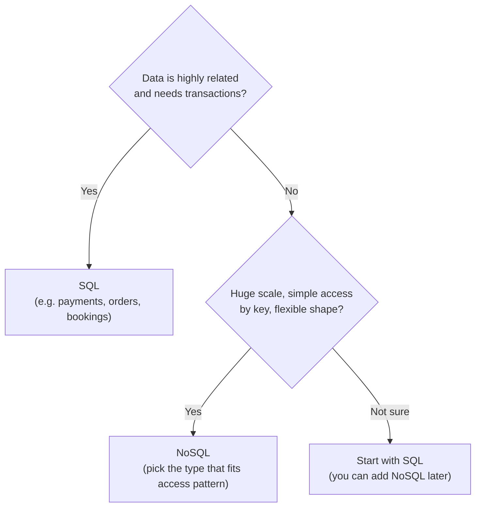
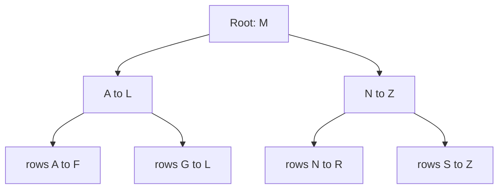

## Why this matters in an interview

Almost every design has a "Data model" step (chapter 01) and a "which database?" question.
You are rarely asked to know one product in depth. You are asked to **choose between SQL and
NoSQL and justify it**, and to explain why a query is slow (the answer is usually an index).

## The idea from scratch

### Why a database at all

Servers can crash and restart (chapter 03), and server memory is wiped when they do. A
**database** stores data durably on disk and lets many servers read and write it safely.

### Relational databases (SQL)

Data lives in **tables** of rows and columns, and tables link to each other through ids.
You query with **SQL**. Examples: MySQL, PostgreSQL.

```text
users                         orders
+----+-------+                +----+---------+--------+
| id | name  |                | id | user_id | amount |
+----+-------+                +----+---------+--------+
| 1  | Asha  |  <-----------  | 10 | 1       | 499    |
| 2  | Ravi  |                | 11 | 1       | 120    |
+----+-------+                +----+---------+--------+
```

```sql
SELECT u.name, SUM(o.amount)
FROM users u JOIN orders o ON o.user_id = u.id
GROUP BY u.name;
```

The strength is that the **structure is enforced** and tables can be **joined**, so you ask
flexible questions about related data.

### ACID: why banks use SQL

A **transaction** is a group of steps that must succeed or fail together. ACID describes the guarantees:

| Letter | Meaning | In plain words |
|---|---|---|
| **A**tomicity | All or nothing | Moving ₹100 from A to B: the debit and credit both happen, or neither does |
| **C**onsistency | Rules stay true | The database never ends in a state that breaks its rules (e.g. a negative balance if forbidden) |
| **I**solation | Transactions do not trip over each other | Two people booking the last seat cannot both succeed |
| **D**urability | Committed means saved | Once it says "done", a crash does not lose it |

### NoSQL: a family, not one thing

"NoSQL" means "not the classic relational model". It was built for huge scale and flexible data.
There are four common kinds:

| Type | Stores | Good for | Example products |
|---|---|---|---|
| **Key-value** | `key → value`, like a giant hash map | Sessions, caches, counters, very fast lookups by key | Redis, DynamoDB |
| **Document** | JSON-like documents, each can have its own shape | User profiles, catalogues, content that changes shape | MongoDB |
| **Wide-column** | Rows with many flexible columns, spread across machines | Huge write-heavy data, time series, logs | Cassandra, HBase |
| **Graph** | Nodes and edges | Friends-of-friends, recommendations, fraud rings | Neo4j |

NoSQL databases usually make it easy to **spread data across many machines**, and often trade
away some of SQL's joins or strict guarantees for that. (Many modern NoSQL systems do offer
transactions in some form, so do not say "NoSQL has no transactions". Say "the guarantees vary by product".)

### SQL or NoSQL? A decision you can defend



Defaults that are safe in an interview:
- **Start with SQL** unless the scale or shape clearly says otherwise. It is mature, well understood and flexible.
- Use **NoSQL for the part that needs it**: a key-value cache for sessions, a wide-column store for a firehose of messages or logs.
- Real systems often use **both**. Say so.

### Indexes: why a query is fast or slow

Without an index, finding `WHERE email = 'asha@x.com'` means reading **every row** (a *full table
scan*, O(n)). An **index** is a separate sorted structure that points to rows, like the index
at the back of a textbook. Databases usually build it as a **B-tree**, which finds a value in
O(log n) steps even for millions of rows.



You do not need to know B-tree internals. Know that each step discards a large part of the
data, so you reach the row in a few hops.

```sql
CREATE INDEX idx_users_email ON users(email);
```

The cost of an index:

| | |
|---|---|
| **Faster** | Reads that filter, sort or join on the indexed column |
| **Slower** | Writes, because every insert or update must also update the index |
| **More** | Disk space |

So index the columns you **search and join on**, not everything. Two practical points:
a **composite index** on `(a, b)` helps queries that filter on `a`, or on `a` and `b`, but not on `b` alone;
and an index on a column with very few distinct values (like a yes/no flag) usually helps little.

### Normalisation vs denormalisation

- **Normalised**: each fact is stored **once**, in its own table, and you join to get the whole picture. No duplication, so no inconsistency. But reads that need many joins can be slow at scale.
- **Denormalised**: you **copy** some data into the table that reads it, so one lookup returns everything. Reads get fast. Writes get harder, because the same fact lives in several places and must be updated in all of them.

Rule of thumb: normalise first, then denormalise **specific hot read paths** when you can show joins are the bottleneck.

### SQL tuning checklist (quick)

When a query is slow, check in this order:
1. Is there an **index** on the columns in `WHERE` and `JOIN`?
2. Are you fetching **more than you need** (`SELECT *`, no `LIMIT`)?
3. Are you running **many small queries** in a loop instead of one query?
4. Is the table so big that you need **caching, replicas or sharding**? (chapters 05 and 06)

## Trade-offs

| Decision | Choose A when... | Choose B when... |
|---|---|---|
| SQL vs NoSQL | A: related data, transactions, flexible queries | B: massive scale, key-based access, flexible shape |
| Add an index | A: the column is searched or joined often | B (skip it): the table is write-heavy and the column is rarely queried |
| Normalise vs denormalise | A: correctness first, write-heavy | B: read-heavy hot path where joins are too slow |

## Interview angle

- Say: "I'll use a relational database because the data is related and I need transactions for [bookings / payments]." Then name your tables and keys.
- If a read is slow: "I'd check the query uses an index on the filter column." This is a strong, simple answer.
- If asked "why not NoSQL?": "The data has relationships and I need strong guarantees, so SQL fits. If we hit scale limits, I'd shard or move the heavy part to NoSQL."
- Common follow-ups: Explain ACID with an example. What is an index and what does it cost? When would you denormalise?

## Check yourself

1. Explain atomicity using a money transfer.
2. A query `WHERE phone = ?` on a 50-million-row table takes seconds. What is the first fix, and what does it cost?
3. Which type of NoSQL would you pick for storing user sessions by session id? For "friends of friends"?
4. Why is a composite index on `(city, age)` no help for a query that only filters on `age`?
5. Give one reason to denormalise and one danger of doing it.
6. A bookings app and a chat history store: which database type for each, and why?



1. Debit from A and credit to B are one transaction. If the credit fails, the debit is rolled back, so money is never lost or created.
2. Add an index on `phone`. It turns a full scan into a fast lookup, but slows writes a little and uses extra disk space.
3. Key-value for sessions (lookup by id, very fast). Graph for friends of friends (relationships are the point).
4. The index is sorted by `city` first. Without a `city` condition the database cannot use that ordering to narrow down by `age`.
5. Reason: faster reads, no joins on a hot path. Danger: the same data is stored in several places, so updates can leave copies out of sync.
6. Bookings: SQL, because of transactions and relationships (no double booking). Chat history: often a wide-column or similar NoSQL store, because it is a huge, write-heavy stream accessed by conversation.



## Remember

- SQL: tables, joins, ACID. Safe default. NoSQL: four kinds (key-value, document, wide-column, graph), built for scale and flexibility.
- ACID = all-or-nothing, rules hold, no interference, saved once committed.
- An index turns a scan into a fast lookup. It costs write speed and space, so index what you search and join on.
- Normalise first, denormalise specific hot reads.
- Most real systems use more than one kind of database.


**Further reading:** the database section of the
[System Design Primer](https://github.com/donnemartin/system-design-primer) (RDBMS, NoSQL, SQL or NoSQL).

