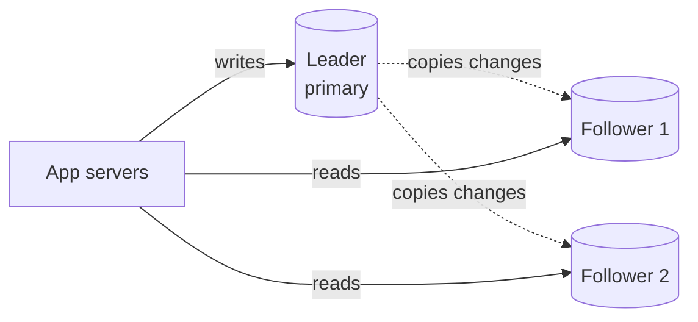
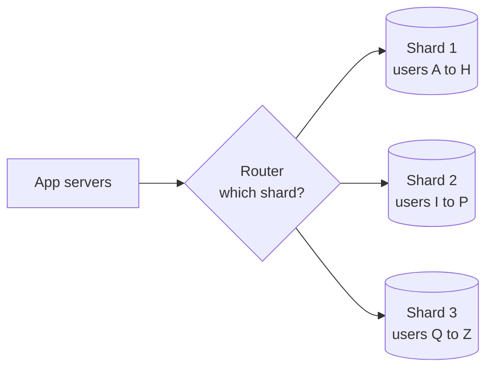
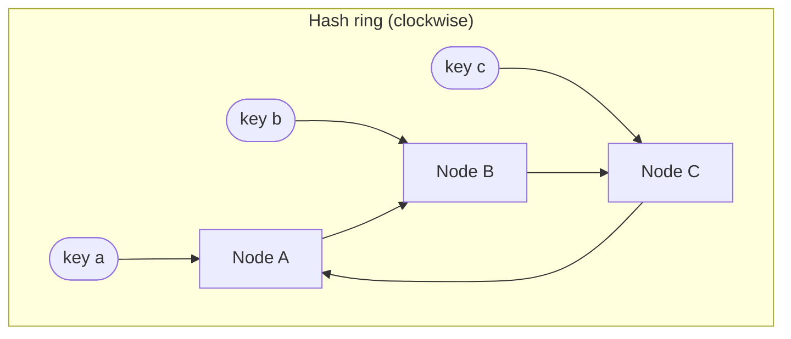

## Why this matters in an interview

After you scale the app servers (chapter 03), the **database** is what breaks first. Two ideas
fix most of it: **replication** (copies of the data, for reads and survival) and **sharding**
(splitting the data across machines, for size and write load). "How would you scale the
database?" has a standard answer built from these two.

## The idea from scratch

### Replication: keep copies

**Replication** keeps the same data on several database machines.

The usual setup is **leader-follower** (older name: master-slave):

- **All writes go to the leader.** It records each change and sends it to the followers.
- **Reads can go to any follower**, so read traffic is spread out.

It gives you two things:

1. **Read scaling.** Most systems are read-heavy, so adding followers adds read capacity.
2. **Availability.** If the leader dies, a follower is promoted to leader (*failover*), and the system keeps running.

**What it does not give you:** more write capacity (every write still goes through one leader)
or more total storage (every machine holds all the data).

#### Replication lag

Copying takes time. With **asynchronous** replication (the common choice) the leader says
"done" before the followers have the change. So a follower can briefly be **behind**.

- A user posts a comment, the page reloads and reads from a lagging follower: **the comment seems to be missing**.
- Typical fixes: read your own recent writes from the leader, or accept that it is *eventually consistent* (chapter 09).

With **synchronous** replication the leader waits for followers to confirm. That is safer, but writes are slower and one slow follower can stall everything. Most systems use async, or sync to just one follower.

| | Asynchronous | Synchronous |
|---|---|---|
| Write speed | Fast | Slower |
| If the leader dies right now | The latest writes may be lost | No loss of confirmed writes |
| Followers | May lag | Up to date |

**Multi-leader** setups (several machines accept writes) exist, mainly for multiple data centres,
but they bring write conflicts. As a fresher, know the name and that conflicts are the cost.

### Sharding: split the data

When the data or the write traffic is too big for one machine, even with replicas, you
**shard** (also called *partitioning*): each machine holds only **a slice** of the data.

Each shard handles its own reads and writes, so **both storage and write load are spread out**.
(In practice each shard is also replicated for availability. The two ideas combine.)

The key question is **how to decide which shard a row goes to**. That choice is the **shard key**.

| Strategy | How | Good | Bad |
|---|---|---|---|
| **Range** | Key ranges: A to H, I to P... | Range queries are easy | **Hot spots**: if most users start with "S", one shard is overloaded |
| **Hash** | `shard = hash(key) mod N` | Even spread | Range queries hit every shard. Changing `N` remaps most keys (see below) |
| **Directory** | A lookup table says where each key lives | Fully flexible | The table is itself a thing to scale and protect |

**Choosing a shard key.** A good key spreads data **evenly** and keeps data that is usually
used together on the **same shard**. Examples: `user_id` for user data. A bad key: `country`
(a few countries hold most users, and it creates hot shards), or `created_at` (all new writes hit the newest shard).

#### What sharding costs you

Sharding is powerful but painful, so **do it last**:

- **Cross-shard queries and joins** are slow and complex. A query that spans users on different shards must ask every shard and merge.
- **Transactions across shards** are hard.
- **Rebalancing**: moving data when you add or remove a shard.
- More moving parts to run and debug.

The order to say in an interview: *first optimise queries and add indexes, then add a cache, then
read replicas, and only then shard.*

### Consistent hashing: adding machines without a reshuffle

Hash-mod-N has a nasty flaw. With `shard = hash(key) mod 3`, adding a fourth machine changes the
formula to `mod 4`, and **most keys now map to a different machine**. That means moving most of
your data (or, for a cache, losing most of it at once).

**Consistent hashing** fixes this:

1. Imagine the hash values arranged on a **circle** (a ring).
2. Hash each **machine** to a point on the ring.
3. Hash each **key** to a point on the ring, then walk **clockwise** until you meet a machine. That machine owns the key.

If you **add or remove a machine**, only the keys between it and its neighbour move. The rest
stay put. On average only about `keys / machines` move, instead of nearly all of them.

One refinement: with only a few machines, the ring slices are uneven. So each real machine is
placed on the ring many times (**virtual nodes**), which evens out the load and lets bigger
machines take more virtual nodes.

Consistent hashing shows up in distributed caches, key-value stores and sharded databases.
You do not need to code it, but you should be able to **draw the ring and explain why adding a node moves few keys**.

### Federation (functional partitioning)

A different way to split: **by feature instead of by row**. Put users in one database,
products in another, orders in a third. Each database is smaller and gets its own traffic.

- **Good:** simple to understand and each part scales independently.
- **Bad:** joins across databases are not possible in SQL, so the app must combine results. A single feature can still outgrow one database, and then you need sharding too.

## Trade-offs

| Decision | Choose A when... | Choose B when... |
|---|---|---|
| Replicas vs sharding | A: reads are the problem (most apps) | B: data size or write load exceeds one machine |
| Async vs sync replication | A: speed matters, small risk is fine | B: you cannot lose confirmed writes |
| Range vs hash sharding | A: you need range queries | B: you need an even spread |
| Hash-mod-N vs consistent hashing | A: the number of nodes never changes | B: nodes come and go |

## Interview angle

- Standard answer to "the database is slow": "Add indexes, then a cache, then read replicas. If writes or data size are still too much, shard by `user_id`."
- When you say "shard", immediately say **the shard key and why**. Then name the cost: cross-shard queries.
- If asked about a celebrity or very popular key causing a **hot shard**: split that key further, or give it dedicated capacity or a cache in front.
- Common follow-ups: What happens when the leader fails? How do you add a shard without downtime? Why not just use a bigger machine?

## Check yourself

1. Your app is 95% reads. Which do you add first, replicas or shards, and why?
2. A user updates their profile and immediately sees the old one. What is the likely cause, and one fix?
3. Why is `created_at` a poor shard key?
4. With `hash(key) mod 4` you add a fifth machine. What goes wrong, and what fixes it?
5. What are virtual nodes for?
6. Name two things that become hard after sharding.



1. Replicas. Reads are the bottleneck, and followers multiply read capacity without the complexity of sharding.
2. Replication lag: the read hit a follower that had not received the update yet. Fix: read your own recent writes from the leader, or tolerate eventual consistency.
3. All new rows have the newest timestamps, so every write lands on the same shard (a hot spot) while old shards sit idle.
4. The formula changes to `mod 5` and most keys map to a different machine, so most data must move (or a cache loses most of its entries at once). Consistent hashing fixes it, because only the keys near the new node move.
5. To spread keys evenly across the ring and let stronger machines take a larger share, by placing each machine at many points on the ring.
6. Any two of: joins across shards, transactions across shards, range queries over all data, rebalancing when shards are added or removed.



## Remember

- Replication = copies. Leader takes writes, followers serve reads. Scales reads and gives failover, not writes.
- Async replication can lag, so a read can briefly return old data.
- Sharding = slices of data on different machines. Scales storage and writes. The shard key decides everything: spread evenly, avoid hot spots.
- Shard last: indexes, then cache, then replicas, then shards.
- Consistent hashing puts nodes and keys on a ring, so adding a node moves only a few keys.


**Further reading:** the replication, federation and sharding parts of the database section in the
[System Design Primer](https://github.com/donnemartin/system-design-primer).

