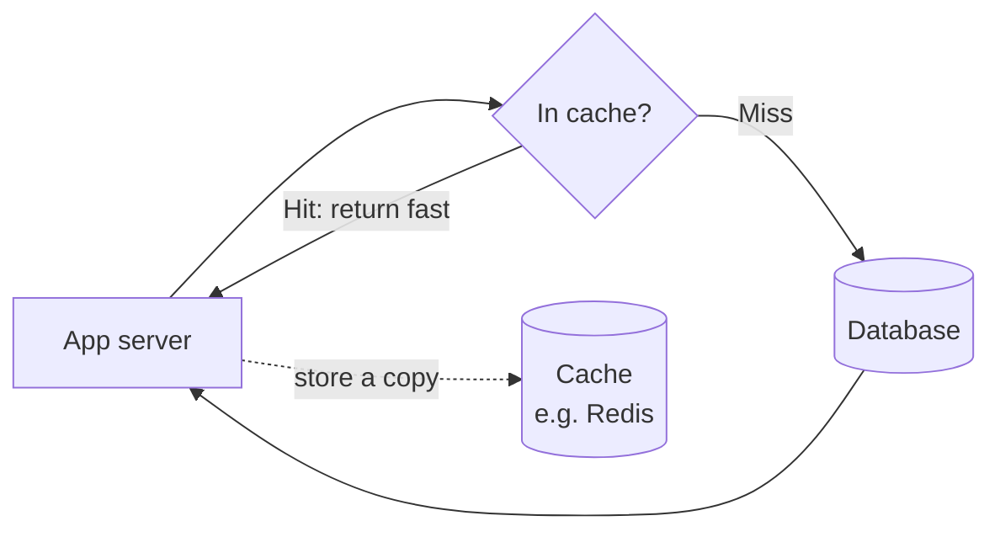
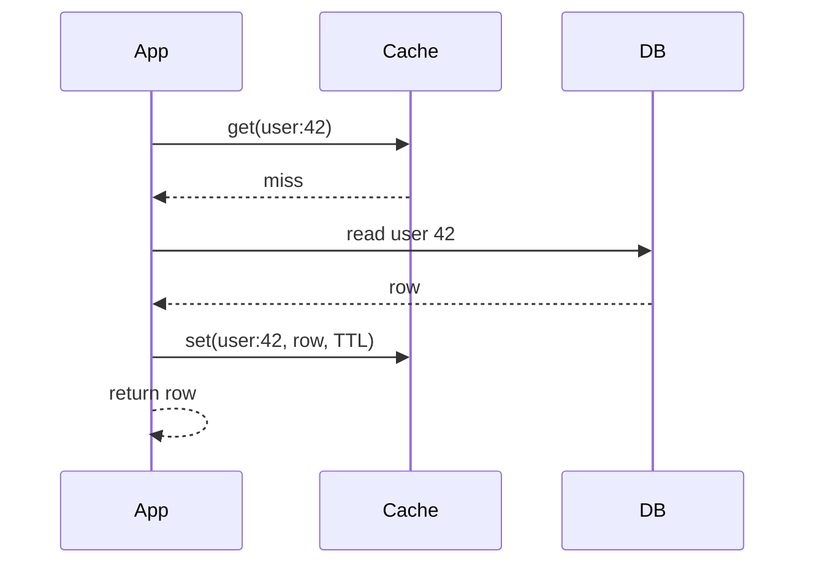

## Why this matters in an interview

Caching is the **cheapest big speed-up** in system design, and it appears in nearly every HLD
answer ("reads are heavy, so I'd add a cache"). Interviewers then probe the hard part: **what
happens when the cached data goes stale?** If you can explain strategies, eviction and invalidation,
you are already ahead of most freshers.

## The idea from scratch

A **cache** is a small, fast store that keeps copies of data that is expensive to fetch or
compute, so the next request for it is quick.

Why it works: a database read might take milliseconds because of disk and queries; a read from
memory takes a fraction of that. And real traffic is lopsided: a small set of items gets most
of the requests (popular products, trending posts). Keep those few in memory and most requests never touch the database.

Two numbers describe a cache:
- **Hit ratio** = hits ÷ (hits + misses). A higher ratio means fewer trips to the database.
- **TTL** (time to live): how long an entry is kept before it expires automatically.

### Where caches live

Caches exist at every layer. Mention the ones that fit your design.

| Layer | What is cached | Example |
|---|---|---|
| Client | Responses and files in the browser or app | Browser cache, app storage |
| **CDN** | Static files near the user (images, video, scripts) | See below |
| Web server / reverse proxy | Full pages and static assets | nginx caching |
| **Application cache** | Results of database queries or computed objects, in memory | Redis or Memcached |
| Database | The database's own internal buffers | Built in, usually automatic |

For interviews, the one you draw most is the **application cache**, a separate in-memory store
(Redis-style) shared by all app servers.

### CDN: a cache near the user

A **CDN** (content delivery network) is a worldwide set of servers that keep copies of your
static content, so a user in Chennai is served from a nearby server instead of your origin
server in another continent. Lower latency, and less load on you.

- **Pull CDN**: the CDN fetches a file from your server **the first time someone asks**, then keeps it. Easy to run. The first user pays the cost.
- **Push CDN**: **you upload** content to the CDN ahead of time. You control exactly what is there. More work, and good for content that rarely changes.

### Caching strategies: how data gets in and stays correct

This is the core of the topic. Learn these four.

**1. Cache-aside (lazy loading).** The app is in charge. This is the most common.

Only data that is actually requested gets cached. If the cache dies, the app still works (slower).
Downside: the first request for each item is a miss, and the data can go stale.

**2. Write-through.** Every write goes to the cache **and** the database together, and is confirmed only when both succeed. The cache is always fresh, but writes are slower and you cache data nobody may read.

**3. Write-back (write-behind).** Writes go to the cache and are confirmed at once. The cache writes to the database **later**, in batches. Writes are very fast, but if the cache crashes before saving, **data is lost**.

**4. Refresh-ahead.** The cache **reloads entries before they expire**, if they are likely to be needed. Good for predictable hot data. Wasteful if it guesses wrong.

| Strategy | Read speed | Write speed | Freshness | Risk |
|---|---|---|---|---|
| Cache-aside | Fast after first miss | Normal | Can go stale until TTL or invalidation | Stale data |
| Write-through | Fast | Slower | Fresh | Caches unused data |
| Write-back | Fast | Very fast | Fresh in cache | **Data loss on cache crash** |
| Refresh-ahead | Fast | Normal | Fresh | Wasted reloads on bad guesses |

Safe default to say: **cache-aside with a TTL**.

### Eviction: what to throw out when it is full

A cache has limited memory, so it must remove entries to make room.

| Policy | Removes | Good when |
|---|---|---|
| **LRU** (least recently used) | The entry unused for the longest time | General purpose. The default answer |
| **LFU** (least frequently used) | The entry used the fewest times | Some items are consistently popular |
| **FIFO** | The oldest entry added | Simple, rarely the best |
| **TTL** | Entries past their expiry | Data with a natural lifetime |

LRU is also a classic **LLD question** (chapter 20): a hash map plus a doubly linked list gives O(1) get and put.
You may already know it from DSA.

### Invalidation: the hard part

> There are only two hard things in computer science: cache invalidation and naming things.

When the database changes, the cached copy becomes **stale**. Options:

- **TTL**: let it expire. Simple, and you accept staleness up to the TTL.
- **Delete on write**: when you update the row, also delete (or update) the cache key. The next read refills it.
- **Event-based**: publish a "changed" event that tells caches to drop the entry (chapter 08).

Delete-on-write is the usual answer. A short TTL is a good safety net on top, so a missed invalidation is not wrong forever.

### Cache problems that interviewers like

| Problem | What happens | Typical fix |
|---|---|---|
| **Cache stampede** | A popular key expires and thousands of requests miss at once, all hitting the database | Let only one request rebuild it (a lock), or refresh before expiry, or add random jitter to TTLs |
| **Cache penetration** | Requests for keys that **do not exist** always miss and always reach the database | Cache the "not found" result briefly, or filter with a Bloom filter |
| **Cache avalanche** | Many keys expire at the same moment | Randomise TTLs, and keep the database able to take a burst |
| **Hot key** | One key is so popular that its cache node is overloaded | Replicate that key across nodes, or add a small local cache |
| **Stale data** | Cache and database disagree | Invalidate on write, use a TTL |

When the cache itself is spread over many machines, **consistent hashing** (chapter 05) decides
which node holds each key, so adding a node does not lose most entries.

### When not to cache

Caching helps when data is **read often and changes rarely**. Skip it for data that must always be exact
(an account balance right before a payment), or that is rarely read twice.

## Trade-offs

| Decision | Choose A when... | Choose B when... |
|---|---|---|
| Cache-aside vs write-through | A: read-heavy, some staleness is fine | B: you need the cache always fresh |
| Write-back | Writes are extremely heavy and a small loss window is acceptable | Never for money or anything that must not be lost |
| Short vs long TTL | Short: data changes often, freshness matters | Long: data is stable, you want a high hit ratio |
| Pull vs push CDN | Pull: easy, content changes | Push: you want control and the content is stable |

## Interview angle

- Say where it sits and why: "Reads are heavy and the same items repeat, so I'd put Redis in front of the database using **cache-aside with a TTL**."
- State the cost out loud: "The trade-off is staleness, so on update I'd delete the cache key."
- If asked "what if the cache goes down?": "The app falls back to the database. I'd make sure the database can survive that load, and run the cache with replicas."
- Common follow-ups: What eviction policy and why? What is a cache stampede? How do you keep cache and database consistent? What do you cache and what not?

## Check yourself

1. Explain cache-aside step by step for a read that misses.
2. Why is write-back risky? Name a case where it is acceptable.
3. A trending product's cache entry expires and the database spikes. What happened, and what is one fix?
4. Why is LRU a sensible default eviction policy?
5. Your app keeps getting requests for user ids that do not exist, and the database is busy. Which cache problem is this?
6. Give two kinds of data you would cache and one you would not.



1. The app asks the cache. On a miss it reads the database, stores the result in the cache (with a TTL), and returns it. The next request hits the cache.
2. The cache confirms the write before the database has it, so a cache crash loses recent writes. It can be acceptable for things like view counters or analytics where a small loss is fine.
3. A cache stampede: many requests missed at the same moment and all went to the database. Fix: let one request rebuild the value while the others wait, refresh before expiry, or add random jitter to TTLs.
4. Recently used items are likely to be used again (the traffic is lopsided), so removing the least recently used loses the least value.
5. Cache penetration. Fix: cache the "not found" answer for a short time, or use a Bloom filter to reject ids that cannot exist.
6. Cache: product pages, user profiles, computed feed results. Do not cache: data that must be exact at that instant, such as a balance checked right before a payment.



## Remember

- A cache keeps hot data in fast memory. It works because traffic is lopsided. Measure with hit ratio.
- Default: cache-aside with a TTL. Know write-through, write-back (can lose data) and refresh-ahead.
- Eviction: LRU is the default answer. LFU, FIFO and TTL are alternatives.
- Invalidate by deleting the key on write, with a TTL as the safety net.
- Know the failure modes: stampede, penetration, avalanche, hot key. A CDN is a cache for static files near users (pull or push).


**Further reading:** the cache and CDN sections of the
[System Design Primer](https://github.com/donnemartin/system-design-primer).

