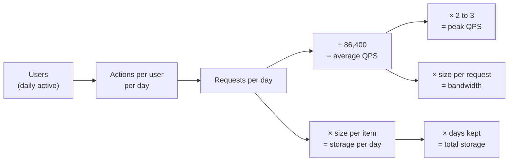

## Why this matters in an interview

Step 2 of the routine (chapter 01) is a quick calculation. Nobody checks your arithmetic to the
last digit. The interviewer wants to see that you can **turn "10 million users" into requests per
second and terabytes**, and then let those numbers *justify* your design: "4,000 reads per
second is too much for one database, so I'll add a cache."

All the numbers on this page are **rules of thumb**. The goal is the right order of magnitude
(is it 100 per second or 100,000?), not precision.

## The idea from scratch

### Tools you need to memorise

**1. Time.** Use round numbers so you can do it in your head.

| Fact | Use this |
|---|---|
| Seconds in a day | 86,400, call it **about 100,000** (10⁵) |
| Seconds in a month | about 2.5 million |
| Seconds in a year | about 30 million |
| 1 million requests per day | about **12 per second** (1,000,000 ÷ 86,400) |

**2. Data sizes (powers of two).** Each step up is about a factor of 1,000.

| Power | Approx. value | Name |
|---|---|---|
| 2¹⁰ | thousand | 1 KB |
| 2²⁰ | million | 1 MB |
| 2³⁰ | billion | 1 GB |
| 2⁴⁰ | trillion | 1 TB |
| 2⁵⁰ | quadrillion | 1 PB |

**3. Typical sizes** (assumptions you may state and adjust):

| Item | Rough size |
|---|---|
| A character of text | 1 byte (ASCII) to a few bytes |
| A short text message | 100 bytes |
| A database row for a simple record | 100 bytes to 1 KB |
| A photo | 200 KB to 2 MB |
| A minute of video | tens of MB, depending on quality |

**4. Latency (how long things take), orders of magnitude only:**

| Operation | Rough time |
|---|---|
| Read from memory | ~100 nanoseconds |
| Read from SSD | ~0.1 millisecond |
| Round trip inside one data centre | ~0.5 millisecond |
| Read from a spinning disk (seek) | ~10 milliseconds |
| Round trip across continents | ~100 to 150 milliseconds |

The lesson in these numbers: **memory is thousands of times faster than disk, and the network
across the world is slower than both.** That is why caches (chapter 06) and CDNs exist.

### The method, always the same

- **QPS** means queries (requests) per second.
- **DAU** is daily active users. Estimate from this, not from total signups.
- **Peak** traffic is higher than the average, so multiply by about 2 to 3 for design purposes.
- **Read to write ratio**: most apps read far more than they write. State one (like 100 : 1).

State every assumption out loud ("let's assume a record is 500 bytes"). The interviewer can
correct you, and you stay in control.

## Worked example 1: URL shortener

**Assumptions:** 100 million new short URLs per month. Reads are 100 times writes. One record is about 500 bytes. We keep data for 5 years.

| Quantity | Calculation | Result |
|---|---|---|
| Writes per second | 100M ÷ (30 × 86,400 ≈ 2.6M seconds) | about **40 / s** |
| Reads per second | 40 × 100 | about **4,000 / s** |
| Peak reads | 4,000 × 2 | about **8,000 / s** |
| Storage per month | 100M × 500 bytes = 50 GB | **50 GB** |
| Storage for 5 years | 50 GB × 60 months | about **3 TB** |

**What the numbers tell us:**
- 40 writes per second is tiny. A single database handles that.
- 8,000 reads per second is more than a comfortable single-database load, and the same links are read again and again. So a **cache** (chapter 06) in front of the database is justified, and a few app servers behind a load balancer.
- 3 TB over 5 years fits on one modern machine, but with replicas for safety. Sharding is not needed yet. That is a good thing to say: **"the numbers show I do not need to shard."**

## Worked example 2: photo sharing

**Assumptions:** 10 million daily active users. On average each uploads 0.5 photos per day, and views 50 photos per day. A photo is 2 MB.

| Quantity | Calculation | Result |
|---|---|---|
| Uploads per day | 10M × 0.5 | 5 million |
| Upload rate | 5M ÷ 86,400 | about **60 / s** |
| New storage per day | 5M × 2 MB | **10 TB / day** |
| Storage per year | 10 TB × 365 | about **3.6 PB** |
| Upload bandwidth | 60 / s × 2 MB | about **120 MB/s**, roughly 1 Gbps |
| Views per day | 10M × 50 | 500 million |
| View rate | 500M ÷ 86,400 | about **6,000 / s** |

**What the numbers tell us:**
- Petabytes means **object storage** for the image files and only metadata (user, caption, timestamps) in the database. You would not store photos as database rows.
- 6,000 views per second of 2 MB images is a lot of bandwidth. A **CDN** (chapter 06) must serve them, not your servers.
- Storage grows by about 3.6 PB a year, so cost and retention matter. Say so.

## Worked example 3: chat messages

**Assumptions:** 50 million daily active users, 40 messages sent per user per day, 100 bytes per message.

| Quantity | Calculation | Result |
|---|---|---|
| Messages per day | 50M × 40 | 2 billion |
| Message rate | 2B ÷ 86,400 | about **23,000 / s** |
| Peak | × 2 | about **50,000 / s** |
| Storage per day | 2B × 100 bytes | **200 GB / day** |
| Storage per year | 200 GB × 365 | about **73 TB** |

**What the numbers tell us:**
- 23,000 writes per second is far more than one database should take. This is a **write-heavy** system, so you reach for a store that spreads writes across machines (sharding by conversation, a wide-column store).
- 73 TB a year is manageable, but it must be partitioned.
- Compare with example 1: same method, completely different design conclusions. That is the point of estimating.

## Turning numbers into decisions

| If you find... | Then consider... |
|---|---|
| Reads far above writes | Cache, read replicas, CDN for static content |
| Writes in the tens of thousands per second | Sharding, a write-optimised store, a queue to absorb bursts (chapter 08) |
| Terabytes to petabytes of files | Object storage, with metadata in a database |
| Tiny numbers (tens of requests per second) | Keep it simple: one database, no sharding |
| Large bandwidth for static files | CDN |

A rough capacity rule to quote, **as an assumption you state**: one ordinary application server
handles on the order of hundreds to a few thousand simple requests per second, and one database
server on the order of a few thousand simple queries per second. Real numbers depend entirely
on the workload, so say "assuming roughly 1,000 requests per second per server."

## Trade-offs

| Decision | Choose A when... | Choose B when... |
|---|---|---|
| Precise vs rough | A (never): interviews | B: round to powers of 10 and keep moving |
| Average vs peak | A: capacity cost estimates | B: sizing servers and the database |

## Interview angle

- **Say your assumptions first**, in one breath, then calculate. For example: "Assume 10 million DAU and 100-byte messages."
- **Round aggressively**: 86,400 becomes 100,000, and 2.6 million becomes 2.5 million. Say "about".
- **End every estimate with a conclusion**: "so we need a cache", "so one database is enough", "so we need a CDN". A bare number with no decision attached scores badly.
- Do not spend more than 3 to 5 minutes here. If the interviewer says "let's skip the estimates", you can skip.
- Common follow-ups: How many servers do you need? How much storage in 5 years? What is your peak QPS?

## Check yourself

1. About how many requests per second is 1 million requests per day?
2. A service has 20 million DAU, and each user makes 10 requests per day. What is the average QPS, and a reasonable peak?
3. You store 100 million records of 1 KB each. How much space is that?
4. Why do we estimate peak traffic, not only the average?
5. Photos average 1 MB, and 1 million are uploaded per day. How much storage grows per year?
6. Estimates show 200 writes per second and 3 TB of data over 5 years. Do you need sharding, and why?



1. About 12 per second (1,000,000 ÷ 86,400).
2. 20M × 10 = 200M requests per day. 200M ÷ 100,000 (rounded) = about 2,000 per second, or about 2,300 using 86,400. Peak is about 2 to 3 times, so roughly 5,000 per second.
3. 100M × 1 KB = 100 million KB = about 100 GB.
4. Systems fail at their busiest moment, not on average. You size servers and databases for the peak.
5. 1M × 1 MB = 1 TB per day, so about 365 TB (roughly 0.4 PB) per year.
6. Probably not. 200 writes per second is easily handled by one database (with replicas for reads and safety), and 3 TB fits on one machine. You would say the numbers do not justify sharding yet.



## Remember

- One day is about 100,000 seconds, so 1 million per day is about 12 per second.
- Each step up in size (KB, MB, GB, TB, PB) is about ×1,000.
- Method: DAU → requests per day → ÷ 86,400 → QPS → × 2 to 3 for peak. Size × count × time for storage.
- Latency order: memory ≪ SSD ≪ disk ≪ network across continents.
- State assumptions, round hard, and always end with a design decision.


**Further reading:** the "Powers of two table" and "Latency numbers every programmer should know"
in the appendix of the [System Design Primer](https://github.com/donnemartin/system-design-primer).

