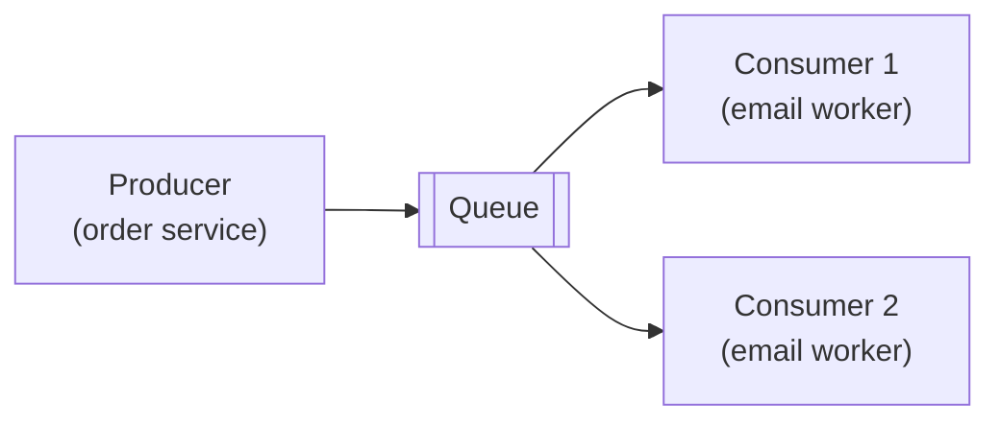
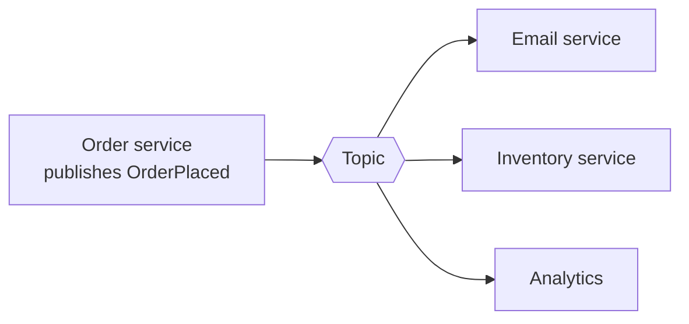

## Why this matters in an interview

Whenever a design has a slow or bursty step (sending email, resizing an image, updating
analytics), the answer is **"do it asynchronously through a queue."** Queues are also how you
survive traffic spikes and how services talk without being tied together. They appear in
almost every HLD answer after the first diagram.

## The idea from scratch

### Synchronous vs asynchronous

- **Synchronous**: the caller waits for the work to finish. Placing an order that also sends an email, updates stock and logs analytics makes the user wait for all of it, and if the email service is down, the order fails.
- **Asynchronous**: the caller drops a **message** ("order 42 was placed") somewhere safe and returns immediately. Other workers pick it up and do the slow parts later.

- The **producer** adds messages. The **consumer** takes them off and processes them.
- The queue **stores** messages until a consumer is ready, so a spike just makes the queue longer instead of crashing the service. This is **buffering**.
- Producer and consumer are **decoupled**: they do not need to be up at the same time, and you can add more consumers to go faster.

### Queue vs pub-sub

| | Queue (point-to-point) | Publish-subscribe |
|---|---|---|
| Each message goes to | **One** consumer (workers share the load) | **Every** subscriber (each gets a copy) |
| Use for | Distributing tasks: "resize this image" | Broadcasting events: "order placed" to email, stock, analytics |

### Two flavours of broker

A **broker** is the system that holds the messages. Two designs you should be able to tell apart:

| | Traditional message queue (RabbitMQ-style) | Log-based (Kafka-style) |
|---|---|---|
| Model | Broker hands a message to a consumer, which **acknowledges** it, then the message is **deleted** | Messages are appended to a **log** and **kept** for a retention period. Consumers track their own position (**offset**) |
| Replay old messages | No (once consumed, gone) | **Yes**, a consumer can rewind |
| Ordering | Per queue, loosely | Strict **within a partition**; a topic is split into partitions for scale |
| Throughput | Good | Very high |
| Best for | Task queues, per-message routing | Event streams, analytics, many independent consumers reading the same data |

You do not need product internals. Know *"queue deletes after consumption, log keeps and lets
consumers replay"*, and that a log scales by **partitioning** a topic (messages with the same key, like a `user_id`, go to the same partition so their order is kept).

### Delivery guarantees

What happens if a consumer crashes halfway through a message?

| Guarantee | Meaning | Risk |
|---|---|---|
| **At-most-once** | Delivered zero or one time | May **lose** messages |
| **At-least-once** | Delivered one or more times (resent until acknowledged) | May deliver **duplicates** |
| **Exactly-once** | Exactly one time | Very hard to guarantee end to end |

The practical standard: **at-least-once delivery plus an idempotent consumer**. The queue may
send a message twice, and processing it twice must be harmless.

### Idempotency: making duplicates harmless

An operation is **idempotent** if doing it twice has the same effect as once.

- "Set balance to 500" is idempotent. "Add 100 to balance" is not.
- Fix for non-idempotent actions: attach a unique **idempotency key** (or message id) to each message. The consumer records the ids it has processed and **ignores repeats**.

This is also the answer to chapter 02's question about retrying `POST /payment` safely.

### Retries, dead-letter queues, back pressure

- **Retry with backoff**: if processing fails, try again after a delay that grows (1s, 2s, 4s...). Immediate retries just hammer a struggling service.
- **Dead-letter queue (DLQ)**: after a set number of failed attempts, move the message to a separate queue so it does not block the others forever. A human or a script inspects it later. Interviewers like this one.
- **Back pressure**: if consumers cannot keep up, the queue grows without limit. Either **scale out the consumers**, **slow or reject producers** (return "try later"), or set a size limit. Watch **queue length** and **consumer lag** as health signals.

### Where queues show up

| Use | Example |
|---|---|
| Slow side-effects | Send email, push notification, generate a PDF |
| Absorb spikes | Flash sale orders, event ticketing |
| Fan-out to many services | One event feeds search indexing, analytics and caches |
| Background processing | Video transcoding, image resizing |
| Keeping systems in sync | Update a search index or cache when the database changes |

### The cost

- The system is now **eventually consistent**: the email goes out *a moment after* the order, not at the same instant.
- More things to run and monitor.
- Harder debugging, because a request is spread across services and time.
- Not every call should be async. If the user needs the result right now (a login), call it synchronously.

## Trade-offs

| Decision | Choose A when... | Choose B when... |
|---|---|---|
| Sync vs async | A: the user needs the answer now | B: slow work, spikes, or optional side effects |
| Queue vs pub-sub | A: one worker should handle each task | B: several services react to the same event |
| Traditional broker vs log | A: task distribution, simple routing | B: event streams, replay, very high volume |
| At-least-once + idempotency | Almost always | Exactly-once only where you can prove it is needed |

## Interview angle

- Introduce a queue with a reason: "Sending the confirmation email is slow and not needed for the response, so I'll publish an event and let a worker send it."
- Always mention **idempotency** when you use a queue. It signals that you know messages can repeat.
- If asked "what if the consumer is slow?": "The queue buffers the burst. I'd scale out consumers and monitor the queue length, and use a dead-letter queue for messages that keep failing."
- Common follow-ups: How do you keep order? (partition by key) What if a message is processed twice? What if the queue itself goes down? (replicate the broker)

## Check yourself

1. Give one benefit of putting email sending behind a queue instead of calling the email service directly.
2. When do you use a queue and when pub-sub?
3. Why is "at-least-once plus idempotent consumers" the usual choice over exactly-once?
4. A message keeps failing. What happens to it so it does not block everything?
5. How does a log-based system let a new service read all of yesterday's events?
6. Name one thing that gets worse when you add a queue.



1. The order request returns fast, an email outage does not fail the order, and spikes are buffered. Producer and consumer are decoupled.
2. Queue when one worker should process each message (task distribution). Pub-sub when several services each need a copy of the same event.
3. Exactly-once is very hard end to end. At-least-once is simple and reliable, and an idempotent consumer makes duplicates harmless.
4. After a few retries with backoff it moves to a dead-letter queue for later inspection.
5. The log keeps messages for a retention period, and a consumer can start reading from an earlier offset.
6. Consistency becomes eventual (effects appear slightly later), and the system is harder to run and debug.



## Remember

- Queues decouple, buffer and let you scale workers. Producer drops a message and moves on.
- Queue = one consumer per message. Pub-sub = every subscriber gets a copy.
- Traditional broker deletes after ack. Log-based keeps and lets you replay, scaling by partitions.
- Use **at-least-once + idempotent consumers**. Retry with backoff, send repeat failures to a dead-letter queue.
- Watch queue length and lag. The price is eventual consistency and more to operate.


**Further reading:** the "Asynchronism" section (message queues, task queues, back pressure) of the
[System Design Primer](https://github.com/donnemartin/system-design-primer).

