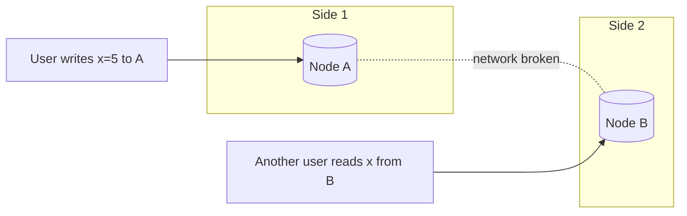

## Why this matters in an interview

"Is your design consistent or available?" is a favourite follow-up once you have replicas,
caches or shards. You are not expected to prove theorems. You are expected to explain, in plain
words, **what you give up when data lives on several machines**, and to pick sensibly for the
problem at hand (a bank is not a social feed).

## The idea from scratch

### Why the problem exists

Chapter 05 gave us copies of data on several machines. Copies can **disagree** for a moment
(replication lag), and the network between machines can **break**. Now a user asks a machine for data. What should it do if it cannot reach the others to check it is up to date?

### The three letters

- **C, Consistency**: every read sees the **latest** write. All machines show the same data.
- **A, Availability**: every request to a working machine gets a **response** (not an error), even if it might not be the latest data.
- **P, Partition tolerance**: the system keeps working even when **the network splits** and machines cannot talk to each other.

### The CAP theorem

In a distributed system, network partitions **will** happen (cables fail, data centres lose contact), so partition tolerance is not optional. The theorem then says:

> **During a partition you must choose: consistency or availability. You cannot have both.**

When B cannot reach A, a read of `x` on B has two honest answers:

| Choice | What B does | Result |
|---|---|---|
| **CP** (consistency) | Refuses or errors: "I cannot confirm I am up to date" | Never returns stale data, but some requests **fail** |
| **AP** (availability) | Answers with what it has: the old value of `x` | Always answers, but the data may be **stale** |

Note: "CA" (no partition tolerance) only makes sense for a single machine, so you will not pick it for a distributed design.

### Which to choose: think about the cost of being wrong

| Need | Lean | Why |
|---|---|---|
| Bank balance, payments, seat booking, inventory at checkout | **CP** | A wrong answer costs money or double-sells a seat. An error is better than a lie |
| Social feed, likes, view counts, product recommendations | **AP** | Showing a slightly old like count is harmless. Being down is not |
| Shopping cart | Often **AP** | A cart that always accepts items is better, and conflicts can be merged |

Real databases are tunable, so say "tends toward" and not "is". Many offer settings that move
them along this scale, per operation.

### Consistency levels

CAP is about the extreme case. Day to day you choose a **consistency model**:

| Model | Meaning | Example feel |
|---|---|---|
| **Strong** | After a write completes, every read sees it | Like a single machine. Slower, because replicas must coordinate |
| **Eventual** | If writes stop, all copies **eventually** agree. Reads may be stale meanwhile | A post takes a second to appear for everyone. Fast and highly available |
| **Weak** | No promise that readers see a write soon | Real-time voice or video, where late data is useless anyway |

Two practical guarantees sit between strong and eventual, and are worth naming:
- **Read-your-writes**: *you* always see your own update immediately (others may lag). This fixes the "I changed my profile and it shows the old one" problem from chapter 05.
- **Monotonic reads**: you never see data go **backwards** in time (new value, then old value) when you refresh.

### Quorum: tuning the dial

Suppose data is stored on **N** replicas. A write waits for **W** of them to acknowledge, and a read asks **R** of them and takes the newest answer.

> If **R + W > N**, every read overlaps with at least one replica that saw the latest write, so reads see the latest value.

Example with N = 3:

| W | R | R + W | Behaviour |
|---|---|---|---|
| 2 | 2 | 4 > 3 | Reads see the latest write. Tolerates one replica being down |
| 3 | 1 | 4 > 3 | Reads are fast, writes are slow (all must ack) |
| 1 | 1 | 2 ≤ 3 | Fast and available, but reads can be **stale** (eventual) |

You do not need to derive it. Know that **you can trade latency, availability and consistency
by choosing W and R.**

### ACID vs BASE (a one-liner to recognise)

- **ACID** (chapter 04): strict guarantees on a transaction. Typical of SQL.
- **BASE**: "**B**asically **A**vailable, **S**oft state, **E**ventually consistent". A loose label for systems that favour availability and scale.

### One more trade-off: latency

Even without a partition, strong consistency means replicas must **talk to each other before
answering**, which costs time. So the real everyday choice is often **consistency vs speed**.

## Trade-offs

| Decision | Choose A when... | Choose B when... |
|---|---|---|
| CP vs AP | A: wrong data is costly (money, seats) | B: being down is costlier than being slightly stale |
| Strong vs eventual | A: correctness first | B: speed and availability first |
| High W | Writes must be durable and visible | Low W: writes must be fast |

## Interview angle

- Say it per feature, not per system: "Payments are CP, so I'd rather reject than double-charge. The feed is AP, so a slightly stale feed is fine."
- If asked about CAP, start with: "Partitions will happen, so the real choice is consistency or availability **during** a partition."
- When you add a cache or a replica, name the staleness it creates and how long you accept ("eventually consistent, within a second or so").
- Common follow-ups: What is eventual consistency? How do you handle conflicting writes? What does R + W > N mean?

## Check yourself

1. State CAP in one sentence, including why partition tolerance is not optional.
2. Is a bank balance lookup CP or AP, and why? What about a "likes" counter?
3. A user edits their profile and an immediate reload shows the old data. What property is missing, and where did the stale read come from?
4. With N = 5, W = 3, R = 3, do reads see the latest write? Why?
5. Why is strong consistency slower even when nothing is broken?
6. What does "eventually consistent" promise and what does it not?



1. Network partitions cannot be avoided in a distributed system, so during one you must choose between consistency (correct or error) and availability (always answer, maybe stale).
2. Balance: CP, because a wrong answer costs money, so an error is better. Likes: AP, because a slightly old count is harmless and being down is worse.
3. Read-your-writes. The read probably hit a replica that had not received the update yet (replication lag).
4. Yes: R + W = 6 > 5, so any read set overlaps at least one replica holding the latest write.
5. Replicas must coordinate (confirm they agree) before replying, and that coordination takes time.
6. It promises that if no new writes arrive, all copies will converge to the same value. It does not promise when, or that a read right after a write sees it.



## Remember

- Copies of data can disagree and networks can split. **During a partition: consistency or availability, not both.**
- CP refuses to answer when unsure. AP answers, possibly with stale data. Choose by the cost of being wrong.
- Models: strong, eventual, weak, plus read-your-writes and monotonic reads.
- Quorum: if **R + W > N**, reads overlap the latest write. Tune W and R to trade speed for safety.
- Decide per feature. Payments lean CP, feeds and counters lean AP.


**Further reading:** "Availability vs consistency", "Consistency patterns" and "Availability patterns" in the
[System Design Primer](https://github.com/donnemartin/system-design-primer).

