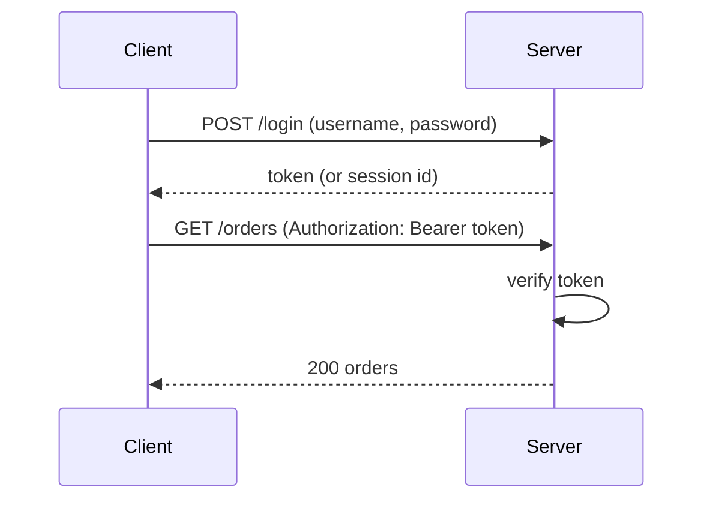

## Why this matters in an interview

Step 3 of the routine (chapter 01) is "define the API", and every design needs it. You will also
be asked "how do users log in?" and "how do you stop abuse?". These are cheap to answer well:
a clean set of REST endpoints, a sentence on sessions vs tokens, and a rate limiter at the edge.

## The idea from scratch

### REST API conventions

REST (chapter 02) models your system as **resources** (nouns) and uses HTTP methods as the verbs.

| Do | Example |
|---|---|
| Use **nouns, plural** for resources | `/users`, `/orders` |
| Let the **method** carry the action | `POST /orders` creates, `GET /orders/42` reads, `DELETE /orders/42` removes |
| Nest for relationships | `GET /users/7/orders` |
| Filter and sort with query parameters | `GET /orders?status=paid&sort=-createdAt` |
| Return correct **status codes** | `201` created, `404` not found, `429` too many requests |
| **Version** the API | `/v1/orders`, so old clients keep working when you change things |

Avoid verbs in the path, like `/createOrder`. The method already says "create".

A good answer in an interview is a short list:

```text
POST   /v1/urls              body: { longUrl, customAlias? }   -> 201 { shortUrl }
GET    /v1/urls/{code}                                         -> 200 { longUrl, createdAt }
DELETE /v1/urls/{code}                                         -> 204
```

### Pagination: never return everything

A list endpoint that returns a million rows will break clients and servers. Return a **page** at a time.

| | Offset pagination | Cursor pagination |
|---|---|---|
| Request | `?page=3&limit=20` (or `offset=40`) | `?after=<cursor>&limit=20` |
| How | Skips `offset` rows | Continues **after the last item you saw** |
| Good | Simple. Jump to any page | Stable and fast on big data, even when new rows arrive |
| Bad | Slow for deep pages (the database still counts past the skipped rows), and items can shift between pages | Cannot jump straight to page 50 |
| Pick when | Small data, page numbers matter | Feeds, timelines, large tables |

### Idempotency in APIs

As chapters 02 and 08 showed, a retried `POST` can create a duplicate. Let the client send an
**`Idempotency-Key`** header (a unique id for that attempt). The server remembers it and
returns the **same result** if it sees the key again. Standard for payment APIs.

### Authentication vs authorisation

- **Authentication (authn)**: *who are you?* (log in)
- **Authorisation (authz)**: *what are you allowed to do?* (can you delete this order?)

Mixing these up is a common slip. `401` means "not logged in", `403` means "logged in but not allowed".

### Sessions vs tokens (JWT)

After login the client must prove who it is on every request, without sending the password again.



| | Server-side **session** | **JWT** (signed token) |
|---|---|---|
| What the client holds | A random **session id** (usually in a cookie) | A **signed token** that contains the user id and expiry |
| Where the state lives | The **server** (database or Redis) looks up the id | In the token itself. The server only checks the signature |
| Stateless servers? | Needs a shared session store (chapter 03) | Yes, any server can verify it |
| Log out or revoke | Easy: delete the session | **Hard**: the token stays valid until it expires |
| Pick when | Classic web apps, need instant revocation | APIs and microservices, mobile apps |

Practical JWT advice: keep tokens **short-lived** and use a separate **refresh token** to get new ones, which limits damage if one leaks.

You may also hear **OAuth** ("Log in with Google"). In one line: it lets a user grant your app limited access to their account on another service, without sharing their password with you.

### API gateway

An **API gateway** is the single front door for all clients. It sits in front of your services and handles the cross-cutting jobs once, so each service does not repeat them:

- routing (`/orders` to the order service)
- **authentication**
- **rate limiting**
- TLS termination (HTTPS)
- logging and metrics, sometimes response caching

It is basically a reverse proxy (chapter 03) with extra jobs. In a monolith you may not need one.

### Rate limiting

A **rate limiter** caps how many requests a client can make in a time window, for example 100 per minute per user. It protects you from:

- abusive or buggy clients,
- brute-force login attempts,
- one noisy customer starving the rest,
- accidental overload (and surprise cloud bills).

When the limit is hit, return **`429 Too Many Requests`**, ideally with a `Retry-After` header.

The common algorithms, at a glance (chapter 13 builds one):

| Algorithm | Idea | Notes |
|---|---|---|
| **Fixed window** | Count requests per clock window (e.g. per minute) | Simple, but a burst across the window edge can let through 2× the limit |
| **Sliding window** | Count over the last N seconds, rolling | Smoother and more accurate |
| **Token bucket** | A bucket refills at a steady rate. Each request takes a token | Allows short **bursts**, then a steady rate. Very common |
| **Leaky bucket** | Requests queue and drain at a fixed rate | Smooths traffic into a constant flow |

Who do you limit? By **user id** or **API key** when logged in, by **IP address** otherwise (careful: many users can share one IP).

### Security basics worth a sentence each

| Threat | Defence |
|---|---|
| Data sniffed on the network | **HTTPS** everywhere |
| Stolen password database | Store a **salted hash** made with a slow hashing function such as bcrypt or Argon2. Never plain text, never a plain fast hash |
| **SQL injection** (attacker input becomes part of a query) | **Parameterised queries**, never string-concatenated SQL |
| **XSS** (attacker script runs in another user's browser) | Escape output, set a content security policy |
| **CSRF** (another site makes your browser send a request) | SameSite cookies, CSRF tokens |
| Abuse and scraping | Rate limiting, authentication |
| Over-powered access | **Least privilege**: give each user and service only the access it needs |
| Secrets in code | Keep keys and passwords out of source code. Use a secrets manager or environment config |

Never trust input from the client. Validate everything on the server.

## Trade-offs

| Decision | Choose A when... | Choose B when... |
|---|---|---|
| Offset vs cursor pagination | A: small data, page numbers | B: large or fast-changing data, feeds |
| Session vs JWT | A: you need instant revocation | B: stateless APIs, many services |
| Token bucket vs fixed window | A: allow bursts, smooth | B: simplest possible limiter |
| Gateway vs none | A: many services, shared concerns | B: single small app |

## Interview angle

- Write the API as a small list of verbs and paths **before** drawing boxes. Mention the status codes for the interesting cases.
- Say "I'd use cursor pagination for the feed, since new items arrive constantly."
- For login: "A short-lived signed token on each request, with a refresh token. Passwords stored as salted hashes."
- For abuse: "A rate limiter at the gateway, 429 on excess, keyed by user id or API key."
- Common follow-ups: What is the difference between 401 and 403? Why not return all rows? How do you revoke a JWT? Where would you put the rate limiter?

## Check yourself

1. Rewrite `POST /createNewOrder` and `GET /getOrderById?id=42` in REST style.
2. Why is offset pagination slow for page 5,000 of a big table, and what replaces it?
3. What is the main downside of JWTs compared with server-side sessions?
4. Which is it: user logged in but trying to delete someone else's order, 401 or 403?
5. Why must passwords be stored as a salted slow hash, not encrypted or stored plainly?
6. Name two jobs an API gateway does besides routing.



1. `POST /v1/orders` and `GET /v1/orders/42`.
2. The database still walks past all the skipped rows, so deep pages are slow, and items can shift between pages. Cursor pagination continues from the last seen item.
3. They are hard to revoke before they expire, since the server holds no state about them. Short lifetimes and refresh tokens limit this.
4. 403. The user is authenticated but not authorised for that order.
5. If the database leaks, plain or reversibly encrypted passwords are exposed directly. A salted slow hash makes each guess expensive and prevents precomputed lookups.
6. Any two of: authentication, rate limiting, TLS termination, logging and metrics, response caching.



## Remember

- REST: plural nouns for resources, the method carries the verb, correct status codes, versioned paths.
- Paginate every list. Cursor pagination for big or changing data.
- Authentication is "who", authorisation is "what allowed". 401 vs 403.
- Session = state on the server, easy to revoke. JWT = state in a signed token, stateless but hard to revoke.
- Gateway centralises auth, rate limiting and routing. Rate limit with 429, token bucket is the common choice.
- Security basics: HTTPS, salted slow password hashes, parameterised queries, least privilege.


**Further reading:** the "Security" and "Communication" sections of the
[System Design Primer](https://github.com/donnemartin/system-design-primer).

