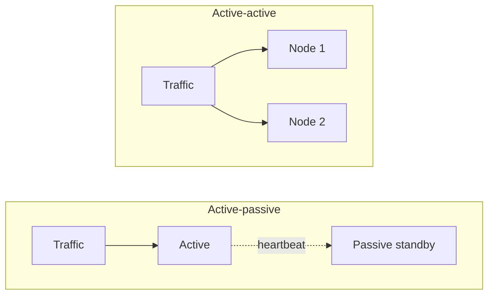
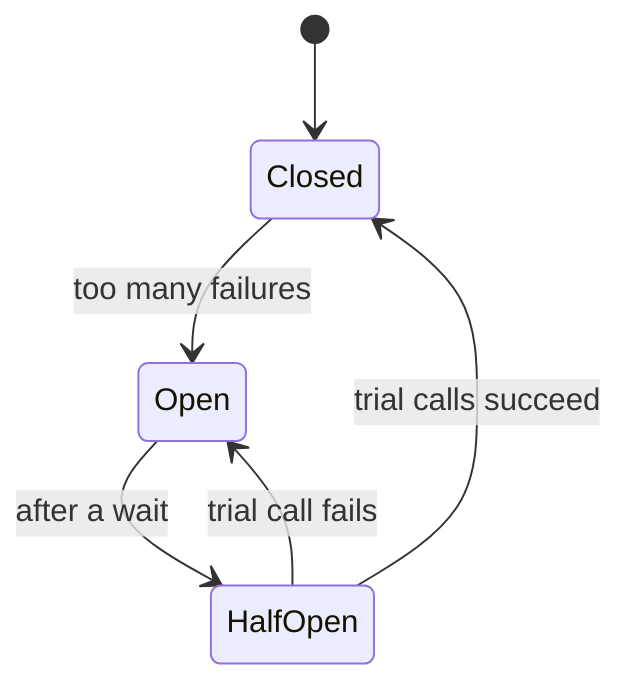

## Why this matters in an interview

At the end of a design you are asked: "What happens when this part fails?" Machines fail,
networks drop packets, and downstream services slow down. This chapter is the vocabulary
for answering calmly: **redundancy, failover, timeouts, retries, circuit breakers, and the
monitoring that tells you something is wrong.**

## The idea from scratch

### Availability and the "nines"

**Availability** is the fraction of time the system works. It is quoted in "nines":

| Availability | Downtime per year (approx.) | Per month (approx.) |
|---|---|---|
| 99% (two nines) | 3.65 days | 7.3 hours |
| 99.9% (three nines) | 8.8 hours | 44 minutes |
| 99.99% (four nines) | 53 minutes | 4.4 minutes |
| 99.999% (five nines) | 5.3 minutes | 26 seconds |

Each extra nine is about **10 times** less downtime and much more expensive. Do not promise five nines unless the problem demands it.

Two rules for combining parts:
- **In a chain (series)**, availability **multiplies**, so it drops. Two services in a row, each 99.9%, give about 99.8%.
- **In parallel (redundant copies)**, you fail only if **all** copies fail, so availability rises. Two independent 99% servers behind a load balancer give about 99.99%.

That second rule is the whole point of redundancy.

### Single points of failure (SPOF)

A **single point of failure** is any one component whose failure takes the system down.
In your design, walk along the request path and ask of each box: *"if this dies, what happens?"*

| Part | Typical fix |
|---|---|
| One app server | Several, behind a load balancer |
| The load balancer | A standby or a second one |
| The database | Replication with failover (chapter 05) |
| The cache | Replicas, and the app falls back to the database |
| The whole data centre | Spread across zones or regions |

### Failover: active-passive vs active-active

| | Active-passive | Active-active |
|---|---|---|
| How | One node serves, a standby waits. A **heartbeat** detects failure and the standby takes over | Both serve traffic at the same time |
| Good | Simple | No idle machines. Failure just removes one node |
| Bad | Standby is idle. Takeover has a short gap, and state may be slightly behind | More complex, since both must handle the same data safely |

### Failures between services: the toolbox

Most outages in a multi-service system start with **one slow dependency**. These tools stop it spreading.

**1. Timeouts.** Never wait forever. Every network call gets a timeout, so a stuck call cannot hold your threads hostage.

**2. Retries with exponential backoff and jitter.** Retry transient failures, but wait longer each time (1s, 2s, 4s) and add a **random bit (jitter)** so thousands of clients do not retry at the same instant. Only retry **idempotent** operations, or use idempotency keys (chapter 08).

**3. Circuit breaker.** If a dependency keeps failing, **stop calling it** for a while and fail fast, instead of piling up requests on something that is already struggling.

- **Closed**: calls go through normally.
- **Open**: calls fail immediately without trying.
- **Half-open**: let a few trial calls through to see if it recovered.

**4. Graceful degradation.** When something non-essential fails, keep the core working. If the recommendations service is down, show the page without recommendations, not an error.

**5. Bulkheads.** Give each dependency its own pool of resources (threads, connections), so one failing dependency cannot use them all up. Named after the sealed compartments in a ship's hull.

**6. Load shedding and rate limiting.** Under overload, reject some requests deliberately (chapter 10) so the rest succeed, instead of everything slowing to a crawl.

### Data durability

Availability is "is it up?". **Durability** is "is the data safe?". Keep **replicas** and **backups**,
and test restoring from a backup. Two terms that sometimes come up:

- **RPO** (recovery point objective): how much recent data you can afford to lose.
- **RTO** (recovery time objective): how long you can afford to be down.

### Observability: knowing something is wrong

You cannot fix what you cannot see. Three kinds of signal:

| Signal | What it is | Answers |
|---|---|---|
| **Logs** | Time-stamped records of events | "What happened in this request?" |
| **Metrics** | Numbers over time (request rate, error rate, latency, CPU) | "Is it healthy? Is it getting worse?" |
| **Traces** | The path of one request across many services | "Which service made it slow?" |

Metrics worth naming: **request rate**, **error rate**, **latency (look at the 95th and 99th percentile, not just the average)**, and **saturation** (how full CPU, memory, disk or queues are).

Why percentiles: an average hides the slow tail. If 1 request in 100 takes 5 seconds, the average looks fine, but real users are hurting.

Then **alerts**: notify a human when a metric crosses a threshold (error rate above 1%). Good alerts point at a **user-visible symptom**, not every blip.

A few terms:
- **SLI** (service level indicator): a measured number, like "99.95% of requests succeeded".
- **SLO** (objective): the target for it, like "99.9% of requests succeed each month".
- **SLA** (agreement): a contract that says what happens (a refund) if you miss it.

### Health checks

Each service exposes a simple endpoint (`/health`) that load balancers and orchestrators poll. If it fails, traffic is routed away and the instance can be restarted.

## Trade-offs

| Decision | Choose A when... | Choose B when... |
|---|---|---|
| Active-passive vs active-active | A: simplicity, a short takeover gap is fine | B: no idle capacity, no gap |
| Retry vs fail fast | A: transient errors on idempotent calls | B: the dependency is clearly down (circuit breaker) |
| More nines | Business-critical, money or safety | Most products do not need beyond three or four nines |

## Interview angle

- Finish a design by walking the path: "If the cache dies the app reads from the database. If the DB leader dies, a replica is promoted."
- Name **timeouts, retries with backoff, and circuit breakers** together. Interviewers listen for them.
- Mention **monitoring and alerting** unprompted: "I'd track error rate and p99 latency and alert on those."
- Common follow-ups: How do you avoid a retry storm? What is a circuit breaker? How would you know the system is failing? How do you handle a whole data centre going down?

## Check yourself

1. What does 99.9% availability allow per year?
2. Why does putting two independent servers in parallel raise availability, while chaining two services lowers it?
3. Describe the three states of a circuit breaker.
4. Why add jitter to retry delays?
5. Why use p99 latency instead of the average?
6. Name the three kinds of observability data and one question each answers.



1. About 8.8 hours of downtime a year (roughly 44 minutes a month).
2. In parallel you only fail if both fail, so failures multiply down. In a chain, every service must work, so their availabilities multiply and the result is lower.
3. Closed (calls pass), open (calls fail immediately after too many failures), half-open (a few trial calls to test recovery, then back to closed or open).
4. So many clients do not retry at the same moment and overload the recovering service again (a retry storm).
5. The average hides the slow tail. p99 shows what the slowest 1% of users experience.
6. Logs ("what happened in this request?"), metrics ("is the system healthy?"), traces ("which service made this request slow?").



## Remember

- Each extra nine is about 10× less downtime and much more cost. Redundancy in parallel raises availability, chains lower it.
- Find single points of failure by walking the request path. Fix each with a copy and failover.
- Timeouts everywhere. Retry only idempotent calls, with backoff and jitter. Circuit breakers fail fast.
- Degrade gracefully, shed load, isolate with bulkheads.
- Observe with logs, metrics and traces. Watch error rate, p99 latency and saturation. Alert on symptoms users feel.


**Further reading:** "Availability patterns" and "Availability in numbers" in the
[System Design Primer](https://github.com/donnemartin/system-design-primer).

