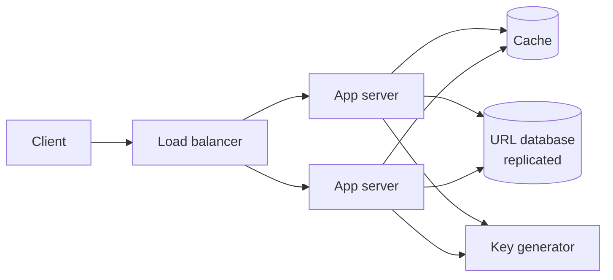
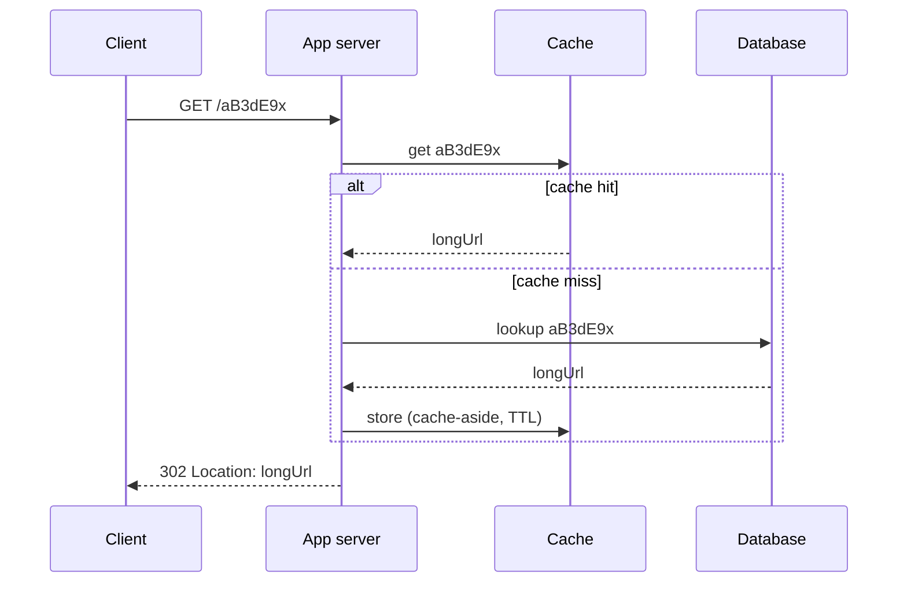

## Why this matters in an interview

This is the most common first HLD question, and a perfect one to practise the 7-step routine
(chapter 01) because it is small. Every building block from chapters 03 to 08 shows up once.
If you can walk this design smoothly, you can handle most "design X" questions at fresher level.

## Step 1: Requirements

Say these aloud and confirm them with the interviewer.

**Functional**
- Given a long URL, return a **short URL** (`https://sho.rt/aB3dE9x`).
- Opening the short URL **redirects** to the original.
- Optional: custom alias, link expiry.

**Non-functional**
- **Very fast redirects** (users feel this).
- **Highly available**: a dead short link is a broken link.
- Short codes are **unique** and hard to guess is nice to have.
- **Read-heavy**: far more redirects than creations.

**Out of scope for now:** user accounts, detailed analytics dashboards.

## Step 2: Estimates

Reusing chapter 07 (assumptions: 100M new URLs per month, reads 100× writes, 500 bytes per record, kept 5 years):

| Quantity | Result |
|---|---|
| Writes | about 40 / s |
| Reads | about 4,000 / s average, 8,000 / s peak |
| Total URLs in 5 years | 100M × 60 = **6 billion** |
| Storage | about 3 TB |

**Conclusions:** write load is tiny, reads need a **cache**, and 3 TB fits without sharding at first.
Code length: 6 billion needs a code space bigger than that. With **base62** (digits plus lower and upper case letters), 6 characters give about 56.8 billion and **7 characters give about 3.5 trillion**. We choose 7, which leaves plenty of headroom.

## Step 3: API

```text
POST /v1/urls
     body: { "longUrl": "https://...", "customAlias": "my-link" (optional), "expiresAt": "..." (optional) }
     -> 201 { "shortUrl": "https://sho.rt/aB3dE9x" }
        409 if the custom alias is taken

GET  /{shortCode}
     -> 302 redirect, Location: <longUrl>
        404 if unknown or expired
```

## Step 4: Data model

One main record:

| Field | Notes |
|---|---|
| `shortCode` | **Primary key**, 7 characters |
| `longUrl` | The destination |
| `createdAt` | Timestamp |
| `expiresAt` | Optional |
| `userId` | Optional, if accounts exist |

**Access pattern:** look up by `shortCode`, and nothing else. No joins, no complex queries.
That fits a **key-value store** naturally, but a SQL table with `shortCode` as the primary key also works at this size. Either is a defensible answer if you say why. State your pick and move on:
*"A key-value store, since access is purely by key and it shards easily."*

## Step 5: High-level design

Start with the smallest version, then add pieces.



**Redirect path (read, the hot one):**



**Create path (write):** the app server asks the **key generator** for a unique code, stores `shortCode → longUrl` in the database, and returns the short URL. Writes do not need the cache, though you may pre-warm it.

## Step 6: Deep dive

### 6a. How do we create unique short codes?

This is the question the interviewer will push on. Three options:

| Approach | How | Good | Bad |
|---|---|---|---|
| **Counter + base62** | Take a unique number and convert it to base62 | No collisions. Short, simple | Needs a shared counter. Codes are **predictable** (sequential) |
| **Hash the URL** | MD5 or SHA of the long URL, take the first 7 chars | Needs no counter. Same URL gives the same code | **Collisions** are possible (two URLs share a prefix), so check and retry. Custom aliases do not fit |
| **Random code** | Generate 7 random base62 characters, insert, retry if taken | Unpredictable | A uniqueness check on every insert. Collision chance grows as the table fills |

**Our choice: counter + base62**, because it cannot collide. Converting a number to base62:

```cpp
std::string toBase62(unsigned long long id) {
    const std::string chars =
        "0123456789abcdefghijklmnopqrstuvwxyzABCDEFGHIJKLMNOPQRSTUVWXYZ";
    if (id == 0) return "0";
    std::string s;
    while (id > 0) {
        s += chars[id % 62];
        id /= 62;
    }
    std::reverse(s.begin(), s.end());
    return s;
}
// toBase62(125) == "21", toBase62(62) == "10"
```

**But one counter is a bottleneck and a single point of failure.** Fix: a small **range
allocator**. Each app server asks it for a **block of ids** (say one million at a time) and then
hands them out locally with no further coordination. Blocks never overlap, so codes never collide.
If a server crashes it wastes the unused part of its block, which is harmless given the code space.
The allocator itself is a tiny, replicated service (or a database row updated atomically).

**Predictable codes:** a sequential counter lets anyone walk through `…001, …002`. If that matters,
scramble the number first (a reversible mixing step) before base62, or use random codes. Mention the
trade-off and let the interviewer steer.

### 6b. 301 or 302 redirect?

| | 301 Moved Permanently | 302 Found (temporary) |
|---|---|---|
| Browser behaviour | **Caches** the redirect and skips us next time | Asks us every time |
| Server load | Lower | Higher |
| Click analytics and expiry | Cannot count or change it once cached | We see every click and can change the target |

For a product that wants analytics or expiry, use **302**. For pure load saving, 301. State your pick and why.

### 6c. Caching

Redirects are read-heavy, and a small set of links gets most of the traffic. Use **cache-aside**
(chapter 06) with **LRU eviction**. As an assumption, caching the hottest 10 million links at about
500 bytes each is around 5 GB, which fits on one cache node, with a replica for safety.
A viral link is a **hot key**: replicate it or add a tiny local cache on each app server.

### 6d. Scaling the database

Not needed at 3 TB and 40 writes per second, but be ready: **replicas** for read volume and
availability, and if it grows, **shard by a hash of `shortCode`** (consistent hashing, chapter 05).
Since access is always by key, sharding is clean: no cross-shard joins.

### 6e. Expiry and cleanup

Check `expiresAt` **on read** and return 404 if past. Also run a **background job** to delete expired rows
and free their storage. Do not scan the whole table in the request path.

### 6f. Analytics without slowing redirects

Do not write analytics inside the redirect. Instead, **publish a click event to a queue**
(chapter 08) and let a separate consumer aggregate it. The redirect stays fast, and an analytics outage
cannot break links.

## Step 7: Bottlenecks and trade-offs

| Weak point | Mitigation |
|---|---|
| Key generator is a single point of failure | Replicate the allocator. Servers hold pre-allocated blocks, so brief outages do not matter |
| Database as a single point of failure | Replication with failover, backups |
| Hot link overloads one cache node | Replicate hot keys, local in-process cache |
| Abuse (spam, malicious targets, link flooding) | Rate limit creation (chapter 13), check URLs against blocklists |
| Cache loss at startup (cold cache) | Database must survive the burst. Warm the cache gradually |
| Data loss | Backups and replicas |

## Trade-offs

| Decision | Choice here | Why |
|---|---|---|
| Code generation | Counter in blocks + base62 | No collisions, no per-request coordination |
| Redirect type | 302 | Keep analytics and expiry control |
| Database | Key-value (or SQL with primary key) | Access is purely by key |
| Analytics | Async via queue | Keeps redirects fast |

## Interview angle

- Walk the 7 steps in order and **say the step you are on**.
- Land the conclusion from your estimate: "reads dominate, so cache; writes are tiny, so no sharding yet."
- Expect the follow-ups: *How do you guarantee uniqueness across servers? 301 vs 302? How do you handle a custom alias? What if the cache dies? How do you delete expired links?*
- Do not start with sharding or microservices. Add complexity only when a number demands it.

## Check yourself

1. Why does a 7-character base62 code comfortably cover 6 billion URLs?
2. Why not use one global counter, and what replaces it?
3. What goes wrong with hashing the long URL and taking the first 7 characters?
4. 301 or 302 if the business wants click counts?
5. Why record analytics through a queue and not in the redirect request?
6. What does the cache do on a miss, and what eviction policy do you choose?



1. 62⁷ ≈ 3.5 trillion possible codes, far more than 6 billion, so there is huge headroom.
2. A single counter is a bottleneck and a single point of failure. Each app server instead gets a block of ids from a range allocator and uses them locally, with no overlap between blocks.
3. Different URLs can produce the same prefix (collision), so you need a check and a retry. Also the same URL always maps to the same code, which clashes with per-user links and custom aliases.
4. 302, so every click reaches the server and can be counted. A 301 would be cached by the browser.
5. It keeps the redirect fast and isolates failures: an analytics problem cannot break links, and bursts are absorbed by the queue.
6. Cache-aside: read the database, store the result with a TTL, return it. LRU eviction, because recently used links are likely to be used again.



## Remember

- Read-heavy, tiny writes: cache the redirects, no sharding at this size.
- 7-character base62 codes, 62⁷ ≈ 3.5 trillion.
- Unique codes with a counter handed out in **blocks** to each server, converted to base62.
- 302 for analytics and expiry control, 301 to save load.
- Cache-aside with LRU. Analytics through a queue. Replicate the database and the key generator.


**Further reading:** "Design Pastebin.com (or Bit.ly)" in the
[System Design Primer](https://github.com/donnemartin/system-design-primer).

