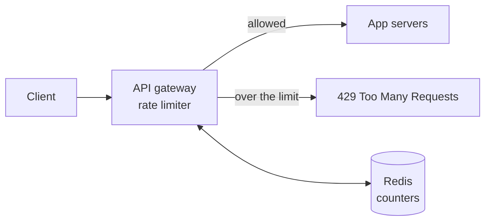
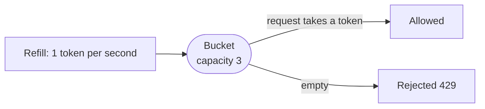

## Why this matters in an interview

A rate limiter is small enough to design in 30 minutes and rich enough to show real skill:
algorithms, data structures, concurrency, and distributed state. It also shows up **inside**
other designs ("I'd rate limit link creation"). Freshers are often asked to code the core
algorithm, so this chapter includes a working class.

## Step 1: Requirements

**Functional**
- Limit how many requests a **client** (user id, API key, or IP) can make in a time window, for example **100 per minute**.
- When the limit is exceeded, **reject** with `429 Too Many Requests`.
- Limits should be **configurable** per client or per endpoint.

**Non-functional**
- Adds **very little latency** to every request.
- **Accurate** enough, and works across **many servers**, not just one.
- Highly available: the limiter must not become the reason the site goes down.

## Step 2: Where does it sit?

| Placement | Notes |
|---|---|
| **Inside each app server** (in memory) | Fastest. But each server sees only its own traffic, so limits are wrong when there are many servers |
| **A middleware / API gateway in front of the services** | The usual answer. One place, shared by all services (chapter 10) |
| **A separate rate limiter service** | Flexible, but an extra network hop |



The gateway keeps its counters in a **shared fast store** (Redis-style) so every gateway instance sees the same numbers.

## Step 3: The algorithms

### Fixed window counter

Count requests in each clock window (for example each minute: 12:00:00 to 12:00:59). If the count passes the limit, reject until the next window.

- **Good:** very simple, tiny memory (one counter per client).
- **Bad:** the **edge burst problem**. A client can send 100 requests at 12:00:59 and 100 more at 12:01:00. That is 200 requests in two seconds, double the intended limit.

### Sliding window log

Store the **timestamp of every request**. To check a new request, drop timestamps older than the window and count what is left.

- **Good:** exact.
- **Bad:** memory grows with the limit (a timestamp per request).

### Sliding window counter

A cheap approximation: keep counters for the **current and previous** windows, and weight the previous one by how much of it still overlaps the sliding window.

- **Good:** smooth, tiny memory, close to exact.
- **Bad:** an approximation (fine in practice).

### Token bucket (the common choice)

A bucket holds up to **capacity** tokens. Tokens are added at a steady **refill rate**. Each request **takes one token**. If the bucket is empty, the request is rejected.



- Allows a **burst** up to the capacity, then a steady rate. That matches real traffic well.
- Needs just two numbers per client: the token count and the last refill time.

### Leaky bucket

Requests enter a queue and are processed at a **fixed rate**, like water dripping from a bucket. Output is perfectly smooth, but a burst fills the queue and waits or is dropped.

### Comparison

| Algorithm | Memory per client | Allows bursts | Accuracy | Notes |
|---|---|---|---|---|
| Fixed window | One counter | Edge burst (unintended) | Rough | Simplest |
| Sliding window log | Grows with limit | No | Exact | Heavy |
| Sliding window counter | Two counters | Smoothed | Close | Good balance |
| **Token bucket** | Two numbers | **Yes, by design** | Good | Common default |
| Leaky bucket | A queue | No (smooths) | Good | Constant output rate |

**Our choice: token bucket**, because it is simple, cheap, and allows reasonable bursts.

## Step 4: A single-machine token bucket in C++

This is the class an interviewer may ask you to write. Note the lazy refill: we do **not** run a timer, we compute the tokens earned since the last call.

```cpp
#include <algorithm>
#include <chrono>
#include <mutex>

class TokenBucket {
    double capacity;
    double refillPerSec;
    double tokens;
    std::chrono::steady_clock::time_point last;
    std::mutex mu;

public:
    TokenBucket(double capacity, double refillPerSec)
        : capacity(capacity), refillPerSec(refillPerSec), tokens(capacity),
          last(std::chrono::steady_clock::now()) {}

    bool allow() {
        std::lock_guard<std::mutex> lock(mu);
        auto now = std::chrono::steady_clock::now();
        double elapsed = std::chrono::duration<double>(now - last).count();
        tokens = std::min(capacity, tokens + elapsed * refillPerSec);
        last = now;
        if (tokens >= 1.0) {
            tokens -= 1.0;
            return true;
        }
        return false;
    }
};
```

How it behaves with `TokenBucket b(3, 1)` (burst of 3, refill 1 per second): five instant calls give
**allow, allow, allow, reject, reject**, and about one second later one more call is allowed.

- **Time complexity:** O(1) per request. **Space:** O(1) per client.
- `steady_clock` is used because it never jumps backwards, unlike the wall clock.
- The **mutex** matters: two threads checking the last token at once would both see it and both pass.
- To limit many clients, keep a `map<clientId, TokenBucket>`. For huge numbers of clients you evict idle ones.

## Step 5: Making it work across many servers

Local memory fails with several gateways, so keep the state in a shared store such as Redis.

**A naive approach has a race condition.**

```text
read count   ->  count = 99
(another gateway reads 99 too)
write count 100   (both think they are the 100th request)
```

Both pass, and the real count is 101. Fixes:

- **Atomic operations.** A store command like `INCR` increments and returns the new value in one step, so two gateways never read the same value. This works neatly for a fixed window: `INCR key`, set an expiry on first use, reject if the result exceeds the limit.
- **A script that runs atomically inside the store.** For token bucket you need "read, compute, write" as one unit. Redis-style stores let you run a small script atomically, so no other command interleaves.

**Key design:** one entry per client and window, for example `rate:user:42:2026-10-23T12:01`, with an **expiry** equal to the window so old keys clean themselves up.

**Latency:** the check is one network round trip to Redis. Keep the store close to the gateways.

**If the rate-limit store is down?** Choose a policy and say it out loud:

| Policy | Meaning | Pick when |
|---|---|---|
| **Fail open** | Let requests through | Availability matters most, and abuse for a short time is acceptable |
| **Fail closed** | Reject everything | Strict protection matters most (for example a login brute-force guard) |

Most public APIs **fail open**, and alert loudly.

## Step 6: Telling the client

On rejection, return **`429 Too Many Requests`** and helpful headers:

```text
HTTP/1.1 429 Too Many Requests
Retry-After: 30
X-RateLimit-Limit: 100
X-RateLimit-Remaining: 0
```

Well-behaved clients wait and retry with backoff (chapter 11).

## Step 7: Bottlenecks and trade-offs

| Weak point | Mitigation |
|---|---|
| The shared store is a single point of failure | Replicas, plus a fail-open policy |
| The store is a hot spot at huge scale | Shard counters by client id (consistent hashing) |
| Extra latency on every request | Keep the store close. Optionally batch updates or cache local approximations |
| A single IP shared by many users (office, school) | Prefer user id or API key when logged in. Use IP only for anonymous traffic |
| Distributed clocks differ | Use the store's clock, or tolerate small error |
| Rules change often | Keep limits in configuration the gateway reloads, not hard coded |

## Trade-offs

| Decision | Choice here | Why |
|---|---|---|
| Algorithm | Token bucket | Bursts allowed, O(1) memory |
| Location | API gateway with shared Redis | One consistent view of every client |
| Atomicity | Atomic command or script | Avoid the read-then-write race |
| Store outage | Fail open (login endpoints may fail closed) | Do not take the site down |

## Interview angle

- Start with "who do we limit, and by what key?" Then place the limiter, then pick the algorithm.
- Name the **fixed window edge burst** problem yourself. It shows you understand why other algorithms exist.
- If asked to code it, write the token bucket above and mention the **mutex** and the **lazy refill**.
- For the distributed part, say **"atomic increment in Redis with an expiry"**, then mention the race condition and why atomicity fixes it.
- Common follow-ups: What if Redis dies? How do you limit per endpoint? How do you handle bursts? What about different limits for free and paid users?

## Check yourself

1. Explain the edge burst problem of the fixed window counter with an example.
2. How does a token bucket allow bursts yet enforce an average rate?
3. Why do we compute tokens lazily when `allow()` is called instead of using a timer?
4. Two gateways read the count 99 at the same time and both allow the request. What is this bug, and how do you fix it?
5. The limiter's Redis is down. Fail open or closed for a public read API? For a login endpoint?
6. Why is rate limiting by IP alone risky?



1. With a limit of 100 per minute, a client sends 100 requests at 12:00:59 and 100 more at 12:01:00. Each window is within its limit, but 200 requests arrived in two seconds.
2. The bucket holds up to `capacity` tokens, so a burst of that size can pass at once. Tokens refill at a fixed rate, so over time the average cannot exceed that rate.
3. It needs no background timer per client. One computation on each call (tokens earned since the last call, capped at capacity) gives the same result with O(1) work and no extra threads.
4. A race condition from read-then-write. Use an atomic increment command, or run the check and update as one atomic script in the store.
5. Public read API: fail open, so an outage does not take the site down. Login: often fail closed (or fall back to a strict local limit), since unlimited attempts invite brute force.
6. Many real users can share one IP (an office, a campus, a mobile carrier), so legitimate users get blocked. Prefer user id or API key when available.



## Remember

- Decide the **key** (user, API key, IP), the **placement** (gateway), and the **algorithm** (token bucket).
- Fixed window is simplest but has the edge burst. Sliding window is smoother. Token bucket allows bursts and is O(1).
- Compute refill **lazily** with `steady_clock`, and protect the state with a **mutex**.
- Across servers: shared Redis, **atomic** increment or script, keys that expire.
- Return **429** with `Retry-After`. Decide fail open or closed when the store is down.


**Further reading:** the rate-limiting part of the API section of the
[System Design Primer](https://github.com/donnemartin/system-design-primer) and general material on token bucket and sliding-window counters.

