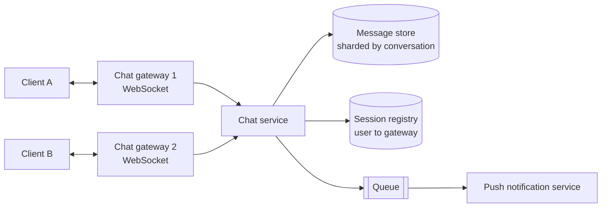
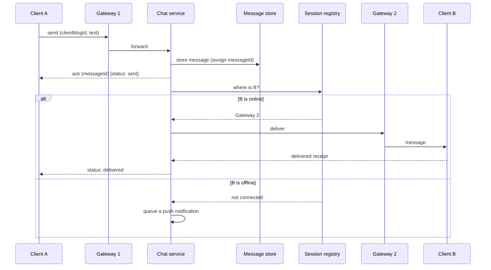

## Why this matters in an interview

Chat is the best example of a **real-time, write-heavy** system, and it breaks the habit
from chapter 03 ("keep servers stateless"): WebSocket connections are **long-lived**. Handling that
tension, plus message ordering and offline delivery, is what the interviewer is checking.

## Step 1: Requirements

**Functional**
- **One-to-one** chat and **group** chat (small groups, say up to 100 members).
- Messages arrive **in real time** when the recipient is online.
- If the recipient is **offline**, they get the messages when they return (and a push notification).
- Delivery status: **sent, delivered, read**.
- Chat history is stored and can be loaded.
- Optional: online/last-seen indicator, images and files.

**Non-functional**
- **Low latency** (feels instant).
- **No lost messages.** Reliability matters more than a perfect UI.
- Messages in a conversation appear in the **correct order**.
- Highly available, scales to a very large user base.

**Out of scope:** end-to-end encryption, voice and video calls, very large channels.

## Step 2: Estimates

From chapter 07: 50 million daily active users, 40 messages each per day, 100 bytes per message.

| Quantity | Result |
|---|---|
| Messages per day | 2 billion |
| Average rate | about 23,000 / s, peak about 50,000 / s |
| Storage | about 200 GB per day, about 73 TB per year |
| Connections | each active user holds an open WebSocket. If a few million are online at once, we need **many gateway servers**, since a server can hold only a limited number of connections (an assumption we size by testing) |

**Conclusions:** it is **write-heavy**, needs a store that spreads writes (sharding), and the real-time
layer needs its own horizontally scaled fleet.

## Step 3: API (and the protocol)

Plain HTTP request-response cannot push a message to a client. Use a **WebSocket** (chapter 02): one persistent two-way connection per online client.

```text
WebSocket  wss://chat.example.com/connect          (after authenticating)

client -> server   { "type": "send",  "conversationId": "c1", "clientMsgId": "u7-1042", "text": "hi" }
server -> client   { "type": "ack",   "clientMsgId": "u7-1042", "messageId": 9001 }
server -> client   { "type": "message", "conversationId": "c1", "messageId": 9001, "from": "u7", "text": "hi" }
client -> server   { "type": "read",  "conversationId": "c1", "upTo": 9001 }
```

Ordinary actions (load history, list conversations) can use plain REST:

```text
GET /v1/conversations/{id}/messages?before=<messageId>&limit=50
```

`clientMsgId` is the **idempotency key** (chapters 02, 08): if the client retries a send, the server recognises it and does not create a duplicate.

## Step 4: Data model

| Table | Key fields | Notes |
|---|---|---|
| `users` | `userId`, name, ... | Small, SQL is fine |
| `conversations` | `conversationId`, type (1:1 or group) | |
| `members` | `conversationId`, `userId` | Who is in each conversation |
| `messages` | `conversationId`, `messageId`, `senderId`, `text`, `createdAt` | Huge and write-heavy |

**The messages table is the big one.** Its access pattern is "give me the latest N messages of one
conversation". So:

- **Partition (shard) by `conversationId`**, so one conversation's messages live together.
- **Order by `messageId`** within the partition, so the latest messages are a quick range read.

A wide-column or key-value store fits this well (chapter 04). The small tables can stay in SQL.

**Message ids.** Do not order by the client's clock (clocks disagree). Let the server assign a
**monotonically increasing id per conversation** (or a time-ordered id), and sort by it. This gives a single, agreed order for everyone.

## Step 5: High-level design



**Parts:**
- **Chat gateways:** hold the WebSocket connections. They are **stateful** (each knows which clients are connected to it), so we scale them by adding more machines.
- **Session registry** (an in-memory store like Redis): maps `userId → which gateway they are connected to`. This is how we resolve the statefulness problem: the gateways are stateful, but **everything else can find a user through the registry**.
- **Chat service:** the logic. It stores messages and decides where to deliver them.
- **Message store:** durable, sharded history.
- **Queue + push service:** notify offline users through the phone's push channel (chapter 08).

### Sending a 1:1 message



**Order of operations matters:** **store first, then deliver.** If we pushed first and crashed before
storing, the message would be lost, and that breaks the "no lost messages" requirement.

### When a user comes online

1. The client connects, authenticates, and the gateway **registers** `userId → gateway` in the registry.
2. The client tells the server the **last `messageId` it has** for each conversation.
3. The server **sends everything newer**. Offline delivery is simply "sync from where you left off", which also repairs any message lost on a flaky connection.

### Group chat

For small groups, **fan out on write**: when someone posts, the chat service looks up the members and
delivers a copy to each member's connection (or push notification if offline). The message is **stored once** per
conversation, with a cursor per member for what they have read. Very large groups need a different
approach (fan-out on read, or batching), which you can mention but not design.

### Delivery and read status

| Status | Meaning | Set when |
|---|---|---|
| Sent | Server stored the message | The server acks the sender |
| Delivered | The recipient's device received it | The recipient's client sends a receipt |
| Read | The recipient opened the conversation | The client sends `read upTo messageId` |

A read receipt covers **all messages up to an id**, not one at a time, which keeps traffic small.

### Presence (online / last seen)

Each client sends a small **heartbeat** every few seconds. The server marks the user online and
stores the time of the last heartbeat. If heartbeats stop, the user is considered offline after a short timeout. Keep presence in a fast store, and for big friend lists only update what a person is actually looking at, since presence changes are very frequent.

### Media

Images and files go to **object storage** through a normal upload (with a CDN for download), and the message only carries a **link** (chapter 06). Never send big files through the chat gateways.

## Step 6: Deep dive: the hard parts

| Problem | Approach |
|---|---|
| A gateway crashes and its users lose the connection | Clients **reconnect** (to any gateway, via the load balancer) and **sync** missed messages from their last `messageId`. The registry entry is rewritten |
| Duplicate messages from client retries | `clientMsgId` idempotency: the server returns the earlier result |
| Ordering | Server-assigned, increasing id per conversation. Clients sort by it |
| Message lost between store and delivery | Delivery is **at-least-once**, with client dedupe by `messageId`. The sync-on-reconnect is the safety net |
| Very large number of open connections | More gateway machines, each tuned for many idle connections. Load balance new connections across them (a connection stays on its gateway for its lifetime) |
| Hot conversations | Sharding by `conversationId` keeps each one together. A giant group may need special handling |

## Step 7: Bottlenecks and trade-offs

| Weak point | Mitigation |
|---|---|
| Session registry loss | Replicate it. If it is lost, clients reconnecting rebuild it, and sync closes the gaps |
| Message store write volume | Shard, and choose a write-optimised store |
| Deploying new gateway versions drops connections | Roll out gradually. Clients reconnect automatically |
| Push notification outages | The sync-on-open path means messages are not lost, only late |
| Consistency vs latency | Prefer availability for delivery (eventual consistency is fine), but keep ordering per conversation (chapter 09) |

## Trade-offs

| Decision | Choice here | Why |
|---|---|---|
| Real-time transport | WebSocket | The server must push, and polling would waste requests |
| Message store | Sharded by `conversationId`, ordered by id | Matches "latest N messages of one conversation" |
| Ordering | Server-assigned ids | Client clocks cannot be trusted |
| Offline delivery | Store first, sync from last id | Nothing is lost |
| Group delivery | Fan-out on write for small groups | Simple, low read latency |

## Interview angle

- Say early: "WebSocket for real-time. Gateways are stateful, so I keep a **session registry** to find a user's gateway."
- Emphasise **store before deliver**, **idempotent sends**, and **sync from last message id on reconnect**.
- Do not start with the database. Draw: client, gateway, chat service, store. Then add the registry and queue.
- Common follow-ups: How do you handle offline users? How do you order messages? How do you scale to millions of connections? How would group chat work? What if a gateway crashes?

## Check yourself

1. Why a WebSocket for chat, and not plain HTTP polling?
2. The gateways hold open connections, so how does the rest of the system still stay simple?
3. Why should the server, not the client's clock, assign message order?
4. Why store the message first and deliver afterwards?
5. A user was offline for two days and opens the app. How do they receive missed messages?
6. How do you stop a retried send from showing up twice?



1. The server must push messages the moment they arrive. Polling wastes requests and adds delay, while a WebSocket keeps one open two-way connection.
2. A session registry records which gateway each user is on. Only the gateways are stateful. The chat service looks a user up in the registry and sends through that gateway.
3. Client clocks differ and can be wrong, so ordering would disagree between users. A server-assigned increasing id per conversation gives everyone the same order.
4. If we delivered first and crashed before storing, the message would be lost. Storing first guarantees the message survives, and delivery can be retried.
5. On reconnect the client sends the last `messageId` it has for each conversation, and the server sends everything newer from the message store.
6. The client attaches a unique `clientMsgId` to each send. The server detects a repeat and returns the earlier result instead of storing a second copy.



## Remember

- WebSocket gateways hold connections (stateful). A session registry maps user to gateway, and everything else stays simple.
- Store first, then deliver. Delivery is at-least-once, clients dedupe by id.
- Shard messages by conversation, order by a server-assigned increasing id.
- Offline users sync from their last message id, plus a push notification as a nudge.
- Statuses: sent, delivered, read (a read receipt covers up to an id). Media goes to object storage and the message holds a link.


**Further reading:** "Design a chat server" under the object-oriented questions and the "Communication" section in the
[System Design Primer](https://github.com/donnemartin/system-design-primer). Treat its design as a second opinion, not a script.

