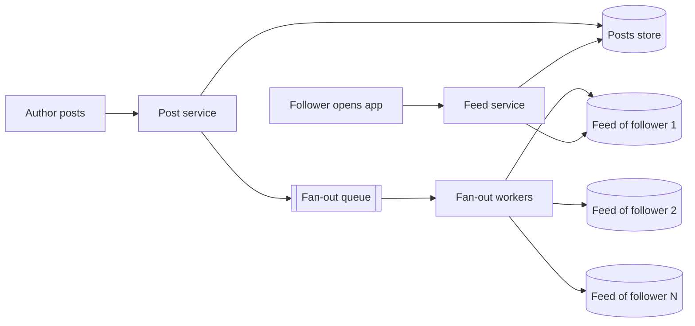
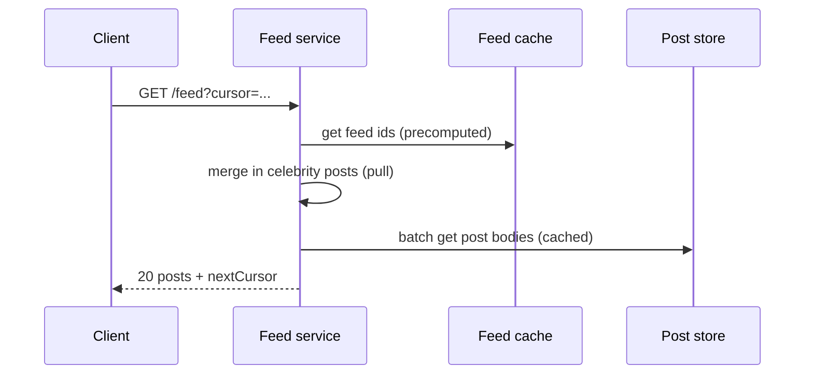

## Why this matters in an interview

A feed ("show me posts from people I follow") is a classic because it forces one big decision:
**do the work when someone posts, or when someone reads?** That trade-off, fan-out on write
vs fan-out on read, is the whole question. Get it right and add the celebrity exception, and
you have the standard strong answer.

## Step 1: Requirements

**Functional**
- A user can **create a post** (text, plus an image or video).
- A user can **follow** other users.
- A user opens the app and sees a **feed**: recent posts from the people they follow, newest first (ranking comes later).
- Feed supports **scrolling** (pagination).

**Non-functional**
- **Feed loads fast** (this is the screen people open most).
- **Highly available.** A slightly stale feed is acceptable (eventual consistency, chapter 09).
- Posts from people you follow should show up **within seconds to a minute**, not hours.

**Out of scope:** comments, likes, direct messages, ads, search, and ML ranking beyond a simple score.

## Step 2: Estimates

Assumptions (state them): 50 million daily active users, each opens the feed 10 times a day and posts twice a day on average; an average user has 200 followers.

| Quantity | Calculation | Result |
|---|---|---|
| Feed reads per day | 50M × 10 | 500 million |
| Feed read rate | 500M ÷ 86,400 | about **5,800 / s** (peak ≈ 12,000 / s) |
| New posts per day | 50M × 2 | 100 million |
| Post rate | 100M ÷ 86,400 | about **1,200 / s** |
| Feed-list inserts if we push each post to all followers | 100M × 200 | **20 billion per day ≈ 230,000 / s** |

**Conclusions:** reads far outnumber writes, so the feed must be **precomputed or cached**. Pushing every post to every follower means a very high internal write rate (230,000 per second), which is fine for a queue-driven worker fleet, but it blows up for someone with **millions** of followers.

## Step 3: API

```text
POST /v1/posts                 body: { text, mediaId? }            -> 201 { postId }
POST /v1/users/{id}/follow                                         -> 204
DELETE /v1/users/{id}/follow                                       -> 204
GET  /v1/feed?cursor=<opaque>&limit=20                             -> 200 { posts: [...], nextCursor }
```

Feeds use **cursor pagination** (chapter 10), because new posts arrive all the time and page numbers would shift.

## Step 4: Data model

| Store | Data | Notes |
|---|---|---|
| **Posts** | `postId`, `authorId`, `text`, `mediaUrl`, `createdAt` | Sharded by `postId` or `authorId`. Mostly written once, read many times |
| **Follows** | `(followerId, followeeId)` | Needs both directions: "who do I follow" and "who follows me" |
| **Feed cache** | per user: a list of recent `postId`s, newest first | In-memory store (Redis-style) |
| **Media** | image and video files | Object storage plus CDN (chapter 06). The post only holds a URL |

The feed cache stores **ids only**, not whole posts. At read time we fetch the post bodies in bulk (and those are cached too). Rough size: 50M users × 500 ids × 8 bytes ≈ **200 GB**, which fits in a sharded in-memory cluster (an assumption: we keep only the latest 500 ids per user).

## Step 5: The core decision: fan-out

### Option A: fan-out on read (pull)

Build the feed **when the user opens it**: fetch the list of people they follow, get each person's recent posts, merge by time.

- **Good:** posting is cheap (just one write). No wasted work for users who never open the app.
- **Bad:** reading is **slow and heavy**. A user following 500 people triggers 500 lookups plus a merge on every load, and the read path is the hot one.

### Option B: fan-out on write (push)

When someone posts, **immediately insert the post id into the feed list of every follower**.



- **Good:** reading is **one cheap lookup** of a precomputed list. Feeds load fast.
- **Bad:** posting costs one write **per follower**. A user with 10 million followers makes a single post cause 10 million writes (the **celebrity problem**), and it wastes work on followers who never open the app.

### Option C: hybrid (what real systems do)

Use **push for normal users** and **pull for celebrities**.

1. For ordinary authors (say under a few thousand followers), fan out on write as above.
2. For celebrities, **do not** fan out. Their posts stay only in the posts store.
3. When a user opens the feed, the feed service takes their **precomputed list** and **merges in recent posts from the few celebrities they follow**, fetched at read time.

| | Push | Pull | Hybrid |
|---|---|---|---|
| Post cost | High (per follower) | Low | Low for celebrities, normal otherwise |
| Read cost | Low | High | Low plus a small merge |
| Celebrity handling | Breaks | Fine | Fine |
| Complexity | Medium | Low | Highest |

**Our choice: hybrid.** Mention the follower threshold as a tunable setting, not a magic number.

### Smaller optimisations worth a sentence

- **Only fan out to active users.** Skip people who have not opened the app for weeks. When they return, build their feed on demand.
- Fan-out is **asynchronous** (a queue and workers, chapter 08). The poster's request returns right after the post is stored. Followers see it a moment later.
- **Cache the post bodies and counts** so building a page does not hammer the posts store.

## Step 6: Deep dive

### Reading the feed (request path)



The **cursor** is "the id (or time) of the last post you saw", so the next page continues after it.

### Ranking

Start with **reverse chronological**. If asked to go beyond, give each candidate post a score from a few signals (recency, how often you interact with the author, how much engagement the post has) and sort by it. Say a machine-learned model usually does this in practice, and that it sits **after** candidate generation: first collect a few hundred candidates cheaply, then rank only those.

### Deletes and unfollows

- **Delete a post:** remove it from the posts store. Readers skip ids whose post no longer exists. Cleaning the feed lists can happen lazily.
- **Unfollow:** future posts stop. Old ids already in the feed may be filtered at read time.

### Consistency

A follower may see a new post a few seconds late, or a deleted post briefly. For a feed that is fine (eventual consistency). The post store itself should be reliable, since that is the source of truth. The feed lists can always be **rebuilt** from it.

## Step 7: Bottlenecks and trade-offs

| Weak point | Mitigation |
|---|---|
| Celebrity fan-out | Hybrid: pull for celebrities |
| Fan-out queue lag during spikes | Scale workers, monitor queue length, accept short delay |
| Feed cache is huge | Keep only the latest N ids per user, evict inactive users, rebuild on demand |
| Hot posts (viral) | Cache post bodies and counters, replicate hot keys |
| Posts store growth | Shard, keep media in object storage |
| Cache loss | The feed is derived data, so rebuild it from follows plus posts |

## Trade-offs

| Decision | Choice here | Why |
|---|---|---|
| Fan-out | Hybrid | Fast reads for most, no explosion for celebrities |
| Feed storage | Lists of ids in memory | Cheap and quick. Bodies fetched separately |
| Pagination | Cursor | Feed changes constantly |
| Consistency | Eventual | Slight delay is acceptable. Availability wins |

## Interview angle

- Frame the whole answer around the **read-vs-write** question: "Reads dominate, so I precompute feeds (push), except for celebrities (pull)."
- Do the estimate: it justifies why fan-out on write is needed **and** why it breaks for celebrities (230,000 inserts per second on average).
- Do not start with ranking models. Get the data flow right first.
- Common follow-ups: What if a user follows a celebrity? What if a user has 5,000 followers? How do you handle deletes? How do you rank? How do you keep the feed fresh for a returning inactive user?

## Check yourself

1. In one line each, what are fan-out on write and fan-out on read?
2. Why is a pure push model a problem for a user with 10 million followers?
3. In the hybrid model, where do a celebrity's posts get merged into your feed?
4. Why store only post ids in the feed cache?
5. Why use cursor pagination for a feed?
6. A user was inactive for a month and opens the app. What happens to their feed?



1. On write: when someone posts, insert it into every follower's feed list immediately. On read: assemble the feed from followed users' posts when the user opens the app.
2. One post triggers 10 million feed writes, which delays everything behind it in the queue and wastes work on followers who never open the app.
3. At read time. The feed service takes the precomputed list and merges in recent posts from the celebrities that user follows.
4. Ids are tiny, so the cache holds many users cheaply, and the full post bodies (with up-to-date counts) are fetched in bulk and cached separately.
5. New posts keep arriving, so page numbers would shift and show duplicates or skips. A cursor continues exactly after the last item seen.
6. They were skipped by fan-out, so their feed list is empty or stale. Build it on demand by pulling recent posts from the people they follow, then keep it updated with push from then on.



## Remember

- Reads dominate, so **precompute the feed** (fan-out on write) into per-user lists of post ids.
- Pure push breaks for celebrities, so use **hybrid**: push for normal users, pull and merge for celebrities.
- Fan-out is async through a queue. Skip inactive users.
- Cursor pagination. Rank simply first: recency, then a score.
- The feed is derived data. Eventual consistency is fine, and lists can be rebuilt.


**Further reading:** "Design the Twitter timeline and search" in the
[System Design Primer](https://github.com/donnemartin/system-design-primer).

