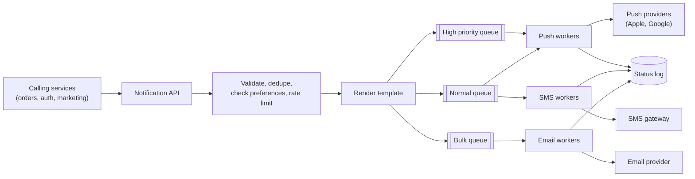

## Why this matters in an interview

A notification system is the textbook use of **queues** (chapter 08): bursty, slow third parties,
retries, duplicates, and "do not annoy the user". It also shows up inside other designs
("send a push when the message arrives"). It is a good place to show you think about
**failure and user experience**, not just boxes.

## Step 1: Requirements

**Functional**
- Send notifications over several **channels**: **push** (mobile), **SMS**, **email**, and **in-app**.
- Other services trigger them with an event ("order shipped", "OTP", "friend request").
- Notifications can be **immediate** or **scheduled** (a reminder at 9 AM).
- Users have **preferences**: opt out of a channel or a type, quiet hours.
- Track **status** (sent, delivered, failed) for debugging and analytics.

**Non-functional**
- **Soft real time**: an OTP should arrive in seconds. A marketing email can wait minutes.
- **Reliable**: do not silently lose important notifications.
- **No duplicates**, and no flooding a user.
- Handles **big bursts** (a campaign to millions of users).

**Out of scope:** writing the content (a template service), and building our own SMS or email carrier.

## Step 2: Estimates

Assumptions: 20 million daily active users, an average of 5 notifications per user per day.

| Quantity | Calculation | Result |
|---|---|---|
| Notifications per day | 20M × 5 | 100 million |
| Average rate | 100M ÷ 86,400 | about **1,200 / s** |
| A campaign burst | 10 million sent over 10 minutes (600 s) | about **17,000 / s** |

**Conclusions:** the average is easy, **bursts** are the challenge, and we must absorb them with queues. External providers also impose **their own rate limits**, so sending is the bottleneck and queueing in front of it is essential.

## Step 3: API (for internal services)

```text
POST /v1/notifications
     body: {
       "userId": "u42",
       "type": "ORDER_SHIPPED",
       "priority": "normal",          // "high" for OTP and security alerts
       "data": { "orderId": "9001" },
       "idempotencyKey": "order-9001-shipped",
       "sendAt": "2026-10-23T09:00:00Z"   // optional, for scheduling
     }
     -> 202 Accepted { "notificationId": "n77" }
```

It returns **202 Accepted**: we took responsibility, but nothing is sent yet. The `idempotencyKey` stops a retried call from sending twice (chapters 02, 08).

## Step 4: Data model

| Store | Data |
|---|---|
| **User preferences** | per user: enabled channels, muted types, quiet hours, language |
| **Device tokens** | per user: the push addresses of each device (a token per device and platform) |
| **Contact info** | email, phone (access carefully, it is sensitive) |
| **Templates** | message text with placeholders, per type, channel and language |
| **Notification log** | `notificationId`, user, type, channel, status, timestamps. Write-heavy, keep for a limited time |

Preferences and tokens are read on **every** notification, so cache them (chapter 06).

## Step 5: High-level design



The flow for one notification:

1. A service calls the **API**, which does cheap checks and returns 202.
2. The **processing step**: drop it if the idempotency key was seen, load the user's **preferences** (skip opted-out channels, apply quiet hours), apply a **per-user rate limit**, look up the **device token or address**, and render the **template**.
3. Put one message per channel on the right **queue**. Separate queues by **priority** and by **channel**, so a huge marketing blast cannot delay an OTP.
4. **Workers** for each channel pull messages and call the **third-party provider**.
5. Record the **status**. Handle failures.

### Why queues are the heart of it

- They **absorb bursts**: 10 million messages queue up and drain at the speed the providers allow.
- They **isolate failures**: if the SMS provider is down, SMS messages wait while push keeps flowing.
- They let you **scale each channel's workers independently**.

## Step 6: Deep dive

### Reliability: retries and dead letters

Providers fail transiently. Workers **retry with exponential backoff and jitter** (chapter 11). After a fixed number of attempts the message moves to a **dead-letter queue** for inspection, and the status becomes "failed". Some failures are **permanent**, like an invalid phone number or an uninstalled app (the push provider reports a dead token). Do not retry those: mark the token invalid and clean it up.

### Avoiding duplicates

Queue delivery is **at-least-once** (chapter 08), so a message may be taken twice, for example when a worker crashes after sending but before acknowledging. Use the `notificationId` (or idempotency key) as a **dedupe key**: before sending, check a fast store (set-if-absent with an expiry); if it exists, skip. You cannot make it perfect, since the provider call and the dedupe write are two steps, so aim for **"very rarely duplicated, never silently lost"**, and say so honestly.

### Not annoying people

| Mechanism | What it does |
|---|---|
| **Preferences and opt-out** | Respect channel and type settings. Legally required for marketing |
| **Quiet hours** | Hold non-urgent messages until morning, using the user's time zone |
| **Per-user rate limit** | At most N marketing notifications per day (chapter 13) |
| **Collapsing / batching** | "5 new likes" instead of five pushes |
| **Priority** | OTP and security alerts bypass quiet hours and go on the fast queue |

### Scheduled notifications

Store them with their `sendAt`. A **scheduler** polls (or uses a delay queue) for items due in the next moments and puts them on the normal queues. Keep a sorted index by time so the scan is cheap.

### Provider limits and fallbacks

Providers cap how fast you can send. Workers must **throttle** to the provider's limit, and handle "slow down" responses. For critical messages, a **fallback provider** (or channel, such as SMS if push fails for an OTP) improves reliability.

### Tracking

Log each attempt and outcome. Some providers send **delivery callbacks** (webhooks) that update the status to delivered, opened or bounced. Feed these to analytics and to the dashboard.

## Step 7: Bottlenecks and trade-offs

| Weak point | Mitigation |
|---|---|
| Provider outage | Queue and retry, fallback provider or channel, alert on error rate |
| Burst overloads workers | Autoscale workers, shape the bulk queue, never starve high priority |
| Preference store hit on every message | Cache it, invalidate on change |
| Duplicate sends | Idempotency key plus dedupe store |
| Message loss | Persistent queues, ack only after a successful send |
| Cost (SMS is expensive) | Prefer push and email, SMS only for critical cases |
| Privacy | Do not put sensitive content in push or SMS bodies. Protect contact data |

## Trade-offs

| Decision | Choice here | Why |
|---|---|---|
| Sync vs async | Async via queues, 202 Accepted | Absorb bursts, isolate provider failures |
| Delivery guarantee | At-least-once plus dedupe | Better to risk a rare duplicate than to lose an OTP |
| One queue vs many | By priority and channel | Marketing must not block OTPs |
| Build vs buy delivery | Use third-party providers | We are not building an SMS carrier |

## Interview angle

- Say "queue between the API and the providers" within the first minute, and **why** (bursts, provider limits, isolation).
- Mention **priority queues**: it is the detail that shows you thought about OTP vs marketing.
- Mention **idempotency and at-least-once** unprompted.
- Common follow-ups: How do you avoid duplicates? What if the provider is down? How do you schedule? How do you stop spamming users? How do you handle 10 million users at once?

## Check yourself

1. Why does the API return 202 Accepted and not 200 OK?
2. Why separate queues by priority?
3. A worker sends an SMS and crashes before acknowledging. What happens, and how do you limit the harm?
4. A push provider says a device token is invalid. Retry or not?
5. Name two ways to avoid annoying users.
6. How does a scheduled notification get sent at 9 AM?



1. Because the notification has only been accepted for processing, not sent. The actual sending happens asynchronously later.
2. So a large low-priority job such as a marketing blast cannot delay a time-critical message such as an OTP.
3. The queue redelivers the message (at-least-once), so it may be sent twice. A dedupe check on the idempotency or notification id before sending makes a duplicate rare.
4. Do not retry. It is a permanent failure, so mark the token invalid and remove it.
5. Any two of: respect preferences and opt-outs, quiet hours, per-user rate limits, batching similar notifications.
6. It is stored with its send time. A scheduler periodically picks up items that are due and puts them on the normal queue, where workers send them.



## Remember

- API accepts (202), then a pipeline: dedupe, preferences, rate limit, template, queue, workers, provider.
- Queues absorb bursts and isolate failures. Separate by **priority** and **channel**.
- At-least-once delivery plus a dedupe key. Retry with backoff, dead-letter the rest, never retry permanent failures.
- Respect preferences, quiet hours and per-user limits.
- Providers are slow, rate-limited and sometimes down: throttle, fall back, log every outcome.


**Further reading:** the asynchronism section of the
[System Design Primer](https://github.com/donnemartin/system-design-primer) (message queues, task queues, back pressure).

