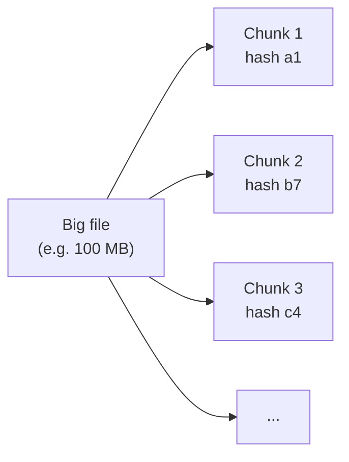
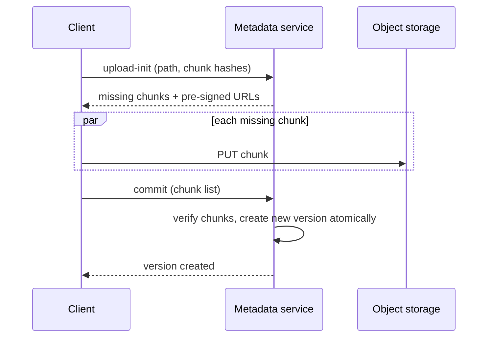
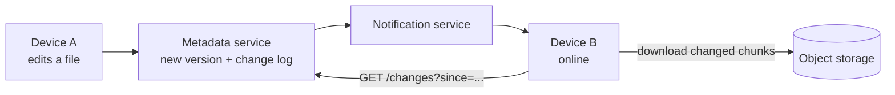
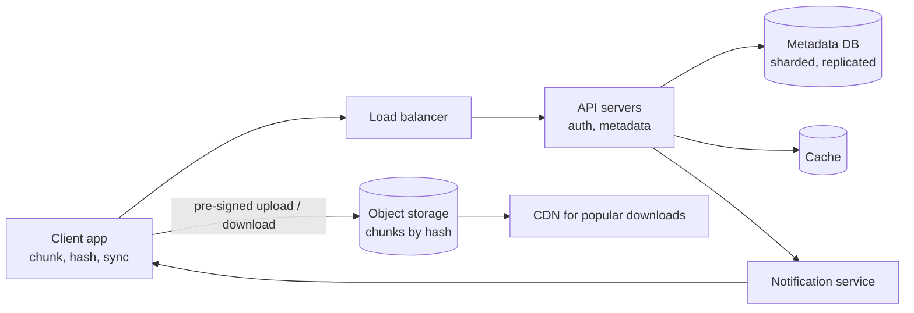

## Why this matters in an interview

File storage and sync brings out ideas you have not needed yet: **splitting big data into
chunks**, **keeping metadata apart from the bytes**, **uploading directly to storage**, and
**syncing many devices** with conflicts. It also tests whether you know when **not** to use a
database (for the file bytes).

## Step 1: Requirements

**Functional**
- **Upload and download** files from any device.
- Files **sync** automatically across a user's devices.
- Support **large files** (gigabytes), and **resume** an interrupted upload.
- **Version history**, and the ability to **share** a file or folder.

**Non-functional**
- **Never lose data** (durability is the top priority).
- **Fast sync**: changing one line of a huge file should not re-upload everything.
- Highly available. Handle a **huge amount of data**.
- Eventual consistency across devices is acceptable. Local changes must never be silently overwritten.

**Out of scope:** real-time collaborative editing, in-browser previews, full-text search.

## Step 2: Estimates

Assumptions: 50 million users, an average of 2 GB stored each; 10 million daily active users; each uploads or edits 2 files per day on average, 1 MB average file size for the daily churn.

| Quantity | Calculation | Result |
|---|---|---|
| Total storage | 50M × 2 GB | **100 PB** |
| Daily new data | 10M × 2 × 1 MB | about **20 TB / day** |
| Upload rate | 20M files ÷ 86,400 | about **230 files / s** |

**Conclusions:** the data is **petabytes**, so it cannot live in a database. We need **object
storage** for the bytes and a **separate metadata database** for the structure. The request rate itself is modest. The size of the data is what dominates.

## Step 3: API

```text
POST /v1/files/upload-init      body: { path, size, chunkHashes: [...] }
                                -> { fileId, chunksToUpload: [3, 7], uploadUrls: {...} }
PUT  <pre-signed upload url>    (client uploads a chunk straight to storage)
POST /v1/files/{fileId}/commit  body: { chunkHashes: [...] }  -> 200 { version }
GET  /v1/files/{fileId}/download -> redirect to storage (or a list of chunk urls)
GET  /v1/changes?since=<cursor>  -> list of changes for sync
```

## Step 4: The core ideas

### Idea 1: split files into chunks

Instead of treating a file as one blob, the client cuts it into **chunks** (for example 4 MB each, an assumption we can tune) and computes a **hash** (a fingerprint) of each chunk.



Why this is powerful:

| Benefit | How |
|---|---|
| **Resume an upload** | Only the chunks not yet stored need to be sent after a failure |
| **Delta sync** | Edit one part of the file and only the changed chunks are re-uploaded |
| **Deduplication** | If a chunk with this hash already exists (even from another user), do not store it again. Identical files and shared content cost nothing extra |
| **Parallelism** | Upload several chunks at once for speed |
| **Even sizing** | Easy to spread over many storage servers |

Honest limitation: if you **insert** bytes near the start of a file, fixed-size chunks all shift and every chunk after changes. Smarter schemes cut chunks by content (**content-defined chunking**) to avoid this. Mention that it exists, no need to design it.

(Deduplicating across users has a privacy side effect, since "does this chunk exist?" leaks information. Many systems restrict dedupe to within a user or an account for that reason.)

### Idea 2: separate metadata from the bytes

| | Metadata service | Block (object) storage |
|---|---|---|
| Holds | File names, folders, owner, versions, list of chunk hashes per version, sharing permissions | The chunk bytes, addressed by hash |
| Store | A **database** (SQL fits: relations and transactions, plus a cache) | **Object storage** (cheap, huge, highly durable, replicated) |
| Size | Small (gigabytes to terabytes) | Huge (petabytes) |
| Access | Frequent small reads and writes | Large reads and writes |

Metadata tables (simplified):

| Table | Key fields |
|---|---|
| `files` | `fileId`, `ownerId`, `path`, `latestVersion`, `deleted` |
| `versions` | `fileId`, `version`, `size`, `createdAt` |
| `version_chunks` | `fileId`, `version`, `index`, `chunkHash` |
| `chunks` | `chunkHash`, `storageLocation`, `refCount` |
| `shares` | `fileId`, `userId`, `permission` |

The `refCount` on a chunk tells us when no version uses it any more, so it can be deleted.

### Idea 3: upload straight to storage

Do not pass gigabytes through your app servers. Instead:

1. The client asks the **metadata service** to start an upload and sends the list of chunk hashes.
2. The service replies with **which chunks are missing** (the rest already exist: dedupe) and a **pre-signed URL** for each: a temporary, signed link that lets the client write one object directly into storage.
3. The client **uploads the chunks directly** to object storage, in parallel.
4. The client calls **commit**. The metadata service checks that all chunks exist and **atomically creates the new version**.



The version only becomes visible at **commit**, so a half-uploaded file never shows up as a broken file.

### Idea 4: sync across devices

How does the laptop learn that the phone changed a file?

- Every change is recorded in a **change log** with an increasing id per user.
- Each device remembers the **last change id** it has seen.
- A **notification service** tells online devices "you have new changes" (a WebSocket or long poll, chapter 02).
- The device then calls `GET /changes?since=<cursor>`, downloads the **changed chunks only**, and applies them.
- A device that was offline simply asks for changes since its cursor when it reconnects, the same sync-from-last-id idea as the chat app (chapter 14).



### Idea 5: conflicts

Two devices edit the same file offline, then both sync. There is no single right answer, so the safe rule is **never lose either change**. Compare the base version each device started from. If the server's latest version is newer than the one a device based its edit on, keep the first commit as the main file and save the second as a **"conflicted copy"** for the user to resolve. Simple, and data is never lost.

## Step 5: High-level design



## Step 6: Deep dive: reliability and scale

| Concern | Approach |
|---|---|
| **Durability** | Object storage replicates every chunk to several disks and zones. Verify chunk hashes on read. Never delete a chunk while `refCount > 0` |
| **Metadata scale** | Shard the metadata DB by `ownerId` (a user's files stay together), with replicas for reads |
| **Large number of small files** | Per-file overhead matters. Batch small files into one request or one chunk |
| **Hot shared files** | Cache metadata, serve downloads through a **CDN** (chapter 06) |
| **Cost of old versions** | Keep a limited history, move cold data to cheaper storage tiers, garbage-collect unreferenced chunks in the background |
| **Security** | Encrypt in transit (HTTPS) and at rest. Check permissions on every metadata call. Pre-signed URLs expire quickly and cover one object |
| **Deleting** | Mark deleted first (a trash period), then remove chunks later when their `refCount` hits zero |

## Step 7: Bottlenecks and trade-offs

| Weak point | Mitigation |
|---|---|
| Metadata DB is a single point of failure | Replication, failover, backups |
| Partial or interrupted uploads leave orphan chunks | A background job removes chunks never committed after a period |
| A device is offline for a long time | Sync from its last change id, or a full resync if the log was trimmed |
| Conflicts | Conflicted copies, never silent overwrite |
| Dedupe privacy | Restrict dedupe to an account, or accept the leak knowingly |

## Trade-offs

| Decision | Choice here | Why |
|---|---|---|
| Whole files vs chunks | Chunks | Resume, delta sync, dedupe, parallel upload |
| Bytes in the DB vs object storage | Object storage | Petabytes, cheap and durable |
| Upload through servers vs direct | Direct with pre-signed URLs | Servers should not carry the data |
| Conflict policy | Keep both (conflicted copy) | Never lose a user's work |
| Consistency | Eventual across devices | Fine for sync, with atomic commit per version |

## Interview angle

- Say "**chunking, metadata vs blob storage, direct upload**" early. These three phrases carry the design.
- Show the estimate: **100 PB** means object storage, not a database.
- Walk the **upload sequence** and the **sync** flow. Interviewers like a clear sequence diagram.
- Common follow-ups: How do you resume an upload? How do you avoid re-uploading unchanged parts? What if two devices edit the same file? How do you share a folder? How do you delete safely?

## Check yourself

1. Why split files into chunks? Give three benefits.
2. Why keep metadata in a database but the file bytes in object storage?
3. What is a pre-signed URL and why use it?
4. A device was offline for a week. How does it catch up?
5. Two devices edit the same file offline. What does the system do?
6. When can a chunk be deleted?



1. Any three of: resume interrupted uploads, upload only changed chunks (delta sync), deduplicate identical chunks, upload in parallel, spread data evenly across storage servers.
2. The bytes are petabytes in size and only need cheap durable storage addressed by hash. Metadata is small but relational and transactional (versions, permissions, folders), which a database handles well.
3. A temporary signed link that lets the client write or read one specific object in storage directly. It keeps large data off the app servers and does not expose credentials.
4. It sends the last change id it saw, the server returns every change since then, and the device downloads only the changed chunks.
5. The first commit becomes the main version. The second device's edit, which was based on an older version, is saved as a conflicted copy so no change is lost.
6. When its reference count drops to zero, meaning no stored version uses it. A background process then garbage-collects it.



## Remember

- Cut files into **chunks with hashes**: resume, delta sync, dedupe, parallelism.
- **Metadata in a database, bytes in object storage.** Petabytes cannot live in a DB.
- Upload **directly to storage** with pre-signed URLs, then **commit** atomically to make a version visible.
- Sync with a **change log and a cursor**, plus a notification to wake devices.
- On conflict, **keep both**. Chunks are deleted only when `refCount` hits zero.


**Further reading:** the object-storage and sharding ideas in the
[System Design Primer](https://github.com/donnemartin/system-design-primer). Cloud object storage docs (S3-style pre-signed URLs) are good for the upload flow.

