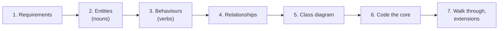
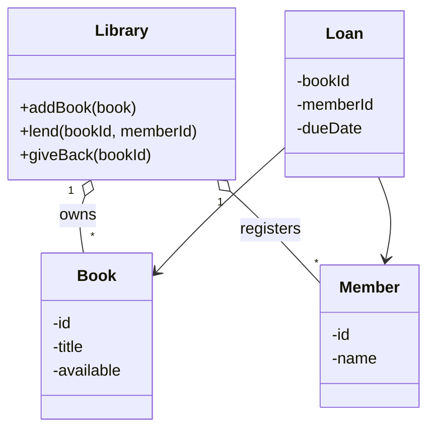

## Why this matters in an interview

For a fresher, the low-level design (LLD) round is often **the** design round. You are given a small
real-world problem ("design a parking lot") and asked to produce **classes, relationships and working
code**. The interviewer is judging whether your design is **clean, extensible and correct**, not whether it scales to a billion users.

## The idea from scratch

### What is different from HLD?

| | HLD (chapters 01 to 17) | LLD (chapters 18 to 20) |
|---|---|---|
| Question | "How does the whole system work and scale?" | "How is the code organised?" |
| Output | Boxes and arrows | Classes, methods, relationships, and real code |
| Judged on | Trade-offs, scale, failure handling | Clean abstractions, correctness, extensibility |
| Time | 45 minutes of discussion | 45 to 60 minutes, usually with code |

### The 7-step routine for an LLD round

Like the HLD routine, use the same order every time.

1. **Clarify requirements and scope.** Ask what must be supported. Write down 4 to 6 requirements and what you will skip.
2. **Find the entities.** Underline the **nouns** in the problem. They are candidate classes (`Vehicle`, `Spot`, `Ticket`).
3. **Find the behaviours.** The **verbs** are candidate methods (`park`, `leave`, `calculateFee`). Assign each to the class that owns the data it needs.
4. **Decide the relationships.** Who has whom, who is a kind of whom?
5. **Sketch a small class diagram.** Names, key fields, key methods.
6. **Write the core flow in code.** The main two or three operations, not every getter.
7. **Walk a scenario and discuss extensions.** Trace one example by hand. Then say what you would change for new requirements and for concurrency.



### The four pillars of OOP

| Pillar | Meaning | C++ feel |
|---|---|---|
| **Encapsulation** | Keep data private, expose behaviour. Protects invariants | `private` fields, public methods |
| **Abstraction** | Show *what* a thing does, hide *how* | Abstract class with pure virtual functions |
| **Inheritance** | A class is a specialised kind of another ("is-a") | `class Car : public Vehicle` |
| **Polymorphism** | Same call, different behaviour depending on the real object | `virtual` functions, called through a base reference or pointer |

### Relationships between classes

| Relationship | Meaning | Example |
|---|---|---|
| **Association** | One class uses or knows another | A `Loan` refers to a `Book` and a `Member` |
| **Aggregation** | "Has-a", but the parts can live on their own | A `Library` has `Book`s, and a book exists without that library object |
| **Composition** | "Has-a", and the part **cannot exist without** the whole | A `Car` has an `Engine`, created and destroyed with it |
| **Inheritance** | "Is-a" | `Square` is a `Shape` |
| **Dependency** | One class uses another only temporarily, for example as a parameter | A `Printer` method takes an `Invoice` |

A tiny class diagram for a library, showing what you would sketch on the board:



**Prefer composition over inheritance.** Inheritance ties a child to its parent forever. If two things merely *share some behaviour*, give one a member that provides it, instead of making one inherit from the other.

```cpp
class Engine {
public:
    void start() { cout << "engine on\n"; }
};
class Car {
    Engine engine;   // Car HAS-A Engine, not IS-A Engine
public:
    void drive() { engine.start(); cout << "driving\n"; }
};
```

## SOLID: the five design rules interviewers name

### S: Single Responsibility

A class should have **one reason to change**. An `Invoice` that calculates totals *and* prints itself changes when pricing changes **and** when the print format changes. Split them.

```cpp
class Invoice {
    vector<int> prices;
public:
    void add(int p) { prices.push_back(p); }
    int total() const { return accumulate(prices.begin(), prices.end(), 0); }
};
class InvoicePrinter {          // printing changes for different reasons than totals
public:
    void print(const Invoice& inv) const { cout << "total=" << inv.total() << "\n"; }
};
```

### O: Open/Closed

Classes should be **open for extension, closed for modification**. Add new behaviour by adding a new class, not by editing a growing `if/else` chain.

```cpp
class Shape {
public:
    virtual ~Shape() = default;
    virtual double area() const = 0;
};
class Rect : public Shape { /* ... */ };
class Tri : public Shape { /* new shape: only this class is added */ };

double totalArea(const vector<unique_ptr<Shape>>& v) {   // never changes
    double s = 0;
    for (auto& p : v) s += p->area();
    return s;
}
```

### L: Liskov Substitution

A child must work **anywhere its parent is expected**, without surprises. The classic violation: `Penguin` inherits from `Bird` which has `fly()`, and `Penguin::fly()` throws an error. Fix the hierarchy instead: a `Bird` base without `fly()`, and a separate `FlyingBird` that adds it.

### I: Interface Segregation

Do not force a class to implement methods it does not need. Prefer **several small interfaces** over one fat one. A `Printer` that is also forced to `fax()` and `scan()` is a sign to split the interface.

### D: Dependency Inversion

High-level code should depend on an **abstraction**, not on a concrete class. Pass the dependency in (**dependency injection**), so it is easy to swap or fake in a test.

```cpp
class Notifier {
public:
    virtual ~Notifier() = default;
    virtual void send(const string& to, const string& msg) = 0;
};
class EmailNotifier : public Notifier {
public:
    void send(const string& to, const string& msg) override {
        cout << "email to " << to << ": " << msg << "\n";
    }
};
class OrderService {
    Notifier& notifier;          // depends on the abstraction, not on EmailNotifier
public:
    OrderService(Notifier& n) : notifier(n) {}
    void place(const string& user) { notifier.send(user, "order placed"); }
};
```

(The snippets above were compiled and run: the invoice prints `total=35`, the shapes total `16`, and the order service sends the email.)

## Worked example: finding the entities for a library

**Prompt:** "Design a library management system."

| Step | Result |
|---|---|
| Requirements | Add books, register members, lend and return a book, a member can borrow up to 3 books, a book is lent to one person at a time. Skip fines and search for now |
| Nouns | Library, Book, Member, Loan |
| Verbs | addBook, register, lend, giveBack |
| Who owns what? | `lend` needs to know the book's availability and the member's current loans, so the **Library** coordinates it. `Book` knows whether it is available. `Member` knows how many it holds |
| Relationships | Library aggregates Books and Members. A Loan associates one Book and one Member |
| Rule to protect | A book cannot be lent twice. Put the check **inside** `lend`, not in the caller |

## Common mistakes

| Mistake | Better |
|---|---|
| Jumping straight to code with no requirements | Spend 5 minutes on scope. Say what you leave out |
| A "God class" that does everything | Give each class one job (SRP) |
| Public fields everywhere | Private data, methods that keep the rules true |
| Inheritance for code reuse only | Composition |
| Long `if (type == ...) else if ...` chains | Polymorphism or a strategy (chapter 19) |
| Designing for features nobody asked for | Build the core, then **say** how you would extend it |
| Ignoring edge cases (full lot, unknown id, duplicate booking) | Return a clear result (`-1`, `false`) and mention the case |
| Silence while coding | Think aloud. Explain why a class exists |

## Trade-offs

| Decision | Choose A when... | Choose B when... |
|---|---|---|
| Inheritance vs composition | A: a true "is-a" with shared behaviour | B: you only want to reuse behaviour (the usual case) |
| Interface vs concrete class | A: behaviour may vary or be swapped | B: there is only one sensible implementation |
| Many small classes vs few | A: each has a clear job | B: do not split just for the sake of splitting |
| Enum vs polymorphic classes | A: few fixed states, simple logic | B: behaviour per type grows (State, Strategy) |

## Interview angle

- Say the routine aloud: "First requirements, then entities, then I'll sketch classes, then code the main flow."
- Keep the class diagram **small**. Four to six classes is typical.
- Pick a **simple approach first**, then show how the design would extend ("a new vehicle type means one new class").
- Mention **concurrency** if relevant (two users booking the same seat) and say where you would lock.
- Common follow-ups: Why is this method on this class? How would you add a new type? How would you make it thread safe? How would you test it?

## Check yourself

1. How do you find candidate classes and methods from a problem statement?
2. Aggregation vs composition: what is the difference, with an example each?
3. What does the Open/Closed principle say, and how does a virtual `area()` demonstrate it?
4. What is wrong with `Penguin : public Bird` if `Bird` has `fly()`?
5. What does Dependency Inversion buy you in testing?
6. Why prefer composition to inheritance?



1. Nouns in the statement become candidate classes, verbs become candidate methods. Each method goes on the class that owns the data it needs.
2. Aggregation: the parts can exist independently (a Library and its Books). Composition: the part cannot exist without the whole and is created and destroyed with it (a Car and its Engine).
3. Classes should be open to extension but closed to modification. With a virtual `area()`, adding a new shape needs only a new class, and code that totals areas does not change.
4. It breaks Liskov Substitution: code expecting any `Bird` to fly would fail for a `Penguin`. Split the hierarchy so only flying birds have `fly()`.
5. You can pass a fake implementation of the abstraction (for example a fake notifier), so the class can be tested without sending real emails.
6. Inheritance tightly couples the child to the parent. Composition lets you swap or change the part independently, with less ripple effect.



## Remember

- LLD = classes, relationships and working code. Follow the 7 steps: requirements, entities, behaviours, relationships, diagram, code, walkthrough.
- Nouns become classes, verbs become methods. Put each method where its data lives.
- Know association, aggregation, composition, inheritance. Prefer **composition**.
- SOLID: one reason to change, extend not modify, substitutable children, small interfaces, depend on abstractions.
- Keep it small, handle the edge cases, think aloud, and say how you would extend it.


**Further reading:** the object-oriented design questions at the end of the
[System Design Primer](https://github.com/donnemartin/system-design-primer) (hash map, LRU cache, call center, deck of cards, parking lot, chat server).

