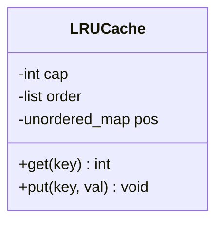
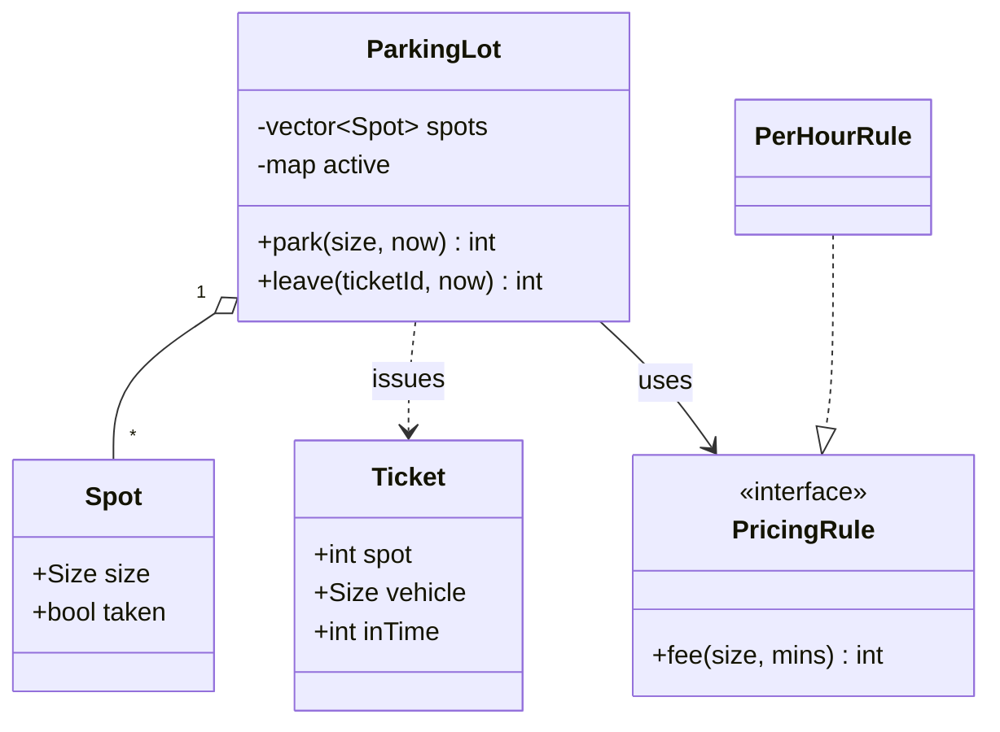
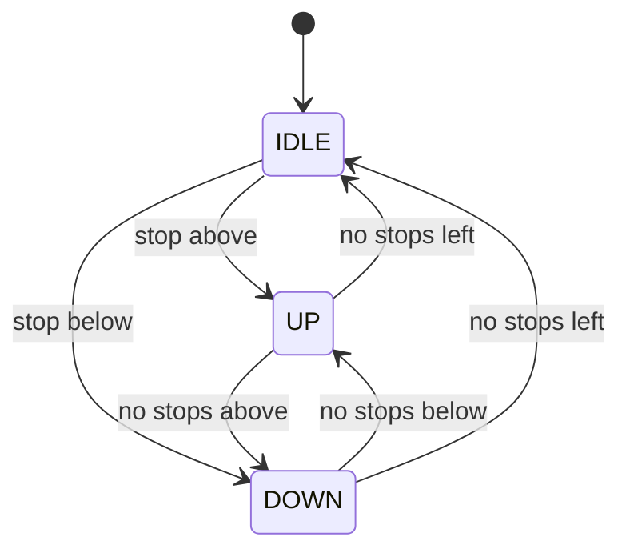
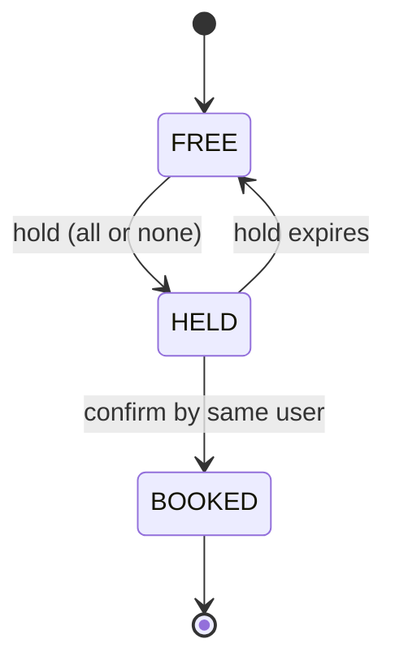

## Why this matters in an interview

These five problems cover most fresher LLD rounds: an **LRU cache** (data structures), a **parking
lot** (entities and a pricing strategy), an **elevator** (state and scheduling), a **vending machine**
(states and money rules), and **seat booking** (concurrency). Each design below follows the same
shape: requirements, entities, class sketch, code, a traced run, complexity, and how to extend it.

**All code on this page was compiled with C++17 and run.** The outputs shown are the real ones.
Every snippet assumes this header:

```cpp
#include <bits/stdc++.h>
using namespace std;
```

---

## 1. LRU cache

### Requirements
- Fixed capacity. `get(key)` returns the value or `-1`. `put(key, value)` inserts or updates.
- When full, `put` of a new key **evicts the least recently used** entry.
- Both operations in **O(1)**. (This is LeetCode 146, so you may already have solved it.)

### Idea
Two structures work together:
- A **doubly linked list** keeps keys ordered by recency (front = most recent), so moving a node to the front and removing the back are O(1).
- A **hash map** from key to **list iterator** gives O(1) lookup of any node.



### Code

```cpp
class LRUCache {
    int cap;
    list<pair<int, int>> order;  // front = most recently used
    unordered_map<int, list<pair<int, int>>::iterator> pos;

public:
    LRUCache(int cap) : cap(cap) {}

    int get(int key) {
        auto it = pos.find(key);
        if (it == pos.end()) return -1;
        order.splice(order.begin(), order, it->second);  // move node to front, O(1)
        return it->second->second;
    }

    void put(int key, int val) {
        auto it = pos.find(key);
        if (it != pos.end()) {
            it->second->second = val;
            order.splice(order.begin(), order, it->second);
            return;
        }
        if ((int)order.size() == cap) {
            pos.erase(order.back().first);
            order.pop_back();
        }
        order.emplace_front(key, val);
        pos[key] = order.begin();
    }
};
```

### Run

```text
put(1,1) put(2,2) get(1)=1 put(3,3) get(2)=-1 put(4,4) get(1)=-1 get(3)=3 get(4)=4
```

`put(3,3)` evicts key 2 (least recent), and `put(4,4)` evicts key 1.

### Why it works
`splice` relinks a node inside the same list **without invalidating iterators**, so the iterators stored in `pos` stay valid. That is the key C++ detail.

**Complexity:** `get` and `put` are O(1) average time (hash map). Space is O(capacity).

**Extensions:** add a **mutex** for thread safety (all operations modify the list, even `get`). For other eviction policies (LFU, TTL), make the policy an interface (Strategy).

---

## 2. Parking lot

### Requirements
- Vehicles: **bike, car, truck**. Spots: bike, car, truck sized. A vehicle can take a spot **at least as large** as itself.
- `park` gives a **ticket** (or fails when nothing fits). `leave` frees the spot and returns the **fee**.
- Fee depends on vehicle type and time, and **pricing rules may change** (so use a Strategy).
- Skip: multiple floors, payment processing, entry gates.

### Entities and relationships



### Code

```cpp
enum class Size { BIKE = 0, CAR = 1, TRUCK = 2 };

struct Spot {
    Size size;
    bool taken = false;
};
struct Ticket {
    int spot;
    Size vehicle;
    int inTime;
};

class PricingRule {
public:
    virtual ~PricingRule() = default;
    virtual int fee(Size v, int mins) const = 0;
};
class PerHourRule : public PricingRule {
public:
    int fee(Size v, int mins) const override {
        int hours = max(1, (mins + 59) / 60);  // minimum one hour
        int rate = v == Size::BIKE ? 10 : v == Size::CAR ? 20 : 40;
        return hours * rate;
    }
};

class ParkingLot {
    vector<Spot> spots;
    unordered_map<int, Ticket> active;
    unique_ptr<PricingRule> rule;
    int nextTicket = 1;

public:
    ParkingLot(vector<Spot> spots, unique_ptr<PricingRule> rule)
        : spots(move(spots)), rule(move(rule)) {}

    // returns a ticket id, or -1 when no free spot fits
    int park(Size v, int now) {
        int best = -1;
        for (int i = 0; i < (int)spots.size(); i++) {
            if (spots[i].taken || spots[i].size < v) continue;  // spot too small
            if (best == -1 || spots[i].size < spots[best].size) best = i;  // smallest fit
        }
        if (best == -1) return -1;
        spots[best].taken = true;
        int id = nextTicket++;
        active[id] = {best, v, now};
        return id;
    }

    // returns the fee, or -1 for an unknown ticket
    int leave(int ticketId, int now) {
        auto it = active.find(ticketId);
        if (it == active.end()) return -1;
        Ticket t = it->second;
        spots[t.spot].taken = false;
        active.erase(it);
        return rule->fee(t.vehicle, now - t.inTime);
    }
};
```

### Run
Lot has spots `{bike, car, car, truck}`:

```text
park(BIKE) -> ticket 1   (takes the bike spot: smallest that fits)
park(BIKE) -> ticket 2   (bike spot taken, so a car spot)
park(CAR)  -> ticket 3   (the other car spot)
park(CAR)  -> ticket 4   (only the truck spot is left)
park(CAR)  -> -1         (full)
leave(3, at 150 min) = 60   (car, 3 started hours x 20)
leave(3, again)      = -1   (ticket already used)
leave(1, at 30 min)  = 10   (bike, minimum 1 hour x 10)
```

**Design choices to say aloud:**
- **Smallest fitting spot** keeps big spots free for big vehicles.
- Pricing is a **Strategy**, so a new rule (weekend rate, flat fee) is a new class.
- Errors are returned (`-1`), not thrown, to keep the example simple. State that you would use a proper result type in production.

**Complexity:** `park` is O(S) for S spots (a scan). `leave` is O(1). **Improvement:** keep one free-spot set per size so `park` becomes O(log S).

**Extensions:** multiple floors (a `Floor` class owning spots), a `Vehicle` class with plate numbers, EV charging spots, and a mutex around `park` and `leave` (two cars must not get the same spot).

---

## 3. Elevator (one car)

### Requirements
- One elevator, floors numbered from 0. Requests for floors come in at any time.
- Move **one floor per step**. Serve requests **in the direction of travel first**, then reverse (like a real elevator, called SCAN).
- Skip: doors, weight, multiple elevators, inside/outside buttons.

### Idea
Keep the pending stops in a **sorted set**. The car has a **direction** (idle, up or down). It keeps going in its direction while a stop exists ahead, and turns around when nothing is left that way.



### Code

```cpp
enum class Dir { IDLE, UP, DOWN };

class Elevator {
    int floor = 0;
    Dir dir = Dir::IDLE;
    set<int> stops;

public:
    void request(int f) {
        if (f != floor) stops.insert(f);
    }
    int curFloor() const { return floor; }

    // move one floor; returns the floor if the car stopped there, else -1
    int step() {
        if (stops.empty()) {
            dir = Dir::IDLE;
            return -1;
        }
        if (dir == Dir::IDLE) dir = (*stops.begin() > floor) ? Dir::UP : Dir::DOWN;
        // nothing left ahead in the current direction -> turn around
        if (dir == Dir::UP && stops.upper_bound(floor) == stops.end()) dir = Dir::DOWN;
        else if (dir == Dir::DOWN && stops.lower_bound(floor) == stops.begin()) dir = Dir::UP;

        floor += (dir == Dir::UP) ? 1 : -1;
        int stopped = stops.erase(floor) ? floor : -1;
        if (stops.empty()) dir = Dir::IDLE;
        return stopped;
    }
};
```

### Run
The car starts at floor 0 and is asked for floor 4. After two steps it is at floor 2, then floors 1 and 3 are requested:

```text
stops, in the order served: 3 4 1
```

It continues **up** past 3 and 4, then turns around and serves 1. It did not go down to 1 first, even though 1 was closer to where the car was when asked: serving the direction of travel first avoids zig-zagging.

**Why the two checks work:** `upper_bound(floor) == end()` means no stop is above the current floor. `lower_bound(floor) == begin()` means no stop is below it.

**Complexity:** each `step` is O(log n) for n pending stops (set operations). Space is O(n).

**Extensions:** several elevators (a `Controller` that assigns each request to the best car, for example the nearest one already heading that way), separate "hall call" (up/down) and "cabin" requests, doors and capacity, and an emergency state. Mention a **State pattern** if the behaviour per state grows.

---

## 4. Vending machine

### Requirements
- Items have a **code**, name, price, quantity.
- The user **inserts money**, **selects** an item, and gets the item plus **change**.
- Reject: no money inserted, unknown code, sold out, not enough money.
- The user can **cancel** and get a refund.

### Idea
The machine is in one of two **states**: waiting (`IDLE`) or holding money (`HAS_MONEY`). Each operation checks the state first. With only two states, an enum is enough (chapter 19 shows when to use State classes instead).

### Code

```cpp
enum class VState { IDLE, HAS_MONEY };

struct Item {
    string name;
    int price;
    int qty;
};

class VendingMachine {
    unordered_map<string, Item> items;  // code -> item
    VState state = VState::IDLE;
    int credit = 0;

public:
    void addItem(const string& code, string name, int price, int qty) {
        items[code] = {move(name), price, qty};
    }
    bool insertMoney(int amt) {
        if (amt <= 0) return false;
        credit += amt;
        state = VState::HAS_MONEY;
        return true;
    }
    // returns the change, or -1 when the selection cannot be served
    int select(const string& code) {
        if (state != VState::HAS_MONEY) return -1;
        auto it = items.find(code);
        if (it == items.end() || it->second.qty == 0) return -1;
        if (credit < it->second.price) return -1;
        it->second.qty--;
        int change = credit - it->second.price;
        credit = 0;
        state = VState::IDLE;
        return change;
    }
    int cancel() {
        int refund = credit;
        credit = 0;
        state = VState::IDLE;
        return refund;
    }
};
```

### Run
One item `A1`, chips, price 30, quantity 1:

```text
select("A1")            -> -1   (no money inserted)
insertMoney(20)
select("A1")            -> -1   (20 is not enough, money is kept)
insertMoney(20)         (credit is now 40)
select("A1")            -> 10   (change; item dispensed)
insertMoney(50)
select("A1")            -> -1   (sold out)
cancel()                -> 50   (refund)
```

**Design choices to say aloud:** a failed selection does **not** swallow the user's money (it stays as credit until they cancel or succeed). `select` is the only place that reduces stock and resets credit, so the rules live in one spot.

**Complexity:** every operation is O(1) average.

**Extensions:** make change from **limited coin denominations** (a greedy or DP question, and the machine may be unable to give change), accept card payment (a Strategy), restock and admin operations, and a timeout that auto-refunds. Switch to State classes (chapter 19) when you add states like `DISPENSING` and `OUT_OF_SERVICE`.

---

## 5. Seat booking (BookMyShow-lite)

### Requirements
- A show has numbered seats.
- A user **holds** several seats together for a short time while paying. **All or none**.
- If they pay, the seats are **booked**. If the hold **expires**, the seats are free again.
- Two users must **never** get the same seat, even at the same instant.

### Idea
Each seat is `FREE`, `HELD` or `BOOKED`. A hold records the **user** and an **expiry time**. All operations on a show take one **mutex**, so the check ("are all these seats free?") and the update ("mark them held") happen as one unit. Otherwise two threads could both pass the check, and the same seat would be given twice (the same read-then-write race as in chapter 13).



### Code

```cpp
class Show {
    enum class S { FREE, HELD, BOOKED };
    struct Seat {
        S st = S::FREE;
        int user = -1;
        int holdUntil = 0;
    };
    vector<Seat> seats;
    mutex mu;

    bool valid(int s) const { return s >= 0 && s < (int)seats.size(); }
    void expireHolds(int now) {
        for (auto& x : seats)
            if (x.st == S::HELD && x.holdUntil <= now) x = Seat();
    }

public:
    Show(int n) : seats(n) {}

    // hold ALL requested seats for ttl time units, or none
    bool hold(int user, const vector<int>& want, int now, int ttl) {
        lock_guard<mutex> g(mu);
        expireHolds(now);
        for (int s : want)
            if (!valid(s) || seats[s].st != S::FREE) return false;
        for (int s : want) seats[s] = {S::HELD, user, now + ttl};
        return true;
    }

    // the same user turns their holds into bookings (payment succeeded)
    bool confirm(int user, const vector<int>& want, int now) {
        lock_guard<mutex> g(mu);
        expireHolds(now);
        for (int s : want)
            if (!valid(s) || seats[s].st != S::HELD || seats[s].user != user) return false;
        for (int s : want) seats[s].st = S::BOOKED;
        return true;
    }
};
```

### Run
A show with 10 seats. Times are plain integers:

```text
hold(user 1, {2,3}, t=0, ttl 5)   -> true
hold(user 2, {3,4}, t=1, ttl 5)   -> false   (seat 3 is held, and seat 4 stays untouched)
hold(user 2, {4},   t=1, ttl 5)   -> true
confirm(user 1, {2,3}, t=3)       -> true    (booked)
hold(user 3, {3},   t=10, ttl 5)  -> false   (seat 3 is booked for good)
hold(user 5, {7},   t=0, ttl 5)   -> true
hold(user 6, {7},   t=6, ttl 5)   -> true    (user 5's hold expired at t=5)
```

I also ran a concurrency check: **8 threads all trying to hold the same single seat gave exactly 1 winner.**

**Design choices to say aloud:**
- **All or none** matters: if user 2's request for `{3,4}` had grabbed seat 4 before failing on 3, seat 4 would be locked with nobody paying.
- The **hold with expiry** stops people from blocking seats forever. In production a background job or a TTL in a store would release holds, instead of checking lazily inside each call (we expire lazily here for simplicity).
- Only the **same user** can confirm their own hold.

**Complexity:** `hold` and `confirm` are O(S + k) here because of the lazy expiry scan over all S seats and k requested seats. A real system would keep an expiry queue to avoid the full scan.

**Extensions:**
- **Many shows and many theatres**: one mutex per show, so unrelated shows never wait on each other (**finer-grained locking**).
- **Across servers** the mutex is not enough. Use a database transaction, or an atomic "set if free" (compare-and-set) in a shared store, with an expiry. That is the distributed version of the same idea (chapters 05 and 13).
- Payments, pricing per seat category, and cancellations with refunds.

---

## Trade-offs

| Decision | Choice here | Why |
|---|---|---|
| LRU structure | List + hash map of iterators | O(1) get, put and evict |
| Parking pricing | Strategy | Rules change without touching the lot |
| Elevator pending stops | Ordered set | Quick next stop above or below |
| Vending states | Enum | Two states only. Move to State classes when it grows |
| Booking concurrency | One mutex per show, all-or-none hold | Correctness first, then refine locking |
| Error reporting | Return `-1` / `false` | Keeps examples short. Mention richer results |

## Interview angle

- Do the **requirements and entities** before any code, even for a "simple" problem.
- Write the **class with the real logic** (`park`, `step`, `select`, `hold`) and keep helpers small.
- **Trace a small example** out loud, like the Run sections above. It catches bugs and impresses.
- State the **complexity** and one **improvement** (per-size free sets, expiry queue).
- Always mention **thread safety** and **where the lock goes**, even if you do not add it.
- Common follow-ups: How do you add a new vehicle or pricing type? What if two threads call `park`? How would you support multiple elevators? How do you make change?

## Check yourself

1. Why does the LRU cache store list **iterators** in the hash map, and why does `splice` keep them valid?
2. In the parking lot, why choose the smallest fitting spot?
3. The elevator is going up and has stops at 3 and 1 (it is at floor 2). Which does it serve first, and why?
4. In the vending machine, what should happen to the user's money when they pick a sold-out item?
5. Why must `hold` check **and** update seats under the same lock?
6. How would you extend seat booking to many servers?



1. The map must reach any node in O(1), and an iterator points straight at the node. `splice` moves a node within the list by relinking it and does not invalidate iterators, so the stored ones remain correct.
2. It leaves larger spots free for larger vehicles, so a bike does not block a truck.
3. Floor 3, because it continues in the direction of travel. It serves floor 1 after turning around.
4. Nothing is taken. The selection is rejected, the credit stays, and the user can pick another item or cancel for a refund.
5. If the check and the update were separate steps, two threads could both see the seat free and both mark it held, so one seat would be given to two users. The lock makes check-and-update atomic.
6. A single in-memory lock no longer protects across machines. Use a database transaction or an atomic compare-and-set in a shared store, with an expiry on holds.



## Remember

- **LRU:** doubly linked list + hash map of iterators, `splice` to move to front, O(1).
- **Parking lot:** smallest fitting spot, pricing as a Strategy, tickets hold entry time.
- **Elevator:** ordered set of stops, keep direction, reverse only when nothing is ahead.
- **Vending machine:** state-checked operations, never swallow money on a failed selection.
- **Booking:** hold all or none under one lock, holds expire, only the same user confirms. Distributed version needs atomic set-if-free.


**Further reading:** the object-oriented design questions in the
[System Design Primer](https://github.com/donnemartin/system-design-primer) (LRU cache, parking lot, call center, deck of cards, hash map, chat server). Practise these as **extra** problems, using the same 7-step routine.

