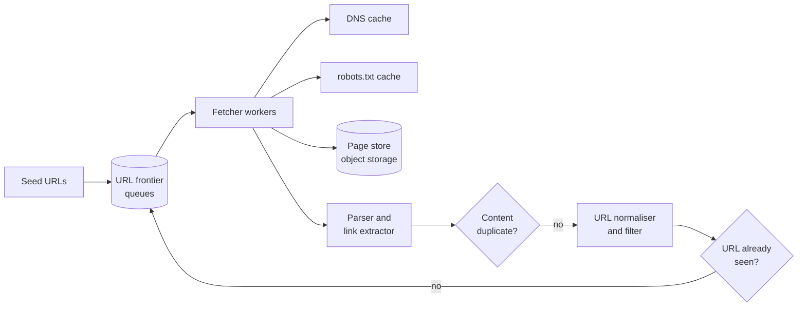
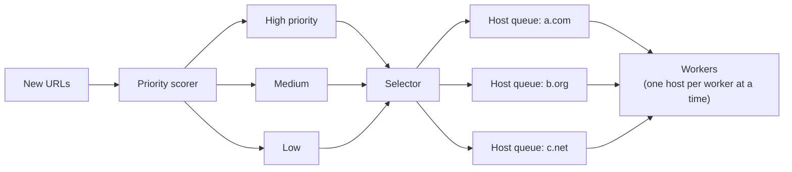

## Why this matters in an interview

A web crawler is a favourite because it hides a **graph traversal** (BFS, which you know from DSA)
inside a distributed system, and then asks the practical questions: **do not hit one site too hard,
do not visit the same page twice, and do not get trapped**. It is also mock prompt 2 on the
[cheat sheet](../21-cheat-sheet-and-mock-questions).

## Step 1: Requirements

**Functional**
- Start from a set of **seed URLs**, download pages, **extract links**, and keep crawling.
- **Store** the page content so another system (a search indexer) can use it later.
- **Re-crawl** pages over time to pick up changes.

**Non-functional**
- **Scalable**: billions of pages, many machines.
- **Polite**: obey `robots.txt` and never overload a site.
- **Robust**: bad HTML, slow servers, redirects, infinite link loops.
- **Efficient**: no duplicate downloads.

**Out of scope:** building the search index, page ranking, crawling pages that need a login or run heavy JavaScript.

## Step 2: Estimates

Assumptions: crawl **1 billion pages per month**, average page **500 KB**.

| Quantity | Calculation | Result |
|---|---|---|
| Pages per second | 1B ÷ (30 × 86,400 ≈ 2.6M s) | about **400 / s** |
| Download bandwidth | 400 × 500 KB | about **200 MB/s ≈ 1.6 Gbps** |
| Raw data per month | 1B × 500 KB | **500 TB** |

**Conclusions:** the data is hundreds of terabytes a month, so pages go to **object storage**
(chapter 17), and we need **many fetcher machines**. The network and the **wait time for slow websites** dominate, not CPU. So a fetcher spends most of its time waiting, which means each machine should run many downloads **at once**.

## Step 3: The crawl is a graph traversal

Pages are nodes and links are edges. Crawling is a graph search that never finishes.

- **BFS** (queue): visits pages level by level from the seeds. This is the usual choice.
- **DFS** (stack): can dive endlessly into one site and into traps. Avoid it.

The twist is that the queue is **distributed**, huge, and needs rules (priority and politeness).

## Step 4: High-level design

The loop for one page:

1. Take a URL from the **frontier**.
2. Check **`robots.txt`** (cached per host) to see if we may fetch it.
3. Resolve the host with a **DNS cache** (DNS lookups are slow, so cache them).
4. **Download** with a timeout.
5. Check the **content fingerprint**: have we stored this exact page before? If yes, drop it.
6. **Store** the page and **parse** out its links.
7. **Normalise** each link, filter it, check the **seen set**, and push **new** URLs to the frontier.

## Step 5: Deep dive

### The URL frontier: priority and politeness

A single FIFO queue is not enough. The frontier has two jobs:

| Job | How |
|---|---|
| **Priority** | Important or frequently changing pages should be fetched first. Several "front" queues by priority, and a selector favours the high ones |
| **Politeness** | At most one request at a time to a host, with a **delay between requests** to it. One "back" queue **per host**, and each host is owned by **one worker** |

Partition work by a **hash of the host name** (consistent hashing, chapter 05), so one machine
owns all URLs of a host. That makes the politeness rule a **local** check, with no coordination across machines.

### Avoiding duplicates

Two different problems:

| Problem | Solution |
|---|---|
| **Same URL seen again** | Keep a **seen set** of normalised URLs. For billions, store hashes in a sharded key-value store, or use a **Bloom filter** (a compact structure that answers "definitely not seen" or "probably seen". It has rare false positives, which means we occasionally skip a new page, an acceptable cost) |
| **Different URLs, same content** (mirrors, tracking parameters) | Hash the page content and keep a set of **content fingerprints**. For near-duplicates, mention similarity hashing exists |

**URL normalisation** makes duplicates detectable: lower-case the host, remove fragments (`#section`), sort or drop tracking query parameters, resolve relative links (`../a.html`), and strip default ports. Skip links such as `mailto:` and non-HTTP schemes.

### Spider traps and bad pages

A site can generate endless unique URLs (a calendar with "next month" forever, session ids in links). Defences:

- **Maximum depth** from the seed and **maximum pages per host**.
- **Maximum URL length.**
- Ignore very large files and unsupported types. Set a **download size limit and timeout**.
- Watch for repeating path patterns.

### Politeness, in detail

- Fetch and cache **`robots.txt`** per host. Respect disallowed paths and any crawl delay.
- Keep a **per-host delay**, and slow down if the site answers slowly or with errors (a sign of overload).
- Identify the crawler with a clear **User-Agent**.

### Freshness: re-crawling

Pages change at different speeds. Estimate each page's **change rate** from past visits and
set its next crawl time accordingly: news front pages every few minutes, rarely changing pages every few weeks. Use `If-Modified-Since` or content hashes to avoid re-storing unchanged pages.

### Fault tolerance

- The frontier must be **durable** (persisted queues), so a crash does not lose the work list.
- Workers are **stateless**. If one dies, its host's URLs are reassigned.
- **Retries** with backoff for temporary failures. Give up after a few attempts and record the failure.
- Periodic **checkpoints** of the seen set.

### Storing and handing off

Store the raw page in **object storage** and write **metadata** (URL, fetch time, content hash, status) to a database. Publish an event to a **queue** (chapter 08) so the indexing system picks up new pages without being coupled to the crawler.

## Step 6: Bottlenecks and trade-offs

| Weak point | Mitigation |
|---|---|
| DNS lookups are slow | Local DNS cache, batch lookups |
| One slow host blocks a worker | Timeouts, many concurrent downloads per machine, one host per queue |
| Seen set grows without bound | Bloom filter, sharding, expire very old entries |
| Hot hosts (huge sites with millions of pages) | Rate-limit per host, cap pages, deprioritise |
| Frontier becomes a bottleneck | Shard it by host hash, batch dequeues |
| Legal and ethical limits | Obey `robots.txt`, avoid private or personal data, respect terms of use |

## Trade-offs

| Decision | Choice here | Why |
|---|---|---|
| BFS vs DFS | BFS | Avoids diving into traps, spreads over many sites |
| Seen set | Sharded hash store or Bloom filter | Billions of URLs need compact membership tests |
| Queues | Priority front queues, per-host back queues | Importance and politeness are separate concerns |
| Partitioning | Hash of host | Politeness stays local |
| Duplicate content | Content hash | Cheap exact match |

## Interview angle

- Say "it is BFS over the web graph" first. That ties it to something you know.
- The two ideas to land: **politeness through per-host queues**, and **deduplication** (URL seen set plus content hash).
- Mention traps and `robots.txt` unprompted.
- Common follow-ups: How do you handle JavaScript-rendered pages? How do you prioritise? How do you detect pages that changed? How do you crawl 1,000× faster?

## Check yourself

1. Why BFS and not DFS?
2. How does the frontier stay polite to a website?
3. What is a Bloom filter and why is an occasional false positive acceptable here?
4. Two URLs return the same page. How do you avoid storing it twice?
5. Name two defences against a spider trap.
6. Why partition the crawl by host name?



1. BFS explores widely across many sites and does not sink into one endless branch. DFS can follow a trap forever.
2. A queue per host, owned by one worker at a time, with a delay between requests, plus obeying `robots.txt`.
3. A compact structure for set membership: it never misses a URL it has seen, but may say "seen" for a new one. The cost is occasionally skipping a page, which is acceptable at web scale.
4. Hash the page content and check a set of stored fingerprints before storing.
5. Any two of: a maximum depth, a maximum pages per host, a URL length limit, timeouts and size limits, detecting repeating patterns.
6. All URLs of a host land on one machine, so the politeness delay is a local check and needs no cross-machine coordination.



## Remember

- A crawler is **BFS** over the web graph with a **distributed frontier**.
- The frontier has **priority queues** and **per-host politeness queues**, partitioned by host hash.
- Dedupe by **normalised URL (seen set or Bloom filter)** and by **content hash**.
- Defend against traps, obey `robots.txt`, cache DNS, set timeouts.
- Store pages in object storage, hand off to indexing through a queue, re-crawl by estimated change rate.


**Further reading:** "Design a web crawler" in the
[System Design Primer](https://github.com/donnemartin/system-design-primer). Attempt it first, then compare.

