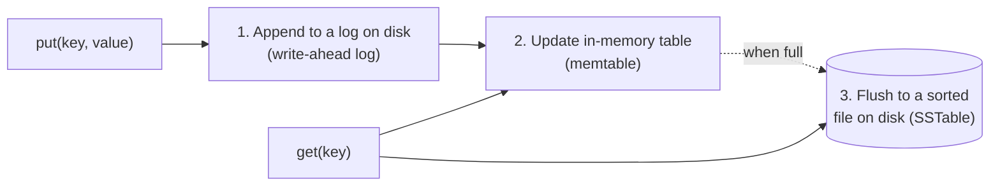
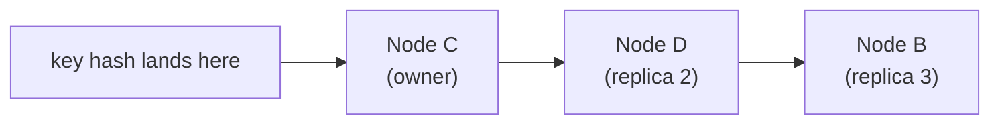
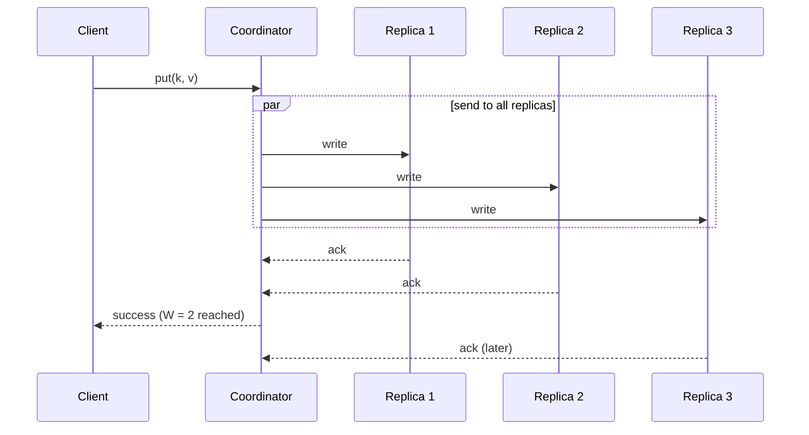

## Why this matters in an interview

This design stitches together almost everything from the earlier chapters: **consistent hashing**
(05), **replication** (05), **CAP and quorums** (09), and **failure handling** (11). It is mock
prompt 3 on the [cheat sheet](../21-cheat-sheet-and-mock-questions). The design below is a
**Dynamo-style** store (the family that Cassandra-like systems belong to), simplified for an interview.

## Step 1: Requirements

**Functional**
- `put(key, value)`, `get(key)`, `delete(key)`.
- Small values (up to a few KB per entry).

**Non-functional**
- **Scale out**: add machines to hold more data and serve more traffic.
- **Highly available**: keep working when machines fail.
- **Low latency** reads and writes.
- **Tunable consistency**: the user chooses between "fast and maybe stale" and "slower and up to date".

**Out of scope:** range queries, joins, transactions across keys.

## Step 2: Estimates

Assumptions: 100 million keys, 1 KB per entry, replication factor 3.

| Quantity | Calculation | Result |
|---|---|---|
| Raw data | 100M × 1 KB | 100 GB |
| With 3 replicas | 100 GB × 3 | 300 GB |

That fits on a few machines, so the real reasons to distribute are **throughput, availability
and growth**, not just size. Say that out loud. If the interviewer raises the numbers (billions of keys), the same design simply uses more nodes.

## Step 3: A single node first

Before distributing, how does **one machine** store data safely and quickly?



- **Write-ahead log:** every write is first **appended** to a log file on disk. If the machine crashes, replay the log. Appending is fast because disks like sequential writes.
- **Memtable:** a sorted in-memory structure that takes the writes, so recent data is fast to read.
- **SSTables:** when the memtable is full it is written out as an immutable **sorted file**. Reads check the memtable first, then the files from newest to oldest, and a **Bloom filter** per file (chapter 22) skips files that cannot contain the key. A background **compaction** merges files and removes overwritten or deleted entries.

This is the **log-structured** design used by many write-heavy stores. At the interview level,
saying "append to a log, update memory, flush sorted files, compact in the background" is enough.

## Step 4: Distributing it

### Partitioning: consistent hashing

Spread keys over the nodes with a **hash ring** (chapter 05). Each physical node appears on the ring
many times as **virtual nodes**, to balance load. Hash the key, go **clockwise** to the first node: that node is the key's **owner**.

### Replication: copies on the next nodes

Store each key on the **N** nodes that follow its position on the ring (for example N = 3), **skipping virtual nodes that belong to a machine already chosen**, so the copies sit on **different physical machines**.



I tested this with a small ring (3 nodes, 100 virtual nodes each). Adding a fourth node moved about **23%** of the keys, **all of them onto the new node**, close to the ideal 1/4. The same change with `hash(key) mod N` moved about **75%**. The replica list for one key came out as three **distinct** machines.

```cpp
class HashRing {
    map<unsigned long long, string> ring;  // point on the ring -> physical node
    int vnodes;
    static unsigned long long h(const string& s);   // a stable 64-bit hash

public:
    HashRing(int vnodes) : vnodes(vnodes) {}

    void addNode(const string& node) {
        for (int i = 0; i < vnodes; i++) ring[h(node + "#" + to_string(i))] = node;
    }
    void removeNode(const string& node) {
        for (int i = 0; i < vnodes; i++) ring.erase(h(node + "#" + to_string(i)));
    }

    // the first n DISTINCT physical nodes clockwise from the key (replica set)
    vector<string> nodesFor(const string& key, int n) const {
        vector<string> out;
        if (ring.empty()) return out;
        auto it = ring.lower_bound(h(key));
        for (size_t step = 0; step < ring.size() && (int)out.size() < n; step++) {
            if (it == ring.end()) it = ring.begin();  // wrap around the ring
            if (find(out.begin(), out.end(), it->second) == out.end()) out.push_back(it->second);
            ++it;
        }
        return out;
    }
};
```

`lower_bound` finds the first ring point at or after the key's hash, and the wrap-around handles the end of the ring. The hash function `h` is any good 64-bit string hash (I used FNV-1a with a mixing step).

### Reads and writes: quorum

Any node can act as the **coordinator** for a request. For a `put`, it sends the write to the N replicas and
waits for **W** acknowledgements. For a `get`, it asks the replicas and waits for **R** answers, returning the newest.

| Setting (N = 3) | Behaviour |
|---|---|
| **W = 2, R = 2** | R + W > N, so reads see the latest write. Tolerates one node down. A balanced default |
| **W = 1, R = 1** | Fastest and most available, but reads may be **stale** (eventual consistency) |
| **W = 3, R = 1** | Fast reads, slow writes, and writes fail if any replica is down |

This is exactly the dial from chapter 09.



## Step 5: Deep dive: handling failure and conflicts

### Failure detection: gossip

There is no central master. Each node periodically sends its view of which nodes are alive to a **few random peers** (a **gossip protocol**). News of a dead node spreads through the cluster in a few rounds, with no single point of failure.

### Temporary failures: hinted handoff

If a replica is briefly down, a healthy node can **temporarily accept its writes** and keep a "hint". When the replica returns, the hints are handed back. This keeps writes available during short outages (at the price of weaker consistency until then).

### Permanent drift: anti-entropy with Merkle trees

Replicas can still drift apart (a missed write, a lost disk). To compare big data sets cheaply, each replica builds a **Merkle tree**, a tree of hashes where each parent is the hash of its children. Two replicas compare **root hashes**. If they match, they are identical. If not, they walk down the tree to find **only the key ranges that differ**, and sync just those.

### Read repair

When a `get` collects R answers and notices one replica is **behind**, the coordinator writes the newest value back to it. Frequently read data heals itself.

### Conflicts: two writes at once

With availability favoured, two clients can write the same key on different replicas at the same time. Options:

| Approach | How | Trade-off |
|---|---|---|
| **Last write wins** | Keep the value with the latest timestamp | Simple. Can **silently drop** a write, and clocks across machines are imperfect |
| **Version vectors** | Track a counter per node to detect that two versions are **concurrent**, then keep both and let the application merge them | No silent loss, more work for the client |

For an interview: name both, say last-write-wins is the simple default, and explain its risk.

### Deletes

You cannot just erase a key, or an out-of-date replica would bring it back. A delete writes a **tombstone** marker that is replicated like any value, and is removed later once all replicas know.

## Step 6: Bottlenecks and trade-offs

| Weak point | Mitigation |
|---|---|
| A hot key overloads its replicas | Cache in front, spread reads across replicas, split the key |
| Adding a node causes data movement | Consistent hashing moves only the new node's share, and moves in the background |
| Clock differences affect last-write-wins | Use logical clocks or version vectors where correctness matters |
| Replica drift | Read repair + Merkle-tree anti-entropy |
| Network partition | Choose per request: quorum (CP-leaning) or low W/R (AP-leaning) |
| Disk growth from old versions and tombstones | Compaction |

## Trade-offs

| Decision | Choice here | Why |
|---|---|---|
| Partitioning | Consistent hashing + virtual nodes | Small data movement when nodes change |
| Replication | N copies on distinct nodes | Availability and durability |
| Consistency | Tunable via W and R | Different use cases need different guarantees |
| Conflicts | Last write wins (default), version vectors (if needed) | Simplicity vs no lost writes |
| Coordination | Peer to peer, no master | No single point of failure |

## Interview angle

- Start from one node (log, memtable, files), then say "now distribute it."
- Say **consistent hashing → replicate N → quorum W and R** in one breath. That is the core.
- Show you know the trade-off: **R + W > N** for freshness, smaller values for speed and availability.
- Do not claim product internals. Say "Dynamo-style".
- Common follow-ups: What if a node fails? How do you detect it? What if two clients write at once? How do you add a node? What consistency do you offer?

## Check yourself

1. Why does a write go to a log before memory?
2. Why does the replica set skip virtual nodes of a machine already chosen?
3. With N = 3, which W and R values guarantee reading the latest write?
4. How do nodes find out that a peer is dead without a central master?
5. What does a Merkle tree save when syncing two replicas?
6. Why do deletes need tombstones?



1. If the machine crashes before data is flushed, the log can be replayed to rebuild memory. Appending to a log is also fast.
2. Otherwise two copies could land on the same physical machine, and one machine failing would lose both.
3. Any pair with R + W > 3, for example W = 2 and R = 2, or W = 3 and R = 1.
4. Gossip: each node regularly shares its view of the cluster with a few random peers, and the information spreads quickly.
5. It lets them compare root hashes first and then locate only the key ranges that differ, instead of comparing every key.
6. Without a marker, a replica that missed the delete would still hold the old value and could resurrect it. A tombstone is replicated like a value, then cleaned up later.



## Remember

- One node: **log → memtable → sorted files → compaction**, with Bloom filters for reads.
- Distribute with **consistent hashing**, **N replicas on distinct machines**, **quorum W and R** (R + W > N for fresh reads).
- No master: **gossip** for failure detection, **hinted handoff** for short outages, **Merkle trees** and **read repair** for drift.
- Conflicts: **last write wins** (simple, can lose a write) or **version vectors**. Deletes use **tombstones**.
- Measured on a small ring: adding a node moved about 23% of keys (vs about 75% with mod-N).


**Further reading:** "Design a key-value store for a search engine" in the
[System Design Primer](https://github.com/donnemartin/system-design-primer), and the replication and consistency sections.

