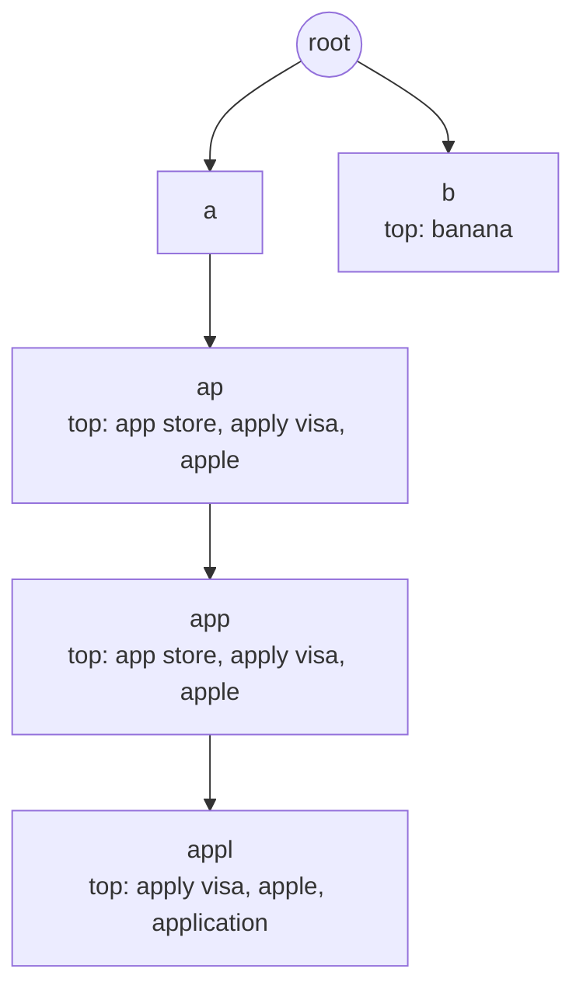
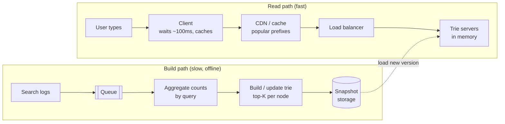

## Why this matters in an interview

Autocomplete ("typeahead") is a favourite because it puts a **data structure you know from DSA (a trie)**
at the centre of a system. The interesting part is not the trie. It is making the answer
**fast** (a few milliseconds per keystroke) and keeping the suggestions **fresh** without
slowing it down. It is mock prompt 4 on the [cheat sheet](../21-cheat-sheet-and-mock-questions).

## Step 1: Requirements

**Functional**
- As the user types a **prefix**, return the **top 5 suggested queries** that start with it.
- Suggestions are ranked by **popularity** (how often people search for them).
- Support updates as new queries become popular.

**Non-functional**
- **Very low latency**: the user is still typing, so aim for well under 100 ms end to end.
- **Highly available**: if it is slow or down, search should still work.
- **Eventually fresh**: suggestions may be minutes or hours behind.

**Out of scope:** spelling correction, personalisation, multiple languages, and showing results for the query itself.

## Step 2: Estimates

Assumptions: 10 million daily users, 10 searches each, and about 5 typeahead requests per search (the client waits briefly before sending, so not every keystroke makes a call).

| Quantity | Calculation | Result |
|---|---|---|
| Typeahead requests per day | 10M × 10 × 5 | 500 million |
| Average rate | 500M ÷ 86,400 | about **5,800 / s** |
| Peak | × 2 | about **12,000 / s** |

**Conclusions:** it is **read-only at serving time** (updates are rare and batched), and the **same
short prefixes** are requested constantly. That points to an in-memory structure plus heavy caching.

## Step 3: API

```text
GET /v1/suggest?q=app&limit=5
    -> 200 { "suggestions": ["app store", "apply visa", "apple", ...] }
```

## Step 4: The data structure: a trie with top-K at each node

A **trie** stores strings by their characters, so all strings sharing a prefix share a path from the root.

The naive approach finds the prefix node, then searches **every query under it** and sorts by count. For the prefix `a` that is millions of queries: far too slow.

**The fix:** at **every node, precompute and store the top K suggestions** for that prefix. Then a lookup is just "walk down the prefix, return the stored list": **O(length of prefix)**, independent of how many queries exist.



The cost moves to **build time** and **memory**: each node holds up to K entries.

### Working code (C++17)

```cpp
class AutoComplete {
    struct Node {
        unordered_map<char, unique_ptr<Node>> next;
        vector<pair<int, string>> top;  // (count, query), best first, at most K
    };
    Node root;
    int K;

    static bool better(const pair<int, string>& a, const pair<int, string>& b) {
        if (a.first != b.first) return a.first > b.first;
        return a.second < b.second;
    }

public:
    AutoComplete(int K) : K(K) {}

    // each distinct query is inserted once, with its total count
    void add(const string& q, int count) {
        Node* cur = &root;
        for (char c : q) {
            auto& child = cur->next[c];
            if (!child) child = make_unique<Node>();
            cur = child.get();
            cur->top.push_back({count, q});
            sort(cur->top.begin(), cur->top.end(), better);
            if ((int)cur->top.size() > K) cur->top.pop_back();
        }
    }

    vector<string> suggest(const string& prefix) const {
        const Node* cur = &root;
        for (char c : prefix) {
            auto it = cur->next.find(c);
            if (it == cur->next.end()) return {};
            cur = it->second.get();
        }
        vector<string> out;
        for (auto& p : cur->top) out.push_back(p.second);
        return out;
    }
};
```

I ran this with K = 3 and the queries `apple` (50), `app store` (90), `application` (30), `apply visa` (70), `banana` (40):

```text
suggest(app):  [app store] [apply visa] [apple]
suggest(appl): [apply visa] [apple] [application]
suggest(b):    [banana]
suggest(z):    (nothing)
```

For `app`, `application` (30) is dropped because it is the 4th best. For `appl`, `app store` no longer matches, so `application` makes the list.

- **`suggest`:** O(L) time for a prefix of length L, plus O(K) to copy the answer.
- **`add`:** O(L · K log K) per query. Fine, because it runs offline in bulk.
- **Space:** O(total characters × K) in the worst case. Compress long single-child chains and share strings in production.

## Step 5: High-level design

Two separate paths: a **fast read path** and a **slow build path**.



### The build path

1. Every search is written to a **log** (through a queue, chapter 08).
2. A periodic job **aggregates counts per query** (for example per hour or per day). It can weight recent searches higher so **trending** queries rise.
3. A builder creates the trie with **top-K per node** and saves a **snapshot**.
4. Serving machines **load the new snapshot** and swap it in atomically (build a new trie, then switch a pointer), so reads never see a half-built structure.

Real-time freshness is a bonus: a small, separate **recent-trends** structure can be merged into the answers, while the large trie rebuilds on a slower schedule.

### The read path

- **Client-side:** wait a short moment after the last keystroke before sending (**debouncing**), skip the call for very short or empty input, and **cache** results already fetched for a prefix.
- **CDN / cache:** the most common prefixes (`a`, `fa`, `wea`) are the same for everyone. Cache them with a **short TTL** (chapter 06). Most requests never reach a trie server.
- **Trie servers:** hold the trie **in memory** and answer a prefix in microseconds.

### Scaling the trie

One machine may not hold every query. **Shard by prefix**: for example one group of servers for queries starting `a` to `c`, another for `d` to `f`.
Plain alphabet ranges are **uneven** (many queries start with `s` and few with `x`), so split by **measured load**, not by letter count, and keep a small routing table. Each shard is **replicated** for availability and read throughput.

### Filtering

Remove blocked, offensive or private terms at **build time** and again at serving time. Keep a blocklist that can be updated quickly.

## Step 6: Bottlenecks and trade-offs

| Weak point | Mitigation |
|---|---|
| Trie too big for memory | Shard by prefix, store top-K only, compress chains, drop very rare queries |
| Stale suggestions | More frequent rebuilds, merge a small real-time trends layer |
| Hot prefixes | Cache at the CDN and client, replicate hot shards |
| Rebuild disrupts serving | Build offline, swap the whole structure atomically |
| Unbalanced shards | Split by measured traffic, rebalance when needed |
| Offensive suggestions | Blocklist at build and serve time |
| Latency spikes | Short timeouts. If suggestions are slow, search still works without them |

## Trade-offs

| Decision | Choice here | Why |
|---|---|---|
| Top-K stored at each node | Yes | Lookup is O(prefix length), not a search through all queries |
| Updates | Offline batch + small real-time layer | The big trie is read-only while serving |
| Freshness | Minutes to hours | Autocomplete tolerates slight staleness |
| Caching | Client, CDN, then trie servers | Short prefixes repeat enormously |
| Sharding | By prefix, balanced by load | Keeps related queries together |

## Interview angle

- Say "trie, with the **top K stored at every node**" within the first minutes. It is the point of the question.
- Split the answer into **read path** and **build path**. It makes the freshness trade-off obvious.
- Mention **debouncing and caching**, because most requests should never reach a server.
- Common follow-ups: How do you update it? How do you handle trending searches? How do you shard it? What about typos? How do you filter inappropriate suggestions?

## Check yourself

1. Why store the top K at each trie node instead of searching below the prefix?
2. What is the time to answer `suggest("app")` with that design?
3. Why is the trie rebuilt offline and swapped, not updated live for every search?
4. Why shard by measured load, not by letters of the alphabet?
5. Name two ways to avoid hitting the trie servers at all.
6. How would you show trending queries sooner than the next full rebuild?



1. Searching everything below a short prefix touches millions of queries. A precomputed list makes the lookup a simple walk.
2. O(L) to walk the 3 characters, plus O(K) to return the list, regardless of how many queries exist.
3. Updating every node's top-K on each search would be heavy and would lock a structure that is read thousands of times per second. A new version built offline and swapped atomically keeps reads fast and consistent.
4. Letters have very uneven traffic (many more queries start with some letters than others), so letter ranges would leave some shards overloaded.
5. Client-side caching and debouncing, and a CDN or cache layer for popular prefixes.
6. Keep a small recent-trends structure, updated frequently from a stream of searches, and merge its entries into the answers alongside the big trie.



## Remember

- A **trie with the top-K suggestions precomputed at every node**: lookup is O(prefix length).
- Two paths: **read** (client debounce → CDN → in-memory trie servers) and **build** (logs → queue → aggregate → build → snapshot → swap).
- Shard by prefix balanced by **load**, replicate shards.
- Accept **eventual freshness**, add a small real-time layer for trends.
- Cache hard: short prefixes repeat constantly. Filter bad terms at build and serve time.


**Further reading:** the caching and asynchronism sections of the
[System Design Primer](https://github.com/donnemartin/system-design-primer). A trie is also a standard DSA topic, so practise implementing it from scratch.

