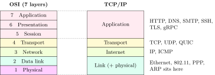
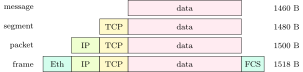
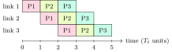

<div class="nb nb-remark" id="remark-1-0-1">

<strong>Remark 1.0.1</strong> (How to read this book) — Every number in a worked example (a delay, a CRC, a subnet, a window, a congestion trace, an RSA key) was printed by a program in the book’s `code/` folder, and the grey box under it is that program’s real output. The Python scripts ran on Python 3.11; the C programs were compiled with `gcc -std=c11 -Wall -Wextra` (gcc 13.3, Linux x86-64). The socket demonstrations ran on the loopback interface of that machine, so they show real kernel behaviour, not a drawing of it. Facts that no program can check (port numbers, header sizes, timer defaults, status codes) were checked against the RFC that defines them; where a value is only a common default, the text says “typically”.

<strong>Sources.</strong> The material follows the standard textbooks: A. S. Tanenbaum and D. J. Wetherall, <em>Computer Networks</em> (5th ed.), and B. A. Forouzan, <em>Data Communications and Networking</em> (5th ed.), with the top-down treatment of TCP and routing familiar from Kurose and Ross. The topic list was compared against the GO Classes computer-networks lecture series (lectures by Sachin Mittal), which is built on the same two textbooks; the text, examples and figures here are new. Protocol details are from the RFCs named where they are used (RFC 791 for IPv4, RFC 9293 for TCP, RFC 6298 for the retransmission timer, RFC 5681 for congestion control, RFC 1034/1035 for DNS, RFC 9110 for HTTP, RFC 8446 for TLS 1.3, and others).

</div>

## 1.1 Why layers, and which layer does what {#sec-cn-layers}

<div class="nb-proto">

<em><span>Prototypical example for this section:</span> a browser on hostel Wi-Fi fetching a page: HTTP inside TCP inside IP inside an 802.11 frame, each wrapper read and removed by its counterpart at the other end.</em>

</div>

### 1.1.i The idea {#s1-1-i}

A network has to solve many unrelated problems at once: turning bits into voltages or light, getting a frame across one cable without corruption, finding a path across hundreds of routers, recovering lost data, and meaning something to an application. Layering splits these into a stack. Each layer offers a <strong>service</strong> to the layer above through an <strong>interface</strong>, and talks to its <strong>peer</strong> layer on the other machine through a <strong>protocol</strong>: a set of message formats and rules. Layer $n$ on the sender adds a <strong>header</strong> (sometimes also a trailer) to whatever layer $n+1$ handed it; layer $n$ on the receiver reads and strips exactly that header. This wrapping is <strong>encapsulation</strong>.

The payoff is replaceability. TCP does not care whether the bits travel over Ethernet, Wi-Fi or 5G; Ethernet does not care whether it carries IPv4 or IPv6. Each layer can be changed without touching the others, as long as the service it offers stays the same. The price is overhead (each header costs bytes and processing) and the occasional information hiding that hurts: TCP cannot tell a loss caused by congestion from a loss caused by a noisy radio link, because the layer that knows is two floors down.

### 1.1.ii The OSI model and the TCP/IP model {#s1-1-ii}

<figure class="nb-fig"></figure>

| \# | Layer | Job | PDU | Address |
|:-:|:--|:--|:--|:--|
| 7 | Application | what the bytes mean to the program | message | URL, e-mail name |
| 6 | Presentation | encoding, compression, encryption |  |  |
| 5 | Session | dialogues, checkpoints, resumption |  |  |
| 4 | Transport | process to process: ports, reliability, flow and congestion control | segment (TCP), datagram (UDP) | port |
| 3 | Network | host to host across many links: addressing, routing, forwarding | packet (datagram) | IP address |
| 2 | Data link | node to node over one link: framing, error detection, MAC | <strong>frame</strong> | MAC address |
| 1 | Physical | bits as signals on a medium | bit, symbol | none |

<div class="nb-caption" id="table-1-1">

<strong>Table 1.1.</strong> The seven OSI layers. The PDU column is the one OA questions test.

</div>

<div class="nb nb-definition" id="definition-1-1-1">

<strong>Definition 1.1.1</strong>. A <strong>protocol data unit</strong> (PDU) is the unit a layer exchanges with its peer: header plus the payload handed down from above. By convention the transport PDU is a <strong>segment</strong> (a <strong>datagram</strong> for UDP), the network PDU is a <strong>packet</strong> (IP calls it a datagram), the data-link PDU is a <strong>frame</strong>, and the physical layer moves <strong>bits</strong>.

</div>

<div class="nb nb-remark" id="remark-1-1-2">

<strong>Remark 1.1.2</strong> (“Frames are used in which layer?”) — The data link layer (layer 2). The physical layer below it has no notion of where a frame begins: it sends bits (or symbols). Framing, that is, marking the start and end of a unit and adding a checksum to it, is the first job of layer 2 ([Section 3.1](../03-errors/#sec-cn-framing)). “Packet” is layer 3, “segment” layer 4. A distractor such as “physical and data link” is wrong: bits are not frames.

</div>

<div class="nb nb-remark" id="remark-1-1-3">

<strong>Remark 1.1.3</strong> (Where did layers 5 and 6 go?) — The Internet never implemented them as separate layers. Session ideas (resuming, checkpoints) and presentation ideas (character encoding, compression, encryption) live inside applications and libraries. TLS is the usual exam puzzle: it encrypts like a presentation layer and manages sessions, yet runs as a library between the application and TCP. The honest answer is “between 4 and 7; the OSI boxes do not fit it”.

</div>

### 1.1.iii Encapsulation with real bytes {#s1-1-iii}

The program `overhead.py` builds a real TCP header, IPv4 header and Ethernet frame (with its CRC-32 FCS) around an application payload and counts the bytes each layer adds. On the wire every Ethernet frame is also preceded by an 8-byte preamble and start-frame delimiter and followed by a 12-byte idle gap.

<figure class="nb-fig"></figure>

```text {filename="Output of overhead.py"}
application data :  1460 bytes
TCP segment      :  1480 bytes (+20 TCP header)
IP packet        :  1500 bytes (+20 IPv4 header)
Ethernet frame   :  1518 bytes (+14 header, +4 FCS)
time on the wire :  1538 byte times (+8 preamble/SFD, +12 gap)
efficiency       : 94.93%

application data :     1 bytes
TCP segment      :    21 bytes (+20 TCP header)
IP packet        :    41 bytes (+20 IPv4 header)
Ethernet frame   :    64 bytes (+14 header, +4 FCS, +5 padding)
time on the wire :    84 byte times (+8 preamble/SFD, +12 gap)
efficiency       : 1.19%
```

The full-size frame is about $95\%$ useful. The one-byte payload (a keystroke in an interactive session) is padded up to the 64-byte Ethernet minimum and is about $1\%$ useful: this is the waste that Nagle’s algorithm ([Section 9.3](../09-transport/#sec-cn-tcp-flow)) exists to reduce.

<div class="nb nb-definition" id="fact-1-1-4">

<strong>Fact 1.1.4</strong> (Which device lives at which layer). A <strong>repeater</strong> or <strong>hub</strong> works at layer 1: it regenerates bits on every port and understands nothing. A <strong>bridge</strong> or <strong>switch</strong> works at layer 2: it reads MAC addresses and forwards frames only where they need to go. A <strong>router</strong> works at layer 3: it reads IP addresses and forwards packets between networks. Firewalls, NAT boxes and load balancers reach into layers 4 to 7. A device must implement every layer up to the one it works at: a router has a physical and a data link layer on each interface.

</div>

### 1.1.iv Connection-oriented and connectionless service {#s1-1-iv}

A <strong>connection-oriented</strong> service sets up state first (TCP’s handshake, a telephone call, an ATM or MPLS virtual circuit), then sends, then tears down. A <strong>connectionless</strong> service sends each unit independently with the full destination address on it (IP, UDP, Ethernet). Reliability is a separate axis: TCP is connection-oriented and reliable; IP is connectionless and unreliable (“best effort”); UDP is connectionless and unreliable. The Internet’s design puts reliability in the end hosts and keeps the core simple, which is the <strong>end-to-end argument</strong>: a function that can only be done correctly with the help of the endpoints should be done there, and the network should not pay for it on every hop.

<div class="nb nb-moral">

Layer 1 moves bits, layer 2 moves frames over one link, layer 3 moves packets across many links, layer 4 moves segments between processes. Each layer talks only to its peer, through its own header.

</div>

## 1.2 Topologies and what one failure does {#sec-cn-topology}

<div class="nb-proto">

<em><span>Prototypical example for this section:</span> a token ring of six stations in which one station’s interface dies.</em>

</div>

<figure class="nb-fig"></figure>

The <strong>physical topology</strong> is how the cables run; the <strong>logical topology</strong> is how signals flow. Old 10BASE5 Ethernet was a physical bus; 10BASE-T Ethernet is a physical star around a hub but still a logical bus (every station hears every frame); IBM Token Ring was usually wired as a physical star to a wiring concentrator but was a logical ring.

`topology.py` models each topology with six stations as a directed graph, kills one element, and counts the ordered pairs of surviving stations that can still reach one another:

```text {filename="Output of topology.py"}
ordered pairs of surviving stations that can still reach each other
topology             links station 0 dies                   other failure
bus                      5          20/20  cable cut between 2 and 3: 12/30
star                     6          20/20                  hub dies: 0/30
ring, one direction      6          10/20             link 2-3 cut: 15/30
dual ring (wrapped)      6          20/20             link 2-3 cut: 30/30
full mesh               15          20/20             link 2-3 cut: 30/30
two stations (0 and 3) die on the dual ring: 4/12
full mesh of n stations needs n(n-1)/2 links: n=6 -> 15, n=50 -> 1225
```

<div class="nb nb-definition" id="fact-1-2-1">

<strong>Fact 1.2.1</strong> (The ring-failure question). In a simple (single, one-way) ring every frame passes through every station, and each station actively repeats it. If one station or link fails, the ring is broken. The graph count above says half of the remaining pairs could still reach each other; the <em>protocol</em> is worse off than that. A token ring needs the whole loop: the token must circulate, and a sender removes its own frame when it comes back round. So in practice <strong>one failure stops the entire ring</strong> until it is repaired or bypassed. The two fixes are a <strong>dual counter-rotating ring</strong> (FDDI): the stations next to the fault loop the primary ring back onto the secondary one (“wrap”) and everyone stays connected; and a wiring concentrator (MAU) whose relays bypass a dead station’s port.

</div>

| Topology | Links ($n$ nodes) | One station fails | Weak point |
|:--|:-:|:--|:--|
| Bus | 1 shared cable | others unaffected | a cable cut or missing terminator kills the segment (reflections) |
| Star | $n$ | others unaffected | the hub or switch: single point of failure |
| Ring (single) | $n$ | whole ring stops | every station and link |
| Dual ring | $2n$ fibres | ring wraps, all survivors connected | two failures partition it |
| Full mesh | $n(n-1)/2$ | others unaffected | cost: $n=50$ needs $1225$ links |

<div class="nb-caption" id="table-1-2">

<strong>Table 1.2.</strong> Topologies and single failures.

</div>

<div class="nb nb-remark" id="remark-1-2-2">

<strong>Remark 1.2.2</strong> — On the bus, the graph model says a cable cut leaves two working halves. A real coaxial bus does worse: the cut end is unterminated, signals reflect from it, and the whole segment sees garbage. The script’s last line shows the limit of the dual ring: two dead stations split it into two islands.

</div>

<div class="nb nb-moral">

Star: the centre is the single point of failure. Ring: every node is, unless the ring is doubled. Mesh: nothing is, at quadratic cost.

</div>

## 1.3 Delay, throughput and the bandwidth–delay product {#sec-cn-delay}

<div class="nb-proto">

<em><span>Prototypical example for this section:</span> a 1500-byte packet sent over a 10 Mbps link to a router 2000 km away.</em>

</div>

### 1.3.i The four delays {#s1-3-i}

<div class="nb nb-definition" id="definition-1-3-1">

<strong>Definition 1.3.1</strong>. For a packet of $L$ bits on a link of rate $R$ bit/s and length $d$, with signal speed $v$:

- <strong>transmission delay</strong> $T_t = L/R$: the time to push all $L$ bits onto the link. It depends on the packet size and the link rate, not on distance;
- <strong>propagation delay</strong> $T_p = d/v$: the time for one bit to travel the link ($v \approx 2\times 10^8$ m/s in copper and fibre, $3\times10^8$ m/s in vacuum). It depends on distance, not on size;
- <strong>queuing delay</strong>: time waiting in the output buffer behind other packets;
- <strong>processing delay</strong>: time to examine the header, check it and look up the output port (microseconds in a router).

The <strong>nodal delay</strong> at one hop is the sum of the four. The ratio $a = T_p/T_t$ is the length of the link measured in packets; it decides the efficiency of every protocol in Chapters [4](../04-arq/) and [5](../05-mac-lan/).

</div>

<div class="nb nb-example nb-block" id="example-1-3-2">

<strong>Example 1.3.2</strong> (One packet, one link)

$L = 1500$ bytes, $R = 10$ Mbps, $d = 2000$ km, $v = 2\times10^8$ m/s.

```text {filename="Output of delays.py, lines 1–3"}
A. One packet over one link
   Tt = L/R = 1.200 ms;  Tp = d/v = 10.000 ms;  Tt + Tp = 11.200 ms
   a = Tp/Tt = 8.333;  bits in flight R*Tp = 100000
```

The last bit reaches the router $T_t + T_p$ after the first bit left. The link holds $R\,T_p = 10^5$ bits at any instant, more than eight packets’ worth: this is what $a=8.33$ means.

</div>

<div class="nb nb-remark" id="remark-1-3-3">

<strong>Remark 1.3.3</strong> (Unit traps) — Link rates are decimal: $1$ Mbps $=10^6$ bit/s, $1$ Gbps $=10^9$ bit/s. Memory and file sizes are often binary ($1$ KB $=1024$ bytes in many questions). Read which convention the question uses, and say which one you assumed. Bytes times eight: the most common OA error is dividing bytes by a rate in bits per second.

</div>

### 1.3.ii Store-and-forward over several hops {#s1-3-ii}

A router receives a whole packet before it starts sending it on (<strong>store-and-forward</strong>), because it must check the frame’s CRC and read the header first. A packet therefore pays its transmission delay once per link, but consecutive packets overlap in time: while packet $2$ is crossing link $1$, packet $1$ is crossing link $2$. This is the pipelining that makes packet switching faster than <strong>message switching</strong>, where the whole message is one unit.

<figure class="nb-fig"></figure>

<div class="nb nb-theorem nb-block" id="theorem-1-3-4">

<strong>Theorem 1.3.4</strong> (Store-and-forward time)

Sending $P$ packets of $L$ bits each over $N$ links of rate $R$ in a row (ignoring queuing and processing) takes

$$
T = (N + P - 1)\,\frac{L}{R} + N\,T_p .
$$

</div>

<div class="nb nb-proof">

<em>Proof.</em> The first packet needs $N$ transmission times plus $N$ propagation delays to arrive. Each later packet leaves the source one transmission time after the previous one and is never held up (all links have the same rate), so it arrives one $L/R$ after its predecessor: $P-1$ more transmission times.

</div>

<div class="nb nb-example nb-block" id="example-1-3-5">

<strong>Example 1.3.5</strong> (Message vs packet switching)

A $1$ MB ($8\times10^6$-bit) message crosses $3$ links of $1$ Mbps; propagation is ignored.

```text {filename="Output of delays.py, lines 4–8"}
B. Store-and-forward: P packets of L bits over N equal links (N-1 routers)
   message switching, M = 1 MB as one unit : 24.000 s
   packet switching,   10 packets of  800000 b : 9.600 s
   packet switching,  100 packets of   80000 b : 8.160 s
   packet switching, 1000 packets of    8000 b : 8.016 s
```

Splitting the message makes the transfer approach $M/R = 8$ s, the time of a single link. Without headers, smaller is always better. With a header of $h$ bits on every packet, tiny packets waste time on headers and there is an optimum:

```text {filename="Output of delays.py, lines 9–15"}
C. Same, but every packet carries an h = 400-bit header
      10 packets: 9.6048 s
     100 packets: 8.2008 s
     200 packets: 8.1608 s  <- optimum
    1000 packets: 8.4168 s
   10000 packets: 12.0024 s
   continuous optimum: payload = sqrt(M*h/(N-1)) = 40000 bits
```

Minimising $(N+P-1)(M/P + h)$ over $P$ gives $P = \sqrt{(N-1)M/h}$, here $200$ packets, and payload $\sqrt{Mh/(N-1)} = 40{,}000$ bits; the search over integers agrees.

</div>

### 1.3.iii Bandwidth–delay product and window-limited throughput {#s1-3-iii}

<div class="nb nb-definition" id="definition-1-3-6">

<strong>Definition 1.3.6</strong>. The <strong>bandwidth–delay product</strong> $R \times \mathrm{RTT}$ is the number of bits that must be sent and not yet acknowledged to keep a link busy for a whole round trip. A sender allowed only $W$ bytes in flight gets throughput at most $W/\mathrm{RTT}$, whatever the link rate.

</div>

```text {filename="Output of delays.py, lines 16–20"}
D. Bandwidth-delay product
   R =   1000 Mbps, RTT = 100 ms: R*RTT =  12.5000 MB in flight
   R =    100 Mbps, RTT =  30 ms: R*RTT =   0.3750 MB in flight
   R =     10 Mbps, RTT = 540 ms: R*RTT =   0.6750 MB in flight
   a 65535-byte window over RTT 100 ms gives at most 5.243 Mbps, whatever R is
```

The 16-bit TCP window field allows $65{,}535$ bytes, which caps a $100$ ms path at about $5.2$ Mbps even on a gigabit link. That is why TCP has a window-scale option ([Section 9.2](../09-transport/#sec-cn-tcp-header)). The $540$ ms row is a typical geostationary satellite round trip.

### 1.3.iv Queuing delay and traffic intensity {#s1-3-iv}

With packets of $L$ bits arriving at average rate $\lambda$ per second on a link of rate $R$, the <strong>traffic intensity</strong> is $\lambda L/R$. If it exceeds $1$ the queue grows without bound; as it approaches $1$ the delay explodes. The textbook M/M/1 queue (Poisson arrivals, exponential packet sizes) makes this concrete: the mean time in the system is $1/(\mu-\lambda)$ with $\mu = R/L$.

```text {filename="Output of delays.py, lines 21–26"}
E. Queuing: average delay of an M/M/1 queue, packets of 1000 bytes on 10 Mbps
   load 0.50: time in system 1/(mu-lambda) = 1.600 ms
   load 0.80: time in system 1/(mu-lambda) = 4.000 ms
   load 0.90: time in system 1/(mu-lambda) = 8.000 ms
   load 0.95: time in system 1/(mu-lambda) = 16.000 ms
   load 0.99: time in system 1/(mu-lambda) = 80.000 ms
```

Going from $90\%$ to $99\%$ load multiplies the delay by ten. Network engineers therefore keep links well below full load, and a router’s finite buffer turns overload into <strong>packet loss</strong>.

<div class="nb nb-example nb-block" id="example-1-3-7">

<strong>Example 1.3.7</strong> (Does the second packet queue?)

Exam questions build queuing delay by hand: a fast link feeds a router whose outgoing link is slower. Track, for each packet, when its last bit reaches the router and when the output link becomes free; the packet waits for the difference if it is positive.

```text {filename="Output of delays.py, lines 33–37"}
H. Does a packet queue at the router? 3 packets of 1000 B, A->R at 10 Mbps,
   R->B at 2 Mbps, Tp = 1 ms per link; A sends them back to back
   P1: at R 1.800 ms, sent 1.800 ms, waits 0.000 ms, at B 6.800 ms
   P2: at R 2.600 ms, sent 5.800 ms, waits 3.200 ms, at B 10.800 ms
   P3: at R 3.400 ms, sent 9.800 ms, waits 6.400 ms, at B 14.800 ms
```

Packet $k$ reaches the router every $0.8$ ms but needs $4$ ms to leave, so each one waits $3.2$ ms longer than the previous one. The last packet reaches B at $14.8$ ms: one $0.8$ ms hop for the first packet, three $4$ ms transmissions on the slow link, two propagation delays. Only the bottleneck’s transmissions add up; the fast link’s are hidden behind them.

</div>

### 1.3.v Throughput {#s1-3-v}

End-to-end throughput is limited by the slowest link on the path, the <strong>bottleneck</strong>, and by how that link is shared:

```text {filename="Output of delays.py, lines 27–29"}
F. Throughput is set by the bottleneck
   server 2 Mbps, client 1 Mbps: 1 Mbps; a 32 Mb file takes 32 s
   10 flows share a 5 Mbps core link: each gets min(2, 1, 5/10) = 0.5 Mbps
```

### 1.3.vi Circuit switching vs packet switching {#s1-3-vi}

<strong>Circuit switching</strong> (the old telephone network) reserves a fixed share of every link on the path for the whole call: guaranteed rate and constant delay, but the reservation is wasted while the user is silent, and setup costs a round trip. <strong>Packet switching</strong> shares links on demand (<strong>statistical multiplexing</strong>): no setup and no idle reservation, but variable queuing delay and possible loss. The classic numerical shows why the Internet chose packets:

```text {filename="Output of delays.py, lines 30–32"}
G. 1 Mbps link; each user sends 100 kbps when active, active 10% of the time
   circuit switching: 10 users
   packet switching, 35 users: P(more than 10 active) = 0.000424
```

With circuits the link supports $10$ users; with packets it supports $35$, and the chance that more than $10$ of them are active at once (so that the link is overloaded) is about $0.04\%$. For bursty traffic packet switching wins; for constant-rate traffic such as a phone call, reservation is attractive, which is why <strong>virtual circuits</strong> (ATM, MPLS, and in spirit QoS reservations) exist: a setup phase fixes a path and per-hop labels, then packets follow it without carrying full addresses.

<div class="nb nb-moral">

$T_t = L/R$ depends on size, $T_p = d/v$ on distance. Store-and-forward pays $L/R$ once per hop but pipelines packets: $(N+P-1)L/R$. A window of $W$ caps throughput at $W/\mathrm{RTT}$.

</div>
