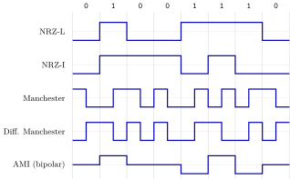
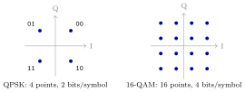

The physical layer turns bits into something a wire, a fibre or the air can carry, and back. Interviews rarely go deep here; GATE-style papers and some OAs ask four kinds of numericals: Nyquist and Shannon capacity, decibels, baud versus bit rate, and multiplexing arithmetic. They also ask what a waveform for a given line code looks like.

## 2.1 Bandwidth, baud and capacity {#sec-cn-capacity}

<div class="nb-proto">

<em><span>Prototypical example for this section:</span> a $1$ MHz channel with a signal-to-noise ratio of $63$: at most $6$ Mbps, and $4$ signal levels to run it at $4$ Mbps.</em>

</div>

### 2.1.i Signals, bandwidth and decibels {#s2-1-i}

Any signal can be written as a sum of sine waves (Fourier). A channel passes some range of frequencies and attenuates the rest; the width of that range in hertz is the channel’s <strong>bandwidth</strong> $B$. A sharp digital pulse needs many harmonics, so a channel of limited bandwidth rounds pulses off, and if pulses are sent too fast they smear into one another (<strong>intersymbol interference</strong>). Two words get confused constantly:

<div class="nb nb-definition" id="definition-2-1-1">

<strong>Definition 2.1.1</strong>. The <strong>baud rate</strong> (signal rate) is the number of <strong>symbols</strong> (signal elements) per second. If each symbol takes one of $M$ distinguishable values (levels, phases or amplitude–phase points), it carries $\log_2 M$ bits, and the <strong>bit rate</strong> is $\text{baud} \times \log_2 M$. “Bandwidth” in hertz is a property of the channel; “bandwidth” in bit/s, as networking people use it, is a data rate.

</div>

Power ratios span many orders of magnitude, so they are quoted in <strong>decibels</strong>: $\mathrm{SNR_{dB}} = 10\log_{10}(S/N)$. Every $10$ dB is a factor of ten; $3$ dB is a factor of two.

```text {filename="Output of capacity.py, lines 1–8"}
A. Decibels: SNR_dB = 10 log10(S/N)
   S/N =     1  ->    0.00 dB
   S/N =     2  ->    3.01 dB
   S/N =    10  ->   10.00 dB
   S/N =   100  ->   20.00 dB
   S/N =  1000  ->   30.00 dB
   S/N =  3162  ->   35.00 dB
   36 dB -> S/N = 3981.1;   a 3 dB loss halves the power: 0.501
```

### 2.1.ii Nyquist: the noiseless limit {#s2-1-ii}

<div class="nb nb-theorem nb-block" id="theorem-2-1-2">

<strong>Theorem 2.1.2</strong> (Nyquist, 1924)

A noiseless channel of bandwidth $B$ can carry at most $2B$ symbols per second. With $L$ signal levels its maximum bit rate is

$$
C = 2B\log_2 L \ \text{bit/s}.
$$

</div>

Nyquist says more levels mean more bits, without limit. That is only true without noise: the levels get closer together, and noise makes neighbouring levels indistinguishable.

```text {filename="Output of capacity.py, lines 9–14"}
B. Nyquist (noiseless): C = 2 B log2 L
   B =  3000 Hz, L =  2 levels: C =     6000 bit/s
   B =  3000 Hz, L =  4 levels: C =    12000 bit/s
   B = 20000 Hz, L =  4 levels: C =    80000 bit/s
   B = 20000 Hz, L = 16 levels: C =   160000 bit/s
   265 kbps in 20 kHz: L = 2^(265000/40000) = 98.7 -> use 128 levels, C = 280 kbps
```

The last line is the usual exam pattern: $265$ kbps through a noiseless $20$ kHz channel needs $2^{6.625} \approx 98.7$ levels; the next power of two, $128$, gives $280$ kbps.

### 2.1.iii Shannon: the noisy limit {#s2-1-iii}

<div class="nb nb-theorem nb-block" id="theorem-2-1-3">

<strong>Theorem 2.1.3</strong> (Shannon, 1948)

A channel of bandwidth $B$ with signal-to-noise ratio $S/N$ (a ratio, not decibels) has capacity

$$
C = B\log_2\!\left(1 + \frac{S}{N}\right) \ \text{bit/s},
$$

no matter how many levels or how clever the modulation. Rates below $C$ can be achieved with arbitrarily small error probability; rates above cannot.

</div>

```text {filename="Output of capacity.py, lines 15–20"}
C. Shannon (noisy): C = B log2(1 + S/N)
   B =      3 kHz, S/N =  3162.0 ( 35.00 dB): C =     34.88 kbit/s
   B =   1000 kHz, S/N =    63.0 ( 17.99 dB): C =   6000.00 kbit/s
   B =   2000 kHz, S/N =   100.0 ( 20.00 dB): C =  13316.42 kbit/s
   B =   1000 kHz, S/N =     1.0 (  0.00 dB): C =   1000.00 kbit/s
   1 MHz, S/N 63: Shannon limit 6 Mbps; pick 4 Mbps; Nyquist levels 2^(R/2B) = 4
```

An analogue telephone line ($3$ kHz, $35$ dB) tops out near $35$ kbps, which is why the last dial-up modems stalled around $33.6$ kbps upstream. At $S/N = 1$ ($0$ dB) the capacity equals the bandwidth.

<div class="nb nb-remark" id="algorithm-2-1-4">

<strong>Algorithm 2.1.4</strong> (Using both theorems together) — Shannon gives the ceiling; Nyquist tells you how many levels a chosen rate needs. For $B = 1$ MHz and $S/N = 63$: Shannon gives $6$ Mbps; choose something safely below, say $4$ Mbps; Nyquist then needs $L = 2^{4/2} = 4$ levels (last line of the output above).

</div>

<div class="nb nb-remark" id="remark-2-1-5">

<strong>Remark 2.1.5</strong> (The decibel trap) — Shannon’s formula takes the ratio. “SNR $= 30$ dB” means $S/N = 1000$, so $C = B\log_2 1001 \approx 9.97\,B$. Plugging in $30$ gives $\approx 4.95\,B$, half the answer.

</div>

<div class="nb nb-moral">

Nyquist: $2B\log_2 L$ without noise. Shannon: $B\log_2(1+S/N)$ with noise, and convert dB to a ratio first. Bit rate $=$ baud $\times \log_2 M$.

</div>

## 2.2 Line coding {#sec-cn-linecoding}

<div class="nb-proto">

<em><span>Prototypical example for this section:</span> the bits `01001110` drawn in five line codes, by a program that applies the rules.</em>

</div>

A <strong>line code</strong> maps bits to signal levels on a baseband medium. The receiver must (i) decide each bit, (ii) stay synchronised with the sender’s clock, and (iii) cope with a channel that may not pass DC. Long runs of identical levels hurt all three: the receiver’s clock drifts with no transitions to lock on to, the average level (<strong>baseline</strong>) the receiver compares against wanders, and a DC component is wasted power that transformers block. Codes are judged by <strong>self-clocking</strong> (a transition in every bit), DC balance and the signal rate they need.

<figure class="nb-fig"></figure>

```text {filename="Output of linecode.py"}
bits             0   1   0   0   1   1   1   0
NRZ-L            -- ++ -- -- ++ ++ ++ --
                 transitions: 4
NRZ-I            -- ++ ++ ++ -- ++ -- --
                 transitions: 4
Manchester       +- -+ +- +- -+ -+ -+ +-
                 transitions: 11
Diff. Manchester -+ +- +- +- -+ +- -+ -+
                 transitions: 11
AMI (bipolar)    00 ++ 00 00 -- ++ -- 00
                 transitions: 6

4B/5B data codes:
   0=11110   1=01001   2=10100   3=10101
   4=01010   5=01011   6=01110   7=01111
   8=10010   9=10011   A=10110   B=10111
   C=11010   D=11011   E=11100   F=11101
max leading zeros 1, max trailing zeros 2
longest run of 0s in any two codes back to back: 3
```

<div class="nb nb-definition" id="definition-2-2-1">

<strong>Definition 2.2.1</strong> (The schemes, with the conventions used above). Five schemes appear in exam questions:

- <strong>NRZ-L</strong> (non-return-to-zero, level): $1$ is high, $0$ is low. A run of equal bits is a flat line: no clock, DC component.
- <strong>NRZ-I</strong> (inverted): a $1$ inverts the level at the start of the bit, a $0$ leaves it. Runs of $1$s now have transitions; runs of $0$s still do not.
- <strong>Manchester</strong>: a transition in the middle of every bit; in IEEE 802.3, $0$ is high-to-low and $1$ is low-to-high. Self-clocking and DC-free, at the price of two signal elements per bit, so $10$ Mbps Ethernet runs at $20$ Mbaud.
- <strong>Differential Manchester</strong>: always a mid-bit transition (the clock); the data is in the bit boundary: a $0$ has a transition at the start, a $1$ has none (IEEE 802.5 Token Ring). It depends only on the presence of transitions, so swapping the two wires does not matter.
- <strong>AMI</strong> (bipolar): $0$ is zero volts, $1$s alternate between $+$ and $-$. DC-free, one symbol per bit, but long runs of $0$s lose the clock (fixed by scrambling such as B8ZS on T1 lines).

</div>

<div class="nb nb-remark" id="remark-2-2-2">

<strong>Remark 2.2.2</strong> (Conventions differ between books) — Some texts draw Manchester the other way round ($0$ = low-to-high, the G. E. Thomas convention) and some draw NRZ-L with $0$ high. In an exam, read the convention off the question’s figure or state yours. What never changes: Manchester and differential Manchester have a transition in the middle of every bit, and differential codes carry information in transitions rather than levels.

</div>

### 2.2.i Block coding: 4B/5B {#s2-2-i}

Manchester doubles the signal rate, which was affordable at $10$ Mbps but not at $100$. Fast Ethernet (100BASE-TX) and FDDI instead map every $4$ data bits to a $5$-bit code word chosen so that the line never sees long runs of zeros, then send the result with NRZ-I (100BASE-TX adds a three-level MLT-3 stage on copper). The overhead is $25\%$ ($125$ Mbaud for $100$ Mbps) instead of $100\%$. The program checks the property that makes it work: no code word starts with more than one $0$ or ends with more than two, so no concatenation has more than three zeros in a row, and NRZ-I turns every $1$ into a transition. Of the $32$ five-bit words, $16$ carry data and some of the rest are control symbols (idle, start and end delimiters); the others are invalid, which gives free error detection. Gigabit Ethernet over fibre uses 8B/10B, and 10 Gigabit Ethernet uses 64B/66B (about $3\%$ overhead).

| Code | Signal elements per bit | Self-clocking | DC-free | Used in |
|:--|:-:|:-:|:-:|:--|
| NRZ-L | 1 | no | no | short serial links, inside chips |
| NRZ-I | 1 | on $1$s only | no | with 4B/5B (FDDI, 100BASE-FX) |
| Manchester | 2 | yes | yes | 10 Mbps Ethernet |
| Diff. Manchester | 2 | yes | yes | 802.5 Token Ring |
| AMI | 1 | on $1$s only | yes | T1 (with B8ZS) |
| 4B/5B + NRZ-I | 1.25 | yes | no | 100 Mbps Ethernet, FDDI |

<div class="nb-caption" id="table-2-1">

<strong>Table 2.1.</strong> Line codes compared.

</div>

<div class="nb nb-moral">

Transitions carry the clock. Manchester buys a transition in every bit with double the baud rate; block codes such as 4B/5B buy enough transitions for $25\%$.

</div>

## 2.3 Modulation, media and multiplexing {#sec-cn-mux}

<div class="nb-proto">

<em><span>Prototypical example for this section:</span> a T1 line: $24$ phone calls interleaved byte by byte, $1.544$ Mbps.</em>

</div>

### 2.3.i Digital modulation {#s2-3-i}

Radio, DSL and cable modems cannot send baseband pulses; they vary a sine-wave <strong>carrier</strong>. <strong>ASK</strong> varies its amplitude, <strong>FSK</strong> its frequency, <strong>PSK</strong> its phase, and <strong>QAM</strong> amplitude and phase together. A scheme with $M$ points in its <strong>constellation</strong> sends $\log_2 M$ bits per symbol.

<figure class="nb-fig"></figure>

```text {filename="Output of capacity.py, lines 21–28"}
D. Baud (symbols/s) vs bit rate = baud * log2(M)
   NRZ      M =   2: 1 bits/symbol,   1000000 baud ->   1000000 bit/s
   QPSK     M =   4: 2 bits/symbol,      2400 baud ->      4800 bit/s
   16-QAM   M =  16: 4 bits/symbol,      2400 baud ->      9600 bit/s
   64-QAM   M =  64: 6 bits/symbol,      2400 baud ->     14400 bit/s
   256-QAM  M = 256: 8 bits/symbol,      2400 baud ->     19200 bit/s
   Manchester at 10 Mbps needs 20 Mbaud (two signal elements per bit)
   4B/5B at 100 Mbps data needs 125 Mbaud on the line
```

QPSK labels its points in Gray code (neighbours differ in one bit), so the most likely symbol error costs one bit. Denser constellations need more SNR: Wi-Fi and LTE pick the modulation per link from measured signal quality, which is why the rate drops as you walk away from the access point.

### 2.3.ii Transmission media {#s2-3-ii}

| Medium | How it works | Notes |
|:--|:--|:--|
| Twisted pair | two insulated copper wires twisted so that interference hits both equally and cancels | Cat5e/Cat6 carry gigabit Ethernet up to $100$ m |
| Coaxial cable | centre conductor inside a braided shield | cable TV and cable Internet; old 10BASE2/10BASE5 Ethernet |
| Optical fibre | light kept in a glass core by total internal reflection | multimode (thicker core, LED or VCSEL, short runs) vs single-mode (laser, tens of km); immune to electrical interference |
| Radio | unguided, omnidirectional | Wi-Fi, cellular; shared, so needs MAC |
| Microwave, satellite | directional, line of sight | geostationary satellites add about $0.25$ s one way |

<div class="nb-caption" id="table-2-2">

<strong>Table 2.2.</strong> Guided and unguided media.

</div>

Signals weaken with distance (<strong>attenuation</strong>), spread out in time (<strong>dispersion</strong>), and pick up noise and <strong>crosstalk</strong>. Repeaters regenerate digital signals; amplifiers boost analogue ones, noise included.

### 2.3.iii Multiplexing: FDM, TDM, WDM {#s2-3-iii}

<div class="nb nb-definition" id="definition-2-3-1">

<strong>Definition 2.3.1</strong>. <strong>Multiplexing</strong> shares one link among several signals. <strong>FDM</strong> gives each signal its own frequency band, separated by <strong>guard bands</strong> (radio and TV broadcasting, ADSL). <strong>TDM</strong> gives each signal its own time slot in a repeating <strong>frame</strong>; <strong>synchronous</strong> TDM gives every input a slot in every frame whether or not it has data, <strong>statistical</strong> TDM gives slots on demand and must then label them. <strong>WDM</strong> is FDM for light: several wavelengths share one fibre.

</div>

```text {filename="Output of capacity.py, lines 29–34"}
E. TDM and FDM
   T1: (24 channels x 8 bits + 1 framing bit) x 8000 frames/s = 1.544 Mbps
   T1 frame = 193 bits every 125 us
   4 sources x 250 kbps, 1 bit per slot: frame 4 bits, link 1 Mbps,
     bit slot 1.00 us, frame 4 us
   FDM: 5 channels x 100 kHz with 10 kHz guard bands: 540 kHz
```

The T1 carrier samples each voice channel $8000$ times a second (twice the $4$ kHz voice band, Nyquist’s sampling theorem) at $8$ bits per sample: $64$ kbps per call. A frame holds one sample from each of $24$ channels plus one framing bit: $193$ bits every $125~\mu$s.

### 2.3.iv CDMA {#s2-3-iv}

<strong>Code division multiple access</strong> lets every station transmit at the same time on the same frequency. Each station has a <strong>chip sequence</strong> of $\pm1$ values, and the sequences are mutually <strong>orthogonal</strong> (inner product $0$). A station sends its sequence for a $1$, its negation for a $0$, nothing when silent; the channel adds the signals. A receiver takes the inner product of what it hears with the sender’s sequence and divides by the length: every other station’s contribution vanishes.

```text {filename="Output of cdma.py"}
code A: +1 +1 +1 +1
code B: +1 -1 +1 -1
code C: +1 +1 -1 -1
code D: +1 -1 -1 +1
pairwise inner products: [0]
sent: A=1, B=0, C silent, D=1
channel (sum of chips): +1 +1 -1 +3
receiver A: channel . code / 4 = +1 -> 1
receiver B: channel . code / 4 = -1 -> 0
receiver C: channel . code / 4 = +0 -> silent
receiver D: channel . code / 4 = +1 -> 1
Walsh(8) gives 8 mutually orthogonal codes of 8 chips
```

Walsh codes (built by the doubling recursion in `cdma.py`) are the classic orthogonal family; 3G cellular systems used CDMA.

## 2.4 Switching {#sec-cn-switching}

<div class="nb-proto">

<em><span>Prototypical example for this section:</span> a phone call holds a circuit for its whole length; a web page’s packets share every link with everyone else’s.</em>

</div>

|  | Circuit switching | Datagram packet switching | Virtual circuit |
|:--|:--|:--|:--|
| Setup | yes, before data | none | yes, before data |
| Path | fixed for the call | each packet routed independently | fixed for the connection |
| Per-unit address | none (the circuit is the address) | full destination address | short label (VCI), rewritten at each hop |
| Resources | reserved, idle when silent | shared on demand | may be reserved |
| Order | in order | may arrive out of order | in order |
| Failure of a switch | calls through it drop | routes around it | connections through it drop |
| Examples | telephone network | IP | ATM, Frame Relay, MPLS |

<div class="nb-caption" id="table-2-3">

<strong>Table 2.3.</strong> Circuit, datagram and virtual-circuit switching.

</div>

<div class="nb nb-example nb-block" id="example-2-4-1">

<strong>Example 2.4.1</strong> (When does setup pay off?)

An $x$-bit message crosses $k$ hops at $b$ bit/s with $d$ seconds of propagation per hop. A circuit costs a setup time $s$, then the bits stream straight through: $s + x/b + kd$. Packets of $p$ bits pay store-and-forward once per extra hop: $x/b + (k-1)p/b + kd$ ([Section 1.3](../01-layering/#sec-cn-delay)).

```text {filename="Output of switching.py"}
x = 1e+06 bits, k = 4 hops, b = 1 Mbps, p = 1e+04 bits, d = 5 ms/hop
packet switching: x/b + (k-1)p/b + kd = 1050.0 ms
circuit, setup    10 ms: s + x/b + kd =  1030.0 ms -> circuit wins
circuit, setup    30 ms: s + x/b + kd =  1050.0 ms -> a tie
circuit, setup   200 ms: s + x/b + kd =  1220.0 ms -> packet wins
packet switching wins exactly when s > (k-1)p/b = 30 ms
```

Packet switching is faster exactly when $s > (k-1)p/b$: the setup must cost more than the store-and-forward pipeline fill.

</div>

In a virtual-circuit network the setup message installs, in each switch, a table entry “input port $i$, label $a$ $\to$ output port $o$, label $b$”. Data units carry only the short label, and each switch swaps it. Labels are local to a link, so they can be short and reused. MPLS does this inside ISP networks, under IP, to steer traffic along engineered paths.

<div class="nb nb-moral">

Circuits reserve and guarantee; datagrams share and adapt. Virtual circuits keep packets but fix the path at setup and replace addresses by per-link labels.

</div>
