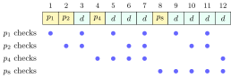

The data link layer turns the physical layer’s raw bit pipe into a sequence of <strong>frames</strong> delivered over one link. It has three jobs: <strong>framing</strong> (where does a frame start and end), <strong>error control</strong> (was it damaged, and can it be repaired), and <strong>flow control</strong> (do not drown a slow receiver). This chapter covers the first two; [Chapter 4](../04-arq/) covers the third and the retransmission protocols built on error detection.

## 3.1 Framing {#sec-cn-framing}

<div class="nb-proto">

<em><span>Prototypical example for this section:</span> a payload that happens to contain the flag byte `7E`: without stuffing, the receiver would think the frame ended in the middle.</em>

</div>

The receiver sees an endless stream of bits and must find frame boundaries. Four methods:

- <strong>Byte count</strong>: a header field gives the frame length. One corrupted count and the receiver loses sync for good: it cannot tell where the next frame starts.
- <strong>Flag bytes with byte stuffing</strong>: a special <strong>flag</strong> byte marks both ends; an <strong>escape</strong> byte protects any flag or escape byte that occurs in the data (character-oriented protocols, PPP).
- <strong>Flag bits with bit stuffing</strong>: the flag is the bit pattern `01111110`; the sender inserts a `0` after every five consecutive `1`s of data, so six `1`s in a row can only be a flag (bit-oriented protocols, HDLC).
- <strong>Physical-layer coding violations</strong>: use code words that never occur in data, such as the unused 4B/5B symbols, as start and end delimiters.

Ethernet uses the last idea in spirit: a preamble and a start-frame delimiter, then the frame, then an idle gap.

```text {filename="Output of stuffing.py"}
Byte stuffing (flag 7E, escape 7D, escaped byte XOR 20)
  payload : 41 7E 42 7D 43
  frame   : 7E 41 7D 5E 42 7D 5D 43 7E
  unstuffed equals payload: True
Bit stuffing (flag 01111110; a 0 after every five 1s)
  data    : 011111101111101111110
  stuffed : 011111010111110011111010   (3 bits added)
                  ^       ^      ^     (^ = stuffed 0)
  on wire : 01111110 011111010111110011111010 01111110
  destuffed equals data: True
  worst case, 1000 ones: 200 stuffed bits
```

<div class="nb nb-remark" id="remark-3-1-1">

<strong>Remark 3.1.1</strong> (Two classic traps) — Bit stuffing inserts the `0` after five `1`s <em>regardless of the next bit</em>: in the example, data `0111110` is sent as `01111100`, with an extra `0` even though a `0` follows anyway, because the receiver deletes a `0` after five `1`s unconditionally. And stuffing makes the frame length data-dependent: the worst case adds one bit per five ($20\%$), byte stuffing in the worst case doubles the payload.

</div>

<div class="nb nb-moral">

Stuffing makes the delimiter impossible inside the data; the receiver undoes exactly what the sender did.

</div>

## 3.2 Error detection: parity and checksums {#sec-cn-parity}

<div class="nb-proto">

<em><span>Prototypical example for this section:</span> an Internet checksum that cannot see two 16-bit words swapped.</em>

</div>

### 3.2.i Codes, redundancy and Hamming distance {#s3-2-i}

Every scheme adds $r$ redundant bits to $m$ data bits, giving an $n = m + r$ bit <strong>codeword</strong>. Only $2^m$ of the $2^n$ possible words are valid; an error is detected when it turns a valid codeword into an invalid word, and missed when it turns it into another valid codeword.

<div class="nb nb-definition" id="definition-3-2-1">

<strong>Definition 3.2.1</strong>. The <strong>Hamming distance</strong> $d(x,y)$ between two words is the number of positions in which they differ ($=$ the number of $1$s in $x \oplus y$). The <strong>minimum distance</strong> $d_{\min}$ of a code is the smallest distance between two distinct codewords.

</div>

<div class="nb nb-theorem nb-block" id="theorem-3-2-2">

<strong>Theorem 3.2.2</strong> (What a distance buys)

A code with minimum distance $d_{\min}$ detects every error pattern of up to $d_{\min}-1$ bits and corrects every pattern of up to $\lfloor (d_{\min}-1)/2 \rfloor$ bits. Equivalently: detecting $s$ errors needs $d_{\min} \ge s+1$; correcting $t$ errors needs $d_{\min} \ge 2t+1$.

</div>

<div class="nb nb-proof">

<em>Proof.</em> Fewer than $d_{\min}$ flips cannot reach another codeword, so the word received is invalid. If at most $t$ bits flip and $d_{\min} \ge 2t+1$, the received word is within $t$ of the sent codeword and at least $t+1$ from every other (triangle inequality), so “nearest codeword” decoding recovers it.

</div>

So a code with $d_{\min} = 15$ detects $14$ errors or corrects $7$, but not both at once at full strength: a decoder that corrects up to $t$ can be guaranteed to detect up to $d_{\min} - 1 - t$.

### 3.2.ii Parity {#s3-2-ii}

A single <strong>parity bit</strong> makes the number of $1$s even (or odd). Its $d_{\min}$ is $2$: it detects every odd number of flipped bits and misses every even number. In <strong>two-dimensional parity</strong> (LRC/VRC) the data is a block with a parity bit per row and per column; one error shows up as one bad row and one bad column, which locates it.

```text {filename="Output of parity.py"}
1-D even parity: data 1011001 -> codeword 10110010
  flip 1 bit(s) at [2]: 10010010 -> error detected
  flip 2 bit(s) at [2, 5]: 10010110 -> accepted (missed!)
  flip 3 bit(s) at [0, 2, 5]: 00010110 -> error detected
2-D even parity (last column and last row are parity):
  1 1 0 0 1 1 1 1
  1 0 1 1 1 0 1 1
  0 1 1 1 0 0 1 0
  0 1 0 1 0 0 1 1
  0 1 0 1 0 1 0 1
  errors [(1, 3)]: odd rows [1], cols [3]: corrected
  errors [(1, 3), (1, 5)]: odd rows [], cols [3, 5]: detected
  errors [(0, 1), (0, 4), (2, 1), (2, 4)]: odd rows [], cols []: missed!
```

A single error is corrected. Two errors in one row are detected (two bad columns) but cannot be located. Four errors at the corners of a rectangle leave every row and column even: missed. So 2-D parity detects all $1$-, $2$- and $3$-bit errors and corrects $1$-bit errors.

### 3.2.iii The Internet checksum {#s3-2-iii}

IP, ICMP, UDP and TCP use the 16-bit <strong>Internet checksum</strong> (RFC 1071): add the data as 16-bit words in <strong>one’s-complement</strong> arithmetic (a carry out of bit $15$ is added back in at bit $0$, the “end-around carry”), then complement the result. The receiver adds everything including the checksum; a correct packet sums to `FFFF`.

```text {filename="Output of checksum.py"}
sender: sum the words
   + 4500 -> 04500
   + 0073 -> 04573
   + F0C2 -> 13635  carry wraps -> 3636
   + BA10 -> 0F046
   + 8C99 -> 17CDF  carry wraps -> 7CE0
sum = 7CE0, checksum = ~sum = 831F
receiver: sum of words + checksum = FFFF (FFFF means accept)
two words swapped: sum = FFFF -> error NOT detected
bit 0 flipped up in one word, down in another: sum = FFFF -> NOT detected
one bit flipped: sum = FEFF -> detected
```

<div class="nb nb-remark" id="remark-3-2-3">

<strong>Remark 3.2.3</strong> (Why so weak, and why still used) — Addition is commutative, so reordered words are invisible, and compensating changes (one bit up in one word, the same bit down in another) cancel. A CRC catches both. The checksum survives because it is cheap in software, can be updated incrementally when a router decrements TTL, and sits on top of a link-layer CRC that catches most errors anyway. It is an end-to-end check against errors the link CRC cannot see: corruption inside a router’s memory.

</div>

<div class="nb nb-moral">

$d_{\min}$ decides everything: detect $d_{\min}-1$, correct $\lfloor(d_{\min}-1)/2\rfloor$. Parity has $d_{\min}=2$; the Internet checksum is cheap and blind to reordering.

</div>

## 3.3 Cyclic redundancy check {#sec-cn-crc}

<div class="nb-proto">

<em><span>Prototypical example for this section:</span> data `1101011111` with generator $x^4+x+1$: remainder `0010`, transmitted frame `11010111110010`.</em>

</div>

### 3.3.i The arithmetic {#s3-3-i}

Treat a bit string as a polynomial with coefficients in $\{0,1\}$: `10011` is $x^4 + x + 1$. Arithmetic is modulo $2$: addition and subtraction are both XOR, with no carries. Sender and receiver agree on a <strong>generator</strong> polynomial $G(x)$ of degree $r$.

<div class="nb nb-remark" id="algorithm-3-3-1">

<strong>Algorithm 3.3.1</strong> (Computing a CRC) — Four steps, the same at both ends:

1. Append $r$ zeros to the data $M(x)$: this is $x^r M(x)$.
2. Divide by $G(x)$ modulo 2 (long division where each step is an XOR) and keep the $r$-bit remainder $R(x)$.
3. Send $T(x) = x^r M(x) + R(x)$, the data followed by the remainder. $T(x)$ is a multiple of $G(x)$.
4. The receiver divides what it gets by $G(x)$; remainder zero means accept.

</div>

```python {filename="crc.py, lines 4–17",linenos=table,linenostart=4}
def mod2(bits, gen, trace=False):
    """Remainder of bits / gen in GF(2) arithmetic (XOR, no carries)."""
    w = list(bits)
    for i in range(len(bits) - len(gen) + 1):
        if w[i] == "1":               # leading 1: XOR the generator in
            for j, g in enumerate(gen):
                w[i + j] = "0" if w[i + j] == g else "1"
            if trace: print(f"  {' ' * (i + 9)}{gen}  -> {''.join(w)}")
    return "".join(w[-(len(gen) - 1):])

def crc(data, gen, trace=False):
    r = len(gen) - 1                  # degree of G(x)
    if trace: print(f"  dividend {data + '0' * r}  (data + {r} zeros)")
    return mod2(data + "0" * r, gen, trace)  # x^r M(x) mod G(x)
```

```text {filename="Output of crc.py"}
data 1101011111, generator 10011 (x^4 + x + 1)
  dividend 11010111110000  (data + 4 zeros)
           10011  -> 01001111110000
            10011  -> 00000011110000
                 10011  -> 00000001101000
                  10011  -> 00000000100100
                   10011  -> 00000000000010
  remainder 0010; transmitted frame 11010111110010
receiver: 11010111110010 mod G = 0000 -> accept
bit 3 flipped: 11000111110010 mod G = 0111 -> reject
CRC-32('123456789'): bit by bit CBF43926, zlib CBF43926
```

Each indented row is one subtraction of the generator under the current leading $1$; the quotient is never needed. The last line checks the bitwise CRC-32 (the reflected form used by Ethernet, with initial value and final XOR `FFFFFFFF`) against `zlib` on the standard test string: both give the standard check value `CBF43926`. In the reflected form the register shifts right and the generator constant is bit-reversed:

```python {filename="crc.py, lines 28–34",linenos=table,linenostart=28}
def crc32(msg):                       # reflected CRC-32, poly EDB88320
    c = 0xFFFFFFFF
    for byte in msg:
        c ^= byte
        for _ in range(8):
            c = (c >> 1) ^ (0xEDB88320 if c & 1 else 0)
    return c ^ 0xFFFFFFFF
```

### 3.3.ii What a CRC detects, and why {#s3-3-ii}

If $T(x)$ is sent and $T(x) + E(x)$ arrives, the receiver computes $(T(x)+E(x)) \bmod G(x) = E(x) \bmod G(x)$. The error is missed exactly when $G(x)$ divides $E(x)$. Each property below is a statement about divisibility:

<div class="nb nb-theorem nb-block" id="theorem-3-3-2">

<strong>Theorem 3.3.2</strong> (Detection properties of a CRC)

Let $G$ have degree $r$. Then:

1. If $G$ has two or more terms, every single-bit error ($E = x^i$) is detected.
2. If $G$ has a constant term and does not divide $x^k + 1$ for any $k$ shorter than the frame, every double-bit error ($E = x^i(x^k+1)$) is detected.
3. If $(x+1)$ divides $G$, every error with an odd number of flipped bits is detected (an odd number of terms means $E(1) = 1 \ne 0$).
4. If $G$ has a nonzero constant term, every burst of length $\le r$ is detected; a burst of length $r+1$ is missed with probability $1/2^{r-1}$, a longer one with probability $1/2^{r}$ (assuming random bits inside the burst).

</div>

`crc_props.py` checks these claims by brute force: it applies <em>every</em> nonzero error pattern to $16$-bit codewords ($12$ data bits, $r = 4$) for two generators and counts the misses.

```text {filename="Output of crc_props.py"}
G = x^4+x+1 (r = 4), codeword length 16
  undetected error patterns (4095 in all), by weight w:
    w2:1  w3:42  w4:133  w5:252  w6:469  w7:750  w8:835  w9:680
    w10:483  w11:294  w12:119  w13:28  w14:7  w15:2
  all odd-weight errors caught: False
  bursts of length 1:    16 patterns,   0 undetected (fraction 0.0000)
  bursts of length 2:    15 patterns,   0 undetected (fraction 0.0000)
  bursts of length 3:    28 patterns,   0 undetected (fraction 0.0000)
  bursts of length 4:    52 patterns,   0 undetected (fraction 0.0000)
  bursts of length 5:    96 patterns,  12 undetected (fraction 0.1250)
  bursts of length 6:   176 patterns,  11 undetected (fraction 0.0625)
G = (x+1)(x^3+x+1) = x^4+x^3+x^2+1 (r = 4), codeword length 16
  undetected error patterns (4095 in all), by weight w:
    w2:11  w4:233  w6:1003  w8:1595  w10:1017  w12:219  w14:17
  all odd-weight errors caught: True
  bursts of length 1:    16 patterns,   0 undetected (fraction 0.0000)
  bursts of length 2:    15 patterns,   0 undetected (fraction 0.0000)
  bursts of length 3:    28 patterns,   0 undetected (fraction 0.0000)
  bursts of length 4:    52 patterns,   0 undetected (fraction 0.0000)
  bursts of length 5:    96 patterns,  12 undetected (fraction 0.1250)
  bursts of length 6:   176 patterns,  11 undetected (fraction 0.0625)
```

Read it against the theorem. Both generators miss exactly $2^{12}-1 = 4095$ patterns: the nonzero codewords themselves, as they must. $x^4+x+1$ misses some odd-weight errors; $(x+1)(x^3+x+1)$ misses none, and every miss has even weight. Bursts up to length $4$ are always caught; length $5$ escapes in $12/96 = 1/8$ of cases and length $6$ in $11/176 = 1/16$, the predicted $2^{-(r-1)}$ and $2^{-r}$. The single weight-2 miss of $x^4+x+1$ is $x^{15}+1$: this generator divides $x^{15}+1$, so two errors exactly $15$ apart escape, which is why frame length is limited relative to the generator’s period.

<div class="nb nb-definition" id="fact-3-3-3">

<strong>Fact 3.3.3</strong> (CRCs in use). Ethernet and many others use CRC-32, $x^{32}+x^{26}+x^{23}+x^{22}+x^{16}+x^{12}+x^{11}+x^{10}+x^{8}+x^{7}+x^{5}+x^{4}+x^{2}+x+1$ (`04C11DB7`, processed bit-reversed as `EDB88320`). Hardware computes a CRC with a shift register and a few XOR gates as the bits go by, which is why the link layer uses CRCs while the software layers above use checksums.

</div>

<div class="nb nb-remark" id="remark-3-3-4">

<strong>Remark 3.3.4</strong> (Multi-select favourites) — “$G(x) = x+1$”: detects all single-bit and all odd-weight errors (it is simply even parity), misses every double-bit error. “A CRC with $r$ check bits detects all bursts of length $\le r$”: true if $G$ has a constant term. “A CRC corrects errors”: false; it only detects.

</div>

<div class="nb nb-moral">

A CRC misses $E$ exactly when $G \mid E$. Choose $G$ with a constant term (all bursts $\le r$), with a factor $(x+1)$ (all odd errors), and with a long period (all double errors).

</div>

## 3.4 Error correction: Hamming codes {#sec-cn-hamming}

<div class="nb-proto">

<em><span>Prototypical example for this section:</span> a 12-bit Hamming codeword with bit 6 flipped: the failing parity checks spell out $0110_2 = 6$.</em>

</div>

Detection plus retransmission is cheaper when errors are rare and a return channel exists. <strong>Forward error correction</strong> is used where retransmission is impossible or too slow: deep-space links, storage (ECC memory, disks, QR codes) and noisy wireless.

<div class="nb nb-theorem nb-block" id="theorem-3-4-1">

<strong>Theorem 3.4.1</strong> (How many check bits)

To correct any single-bit error in an $n = m+r$ bit codeword, the $2^r$ possible syndromes must distinguish “no error” and an error in each of the $n$ positions:

$$
2^r \ \ge \ m + r + 1.
$$

</div>

<div class="nb nb-remark" id="algorithm-3-4-2">

<strong>Algorithm 3.4.2</strong> (Hamming code construction) — Number the codeword bits from $1$. Positions that are powers of two ($1,2,4,8,\dots$) hold parity bits; the others hold data bits in order. Parity bit $p$ makes the group of positions whose index has bit $p$ set have even parity: $p_1$ covers $1,3,5,7,9,11,\dots$; $p_2$ covers $2,3,6,7,10,11,\dots$; $p_4$ covers $4$–$7$, $12$–$15, \dots$. The receiver recomputes the checks; the failing ones, read as a binary number, give the position of the error (equivalently, the XOR of the positions of all $1$ bits).

</div>

<figure class="nb-fig"></figure>

```text {filename="Output of hamming.py"}
parity bits r needed for m data bits (smallest r with 2^r >= m + r + 1):
   m=1:r=2  m=4:r=3  m=8:r=4  m=11:r=4  m=16:r=5
   m=26:r=5  m=32:r=6  m=57:r=6  m=64:r=7  m=120:r=7
data 1011: codeword 0110011 (n = 7), syndrome 0
data 10011010: codeword 011100101010 (n = 12), syndrome 0
flip bit 6: got 011101101010, syndrome 0110 = 6, corrected 011100101010
two errors (positions 2 and 6): syndrome 4 -> 'corrects' the wrong bit
Hamming(7,4): 16 codewords, minimum distance 3 -> detects 2, corrects 1
extended (8,4), overall parity added: minimum distance 4 (SECDED)
```

The $8$ data bits `10011010` need $r = 4$ ($2^4 = 16 \ge 13$), giving a $12$-bit codeword. Flipping bit $6$ makes checks $p_2$ and $p_4$ fail, syndrome $0110 = 6$. With two errors the syndrome points at an innocent bit: a plain Hamming code has $d_{\min} = 3$, so it corrects one error or detects two, but cannot tell which situation it is in. Adding one overall parity bit raises $d_{\min}$ to $4$: single-error correction, double-error detection (<strong>SECDED</strong>), the scheme used in ECC memory.

<div class="nb nb-moral">

Hamming: parity bits at powers of two, $2^r \ge m+r+1$, syndrome $=$ position of the bad bit. $d_{\min}=3$ corrects one; add overall parity for SECDED.

</div>
