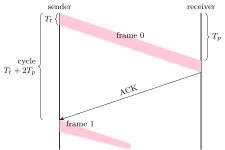
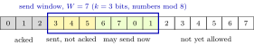
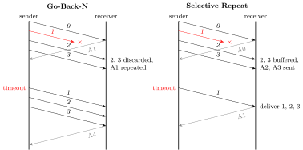

Error detection tells the receiver a frame is bad; something must then get a good copy across. <strong>Automatic repeat request</strong> (ARQ) protocols do it with acknowledgements, timers and retransmission, and the same machinery limits how fast the sender may go (<strong>flow control</strong>). These three protocols are the most numerical part of an exam on the link layer, and TCP ([Chapter 9](../09-transport/)) is a sliding-window protocol built on the same ideas.

## 4.1 Stop-and-wait {#sec-cn-sw}

<div class="nb-proto">

<em><span>Prototypical example for this section:</span> a 1000-bit frame on a 1 Mbps link with 20 ms propagation: the sender is busy 1 ms out of every 41.</em>

</div>

<figure class="nb-fig"></figure>

The sender transmits one frame and waits for its acknowledgement before sending the next. If the ACK does not come back within a <strong>timeout</strong>, it resends. Because a frame or its ACK can be lost, the receiver may get a duplicate; a one-bit <strong>sequence number</strong> ($0,1,0,1,\dots$) lets it recognise and discard the copy (and re-ACK it). The ACK carries the number of the frame expected next.

<div class="nb nb-theorem nb-block" id="theorem-4-1-1">

<strong>Theorem 4.1.1</strong> (Efficiency of stop-and-wait)

With transmission time $T_t$, propagation delay $T_p$ and $a = T_p/T_t$, ignoring the ACK’s transmission time and processing,

$$
\eta = \frac{T_t}{T_t + 2T_p} = \frac{1}{1+2a}, \qquad
	\text{throughput} = \eta \times R.
$$

If each frame is lost with probability $p$ (ACKs safe), a frame needs $1/(1-p)$ transmissions on average and $\eta = (1-p)/(1+2a)$.

</div>

```text {filename="Output of arq_eff.py, lines 1–3"}
A. R = 1 Mbps, L = 1000 bits, Tp = 20 ms: Tt = 1 ms, a = Tp/Tt = 20
   stop-and-wait: eta = 1/(1+2a) = 0.0244, throughput = 24.39 kbps
   window for 100%: W >= 1+2a = 41;  W = 7 gives eta = 0.1707
```

The link could carry $1+2a = 41$ frames per cycle and carries one. On a LAN with $a \ll 1$ stop-and-wait is fine; on any long or fast link it is hopeless.

<div class="nb nb-remark" id="remark-4-1-2">

<strong>Remark 4.1.2</strong> (What goes into the cycle) — Questions differ on whether the ACK’s own transmission time, the processing delay and the timeout count. The general cycle is $T_t + T_p + T_{\text{proc}} + T_{t,\text{ack}} + T_p$; with piggybacking the “ACK” is a full data frame going the other way, so $T_{t,\text{ack}} = T_t$. Read the question, then write the cycle out term by term before dividing.

```text {filename="Output of arq_eff.py, lines 16–17"}
D. Piggybacking and ACK size: the cycle is Tt + 2Tp + Tt_ack
   100-bit ACK: cycle 41.1 ms, stop-and-wait eta = 0.0243
```

</div>

<div class="nb nb-moral">

Stop-and-wait uses $1/(1+2a)$ of the link. Everything else in this chapter exists to fill the other $2a$ frame times.

</div>

## 4.2 Sliding windows: Go-Back-N and Selective Repeat {#sec-cn-gbn}

<div class="nb-proto">

<em><span>Prototypical example for this section:</span> every fifth transmission lost: Go-Back-N with window $3$ needs $18$ transmissions to deliver $10$ frames; Selective Repeat needs $12$.</em>

</div>

### 4.2.i Pipelining {#s4-2-i}

Let the sender have up to $W$ unacknowledged frames in flight: the <strong>send window</strong>. After sending $W$ frames back to back it may need to wait; if $W \ge 1+2a$ the first ACK returns before the window is used up and the link never idles.

$$
\eta = \min \!\left(1,\ \frac{W}{1+2a}\right).
$$

Sequence numbers now need $k$ bits and wrap modulo $2^k$.

<figure class="nb-fig"></figure>

### 4.2.ii Go-Back-N {#s4-2-ii}

<div class="nb nb-definition" id="definition-4-2-1">

<strong>Definition 4.2.1</strong>. In <strong>Go-Back-N</strong> (GBN) the receiver window is $1$: the receiver accepts only the next in-order frame and discards everything else, sending a <strong>cumulative ACK</strong> (“all frames before $n$ received”). The sender keeps one timer, for the oldest unacknowledged frame; on timeout it resends that frame and <em>every</em> frame sent after it.

</div>

GBN keeps the receiver trivial (no buffer) and wastes bandwidth on errors: one lost frame costs up to a whole window of retransmissions. A cumulative ACK also hides lost ACKs: ACK $5$ confirms frames $0$–$4$ even if ACK $3$ never arrived.

### 4.2.iii Selective Repeat {#s4-2-iii}

<div class="nb nb-definition" id="definition-4-2-2">

<strong>Definition 4.2.2</strong>. In <strong>Selective Repeat</strong> (SR) the receiver buffers out-of-order frames that fall inside its window and acknowledges each frame individually; the sender keeps a timer per frame and resends only frames that time out (or are negatively acknowledged with a <strong>NAK</strong>). The receiver delivers to the layer above in order, as soon as the gap is filled.

</div>

<figure class="nb-fig"></figure>

### 4.2.iv How small must the window be? {#s4-2-iv}

<div class="nb nb-theorem nb-block" id="theorem-4-2-3">

<strong>Theorem 4.2.3</strong> (Window limits for $k$-bit sequence numbers)

Stop-and-wait needs $k=1$. Go-Back-N works if and only if $W \le 2^k - 1$. Selective Repeat works if and only if $W \le 2^{k-1}$ (sender and receiver windows equal). In general, $W_s + W_r \le 2^k$.

</div>

<div class="nb nb-proof">

<em>Why.</em> Take the worst case: the sender sends a full window, all frames arrive, all ACKs are lost. The receiver now expects the next $W_r$ numbers, while the sender times out and resends the old $W_s$ numbers. If the two sets of numbers overlap modulo $2^k$, an old duplicate is accepted as new data, and nothing can detect it. They are disjoint exactly when $W_s + W_r \le 2^k$; GBN has $W_r = 1$, SR has $W_r = W_s$.

</div>

`sr_ambiguity.py` replays exactly that worst case:

```text {filename="Output of sr_ambiguity.py"}
GBN k=2 W=3: resend [0, 1, 2], receiver window [3]
               -> safe
GBN k=2 W=4: resend [0, 1, 2, 3], receiver window [0]
               -> BROKEN, old [0] taken as new
SR  k=2 W=2: resend [0, 1], receiver window [2, 3]
               -> safe
SR  k=2 W=3: resend [0, 1, 2], receiver window [3, 0, 1]
               -> BROKEN, old [0, 1] taken as new
SR  k=3 W=4: resend [0, 1, 2, 3], receiver window [4, 5, 6, 7]
               -> safe
SR  k=3 W=5: resend [0, 1, 2, 3, 4], receiver window [5, 6, 7, 0, 1]
               -> BROKEN, old [0, 1] taken as new
```

```text {filename="Output of arq_eff.py, lines 4–11"}
   sequence bits for W = 41: GBN 6 (2^k-1 >= W), SR 7 (2^(k-1) >= W)
B. Largest windows for k sequence-number bits
   k = 1: stop-and-wait 1, GBN   1, SR   1
   k = 2: stop-and-wait 1, GBN   3, SR   2
   k = 3: stop-and-wait 1, GBN   7, SR   4
   k = 4: stop-and-wait 1, GBN  15, SR   8
   k = 5: stop-and-wait 1, GBN  31, SR  16
   k = 8: stop-and-wait 1, GBN 255, SR 128
```

For the prototype link ($a = 20$) a full pipe needs $W \ge 41$: $6$ bits for GBN ($2^6 - 1 = 63$) but $7$ for SR ($2^6 = 64$).

### 4.2.v Losses: who pays more {#s4-2-v}

`arq_sim.py` is an event-driven simulator of both protocols: one time unit per frame, ACKs return $2a = 4$ units after a frame finishes, the timeout is $6$ units, ACKs are never lost, and every fifth <em>transmission</em> is lost.

```python {filename="arq_sim.py, lines 1–6",linenos=table,linenostart=1}
# Event-driven Go-Back-N and Selective Repeat; time unit = one frame time.
# A frame sent at t ends at t+1; its ACK is back at t + 1 + rtt_extra
# (rtt_extra = 2a; ACKs never lost). Every k-th transmission is lost.
# GBN: cumulative ACKs, one timer (oldest frame), timeout resends all.
# SR: individual ACKs, a timer per frame, timeout resends that frame.
def simulate(proto, n, W, rtt_extra, timeout, every_kth):
```

```text {filename="Output of arq_sim.py"}
GBN W=3: 18 transmissions for 10 frames
   1 2 3 4 5x 6 7 5 6 7x 8 9 7 8 9x 10 9 10
GBN W=4: 26 transmissions for 10 frames
   1 2 3 4 5x 6 7 8 5 6x 7 8 9 6 7x 8 9 10 7 8x 9 10 8 9 10x 10
SR W=3: 12 transmissions for 10 frames
   1 2 3 4 5x 6 7 5 8 9x 10 9
SR W=4: 12 transmissions for 10 frames
   1 2 3 4 5x 6 7 8 5 9x 10 9
(x = lost; every 5th transmission is lost; a = 2, timeout 6 frame times)
```

With GBN each loss drags the frames sent after it back through the link, and a larger window makes it worse ($26$ transmissions with $W=4$): more frames are in flight behind each loss, and the extra traffic pushes more frames into the “every fifth” slots. SR resends only the two lost frames. The classic expectation formulas say the same thing for random loss with probability $p$ (frame errors only, $W \ge 1+2a$; the GBN form is the standard textbook approximation):

```text {filename="Output of arq_eff.py, lines 12–15"}
C. With frame loss probability p (ACKs never lost), W >= 1+2a
   p = 0.00: S&W 0.0244   GBN 1.0000   SR 1.0000   copies per frame 1.000
   p = 0.01: S&W 0.0241   GBN 0.7071   SR 0.9900   copies per frame 1.010
   p = 0.10: S&W 0.0220   GBN 0.1800   SR 0.9000   copies per frame 1.111
```

<div class="nb nb-remark" id="remark-4-2-4">

<strong>Remark 4.2.4</strong> (Piggybacking) — When data flows both ways, the receiver can put its ACK in the header of its next data frame instead of sending a separate frame (<strong>piggybacking</strong>). It saves frames and headers; the cost is a delay if no reverse data is ready, so implementations wait a short time and then send a bare ACK anyway. TCP’s delayed ACK is the same compromise ([Section 9.3](../09-transport/#sec-cn-tcp-flow)).

</div>

|  | Stop-and-wait | Go-Back-N | Selective Repeat |
|:--|:--|:--|:--|
| Send window | 1 | $\le 2^k - 1$ | $\le 2^{k-1}$ |
| Receive window | 1 | 1 | $=$ send window |
| ACKs | per frame | cumulative | individual (+ NAK) |
| Timers | 1 | 1 (oldest frame) | one per frame |
| On loss, resend | that frame | it and all later ones | only that frame |
| Receiver buffer | none | none | $W$ frames, reordering |
| Efficiency (no loss) | $1/(1+2a)$ | $\min(1, W/(1+2a))$ | $\min(1, W/(1+2a))$ |

<div class="nb-caption" id="table-4-1">

<strong>Table 4.1.</strong> The three ARQ protocols.

</div>

<div class="nb nb-moral">

Fill the pipe with $W \ge 1+2a$; GBN needs $W \le 2^k-1$ and resends everything after a loss; SR needs $W \le 2^{k-1}$, buffers, and resends only what was lost.

</div>
