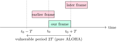
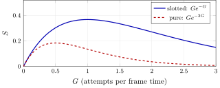
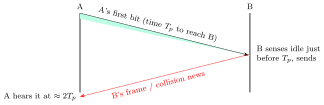
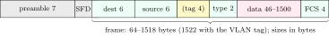
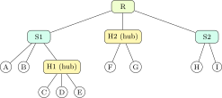
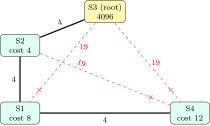
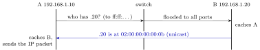

When many stations share one channel (a coaxial bus, a hub, the air), someone must decide who transmits when. That is the <strong>medium access control</strong> (MAC) sublayer, the lower half of the data link layer. This chapter derives the classic throughput numbers, then moves to what real LANs look like today: switched Ethernet, VLANs, spanning tree, and ARP gluing IP addresses to MAC addresses.

## 5.1 Sharing a channel: ALOHA {#sec-cn-aloha}

<div class="nb-proto">

<em><span>Prototypical example for this section:</span> pure ALOHA tops out at $18.4\%$ of the channel, slotted ALOHA at $36.8\%$, and a program finds the same maxima by brute force.</em>

</div>

### 5.1.i Three families {#s5-1-i}

- <strong>Channel partitioning</strong>: split the channel by frequency (FDMA), time (TDMA) or code (CDMA) ([Section 2.3](../02-physical/#sec-cn-mux)). No collisions, but an idle station’s share is wasted.
- <strong>Random access</strong>: send when you like, detect or avoid collisions, retry after a random delay: ALOHA, CSMA, CSMA/CD, CSMA/CA. Good at light load, degrades under heavy load.
- <strong>Taking turns</strong>: reservation, polling (a master invites each station in turn), token passing. Good at heavy load; overhead and a single point of failure (the master, the token) at light load.

### 5.1.ii Pure and slotted ALOHA {#s5-1-ii}

In <strong>pure ALOHA</strong> a station sends whenever it has a frame and learns of a collision by not getting an acknowledgement. Frames take $T$ seconds. A frame starting at $t_0$ collides with any frame that starts in $(t_0 - T,\ t_0 + T)$: the <strong>vulnerable period</strong> is $2T$. <strong>Slotted ALOHA</strong> only lets frames start at slot boundaries, so two frames either coincide exactly or do not overlap: the vulnerable period shrinks to $T$.

<figure class="nb-fig"></figure>

<div class="nb nb-theorem nb-block" id="theorem-5-1-1">

<strong>Theorem 5.1.1</strong> (ALOHA throughput)

Let attempts (new and retransmitted) form a Poisson process with $G$ attempts per frame time. A frame succeeds if no other attempt starts in its vulnerable period, so the throughput $S$ (successful frames per frame time) is

$$
S_{\text{pure}} = G e^{-2G}, \qquad S_{\text{slotted}} = G e^{-G}.
$$

The maxima are $1/(2e) \approx 0.184$ at $G = 1/2$ and $1/e \approx 0.368$ at $G = 1$.

</div>

<div class="nb nb-proof">

<em>Proof.</em> $P(\text{no other attempt in an interval of length } kT) = e^{-kG}$ for a Poisson process of rate $G$ per $T$. Differentiating $Ge^{-2G}$ gives $(1-2G)e^{-2G} = 0$; for $Ge^{-G}$, $(1-G)e^{-G} = 0$.

</div>

<figure class="nb-fig"></figure>

```text {filename="Output of aloha.py"}
pure ALOHA    S = G e^-2G: max 0.1839 at G = 0.500  (1/(2e) = 0.1839)
slotted ALOHA S = G e^-G : max 0.3679 at G = 1.000  (1/e    = 0.3679)
   G = 0.25: pure 0.1516, slotted 0.1947
   G = 0.50: pure 0.1839, slotted 0.3033
   G = 1.00: pure 0.1353, slotted 0.3679
   G = 2.00: pure 0.0366, slotted 0.2707
finite n, slotted, each station sends with probability p: S = n p (1-p)^(n-1)
   n =  2: best p = 0.5000 (1/n = 0.5000), S = 0.5000
   n =  5: best p = 0.2000 (1/n = 0.2000), S = 0.4096
   n = 10: best p = 0.1000 (1/n = 0.1000), S = 0.3874
   n = 50: best p = 0.0200 (1/n = 0.0200), S = 0.3716
Monte Carlo, n = 50, p = 1/50, 200000 slots: success fraction 0.3718
```

With a finite number $n$ of stations each transmitting in a slot with probability $p$, a slot succeeds when exactly one transmits: $S = np(1-p)^{n-1}$, maximised at $p = 1/n$, and $(1-1/n)^{n-1} \to 1/e$ as $n$ grows. The seeded simulation agrees with the formula to three decimals.

<div class="nb nb-remark" id="remark-5-1-2">

<strong>Remark 5.1.2</strong> (Reading ALOHA questions) — $G$ counts <em>attempts</em> per frame time, not new frames. “The system produces $1000$ frames per second of $200$ bits on a $200$ kbps channel” means $T = 1$ ms and $G = 1$, so pure ALOHA delivers $S = e^{-2} \approx 0.135$ of the frame times: about $135$ frames per second. Beyond the maximum, more offered load means <em>less</em> throughput: the channel collapses into collisions.

</div>

<div class="nb nb-moral">

Pure ALOHA: vulnerable $2T$, $S = Ge^{-2G}$, max $18.4\%$. Slotted: vulnerable $T$, $S = Ge^{-G}$, max $36.8\%$.

</div>

## 5.2 Carrier sense: CSMA, CSMA/CD and turn-taking {#sec-cn-csma}

<div class="nb-proto">

<em><span>Prototypical example for this section:</span> a $64$-byte minimum Ethernet frame: on a $10$ Mbps network it allows a few kilometres of cable, on gigabit Ethernet only about $50$ m.</em>

</div>

### 5.2.i Listen before talking {#s5-2-i}

<strong>Carrier sense multiple access</strong> (CSMA): sense the channel before sending. Collisions still happen, because a station cannot hear a transmission that started less than one propagation delay ago; the vulnerable period is now $T_p$ rather than $T$. What to do when the channel is busy:

- <strong>1-persistent</strong>: wait until idle, then send at once. Two waiting stations then collide for certain. (Classic Ethernet.)
- <strong>Non-persistent</strong>: if busy, wait a random time and sense again. Fewer collisions, more idle time.
- <strong>p-persistent</strong> (slotted channels): when idle, send with probability $p$, else defer one slot and repeat.

### 5.2.ii CSMA/CD and the minimum frame {#s5-2-ii}

With <strong>collision detection</strong> a station keeps listening while it transmits; on detecting a collision it stops, sends a short <strong>jam signal</strong> so that everyone notices, and backs off. Detection only works while the station is still transmitting.

<figure class="nb-fig"></figure>

<div class="nb nb-theorem nb-block" id="theorem-5-2-1">

<strong>Theorem 5.2.1</strong> (Minimum frame size)

In the worst case A starts, B starts just before A’s first bit arrives, and the collision’s evidence returns to A after almost $2T_p$. A must still be transmitting then:

$$
T_t \ge 2T_p \quad \Longleftrightarrow \quad L_{\min} = 2\,T_p\,R = \frac{2dR}{v}.
$$

</div>

```text {filename="Output of csmacd.py, lines 1–9"}
A. Tt >= 2 Tp: still sending when news of a collision returns
   R =    10 Mbps, d = 2000 m: Lmin = 2 Tp R =     200 bits =   25.0 bytes
   R =    10 Mbps, d = 5000 m: Lmin = 2 Tp R =     500 bits =   62.5 bytes
   R =   100 Mbps, d =  200 m: Lmin = 2 Tp R =     200 bits =   25.0 bytes
   R =  1000 Mbps, d =  200 m: Lmin = 2 Tp R =    2000 bits =  250.0 bytes
   64-byte minimum at    10 Mbps allows d <= L v / (2R) =  5120.0 m
   64-byte minimum at   100 Mbps allows d <= L v / (2R) =   512.0 m
   64-byte minimum at  1000 Mbps allows d <= L v / (2R) =    51.2 m
   10 Mbps slot time = 512 bit times = 51.2 us
```

Classic $10$ Mbps Ethernet fixed the <strong>slot time</strong> at $512$ bit times ($51.2~\mu$s), hence the $64$-byte minimum frame; the standard’s $2500$ m limit is far below the $5120$ m the bare formula allows, leaving margin for repeaters and the jam. At $100$ Mbps the same frame allows a tenth of the length, which is why Fast Ethernet hub networks are limited to about $200$ m, and at $1$ Gbps half-duplex operation needed <strong>carrier extension</strong>. Switched full-duplex Ethernet has no collisions at all and does not run CSMA/CD.

<div class="nb nb-remark" id="algorithm-5-2-2">

<strong>Algorithm 5.2.2</strong> (Binary exponential backoff) — After the $n$-th collision of a frame, choose $K$ uniformly from $\{0, 1, \dots, 2^{\min(n,10)}-1\}$ and wait $K$ slot times. After the $16$th attempt fails, give up and report an error.

</div>

```text {filename="Output of csmacd.py, lines 10–19"}
B. Binary exponential backoff: after the n-th collision pick K in 0..2^min(n,10)-1
   collision  1: K in 0..   1, mean wait    0.5 slots
   collision  2: K in 0..   3, mean wait    1.5 slots
   collision  3: K in 0..   7, mean wait    3.5 slots
   collision 10: K in 0..1023, mean wait  511.5 slots
   collision 12: K in 0..1023, mean wait  511.5 slots
   collision 15: K in 0..1023, mean wait  511.5 slots
   collision 16: give up, frame discarded (attempt limit 16)
   two stations after their n-th collision pick the same K with probability:
   n=1: 1/2, n=2: 1/4, n=3: 1/8, n=4: 1/16
```

The doubling adapts to the unknown number of contenders: two stations collide again with probability $1/2$, then $1/4$, then $1/8$. A widely quoted approximation for CSMA/CD efficiency is $1/(1 + 5T_p/T_t)$ (Kurose–Ross): long frames on short cables are efficient.

```text {filename="Output of csmacd.py, lines 20–23"}
C. Efficiency approximation 1/(1 + 5 Tp/Tt)
   Tp/Tt = 0.1953: efficiency ~ 0.506
   Tp/Tt = 0.0083: efficiency ~ 0.960
   Tp/Tt = 0.8333: efficiency ~ 0.194
```

### 5.2.iii CSMA/CA {#s5-2-iii}

Wireless stations cannot detect collisions: their own transmission drowns everything else, and the station that would be hit may be out of their range. 802.11 therefore <em>avoids</em> them: wait until the channel has been idle for a fixed gap, then count down a random backoff only while the channel is idle, transmit the whole frame, and treat a missing link-layer ACK as a collision. Optional RTS/CTS reserves the channel first. [Section 12.1](../12-wireless-setpieces/#sec-cn-wifi) has the details and the hidden-terminal problem.

### 5.2.iv Taking turns: polling and token passing {#s5-2-iv}

In <strong>token passing</strong> a special frame, the <strong>token</strong>, circulates; only its holder may transmit, for at most a <strong>token holding time</strong>, then passes it on. There are no collisions and access time is bounded, which is attractive for real-time traffic. The costs: token latency even when the network is idle, and fragility: a lost or duplicated token, or a dead station on a ring ([Section 1.2](../01-layering/#sec-cn-topology)), needs recovery machinery (a monitor station in 802.5, the dual ring in FDDI). <strong>Polling</strong> has a master invite each station in turn (Bluetooth piconets work this way); the master is a single point of failure.

<div class="nb nb-moral">

CSMA/CD needs $T_t \ge 2T_p$, so $L_{\min} = 2dR/v$. Backoff doubles the range each collision up to $1023$ slots and gives up after $16$ attempts. Wireless avoids collisions instead of detecting them.

</div>

## 5.3 Ethernet, switches and VLANs {#sec-cn-ethernet}

<div class="nb-proto">

<em><span>Prototypical example for this section:</span> a host behind a hub, a host behind a switch, and a router: eight collision domains, three broadcast domains.</em>

</div>

### 5.3.i The Ethernet frame and MAC addresses {#s5-3-i}

<figure class="nb-fig"></figure>

The <strong>EtherType</strong> names the payload (`0800` IPv4, `0806` ARP, `86DD` IPv6, `8100` marks a VLAN tag). A value of $1500$ or less is instead a length, the old IEEE 802.3 format. A <strong>MAC address</strong> is $48$ bits, written as six hex bytes; the first three bytes of a manufacturer-assigned address are its <strong>OUI</strong>. The lowest bit of the first byte is the <strong>I/G bit</strong> (1 = group: multicast or broadcast), the next is the <strong>U/L bit</strong> (1 = locally administered, as in randomised MACs on phones).

```text {filename="Output of ethframe.py"}
untagged: 64 bytes, header 14, first 18 bytes:
   ff ff ff ff ff ff 02 1a 2b 3c 4d 5e 08 06 00 00 00 00
with 802.1Q tag (VID 20): 64 bytes, header 18, first 18 bytes:
   ff ff ff ff ff ff 02 1a 2b 3c 4d 5e 81 00 60 14 08 06
frame sizes with FCS: untagged 64..1518, tagged 64..1522
VLAN IDs: 12 bits -> 4096 values, 0 and 4095 reserved -> 4094 usable
00:1b:21:0a:0b:0c: I/G bit 0 -> unicast; U/L bit 0 -> globally unique (OUI)
01:00:5e:00:00:fb: I/G bit 1 -> multicast; U/L bit 0 -> globally unique (OUI)
33:33:00:00:00:01: I/G bit 1 -> multicast; U/L bit 1 -> locally administered
02:1a:2b:3c:4d:5e: I/G bit 0 -> unicast; U/L bit 1 -> locally administered
ff:ff:ff:ff:ff:ff: all ones -> broadcast
```

### 5.3.ii Hubs, bridges, switches, routers {#s5-3-ii}

A <strong>hub</strong> repeats every bit to every port: all its ports form one <strong>collision domain</strong>. A <strong>bridge</strong> or <strong>switch</strong> stores each frame, checks the FCS and forwards it only to the port where the destination lives: each port is its own collision domain (and with full duplex there are no collisions at all). But a switch floods broadcasts and unknown destinations to every port, so all its ports remain in one <strong>broadcast domain</strong>. A <strong>router</strong> does not forward link-layer broadcasts: each router interface is a separate broadcast domain.

<figure class="nb-fig"></figure>

```text {filename="Output of domains.py"}
collision domains: 8
   R-S1
   S1-A
   S1-B
   S1-H1, H1-C, H1-D, H1-E
   R-H2, H2-F, H2-G
   R-S2
   S2-H
   S2-I
broadcast domains: 3
   R-S1, S1-A, S1-B, S1-H1, H1-C, H1-D, H1-E
   R-H2, H2-F, H2-G
   R-S2, S2-H, S2-I
```

### 5.3.iii How a switch learns {#s5-3-iii}

A switch builds its <strong>MAC table</strong> (forwarding table) by watching source addresses: a frame from MAC $x$ arriving on port $p$ means “$x$ is reachable through $p$”. Entries age out after a few minutes so that moved hosts are relearned. For each frame:

<div class="nb nb-remark" id="algorithm-5-3-1">

<strong>Algorithm 5.3.1</strong> (Learning switch) — Record (source MAC, in-port). If the destination is broadcast or unknown, flood to all ports except the in-port; if it is known on the in-port, drop the frame (filter); else forward it to that one port.

</div>

```text {filename="Output of switch_learn.py"}
A->D  in on 1: unknown: flood to ports [2, 3, 4]
       table {'A': 1}
D->A  in on 4: forward to port 1 only
       table {'A': 1, 'D': 4}
E->D  in on 4: same port as source: filter (drop)
       table {'A': 1, 'D': 4, 'E': 4}
B->FF in on 2: broadcast: flood to ports [1, 3, 4]
       table {'A': 1, 'B': 2, 'D': 4, 'E': 4}
C->A  in on 3: forward to port 1 only
       table {'A': 1, 'B': 2, 'C': 3, 'D': 4, 'E': 4}
A->E  in on 1: forward to port 4 only
       table {'A': 1, 'B': 2, 'C': 3, 'D': 4, 'E': 4}
```

The third frame shows filtering: D and E sit behind the same hub on port 4, so the switch does not forward E’s frame anywhere. A switch forwards either <strong>store-and-forward</strong> (receive the whole frame, check the FCS, then send) or <strong>cut-through</strong> (start sending once the destination address has arrived: lower latency, but corrupted frames are forwarded).

### 5.3.iv VLANs {#s5-3-iv}

A <strong>VLAN</strong> splits one physical switched network into several broadcast domains. Each switch port is assigned to a VLAN (an <strong>access port</strong>); links between switches carry many VLANs (a <strong>trunk</strong>), and frames on a trunk carry the 4-byte IEEE <strong>802.1Q</strong> tag: TPID `8100`, a 3-bit priority, a 1-bit drop-eligible flag and a 12-bit VLAN ID ($4094$ usable values). Traffic between VLANs must go through a router (or a layer-3 switch), exactly as if the VLANs were separate physical LANs. VLANs give isolation (the guest Wi-Fi cannot see the finance servers), smaller broadcast domains, and moves without recabling.

<div class="nb nb-moral">

Hubs extend collision domains; switches split collision domains but not broadcast domains; routers and VLANs split broadcast domains. Switches learn from source addresses and flood the unknown.

</div>

## 5.4 Spanning tree {#sec-cn-stp}

<div class="nb-proto">

<em><span>Prototypical example for this section:</span> four switches wired in a mesh for redundancy: STP elects the switch with priority $4096$ as root and blocks three ports to leave a tree.</em>

</div>

Redundant links between switches create loops, and Ethernet frames have no TTL. One broadcast frame circles forever and multiplies at every switch that floods it (a <strong>broadcast storm</strong>); MAC tables flap as the same source appears on different ports. The <strong>Spanning Tree Protocol</strong> (IEEE 802.1D) disables just enough ports to make the active topology a tree, and re-enables them when a link fails.

<div class="nb nb-remark" id="algorithm-5-4-1">

<strong>Algorithm 5.4.1</strong> (Spanning tree, as decided by exchanging BPDUs) — The rules below are applied by every switch from the configuration messages (BPDUs) it receives.

1. <strong>Root bridge</strong>: the switch with the lowest <strong>bridge ID</strong> (priority, then MAC address).
2. <strong>Root port</strong>: on every other switch, the port with the lowest total path cost to the root; ties go to the lower neighbour bridge ID, then the lower port ID.
3. <strong>Designated port</strong>: on every link (segment), the port of the switch with the lowest cost to the root (ties: lower bridge ID). All root-bridge ports are designated.
4. Every other port is <strong>blocked</strong>: it receives BPDUs but forwards no data.

</div>

<figure class="nb-fig"></figure>

```text {filename="Output of stp.py"}
root bridge: S3 (4096, '00:00:00:00:00:a3') (lowest bridge ID)
S1: root path cost 8, root port 1 (towards S2)
S2: root path cost 4, root port 2 (towards S3)
S4: root path cost 12, root port 3 (towards S1)
link S1-S2 (cost  4): S1 port 1 root port  | S2 port 1 designated
link S1-S3 (cost 19): S1 port 2 BLOCKED    | S3 port 1 designated
link S2-S3 (cost  4): S2 port 2 root port  | S3 port 2 designated
link S2-S4 (cost 19): S2 port 3 designated | S4 port 1 BLOCKED
link S3-S4 (cost 19): S3 port 3 designated | S4 port 2 BLOCKED
link S1-S4 (cost  4): S1 port 3 designated | S4 port 3 root port
```

The tree (solid) has three links for four switches. Each blocked port ($\times$) is the worse end of a redundant link. If the S2–S1 link fails, S1 stops hearing BPDUs from S2 and its port towards S3 takes over as root port. Classic 802.1D needs tens of seconds to reconverge (listening and learning states); <strong>Rapid STP</strong> (802.1w) cuts that to around a second or less.

<div class="nb nb-moral">

Lowest bridge ID is root; each switch keeps its cheapest port to the root; each link keeps one designated port; everything else blocks.

</div>

## 5.5 ARP: from IP address to MAC address {#sec-cn-arp}

<div class="nb-proto">

<em><span>Prototypical example for this section:</span> a laptop that knows its gateway is `192.168.1.1` but must learn the gateway’s MAC address before it can send a single packet.</em>

</div>

IP decides the next hop (the destination itself if it is on the local subnet, otherwise the default gateway, [Section 6.4](../06-addressing/#sec-cn-lpm)). To put the packet in an Ethernet frame the host needs that next hop’s MAC address. The <strong>Address Resolution Protocol</strong> (RFC 826) finds it.

<div class="nb nb-definition" id="definition-5-5-1">

<strong>Definition 5.5.1</strong>. <strong>ARP</strong> maps a known IPv4 address on the local link to its MAC address. The asker broadcasts an <strong>ARP request</strong> (“who has $192.168.1.20$? tell $192.168.1.10$”); the owner answers with a unicast <strong>ARP reply</strong>. Both sides cache the mapping in the <strong>ARP cache</strong> for a limited time (typically minutes).

</div>

<figure class="nb-fig"></figure>

```text {filename="Output of arp_packet.py"}
request (who has 192.168.1.20?): 28 bytes
   in an Ethernet frame to ff:ff:ff:ff:ff:ff (broadcast), EtherType 0806
   htype 1 ptype 0x0800 hlen 6 plen 4 op 1
   sender 02:00:00:00:00:0a 192.168.1.10
   target 00:00:00:00:00:00 192.168.1.20
reply (192.168.1.20 is at ...0b): 28 bytes
   in an Ethernet frame to 02:00:00:00:00:0a (unicast), EtherType 0806
   htype 1 ptype 0x0800 hlen 6 plen 4 op 2
   sender 02:00:00:00:00:0b 192.168.1.20
   target 02:00:00:00:00:0a 192.168.1.10
gratuitous ARP from B: sender IP = target IP = 192.168.1.20 / 192.168.1.20
```

<div class="nb nb-definition" id="fact-5-5-2">

<strong>Fact 5.5.2</strong> (Variants). Four variations come up in interviews:

- A <strong>gratuitous ARP</strong> is a request or reply for the sender’s own address. It detects an address conflict (someone answers) and updates other hosts’ caches after a failover moves an IP address to a new MAC.
- <strong>Proxy ARP</strong>: a router answers ARP requests for hosts on another network with its own MAC, so hosts that think the destination is local still reach it.
- ARP has no authentication: anyone can send a forged reply and become the “gateway” for a victim (<strong>ARP spoofing</strong>, [Section 11.3](../11-security/#sec-cn-attacks)).
- IPv6 has no ARP; <strong>Neighbor Discovery</strong> does the same job with ICMPv6 messages sent to multicast addresses.

</div>

<div class="nb nb-remark" id="remark-5-5-3">

<strong>Remark 5.5.3</strong> (ARP, RARP, BOOTP, DHCP) — ARP: “I know the IP, give me the MAC.” <strong>RARP</strong> was the reverse: a diskless machine that knows only its own MAC asks a server “what is my IP?”. RARP worked at the link layer, needed a server on every LAN and returned only an address, so it was replaced by BOOTP and then DHCP ([Section 7.4](../07-ip/#sec-cn-dhcp)), which run over UDP, cross routers via relay agents, and hand out the mask, gateway and DNS servers as well. ARP requests never cross a router: to reach a remote host you ARP for the gateway, not for the host.

</div>

<div class="nb nb-moral">

ARP resolves the next hop’s IP address to a MAC address on the local link: broadcast request, unicast reply, cached. The IP header keeps the end-to-end addresses; the MAC addresses change at every hop.

</div>
